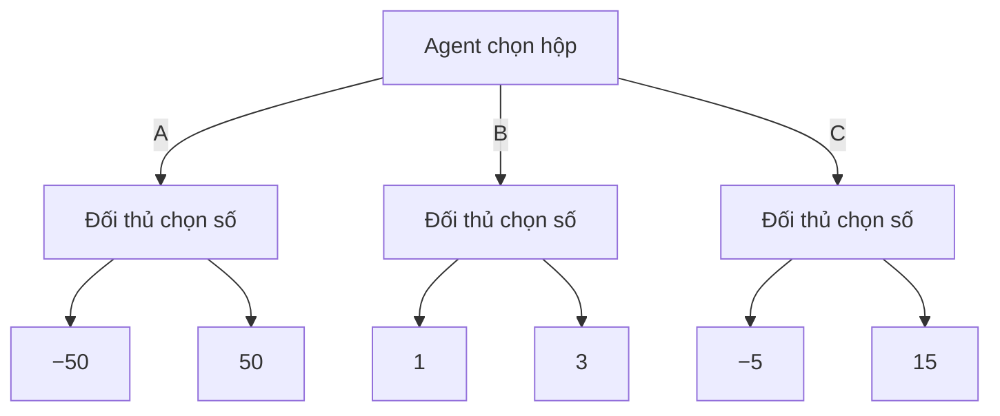

# Games 1: Mô hình hóa trò chơi, Game Evaluation, Expectimax và Minimax

*Nội dung trình bày seminar “Games 1 (combined)” — Nhóm 10, lớp 24TN, HCMUS. Thành viên: Võ Nhất Bảo, Phạm Lê Huy Hoàng. Ngày trình bày: 09/11/2026.*

## Phạm vi và mục tiêu

Nội dung gồm năm phần: **Overview, Modeling, Game evaluation, Expectimax và Minimax**, theo mạch của [games1.pdf, trang PDF 1–56](../docs/games1.pdf#page=1). Các ví dụ và cách triển khai được bổ sung từ tài liệu CS188.

Bài toán xuyên suốt là: **từ một trạng thái trò chơi, agent nên chọn hành động nào khi một phần diễn biến tiếp theo do đối thủ quyết định?**

Các điểm cốt lõi:

- Biểu diễn trò chơi bằng trạng thái, hành động, phép chuyển, lượt chơi và utility.
- Hiểu vì sao lời giải cần là một chiến lược phản ứng theo trạng thái.
- Phân biệt đánh giá hai chiến lược đã biết với tìm chiến lược tốt nhất.
- Tính được giá trị và chọn được nước đi trên một cây nhỏ.
- Giải thích sự khác nhau giữa tối đa hóa kỳ vọng và tối ưu mức bảo đảm.

Trong tài liệu này, số trang dẫn nguồn luôn là **trang PDF tính từ 1**. Riêng `games1.pdf`, số in ở chân slide bằng số trang PDF trừ 1.

## 1. Overview: tìm kiếm khi có đối thủ

### 1.1. Từ tìm một kế hoạch đến tìm một chiến lược

Trong bài toán tìm kiếm tất định thông thường, agent có thể tìm một chuỗi hành động rồi thực hiện nó để đi tới mục tiêu. Trong trò chơi, agent chỉ quyết định nước đi ở lượt của mình; đối thủ quyết định ở những lượt còn lại.

Vì vậy, một chuỗi nước đi dẫn tới chiến thắng chỉ là **một diễn biến có thể xảy ra**. Đối thủ có thể chọn một phản ứng khác và làm chuỗi đó không còn thực hiện được.

Lời giải cần tìm là **strategy/policy**: quy tắc cho biết agent nên làm gì tại mỗi trạng thái có thể gặp. Chất lượng của chiến lược phụ thuộc vào cả cách agent chơi lẫn cách đối thủ phản ứng. Đây là điểm xuất phát của **adversarial search — tìm kiếm đối kháng**. [CS188 Note 6, trang 1–2](../docs/cs188-fa23-note06.pdf#page=1)

### 1.2. Ví dụ xuyên suốt: ba hộp số

Agent chọn một hộp; sau đó người còn lại chọn một số trong hộp ấy. Số được chọn là utility của agent.

| Hộp | Hai kết quả có thể nhận |
|---|---|
| A | −50, 50 |
| B | 1, 3 |
| C | −5, 15 |



Cùng luật chơi và cùng tập kết quả, lựa chọn tốt nhất thay đổi theo mô hình về người chọn số:

| Cách người còn lại chọn số | Giá trị A | Giá trị B | Giá trị C | Hộp tốt nhất |
|---|---:|---:|---:|---|
| Chọn số lớn nhất để giúp agent | 50 | 3 | 15 | A |
| Chọn đều hai số | 0 | 2 | 5 | C |
| Chọn số nhỏ nhất để làm agent bất lợi | −50 | 1 | −5 | B |

**Không có một hộp tốt nhất cho mọi giả định về đối thủ.** Có lá mang giá trị cao chưa đủ để kết luận một nước đi tốt, vì agent có thể không kiểm soát việc đi tới lá đó. [CS221, trang 5–6](../docs/games1.pdf#page=5)

### 1.3. Hai đặc điểm quan trọng của game

**Utility nằm ở kết cục.** Trong mô hình đang xét, giá trị thắng, hòa, thua chỉ được xác định khi ván kết thúc. Một nước có vẻ thuận lợi trước mắt chưa chắc dẫn tới kết cục tốt.

**Quyền quyết định thuộc về những người chơi khác nhau.** Khi đánh giá một nhánh, agent phải xét cả những phản ứng mà đối thủ có thể lựa chọn. Thuật toán tìm kiếm cần thể hiện sự khác nhau này tại từng nút. [CS221, trang 17–18](../docs/games1.pdf#page=17)

## 2. Modeling: biểu diễn trò chơi

### 2.1. Lớp trò chơi đang xét

Mô hình chính gồm các trò chơi:

- **Hai người chơi:** agent và đối thủ (opp).
- **Zero-sum:** utility của đối thủ bằng số đối của utility agent.
- **Đi lần lượt:** mỗi trạng thái chưa kết thúc có một người được chọn hành động.
- **Quan sát đầy đủ:** trạng thái liên quan đến quyết định không bị che giấu.
- **Chuyển trạng thái tất định:** biết trạng thái và hành động thì xác định được trạng thái kế tiếp.

Các cây được giải đầy đủ trong bài đều hữu hạn. Đây là điều kiện để phép tính từ terminal về gốc hoàn tất.

Zero-sum không có nghĩa trò chơi chỉ có thắng hoặc thua. Có thể có hòa, chẳng hạn utility của agent là `+1, 0, −1`, còn utility của đối thủ tương ứng là `−1, 0, +1`. [CS221, trang 13–14](../docs/games1.pdf#page=13)

### 2.2. Sáu thành phần của mô hình

| Thành phần | Ý nghĩa |
|---|---|
| `s_start` | Trạng thái bắt đầu |
| `Actions(s)` | Các hành động hợp lệ ở trạng thái `s` |
| `Succ(s, a)` | Trạng thái sau khi thực hiện hành động `a` |
| `IsEnd(s)` | Kiểm tra ván đã kết thúc hay chưa |
| `Utility(s)` | Giá trị kết cục tại trạng thái kết thúc, theo góc nhìn agent |
| `Player(s)` | Người đang có quyền chọn hành động |

So với mô hình tìm kiếm đã học, `Player(s)` xác định **ai điều khiển bước chuyển tiếp theo**, còn `Utility(s)` cho phép so sánh các kết cục. Đến được terminal chưa đồng nghĩa đạt mục tiêu: thua cũng là một trạng thái kết thúc. [CS221, trang 13–18](../docs/games1.pdf#page=13)

### 2.3. Ví dụ mô hình hóa Tic-Tac-Toe

Với luật thông thường X đi trước, chọn X làm agent:

| Thành phần | Biểu diễn |
|---|---|
| State | Bàn cờ 3×3 và người đến lượt |
| `s_start` | Bàn trống, X đến lượt |
| `Actions(s)` | Những ô trống, nếu ván chưa kết thúc |
| `Succ(s, a)` | Đặt quân của người đến lượt vào ô `a`, rồi chuyển lượt |
| `IsEnd(s)` | Một bên có ba quân thẳng hàng hoặc bàn đã đầy |
| `Utility(s)` | `+1` nếu X thắng, `0` nếu hòa, `−1` nếu O thắng |
| `Player(s)` | X hoặc O |

Hai điểm cần giữ đúng:

- **State phải đủ thông tin để áp dụng luật.** Bàn cờ và lượt chơi là cách biểu diễn rõ ràng cho ví dụ này.
- **Nước hợp lệ và nước tốt là hai khái niệm khác nhau.** Đặt vào một ô trống có thể hợp lệ nhưng dẫn tới thua. `Actions(s)` kiểm tra luật; thuật toán tìm kiếm đánh giá chất lượng nước đi.

Khi đã có người thắng, ván kết thúc ngay cả khi còn ô trống. Thuật toán phải kiểm tra `IsEnd(s)` trước khi tiếp tục sinh nước đi. Mô hình dựa trên sáu thành phần của CS221; Tic-Tac-Toe là ví dụ game tree trong [CS188 Lecture 7, trang 14](../docs/cs188-sp26-lec07.pdf#page=14).

### 2.4. Game Tree khác State-Space Graph như thế nào?

Trong cây trò chơi:

- Nút biểu diễn một trạng thái trong một lịch sử chơi.
- Cạnh biểu diễn một hành động hợp lệ.
- Lá biểu diễn trạng thái kết thúc và mang utility.
- Một đường từ gốc tới lá biểu diễn một ván diễn tiến cụ thể.

**State-Space Graph** biểu diễn mỗi trạng thái khác nhau bằng một đỉnh, với các cạnh là phép chuyển hợp lệ. **Game Tree** khai triển các lịch sử chơi từ trạng thái đầu: nếu hai lịch sử dẫn tới cùng state, chúng vẫn tạo hai nút riêng trên cây. [CS221, trang 11–12](../docs/games1.pdf#page=11)

| Khía cạnh | Game Tree — cây trò chơi | State-Space Graph — đồ thị trạng thái |
|---|---|---|
| Một nút biểu diễn | Một lần xuất hiện của state theo một lịch sử chơi | Một state đủ thông tin |
| Hai lịch sử dẫn tới cùng state | Có các nút riêng | Cùng đi tới một đỉnh |
| Quan hệ cha–con | Mỗi nút ngoài gốc có một cha | Một đỉnh có thể có nhiều đỉnh đi vào |
| Chu trình | Không có; state lặp lại được khai triển thành nút mới | Có thể có, tùy luật trò chơi |
| Hệ quả khi tính giá trị | Có thể tính lại cùng một state nhiều lần | Có thể lưu và dùng lại giá trị của cùng state |

Ví dụ Tic-Tac-Toe từ bàn trống, X đi trước, đánh số ô từ 0 đến 8 theo hàng:

```text
Chỉ số ô         Lịch sử 1: X0 → O4 → X2
0 1 2            Lịch sử 2: X2 → O4 → X0
3 4 5
6 7 8            Cùng trạng thái:
                 X . X
                 . O .
                 . . .
                 O đến lượt
```

Hai thứ tự đặt quân khác nhau tạo hai nút trong Game Tree nhưng chỉ một state trong graph. Từ trạng thái ấy, tập hành động hợp lệ và bài toán tiếp diễn là như nhau. Ví dụ này minh họa cách gộp state từ mô hình của CS221.

Trong Tic-Tac-Toe thông thường, duyệt toàn cây từ bàn trống có **549.946 nút**, trong khi chỉ có **5.478 trạng thái khác nhau**. Hai số đếm đo hai đại lượng khác nhau, không mâu thuẫn. Kết quả được tính bằng [code tham chiếu](<../research_notes/Seminar Games 1 nhóm 10/verify_examples.py>).

**Dùng lại giá trị đòi hỏi state đủ thông tin và cùng tiêu chuẩn đánh giá.** Cùng hình bàn cờ nhưng khác lượt là hai state khác nhau. Nếu luật hoặc mô hình đối thủ phụ thuộc vào lịch sử, thông tin cần thiết ấy cũng phải được giữ trong state trước khi gộp.

Các thuật toán trong phần này được diễn giải trên cây để thấy rõ từng lựa chọn và phản ứng. Gộp state có thể giảm công tính lặp, nhưng không loại bỏ khó khăn khi bản thân không gian trạng thái vẫn quá lớn.

### 2.5. Policy: cách một người chơi chọn hành động

**Policy tất định** chọn một hành động cụ thể tại mỗi trạng thái thuộc lượt người chơi đó:

$$
\pi_p(s)\in Actions(s).
$$

Ví dụ: agent luôn chọn hộp A ở gốc.

**Policy ngẫu nhiên** cho xác suất chọn từng hành động:

$$
\pi_p(s,a)\ge 0,\qquad
\sum_{a\in Actions(s)}\pi_p(s,a)=1.
$$

Ví dụ: tại một hộp có hai số, đối thủ chọn mỗi số với xác suất `1/2`. Policy tất định cũng có thể biểu diễn bằng xác suất `1` cho hành động được chọn và `0` cho các hành động còn lại.

Policy được dùng tại các trạng thái chưa kết thúc thuộc lượt người chơi tương ứng. Một policy là cách chơi cho nhiều tình huống, không chỉ là một nước đi ở gốc. [CS221, trang 21–22](../docs/games1.pdf#page=21)

## 3. Game evaluation: đánh giá khi cả hai policy đã biết

### 3.1. Câu hỏi cần giải

Cho trước policy của agent và policy của đối thủ, **utility kỳ vọng của agent là bao nhiêu?**

Game evaluation đo chất lượng của một cặp policy đã cố định. Agent chưa được thay cách chơi để chọn phương án tốt hơn.

Kỳ vọng là trung bình có trọng số theo xác suất các kết quả. Nó không nhất thiết là kết quả nhận được trong một ván cụ thể. [CS221, trang 25–28](../docs/games1.pdf#page=25)

### 3.2. Quy tắc tính giá trị

Tại terminal, giá trị bằng utility. Tại trạng thái chưa kết thúc, lấy trung bình có trọng số của giá trị các trạng thái con, theo policy của người đang có lượt.

$$
V_{\mathrm{eval}}(s)=
\begin{cases}
Utility(s), & IsEnd(s),\\[2mm]
\displaystyle\sum_{a\in Actions(s)}
\pi_{\mathrm{agent}}(s,a)\,
V_{\mathrm{eval}}(Succ(s,a)),
& Player(s)=\mathrm{agent},\\[3mm]
\displaystyle\sum_{a\in Actions(s)}
\pi_{\mathrm{opp}}(s,a)\,
V_{\mathrm{eval}}(Succ(s,a)),
& Player(s)=\mathrm{opp}.
\end{cases}
$$

**Vì sao dùng tổng có trọng số?** Mỗi hành động xảy ra theo xác suất đã cho. Giá trị tại nút là trung bình các kết quả tiếp diễn tương ứng. Cách giải thích giống nhau ở cả lượt agent lẫn lượt đối thủ; chỉ policy dùng làm trọng số thay đổi.

Công thức không có `max` hay `min`, vì cả hai cách chơi đều đã được cố định. [CS221, trang 27–28](../docs/games1.pdf#page=27)

### 3.3. Áp dụng vào ba hộp

Giả sử đối thủ chọn đều hai số trong mỗi hộp:

$$
V(A)=\tfrac12(-50)+\tfrac12(50)=0,
$$
$$
V(B)=\tfrac12(1)+\tfrac12(3)=2,
\qquad
V(C)=\tfrac12(-5)+\tfrac12(15)=5.
$$

Nếu policy agent đã quy định **chọn A**, ta có:

$$
V_{\mathrm{eval}}(s_{\mathrm{start}})
=1\cdot0+0\cdot2+0\cdot5=\boxed{0}.
$$

Dù C có kỳ vọng cao hơn, Game evaluation vẫn trả `0`: nhiệm vụ hiện tại là đánh giá policy chọn A. [CS221, trang 25](../docs/games1.pdf#page=25)

Nếu agent cũng chọn đều cả ba hộp, giá trị trở thành:

$$
V_{\mathrm{eval}}(s_{\mathrm{start}})
=\tfrac13(0)+\tfrac13(2)+\tfrac13(5)=\boxed{\tfrac73}.
$$

Thay policy thì giá trị của cặp policy thay đổi; bản thân phép đánh giá không tự tìm policy mới.

### 3.4. Vai trò của Game evaluation

Game evaluation giúp trả lời các câu hỏi như: cùng một cách chơi của agent, kết quả thay đổi thế nào khi gặp những đối thủ khác nhau? Hoặc trước một đối thủ cố định, hai policy agent đạt kết quả khác nhau ra sao?

Nó có vai trò tương tự **policy evaluation trong MDP**: biết cách hành động rồi tính giá trị. Game evaluation cũng là công cụ để đọc bảng đối đầu ở phần Minimax. [CS221, trang 27 và 47–48](../docs/games1.pdf#page=27)

**Game evaluation khác evaluation function.** Game evaluation tính giá trị của hai policy từ luật chơi, xác suất và utility ở terminal. Evaluation function ước lượng giá trị một trạng thái khi chưa tìm tới terminal; nội dung đó thuộc Games 2. [CS221, trang 75](../docs/games1.pdf#page=75)

## 4. Expectimax: chọn chiến lược có kỳ vọng tốt nhất

### 4.1. Từ đánh giá sang tối ưu hóa

Vẫn biết policy đối thủ $\pi_{\mathrm{opp}}$, nhưng agent được quyền chọn cách chơi.

Câu hỏi trở thành: **trước đúng policy đối thủ này, agent nên chọn hành động nào để đạt utility kỳ vọng cao nhất?**

Tại lượt agent, thay phép lấy trung bình theo policy đã cho bằng phép `max`. Tại lượt đối thủ, giữ phép lấy kỳ vọng theo $\pi_{\mathrm{opp}}$. [CS221, trang 31–34](../docs/games1.pdf#page=31)

### 4.2. Công thức và ý nghĩa các loại nút

$$
V_{\mathrm{exptmax}}(s)=
\begin{cases}
Utility(s), & IsEnd(s),\\[2mm]
\displaystyle\max_{a\in Actions(s)}
V_{\mathrm{exptmax}}(Succ(s,a)),
& Player(s)=\mathrm{agent},\\[3mm]
\displaystyle\sum_{a\in Actions(s)}
\pi_{\mathrm{opp}}(s,a)\,
V_{\mathrm{exptmax}}(Succ(s,a)),
& Player(s)=\mathrm{opp}.
\end{cases}
$$

| Loại nút | Phép tính | Ý nghĩa |
|---|---|---|
| MAX — lượt agent | Lấy giá trị con lớn nhất | Agent chọn hành động tốt nhất |
| Nút kỳ vọng — lượt đối thủ theo policy đã biết | Trung bình có trọng số | Các phản ứng xảy ra theo mô hình xác suất |
| Terminal | Trả utility | Kết cục đã xác định |

Trong tài liệu CS188, nút lấy kỳ vọng được gọi là **chance node**. Ở phần Games 1 này, xác suất đến từ mô hình về cách đối thủ chọn nước; `Succ(s,a)` vẫn tất định khi hành động đã được chọn. [CS188 Note 7, trang 1–2](../docs/cs188-fa23-note07.pdf#page=1)

**Giá trị và hành động là hai đầu ra liên quan nhưng khác nhau.** Phép `max` cho giá trị tốt nhất; hành động cần chọn là hành động dẫn tới giá trị đó. Khi nhiều hành động cùng tốt nhất, có thể chọn một trong số chúng.

### 4.3. Áp dụng vào ba hộp

Đối thủ vẫn chọn đều nên ba hộp giữ các giá trị `0, 2, 5`. Gốc là nút MAX:

$$
V_{\mathrm{exptmax}}(s_{\mathrm{start}})
=\max(0,2,5)=\boxed{5}.
$$

Agent chọn **C**. Khác biệt với Game evaluation nằm ở quyền lựa chọn của agent: thay vì bắt buộc đi A, agent được so sánh cả ba hộp. [CS221, trang 31–34](../docs/games1.pdf#page=31)

Giá trị `5` là kỳ vọng. Một ván chọn C thực tế nhận `−5` hoặc `15`, không nhận `5`.

### 4.4. Độ nhạy của Expectimax với mô hình đối thủ

Expectimax tối ưu theo policy đối thủ được đưa vào mô hình. Chọn đều chỉ là một giả định; khi xác suất thay đổi, cả giá trị kỳ vọng lẫn hành động tốt nhất đều có thể thay đổi.

#### Một tham số, ba lựa chọn

Trong trò ba hộp, đặt `p` là xác suất đối thủ chọn **số nhỏ hơn**, còn `1 − p` là xác suất chọn số lớn hơn. Để so sánh đơn giản, dùng cùng `p` cho cả ba hộp. Đây là giả định riêng của ví dụ.

$$
\begin{aligned}
V_A(p)&=-50p+50(1-p)=50-100p,\\
V_B(p)&=p+3(1-p)=3-2p,\\
V_C(p)&=-5p+15(1-p)=15-20p.
\end{aligned}
$$

| `p` — xác suất chọn số nhỏ | Giá trị A | Giá trị B | Giá trị C | Hộp tốt nhất |
|---|---:|---:|---:|---|
| 0 | 50 | 3 | 15 | A |
| 0,4 | 10 | 2,2 | 7 | A |
| 0,5 — chọn đều | 0 | 2 | 5 | C |
| 0,6 | −10 | 1,8 | 3 | C |
| 0,9 | −40 | 1,2 | −3 | B |
| 1 — luôn chọn số nhỏ | −50 | 1 | −5 | B |

Thuật toán giữ nguyên phép `max` tại gốc và phép lấy kỳ vọng tại lượt đối thủ. Chỉ mô hình xác suất thay đổi mà lựa chọn đã lần lượt chuyển **A → C → B**.

Các ngưỡng đổi lựa chọn, tính từ ba biểu thức trên:

- `p < 7/16`: chọn A.
- `7/16 < p < 2/3`: chọn C.
- `p > 2/3`: chọn B.
- Tại `p = 7/16`, A và C cùng tốt nhất; tại `p = 2/3`, B và C cùng tốt nhất.

Ví dụ, từ giả định chọn đều `p = 0,5`, chỉ cần giảm `p` xuống dưới `0,4375` là lựa chọn đổi từ C sang A. Hộp A nhạy hơn với `p` vì hai kết quả của nó cách xa nhau hơn hai kết quả của B hay C.

#### Mô hình dự đoán và kết quả thực tế

Nếu agent tính theo `p = 0,5`, nó chọn C với kỳ vọng dự kiến `5`. Nhưng nếu thực tế `p = 0,9`, kỳ vọng của C là `−3`, trong khi B đạt `1,2`. Nếu đối thủ luôn chọn số nhỏ nhất, C nhận `−5`, thấp hơn mức bảo đảm `1` của B.

**Expectimax tối ưu trước mô hình đã cho; điều đó chưa bảo đảm mô hình mô tả đúng đối thủ.** Khi `p = 1` trong chính ví dụ này, mỗi nút kỳ vọng chỉ còn số nhỏ nhất, nên quyết định trùng với Minimax. Với các xác suất khác, chọn B vẫn có thể là kết quả của Expectimax, như tại `p = 0,9`.

Phân tích theo `p` là phần nhóm phát triển từ trò ba hộp của [CS221, trang 5–6](../docs/games1.pdf#page=5) và công thức [Expectimax, trang 33–34](../docs/games1.pdf#page=33). Các phép tính chi tiết được lưu ở mục “Mô hình sai thì sao: ngưỡng lật quyết định và regret” trong [bản nghiên cứu](<Seminar Games 1 nhóm 10 - Bản nghiên cứu.md#mô-hình-sai-thì-sao-ngưỡng-lật-quyết-định-và-regret>).

### 4.5. Ý nghĩa và điều kiện sử dụng

Expectimax tìm cách khai thác một mô hình đối thủ đã cho để đạt kỳ vọng cao nhất. Tính tối ưu được hiểu **theo mô hình ấy**. Phép lấy kỳ vọng cần xác suất không âm, tổng bằng `1`, và các giá trị utility có ý nghĩa về độ lớn để lấy trung bình.

Các ví dụ có lấy kỳ vọng trong bài dùng utility hữu hạn. Với Tic-Tac-Toe, thang `+1, 0, −1` cho:

$$
E[U]=P(\text{thắng})-P(\text{thua}).
$$

Vì vậy, **utility kỳ vọng không đồng nhất với xác suất thắng**.

Liên hệ với MDP: Game evaluation đánh giá cách chơi đã cho, còn Expectimax tìm cách chơi tốt nhất trước mô hình đối thủ đã biết. Đây là sự tương đồng về vai trò của các công thức với policy evaluation và value iteration. [CS221, trang 27–34](../docs/games1.pdf#page=27)

## 5. Minimax: chọn chiến lược có mức bảo đảm tốt nhất

### 5.1. Khi không có policy đối thủ để tin cậy

Nếu không biết đối thủ sẽ phản ứng theo xác suất nào, agent có thể đánh giá mỗi nước đi bằng **đáp trả bất lợi nhất** mà đối thủ có thể chọn, rồi chọn nước có mức bảo đảm cao nhất.

Trong game zero-sum, đối thủ tăng utility của họ cũng chính là giảm utility của agent. Vì thế:

- Tại lượt agent: lấy `max`.
- Tại lượt đối thủ: lấy `min`.
- Tại terminal: trả utility theo cùng góc nhìn agent.

Minimax không cần policy đối thủ làm đầu vào. [CS221, trang 37–42](../docs/games1.pdf#page=37)

### 5.2. Công thức và cách chọn nước đi

$$
V_{\mathrm{minmax}}(s)=
\begin{cases}
Utility(s), & IsEnd(s),\\[2mm]
\displaystyle\max_{a\in Actions(s)}
V_{\mathrm{minmax}}(Succ(s,a)),
& Player(s)=\mathrm{agent},\\[3mm]
\displaystyle\min_{a\in Actions(s)}
V_{\mathrm{minmax}}(Succ(s,a)),
& Player(s)=\mathrm{opp}.
\end{cases}
$$

Tính giá trị từ lá lên gốc. Tại lượt agent, chọn hành động dẫn tới con có giá trị lớn nhất; tại lượt đối thủ, mô hình hóa việc chọn con có giá trị nhỏ nhất. [CS221, trang 41–44](../docs/games1.pdf#page=41)

Với ba hộp:

| Hộp | Đáp trả bất lợi nhất | Giá trị Minimax |
|---|---|---:|
| A | Đối thủ chọn −50 | −50 |
| B | Đối thủ chọn 1 | 1 |
| C | Đối thủ chọn −5 | −5 |

$$
V_{\mathrm{minmax}}(s_{\mathrm{start}})
=\max(-50,1,-5)=\boxed{1}.
$$

Agent chọn **B**. Dù đối thủ chọn `1` hay `3`, kết quả vẫn ít nhất là `1`. Hộp A có lá `50` nhưng không bảo đảm đạt được nó. [CS221, trang 39–40](../docs/games1.pdf#page=39)

### 5.3. Cây nhiều tầng: xét đúng quyền lựa chọn ở từng lượt

Trong một cây sâu hơn, Minimax phải tiếp tục xen kẽ `max` và `min` theo người có lượt. Không thể lấy thẳng lá nhỏ nhất của cả một nhánh, vì trong nhánh đó agent vẫn có những lựa chọn của mình.

Ví dụ minh họa:

```text
                         MAX
                   /             \
                A: MIN          B: MIN
               /      \          /   \
             MAX      MAX       5     6
            /   \    /   \
          −100  10  8    20
```

Tính từ dưới lên:

1. Hai nút MAX trong A trả `max(−100, 10) = 10` và `max(8, 20) = 20`.
2. Nút A trả `min(10, 20) = 10`.
3. Nút B trả `min(5, 6) = 5`.
4. Gốc trả `max(10, 5) = 10`, chọn **A**.

Lá `−100` không quyết định giá trị A: khi tới nút MAX tương ứng, agent có thể chọn `10`. Đối thủ được chọn một nhánh tại lượt MIN, nhưng không được chọn thay agent ở lượt MAX.

Đây là cơ chế cốt lõi của Minimax: **đánh giá phản ứng của đối thủ đồng thời giữ đúng quyền quyết định của agent trong tương lai**. Ví dụ do nhóm xây dựng từ quy tắc truy hồi.

### 5.4. Triển khai bằng đệ quy

Giả mã dưới đây tính giá trị Minimax:

```python
def minimax(s):
    if IsEnd(s):
        return Utility(s)

    values = []
    for a in Actions(s):
        values.append(minimax(Succ(s, a)))

    if Player(s) == agent:
        return max(values)
    return min(values)
```

Tại gốc thuộc lượt agent, lưu hành động gắn với giá trị lớn nhất để chọn nước đi. Hàm tính giá trị có thể được gọi lại tại mỗi trạng thái thực tế sau nước đáp trả của đối thủ.

Hai hướng xử lý thông tin trong cùng thuật toán:

| Hướng | Thao tác |
|---|---|
| Từ gốc xuống | Thử hành động hợp lệ và sinh trạng thái kế tiếp |
| Từ lá lên | Nhận giá trị con rồi lấy `max` hoặc `min` để tính giá trị cha |

Thử một nhánh trong quá trình tìm kiếm không có nghĩa agent đã quyết định chơi nhánh đó. Quyết định chỉ được xác định sau khi so sánh giá trị các lựa chọn.

Cách triển khai này tương tự **DFS hậu tự — postorder**: một nút chỉ có giá trị hoàn chỉnh sau khi các con đã được tính. Việc truyền giá trị lên cha còn được gọi là **backward induction**; nó không phải tìm kiếm trạng thái ngược từ một đích. [CS188 Note 6, trang 5](../docs/cs188-fa23-note06.pdf#page=5), [CS188 Lecture 7, trang 16–17](../docs/cs188-sp26-lec07.pdf#page=16)

### 5.5. Halving Game: lớp đấu với Minimax

Halving Game cho phép người nghe trực tiếp thử một chiến lược trước AI Minimax. Trò chơi chỉ có hai hành động, nhưng AI có thể xác định một trạng thái là thắng hoặc thua khi cả hai chơi tối ưu ngay từ trước khi ván kết thúc. Đây là ứng dụng của việc truyền giá trị từ terminal về trạng thái hiện tại.

#### Luật chơi và mô hình

- Bắt đầu với một số nguyên dương `N`; lớp đi trước tại `N = 15`.
- Hai bên luân phiên chọn `-` để trừ 1 hoặc `/` để thay số hiện tại bằng $\lfloor N/2\rfloor$.
- **Người được để lại với số 0 thắng.** Người vừa thực hiện nước đưa số về 0 thua.

Ví dụ, khi đến lượt với `N = 1`, cả hai hành động đều đưa đối phương tới 0, nên người đang đi thua. [CS221, trang 19 và 45](../docs/games1.pdf#page=19)

State là `(player, N)`, trong đó `player` chỉ người **đến lượt**. Trong demo, **lớp là +1 (MAX), máy là −1 (MIN)**; mỗi hành động đổi lượt. Tại terminal `(player, 0)`, mã nguồn trả `Utility = player * inf`:

| Terminal | Người thắng | Utility theo góc nhìn lớp |
|---|---|---|
| `(+1, 0)` | Lớp | `+inf` |
| `(−1, 0)` | Máy | `-inf` |

Các giá trị vô hạn ở đây chỉ dùng để so sánh thắng/thua trong Minimax. Có thể thay chúng bằng `+1` và `−1` mà vẫn giữ các nước tối ưu của trò chơi này. Demo dùng [`game.py` của CS221, bản lưu trữ cs221.1196](https://web.stanford.edu/class/archive/cs/cs221/cs221.1196/semilive/games1/game.py).

#### Hai nước mở đầu tại N = 15

| Lớp chọn | Trạng thái sau nước đi | `value` theo góc nhìn lớp | Ý nghĩa |
|---|---|---|---|
| `-` | `(−1, 14)`: máy đến lượt | `inf` | Lớp có chiến lược bảo đảm thắng nếu tiếp tục chơi tối ưu, bất kể máy phản ứng thế nào |
| `/` | `(−1, 7)`: máy đến lượt | `-inf` | Máy có chiến lược bảo đảm thắng nếu chơi tối ưu |

Chỉ `-` giữ được thế thắng cho lớp. Tuy nhiên, **một nước đi tối ưu chưa đủ: bảo đảm thắng đòi hỏi tiếp tục tuân theo chiến lược tối ưu ở các lượt sau**.

Chẳng hạn, sau `15 → 14 → 13`, lớp đang có thế thắng. Nếu tiếp tục trừ 1 thành 12 thay vì chia 2 thành 6, lớp đánh mất bảo đảm và máy có thể ép thắng. Vì vậy, máy ở thế thua tại 14 vẫn có thể thắng nếu lớp mắc sai lầm về sau.

**`value` luôn được tính theo lớp +1**, kể cả khi máy −1 đang chọn nước. Do đó, dòng `minimax says action = -, value = inf` cho biết trạng thái ấy có lợi cho lớp khi lớp tiếp tục tối ưu.

#### Hoạt động “Lớp đấu với Minimax” — 3 đến 4 phút

1. Tải trước `game.py` từ nguồn CS221 ở trên, chạy `python3 game.py` và chiếu terminal. Bản mã này khởi tạo sẵn `N = 15`, lớp đi trước và máy dùng Minimax; đã chạy lại được bằng Python 3.13.17.
2. Lớp bỏ phiếu nhanh `-` hoặc `/` ở mỗi lượt của mình. Sau mỗi nước của lớp, đối chiếu `value` máy in ra với bảng hai nước mở đầu và trạng thái hiện tại.
3. Giới hạn một ván. Nếu hết thời lượng, dừng sau một lượt máy, dùng giá trị vừa in để xác định bên nào có chiến lược bảo đảm thắng từ trạng thái đó, rồi chuyển sang nhận xét.
4. Sau ván, đối chiếu các số 3, 5, 7, 15 với 14 và 16; dự đoán liệu người đi trước tại `N = 16` có giữ được chiến thắng hay không.

Phương án dự phòng không cần chạy chương trình: dùng bảng hai nước mở đầu và chuỗi minh họa khi lớp chọn `-`, `/`, `-`, `/` còn máy phản ứng theo mã nguồn:

```text
(+1,15) → (−1,14) → (+1,13) → (−1,6) → (+1,5)
        → (−1,4) → (+1,3) → (−1,1) → (+1,0): lớp thắng
```

Log đầy đủ của hai ván thắng/thua có trong [Phụ lục A2 của bản nghiên cứu](<Seminar Games 1 nhóm 10 - Bản nghiên cứu.md#phụ-lục-a2-demo-halving-n--15-bằng-code-cs221-lưu-trữ>).

#### Nhận xét từ kết quả

Các số lẻ từ 3 trở lên là thế thắng cho người đang đến lượt, nhưng đây **chỉ là một phần các thế thắng**: `N = 2` và `N = 8` cũng thắng; `N = 1` lại thua.

Với `N = 14`, hai hành động đưa đối phương tới 13 hoặc 7, đều là thế thắng của người nhận lượt. Tương tự, `N = 16` đưa đối phương tới 15 hoặc 8, đều là thế thắng. Vì vậy, **14 và 16 là thế thua cho người đang đến lượt khi cả hai chơi tối ưu**.

Các kết quả được tính từ quy tắc Minimax bằng [code tham chiếu Halving](<../research_notes/Seminar Games 1 nhóm 10/verify_examples.py>). Điểm chính của ví dụ là AI đánh giá được kết cục có thể bảo đảm từ một trạng thái chưa kết thúc, đồng thời người chơi phải giữ đúng policy để duy trì bảo đảm ấy.

### 5.6. So sánh ba phương pháp trên cùng cây

| Phương pháp | Dữ kiện đã biết | Lượt agent | Lượt đối thủ | Kết quả cần tìm |
|---|---|---|---|---|
| Game evaluation | Policy cả hai bên | Kỳ vọng theo policy agent | Kỳ vọng theo policy đối thủ | Giá trị của cặp policy |
| Expectimax | Policy đối thủ | `max` | Kỳ vọng theo policy đối thủ | Kỳ vọng tốt nhất và cách chơi tương ứng |
| Minimax | Luật game và utility | `max` | `min` | Mức bảo đảm tốt nhất và cách chơi tương ứng |

Cả ba đều dùng cùng trạng thái, hành động và utility. **Câu hỏi cần giải quyết định phép toán tại nút.**

Trong ví dụ ba hộp:

- Game evaluation: agent đã chọn A, đối thủ chọn đều → giá trị `0`.
- Expectimax: agent được chọn, đối thủ chọn đều → chọn C, kỳ vọng `5`.
- Minimax: agent được chọn, chuẩn bị cho đáp trả bất lợi nhất → chọn B, bảo đảm `1`.

Ba số `0, 5, 1` cần được đọc cùng giả định của từng bài toán. [CS221, trang 25–43](../docs/games1.pdf#page=25)

### 5.7. Bảng đối đầu và ba tính chất quan trọng

Khi cố định một policy của agent và một policy của đối thủ, Game evaluation cho giá trị của cặp đó.

Trong trò ba hộp, policy Minimax của agent chọn B; policy Expectimax tối ưu trước đối thủ chọn đều chọn C. Cho mỗi policy gặp hai đối thủ:

| Policy agent | Đối thủ chọn số nhỏ nhất | Đối thủ chọn đều |
|---|---:|---:|
| Minimax: chọn B | **1** | **2** |
| Expectimax theo mô hình chọn đều: chọn C | **−5** | **5** |

Bảng này thể hiện ba tính chất trong tài liệu khóa học:

1. **Tốt nhất trước đối thủ Minimax.** Khi đối thủ giữ policy Minimax, agent không thể cải thiện giá trị bằng cách đổi sang một policy khác. Trong ví dụ, đối thủ chọn số nhỏ nhất ở mọi hộp, và B là lựa chọn tốt nhất với giá trị `1`.
2. **Bảo đảm trước mọi đối thủ.** Nếu agent tiếp tục tuân theo policy Minimax ở mọi lượt, kết quả không thấp hơn giá trị Minimax, dù đối thủ có chơi tối ưu hay không. Với B, đối thủ có thể cho `1` hoặc `3`, đều không thấp hơn `1`.
3. **Biết policy đối thủ thì có thể đạt kỳ vọng cao hơn.** Trước đúng policy đối thủ đã dùng để tính toán, Expectimax đạt kỳ vọng ít nhất bằng Minimax. Khi đối thủ chọn đều, C cho `5`, còn B cho `2`.

Trên bảng, quan hệ giữa bốn giá trị là:

$$
\boxed{-5\le1\le2\le5}.
$$

Minimax ưu tiên mức sàn; Expectimax ưu tiên kỳ vọng theo một mô hình cụ thể. Các tính chất không khẳng định một phương pháp luôn cho kết quả cao hơn phương pháp kia trong mọi cuộc đối đầu. [CS221, trang 47–56](../docs/games1.pdf#page=47)

### 5.8. Thế Q: một nước đe dọa chưa chắc là nước tốt

**Quy ước: O đi trước, X là agent và hiện đến lượt X.** Utility theo X là thắng `+1`, hòa `0`, thua `−1`. Thế Q có bốn ô trống:

```text
Chỉ số ô          Thế Q
0 1 2             . . .
3 4 5             O . X
6 7 8             X O O
```

Các nước hợp lệ là `X0, X1, X2, X4`. Hai nước X2 và X4 đều tạo đe dọa trên đường chéo 2–4–6: X2 đe dọa thắng tại ô 4, còn X4 đe dọa thắng tại ô 2. Tuy nhiên, phản ứng chặn của O tạo ra hai tình huống khác nhau.

#### X2: buộc đối thủ chặn nhưng mở đường thua

Sau X2, O phải chọn ô 4 để tránh thua ngay. Nước O4 vừa chặn X, vừa tạo **hai đe dọa cùng lúc**: O thắng bằng ô 0 trên đường chéo 0–4–8, hoặc bằng ô 1 trên cột 1–4–7. Tình huống tạo hai đe dọa như vậy gọi là một **fork**.

```text
Q             X2            O4            X0            O1
. . .         . . X         . . X         X . X         X O X
O . X         O . X         O O X         O O X         O O X
X O O         X O O         X O O         X O O         X O O
```

X chỉ chặn được một đe dọa. Nếu X0 thì O1 thắng; nếu X1 thì O0 thắng. Vì vậy, X2 có giá trị Minimax **−1** dù tạo được một đe dọa tức thời.

#### X4: chiếm trung tâm và giữ được hòa

Sau X4, O phải chặn tại ô 2. Nước O2 không tạo được hai đe dọa đồng thời như O4 ở nhánh trước, và X có thể giữ hòa:

```text
Q             X4            O2            X0            O1
. . .         . . .         . . O         X . O         X O O
O . X         O X X         O X X         O X X         O X X
X O O         X O O         X O O         X O O         X O O
```

Nếu O không chặn ô 2, X có thể thắng ngay ở đó. Trước phản ứng đúng O2, kết cục là hòa khi X tiếp tục chơi đúng. Giá trị Minimax của X4 là **0**.

#### Giá trị các nước và quyết định của hai thuật toán

| Nước X | Đe dọa tức thời | Giá trị Minimax | Giá trị Expectimax nếu O chọn đều |
|---|---|---:|---:|
| 0 | Không | **0** | 0 |
| 1 | Không | **0** | 0 |
| 2 | Thắng tại ô 4 | −1 | 1/3 |
| 4 | Thắng tại ô 2 | **0** | **2/3** |

Minimax lấy `max(0, 0, −1, 0) = 0`, nên **X0, X1 và X4 đều tối ưu**; X2 làm mất bảo đảm hòa. Nếu phá hòa bằng hành động đầu tiên theo thứ tự ô tăng dần, chương trình chọn X0.

Expectimax trước O chọn đều chọn **X4**. Sau X4, O có ba nước: O0 và O1 cho X thắng ngay bằng X2, còn O2 dẫn tới hòa. Do đó, giá trị là `(1 + 1 + 0)/3 = 2/3`. Sau X2, hai đáp trả không chặn của O cho X thắng, nhưng O4 dẫn tới thua, nên giá trị là `(1 + 1 − 1)/3 = 1/3`.

**Q cho thấy phải đánh giá cả phản ứng mà nước đi của mình tạo cơ hội cho đối thủ.** Một nước gây sức ép ngay trước mắt vẫn có thể dẫn tới thua.

Ở Q, X4 đồng thời là nước tối ưu của Minimax và Expectimax. Vì thế, ví dụ này không cho hai tập nước tối ưu tách nhau; thế P tiếp theo sẽ thể hiện khác biệt đó.

Các giá trị do nhóm tính bằng [code tham chiếu](<../research_notes/Seminar Games 1 nhóm 10/verify_examples.py>). Cây đầy đủ 61 nút và thứ tự lời gọi được giữ ở [phần thế Q trong bản nghiên cứu](<Seminar Games 1 nhóm 10 - Bản nghiên cứu.md#56-thế-q-cho-thấy-một-nước-đe-dọa-có-thể-mở-đường-thua>).

### 5.9. Thế P: cùng một thế cờ, hai lựa chọn khác nhau

Ví dụ sau áp dụng hai cách đánh giá vào một game có nhiều lượt. **Quy ước của ví dụ: O đi trước, X là agent và hiện đến lượt X.** Utility theo X là thắng `+1`, hòa `0`, thua `−1`.

Đánh số ô và thế cờ P:

```text
Chỉ số ô          Thế P
0 1 2             . . .
3 4 5             O . X
6 7 8             . O .
```

Hai ví dụ liên hệ trực tiếp: từ P, sau **X6 rồi O8**, ta nhận được đúng thế Q ở trên.

Có sáu hành động hợp lệ: `0, 1, 2, 4, 6, 8`. Hai cột dưới đánh giá kết quả **sau khi X chọn nước đầu tương ứng**:

| Nước X | Giá trị Minimax | Giá trị Expectimax nếu O chọn đều |
|---|---:|---:|
| 0 | **0** | 3/5 |
| 1 | −1 | 2/15 |
| 2 | −1 | **13/15** |
| 4 | −1 | 2/3 |
| 6 | **0** | 7/15 |
| 8 | −1 | **13/15** |

Ở cột Minimax, các lượt sau của X tiếp tục theo Minimax và O được đánh giá theo đáp trả bất lợi nhất. Ở cột Expectimax, các lượt sau của X tiếp tục tối ưu kỳ vọng và O chọn đều ở **mỗi lượt**. Vì cách chơi tiếp diễn khác nhau, hai cột thể hiện hai bài toán khác nhau.

Kết quả:

- **Minimax chọn ô 0 hoặc 6**, giữ được ít nhất hòa nếu X tiếp tục chơi đúng policy.
- **Expectimax trước O chọn đều chọn ô 2 hoặc 8**, đạt kỳ vọng `13/15`; các nước ấy có thể bị đối thủ chơi đúng phản bác thành thua.

Các giá trị do code của nhóm tính trên toàn bộ cây con, không phải số liệu được trích từ slide khóa học. Đã kiểm lại bằng [verify_examples.py](<../research_notes/Seminar Games 1 nhóm 10/verify_examples.py>).

#### Vì sao ô 2 hấp dẫn trước đối thủ chọn đều?

Sau X2, X có hai quân ở cột phải và đe dọa thắng tại ô 8:

```text
Sau X2
. . X
O . X
. O .
O đến lượt
```

O có năm ô để chọn: `0, 1, 4, 6, 8`. Chỉ **O8** ngăn được X thắng ngay tại ô 8.

| Phản ứng của O sau X2 | Giá trị tiếp diễn với X tối ưu kỳ vọng, O tiếp tục chọn đều |
|---|---:|
| O0, O1, O4 hoặc O6 | +1: X thắng ngay ở ô 8 |
| O8 | 1/3 |

Vì các nước O có xác suất bằng nhau:

$$
V_{\mathrm{exptmax}}(\text{sau X2})
=\frac{1+1+1+1+\tfrac13}{5}
=\boxed{\frac{13}{15}}.
$$

Kỳ vọng cao đến từ việc nhiều phản ứng của O dẫn tới thắng cho X. Trong khi đó, Minimax xét rằng O **có thể chọn đúng O8**, rồi tiếp tục phản bác những nước sau.

Một đường phản bác cụ thể:

```text
P             X2            O8            X6            O4
. . .         . . X         . . X         . . X         . . X
O . X         O . X         O . X         O . X         O O X
. O .         . O .         . O O         X O O         X O O
```

Sau O8, X phải chặn ô 6 để tránh O thắng ngay ở hàng dưới; O4 tiếp đó tạo hai đe dọa tại ô 0 và ô 1. X chỉ chặn được một, nên O có thể ép thắng. Không phải mọi cách chơi của O đều dẫn tới thua cho X; **sự tồn tại của đáp trả ép thua** là điều Minimax phải tính đến.

#### Đọc đúng utility kỳ vọng

Với X2 và X tiếp tục theo Expectimax trước O chọn đều, phân phối kết quả là:

$$
P(\text{thắng})=\frac{14}{15},\qquad
P(\text{hòa})=0,\qquad
P(\text{thua})=\frac{1}{15}.
$$

Do đó:

$$
E[U]=\frac{14}{15}(+1)+\frac{1}{15}(-1)=\frac{13}{15}.
$$

`13/15` là utility kỳ vọng; xác suất thắng là `14/15`. Phép tính chi tiết được giữ trong [bản nghiên cứu](<Seminar Games 1 nhóm 10 - Bản nghiên cứu.md#57-thế-p-khiến-hai-tập-nước-tốt-nhất-tách-hẳn-nhau>).

Ví dụ P làm rõ sự đánh đổi: một nước có thể có kỳ vọng cao trước mô hình đối thủ thường mắc sai lầm, đồng thời không giữ được mức bảo đảm trước đối thủ đáp trả chính xác.

### 5.10. Giới hạn tính toán và hướng tiếp nối

Minimax đầy đủ phải tính giá trị các cây con để kết luận giá trị nút hiện tại. Với hệ số phân nhánh tối đa `b > 1` và độ sâu tối đa `m` ply, chi phí thời gian thường được viết:

$$
O(b^m).
$$

Ở đây, **một ply là một hành động của một người chơi**, và `m` là tổng số ply dọc đường từ gốc tới terminal sâu nhất. Trong game hai người đi luân phiên, nếu `d` đếm số cặp lượt thì `m = 2d`, nên cách viết của CS221 là `O(b^{2d})`.

DFS không cần lưu cả cây cùng lúc, nhưng vẫn phải bỏ thời gian xét các nhánh. Bộ nhớ phụ thuộc cách sinh successor: sinh sẵn các con ở mỗi tầng cho cận `O(bm)` như CS188; sinh từng con với lượng dữ liệu hằng mỗi tầng cho `O(m)`, khi coi kích thước state là hằng. [CS188 Lecture 7, trang 20](../docs/cs188-sp26-lec07.pdf#page=20), [CS188 Note 6, trang 5](../docs/cs188-fa23-note06.pdf#page=5), [CS221, trang 69–70](../docs/games1.pdf#page=69)

Với Tic-Tac-Toe thông thường từ bàn trống, X đi trước, phép duyệt toàn cây dừng ngay khi có người thắng cho:

| Đại lượng | Kết quả do code tính |
|---|---:|
| Nút được thăm, có tính các trạng thái lặp | 549.946 |
| Trạng thái khác nhau | 5.478 |
| Giá trị Minimax tại gốc | 0 — hai bên chơi đúng thì hòa |

Tic-Tac-Toe nhỏ nên có thể giải hết. Với cờ vua, ví dụ ước lượng của CS188 dùng `b ≈ 35`, `m ≈ 100`: quy mô tăng theo `35^100`, vượt khả năng duyệt toàn cây trong thực tế. Đây là ước lượng theo cây đều, không phải số đếm chính xác mọi ván cờ vua. [CS188 Lecture 7, trang 20](../docs/cs188-sp26-lec07.pdf#page=20)

Vấn đề tiếp theo là giới hạn độ sâu, ước lượng giá trị trạng thái và giảm số nhánh cần xét. **Evaluation functions, depth-limited search, alpha-beta pruning và Expectiminimax thuộc phần Games 2 của nhóm 11.**

## Nội dung cốt lõi cần nắm

**Mô hình trò chơi xác định các diễn biến hợp lệ; giả định về đối thủ xác định cách đánh giá chúng.**

- Game evaluation: cố định hai policy, tính utility kỳ vọng.
- Expectimax: biết policy đối thủ, chọn cách chơi có kỳ vọng cao nhất trước policy đó.
- Minimax: xét đáp trả bất lợi nhất, chọn cách chơi có mức bảo đảm tốt nhất.

Cả ba dùng cùng nguyên tắc tính từ terminal về gốc. Điểm khác biệt nằm ở việc tại mỗi nút, ta **theo một policy đã cho**, **tự chọn phương án tốt nhất**, hay **chuẩn bị cho lựa chọn bất lợi nhất của đối thủ**.

## Tài liệu tham khảo

| Tài liệu | Phần được sử dụng |
|---|---|
| [CS221 — games1.pdf](../docs/games1.pdf) | Khung chính: mô hình, policy, Game evaluation, Expectimax, Minimax và ba tính chất; trang PDF 1–56 |
| [CS188 — Lecture 7, Spring 2026](../docs/cs188-sp26-lec07.pdf) | Game tree, cách tính Minimax, giả mã và độ phức tạp; chủ yếu trang 6–20 |
| [CS188 — Note 6, Fall 2023](../docs/cs188-fa23-note06.pdf) | Từ kế hoạch sang strategy, mô hình trò chơi, Minimax và DFS hậu tự; trang 1–5 |
| [CS188 — Note 7, Fall 2023](../docs/cs188-fa23-note07.pdf) | Expectimax và nút kỳ vọng; trang 1–2 |
| [Danh sách nhóm CSAI](<../docs/Danh sách nhóm CSAI.xlsx>) | Năm mục được giao cho nhóm 10 và phạm vi của các nhóm tiếp theo |
| [CS221 — `game.py`, bản lưu trữ cs221.1196](https://web.stanford.edu/class/archive/cs/cs221/cs221.1196/semilive/games1/game.py) | Mã demo Halving: lớp +1 đấu với máy Minimax −1, bắt đầu tại N = 15 |
| [verify_examples.py](<../research_notes/Seminar Games 1 nhóm 10/verify_examples.py>) | Kiểm tra ba hộp, Halving, bảng đối đầu, giá trị từng nước ở P/Q và số đếm Tic-Tac-Toe |

[Bản nghiên cứu đầy đủ trước khi điều chỉnh](<Seminar Games 1 nhóm 10 - Bản nghiên cứu.md>) giữ các chứng minh, phép rút gọn MDP, phân tích chi tiết độ nhạy của Expectimax, log Halving Game, toàn bộ cây và trace thế Q, mã nguồn bổ sung và các nguồn mở rộng để tra cứu.
