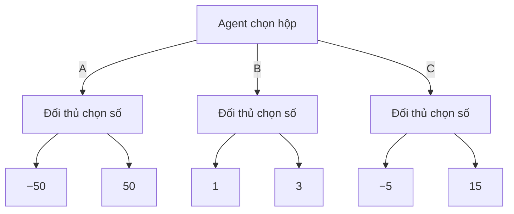
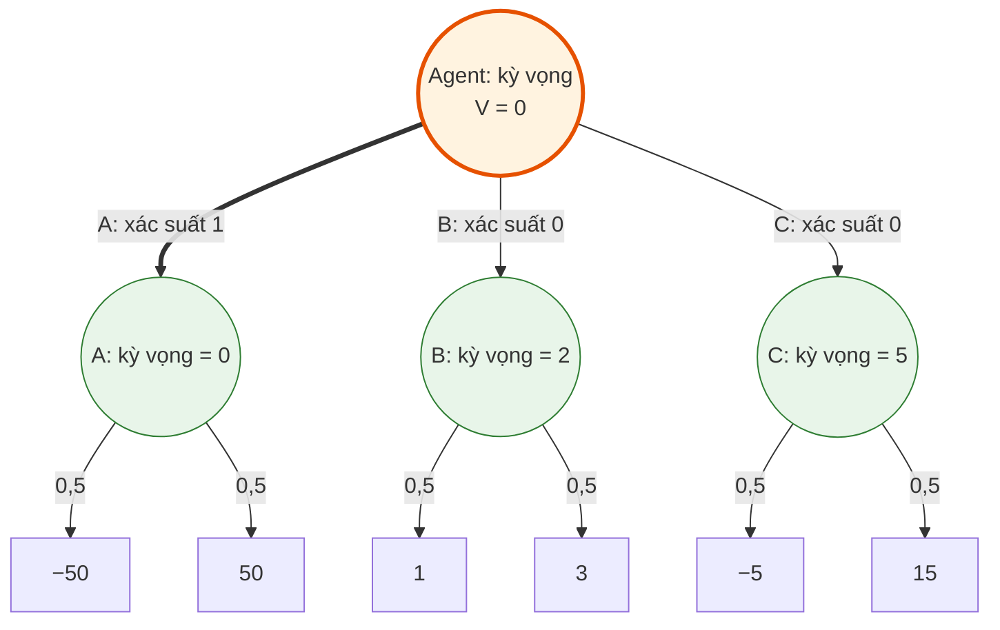
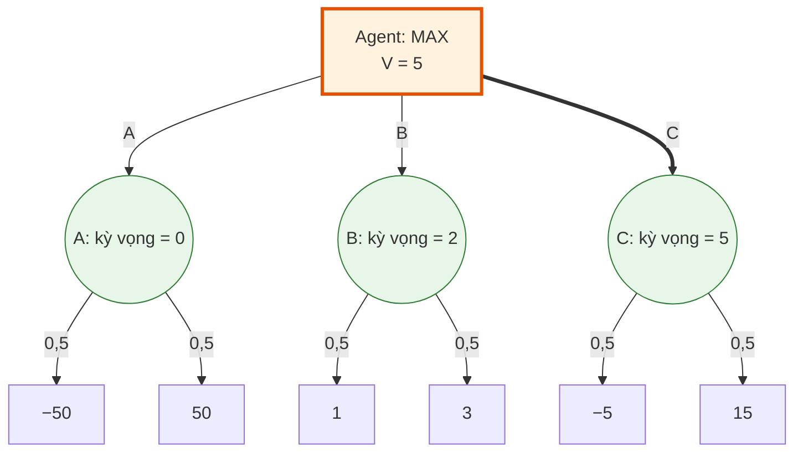
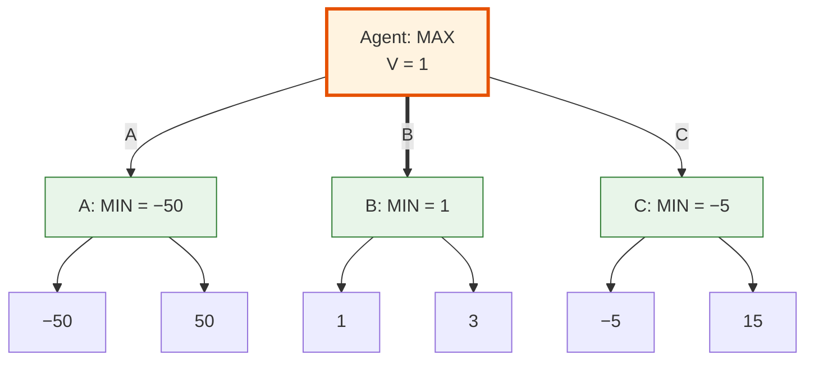

# Games 1: Mô hình hóa trò chơi, Game Evaluation, Expectimax và Minimax

*Nội dung trình bày seminar “Games 1 (combined)” — Nhóm 10, lớp 24TN, HCMUS. Thành viên: Võ Nhất Bảo, Phạm Lê Huy Hoàng. Ngày trình bày: 09/11/2026.*

## Phạm vi và mục tiêu

Nội dung gồm năm phần: **Overview, Modeling, Game evaluation, Expectimax và Minimax**, theo mạch của [games1.pdf, trang PDF 1–56](../docs/games1.pdf#page=1). Các ví dụ và cách triển khai được bổ sung từ tài liệu CS188.

Bài toán xuyên suốt là: **từ một trạng thái trò chơi, agent nên chọn hành động nào khi một phần diễn biến tiếp theo do đối thủ quyết định?**

Các điểm cốt lõi:

- Biểu diễn trò chơi bằng trạng thái, hành động, phép chuyển, lượt chơi và utility.
- Hiểu vì sao lời giải cần là một chiến lược phản ứng theo trạng thái.
- Phân biệt đánh giá hai chiến lược đã biết với tìm chiến lược tốt nhất.
- Tính được giá trị và chọn được nước đi trên một cây nhỏ.
- Giải thích sự khác nhau giữa tối đa hóa kỳ vọng và tối ưu mức bảo đảm.

Trong tài liệu này, số trang dẫn nguồn luôn là **trang PDF tính từ 1**. Riêng `games1.pdf`, số in ở chân slide bằng số trang PDF trừ 1.

Khi trình bày trực tiếp, dùng trò ba hộp để giải đủ ba phương pháp và bảng đối đầu; dùng thế Q cho một ví dụ phản bác ngắn. Halving là hoạt động demo tùy thời lượng; thế P, bảng đối đầu P và biến đổi utility là phần mở rộng để đọc hoặc vấn đáp. Bản báo cáo vẫn giữ phép tính chi tiết để người đọc tự theo dõi.

## 1. Overview: tìm kiếm khi có đối thủ

### 1.1. Từ tìm một kế hoạch đến tìm một chiến lược

**Giải bài toán bằng tìm kiếm trong không gian trạng thái.** Trước khi chọn thuật toán, ta cần biểu diễn tình huống hiện tại bằng một state, xác định các hành động hợp lệ và cách mỗi hành động tạo ra state tiếp theo. Với bài toán tìm kiếm tất định một tác nhân, một cách mô tả là:

$$
\mathcal P=(S,s_0,A,T,G,c),
$$

trong đó $S$ là tập trạng thái, $s_0$ là trạng thái đầu, $A(s)$ là tập hành động hợp lệ, $T(s,a)$ là trạng thái kế tiếp, $G\subseteq S$ là tập trạng thái đích và $c(s,a)$ là chi phí một bước.

Một **nghiệm hợp lệ** là đường đi $\rho=(s_0,a_0,s_1,\ldots,a_{k-1},s_k)$ tuân theo phép chuyển và có $s_k\in G$. Nếu cần tối ưu chi phí, ta tìm:

$$
C(\rho)=\sum_{t=0}^{k-1}c(s_t,a_t),\qquad
\rho^*\in\arg\min_{\rho\in\mathcal P_{\mathrm{goal}}}C(\rho),
$$

với $\mathcal P_{\mathrm{goal}}$ là tập các đường đi hợp lệ từ $s_0$ tới đích. **Tìm được một nghiệm và tìm được nghiệm tối ưu là hai yêu cầu khác nhau.** Đường ít cạnh nhất cũng chưa chắc có chi phí nhỏ nhất: hai bước có chi phí $9+9$ đắt hơn ba bước có chi phí $1+1+1$.

Ở đây, search là quá trình khám phá các phương án trong mô hình; tiêu chí tối ưu xác định phương án nào tốt nhất. Không phải mọi bài toán AI đều cần quy về đường đi ngắn nhất. [CS188 — State Spaces and Search Problems](https://inst.eecs.berkeley.edu/~cs188/textbook/search/state.html)

**Điều gì thay đổi khi có đối thủ?** Trong bài toán tìm kiếm tất định trên, agent có thể tìm một chuỗi hành động rồi thực hiện nó để đi tới mục tiêu. Trong trò chơi, agent chỉ quyết định nước đi ở lượt của mình; đối thủ quyết định ở những lượt còn lại.

Vì vậy, một chuỗi nước đi dẫn tới chiến thắng chỉ là **một diễn biến có thể xảy ra**. Đối thủ có thể chọn một phản ứng khác và làm chuỗi đó không còn thực hiện được.

Lời giải cần tìm là **strategy/policy**: quy tắc cho biết agent nên làm gì tại mỗi trạng thái có thể gặp. Chất lượng của chiến lược phụ thuộc vào cả cách agent chơi lẫn cách đối thủ phản ứng. Đây là điểm xuất phát của **adversarial search — tìm kiếm đối kháng**. [CS188 Note 6, trang 1–2](../docs/cs188-fa23-note06.pdf#page=1)

### 1.2. Ví dụ xuyên suốt: ba hộp số

Agent chọn một hộp; sau đó người còn lại chọn một số trong hộp ấy. Số được chọn là utility của agent.

| Hộp | Hai kết quả có thể nhận |
|---|---|
| A | −50, 50 |
| B | 1, 3 |
| C | −5, 15 |



Cùng luật chơi và cùng tập kết quả, lựa chọn tốt nhất thay đổi theo mô hình về người chọn số:

| Cách người còn lại chọn số | Giá trị A | Giá trị B | Giá trị C | Hộp tốt nhất |
|---|---:|---:|---:|---|
| Chọn số lớn nhất để giúp agent | 50 | 3 | 15 | A |
| Chọn đều hai số | 0 | 2 | 5 | C |
| Chọn số nhỏ nhất để làm agent bất lợi | −50 | 1 | −5 | B |

**Không có một hộp tốt nhất cho mọi giả định về đối thủ.** Có lá mang giá trị cao chưa đủ để kết luận một nước đi tốt, vì agent có thể không kiểm soát việc đi tới lá đó. [CS221, trang 5–6](../docs/games1.pdf#page=5)

### 1.3. Hai đặc điểm quan trọng của game

**Utility nằm ở kết cục.** Trong mô hình đang xét, giá trị thắng, hòa, thua chỉ được xác định khi ván kết thúc. Một nước có vẻ thuận lợi trước mắt chưa chắc dẫn tới kết cục tốt.

**Quyền quyết định thuộc về những người chơi khác nhau.** Khi đánh giá một nhánh, agent phải xét cả những phản ứng mà đối thủ có thể lựa chọn. Thuật toán tìm kiếm cần thể hiện sự khác nhau này tại từng nút. [CS221, trang 17–18](../docs/games1.pdf#page=17)

## 2. Modeling: biểu diễn trò chơi

### 2.1. Lớp trò chơi đang xét

Mô hình chính gồm các trò chơi:

- **Hai người chơi:** agent và đối thủ (opp).
- **Zero-sum:** utility của đối thủ bằng số đối của utility agent.
- **Đi lần lượt:** mỗi trạng thái chưa kết thúc có một người được chọn hành động.
- **Quan sát đầy đủ:** trạng thái liên quan đến quyết định không bị che giấu.
- **Chuyển trạng thái tất định:** biết trạng thái và hành động thì xác định được trạng thái kế tiếp.

Các cây được giải đầy đủ trong bài đều hữu hạn. Đây là điều kiện để phép tính từ terminal về gốc hoàn tất.

Zero-sum không có nghĩa trò chơi chỉ có thắng hoặc thua. Có thể có hòa, chẳng hạn utility của agent là `+1, 0, −1`, còn utility của đối thủ tương ứng là `−1, 0, +1`. [CS221, trang 13–14](../docs/games1.pdf#page=13)

### 2.2. Sáu thành phần của mô hình

| Thành phần | Ý nghĩa |
|---|---|
| `s_start` | Trạng thái bắt đầu |
| `Actions(s)` | Các hành động hợp lệ ở trạng thái `s` |
| `Succ(s, a)` | Trạng thái sau khi thực hiện hành động `a` |
| `IsEnd(s)` | Kiểm tra ván đã kết thúc hay chưa |
| `Utility(s)` | Giá trị kết cục tại trạng thái kết thúc, theo góc nhìn agent |
| `Player(s)` | Người đang có quyền chọn hành động |

So với mô hình tìm kiếm đã học, `Player(s)` xác định **ai điều khiển bước chuyển tiếp theo**, còn `Utility(s)` cho phép so sánh các kết cục. Đến được terminal chưa đồng nghĩa đạt mục tiêu: thua cũng là một trạng thái kết thúc. [CS221, trang 13–18](../docs/games1.pdf#page=13)

| Search tất định một tác nhân | Mô hình game đang xét | Ý nghĩa khi chuyển sang game |
|---|---|---|
| $s_0$ | `s_start` | Vẫn cần điểm xuất phát |
| $A(s)$ và $T(s,a)$ | `Actions(s)` và `Succ(s,a)` | Vẫn sinh các bước chuyển hợp lệ |
| Kiểm tra $s\in G$ | `IsEnd(s)` | Kiểm tra kết thúc; kết thúc có thể là thắng, hòa hoặc thua |
| Tối thiểu tổng chi phí $C(\rho)$ | Tối đa terminal utility theo cách đối thủ phản ứng | Tiêu chí đánh giá chuyển từ chi phí đường đi sang chất lượng kết cục |
| Agent quyết định mọi bước | `Player(s)` chỉ người có lượt | Agent phải tính cả các bước do người khác quyết định |

Sự đối chiếu này dùng mô hình Search một tác nhân ở mục 1.1. Với game, chỉ biết các bước hợp lệ vẫn chưa đủ để chọn nước: cần thêm cách đánh giá những phản ứng có thể xảy ra của đối thủ.

### 2.3. Ví dụ mô hình hóa Tic-Tac-Toe

Với luật thông thường X đi trước, chọn X làm agent:

**Quy ước này chỉ dùng cho ví dụ mô hình hóa từ bàn trống và các số đếm tương ứng. Hai thế P/Q ở phần sau dùng O đi trước**, nên không được xem P/Q là các bàn phát sinh từ ví dụ X đi trước này.

| Thành phần | Biểu diễn |
|---|---|
| State | Bàn cờ 3×3 và người đến lượt |
| `s_start` | Bàn trống, X đến lượt |
| `Actions(s)` | Những ô trống, nếu ván chưa kết thúc |
| `Succ(s, a)` | Đặt quân của người đến lượt vào ô `a`, rồi chuyển lượt |
| `IsEnd(s)` | Một bên có ba quân thẳng hàng hoặc bàn đã đầy |
| `Utility(s)` | `+1` nếu X thắng, `0` nếu hòa, `−1` nếu O thắng |
| `Player(s)` | X hoặc O |

Hai điểm cần giữ đúng:

- **State phải đủ thông tin để áp dụng luật.** Bàn cờ và lượt chơi là cách biểu diễn rõ ràng cho ví dụ này.
- **Nước hợp lệ và nước tốt là hai khái niệm khác nhau.** Đặt vào một ô trống có thể hợp lệ nhưng dẫn tới thua. `Actions(s)` kiểm tra luật; thuật toán tìm kiếm đánh giá chất lượng nước đi.

Khi đã có người thắng, ván kết thúc ngay cả khi còn ô trống. Thuật toán phải kiểm tra `IsEnd(s)` trước khi tiếp tục sinh nước đi. Mô hình dựa trên sáu thành phần của CS221; Tic-Tac-Toe là ví dụ game tree trong [CS188 Lecture 7, trang 14](../docs/cs188-sp26-lec07.pdf#page=14).

### 2.4. Game Tree khác State-Space Graph như thế nào?

Trong cây trò chơi:

- Nút biểu diễn một trạng thái trong một lịch sử chơi.
- Cạnh biểu diễn một hành động hợp lệ.
- Lá biểu diễn trạng thái kết thúc và mang utility.
- Một đường từ gốc tới lá biểu diễn một ván diễn tiến cụ thể.

**State-Space Graph** biểu diễn mỗi trạng thái khác nhau bằng một đỉnh, với các cạnh là phép chuyển hợp lệ. **Game Tree** khai triển các lịch sử chơi từ trạng thái đầu: nếu hai lịch sử dẫn tới cùng state, chúng vẫn tạo hai nút riêng trên cây. [CS221, trang 11–12](../docs/games1.pdf#page=11)

| Khía cạnh | Game Tree — cây trò chơi | State-Space Graph — đồ thị trạng thái |
|---|---|---|
| Một nút biểu diễn | Một lần xuất hiện của state theo một lịch sử chơi | Một state đủ thông tin |
| Hai lịch sử dẫn tới cùng state | Có các nút riêng | Cùng đi tới một đỉnh |
| Quan hệ cha–con | Mỗi nút ngoài gốc có một cha | Một đỉnh có thể có nhiều đỉnh đi vào |
| Chu trình | Không có; state lặp lại được khai triển thành nút mới | Có thể có, tùy luật trò chơi |
| Hệ quả khi tính giá trị | Có thể tính lại cùng một state nhiều lần | Có thể lưu và dùng lại giá trị của cùng state |

Ví dụ Tic-Tac-Toe từ bàn trống, X đi trước, đánh số ô từ 0 đến 8 theo hàng:

```text
Chỉ số ô         Lịch sử 1: X0 → O4 → X2
0 1 2            Lịch sử 2: X2 → O4 → X0
3 4 5
6 7 8            Cùng trạng thái:
                 X . X
                 . O .
                 . . .
                 O đến lượt
```

Hai thứ tự đặt quân khác nhau tạo hai nút trong Game Tree nhưng chỉ một state trong graph. Từ trạng thái ấy, tập hành động hợp lệ và bài toán tiếp diễn là như nhau. Ví dụ này minh họa cách gộp state từ mô hình của CS221.

Trong Tic-Tac-Toe thông thường, duyệt toàn cây từ bàn trống có **549.946 nút**, trong khi chỉ có **5.478 trạng thái khác nhau**. Hai số đếm đo hai đại lượng khác nhau, không mâu thuẫn. Kết quả được tính bằng [code tham chiếu](<../research_notes/Seminar Games 1 nhóm 10/verify_examples.py>).

**Dùng lại giá trị đòi hỏi state đủ thông tin và cùng tiêu chuẩn đánh giá.** Cùng hình bàn cờ nhưng khác lượt là hai state khác nhau. Nếu luật hoặc mô hình đối thủ phụ thuộc vào lịch sử, thông tin cần thiết ấy cũng phải được giữ trong state trước khi gộp.

Các thuật toán trong phần này được diễn giải trên cây để thấy rõ từng lựa chọn và phản ứng. Gộp state có thể giảm công tính lặp, nhưng không loại bỏ khó khăn khi bản thân không gian trạng thái vẫn quá lớn.

### 2.5. Policy: cách một người chơi chọn hành động

**Policy tất định** chọn một hành động cụ thể tại mỗi trạng thái thuộc lượt người chơi đó:

$$
\pi_p(s)\in Actions(s).
$$

Ví dụ: agent luôn chọn hộp A ở gốc.

**Policy ngẫu nhiên** cho xác suất chọn từng hành động:

$$
\pi_p(s,a)\ge 0,\qquad
\sum_{a\in Actions(s)}\pi_p(s,a)=1.
$$

Ví dụ: tại một hộp có hai số, đối thủ chọn mỗi số với xác suất `1/2`. Policy tất định cũng có thể biểu diễn bằng xác suất `1` cho hành động được chọn và `0` cho các hành động còn lại.

Policy được dùng tại các trạng thái chưa kết thúc thuộc lượt người chơi tương ứng. Một policy là cách chơi cho nhiều tình huống, không chỉ là một nước đi ở gốc. [CS221, trang 21–22](../docs/games1.pdf#page=21)

Ví dụ, một policy Tic-Tac-Toe phải chỉ cách X phản ứng sau các nước O khác nhau. Một đường đi $X0\to O4\to X2$ chỉ ghi lại **một lịch sử chơi**; nó không cho biết X làm gì nếu O chọn ô 1 thay cho ô 4. Vì vậy, kết quả cần tìm trong game là policy. Khi triển khai, có thể tính lại nước đi từ state thực tế ở mỗi lượt, thay vì lưu sẵn toàn bộ bảng policy.

### 2.6. Utility khác value: cùng một state đang được đánh giá theo cách nào?

Đặt $U(s)=Utility(s)$ tại terminal. **Terminal utility** chấm một kết cục đã xác định; **state value** đánh giá utility của các kết cục có thể phát sinh từ state hiện tại, theo cách hai bên tiếp tục chơi.

Từ đây, dùng $\pi$ cho policy agent và $\mu$ cho policy đối thủ. Ký hiệu xác suất có điều kiện $\pi(a\mid s)$, $\mu(a\mid s)$ lần lượt tương đương $\pi_{\mathrm{agent}}(s,a)$, $\pi_{\mathrm{opp}}(s,a)$ trong PDF. Với utility hữu hạn và $s_T$ là trạng thái terminal đạt được:

| Ký hiệu | Định nghĩa | Câu hỏi đang trả lời |
|---|---|---|
| $U(s)$, với $IsEnd(s)$ | Utility của kết cục $s$ | Kết cục này tốt đến đâu đối với agent? |
| $V^{\pi,\mu}(s)$ | $\mathbb E[U(s_T)\mid s,\pi,\mu]$ | Nếu giữ nguyên hai policy, utility kỳ vọng là bao nhiêu? |
| $V^{*,\mu}(s)$ | $\max_\pi V^{\pi,\mu}(s)$ | Trước policy đối thủ $\mu$ cố định, agent đạt kỳ vọng tốt nhất là bao nhiêu? |
| $V_{\mathrm{mm}}(s)$ | $\max_\pi\min_\mu V^{\pi,\mu}(s)$ | Agent bảo đảm được mức nào trước phản ứng bất lợi nhất? |

Trong mô hình hữu hạn, quan sát đầy đủ đang xét, hai giá trị tối ưu ở trên được tính bằng truy hồi Expectimax và Minimax. Để đối chiếu trực tiếp với PDF, bài cũng dùng các tên:

$$
V_{\mathrm{eval}}(s)=V^{\pi,\mu}(s),\qquad
V_{\mathrm{exptmax}}(s)=V^{*,\mu}(s),\qquad
V_{\mathrm{minmax}}(s)=V_{\mathrm{mm}}(s).
$$

Hai ký hiệu đầu chỉ viết gọn sự phụ thuộc vào policy; khi đổi policy phải tính lại value.

Chẳng hạn, tại **cùng trạng thái đầu trò ba hộp**:

| Cách đánh giá | Policy/giả định | Value tại gốc |
|---|---|---:|
| Game evaluation | Agent đã chọn A, đối thủ chọn đều | $\tfrac12(-50)+\tfrac12(50)=0$ |
| Expectimax | Đối thủ chọn đều, agent được tối ưu | $\max(0,2,5)=5$ |
| Minimax | Agent tối ưu trước phản ứng bất lợi nhất | $\max(-50,1,-5)=1$ |

Các số ở lá $-50,50,1,3,-5,15$ không thay đổi. Ba value $0,5,1$ khác nhau vì **câu hỏi và cách chơi tiếp diễn khác nhau**; các phần tiếp theo sẽ triển khai từng phép tính. Phân biệt này dựa trên định nghĩa game value của [CS221, trang 25–34](../docs/games1.pdf#page=25) và phần terminal/state value của [CS188 Note 6, trang 2–3](../docs/cs188-fa23-note06.pdf#page=2).

## 3. Game evaluation: đánh giá khi cả hai policy đã biết

### 3.1. Câu hỏi cần giải

Cho trước policy của agent và policy của đối thủ, **utility kỳ vọng của agent là bao nhiêu?**

Game evaluation tính $V^{\pi,\mu}(s)$ của **một cặp policy đã cố định**. Agent chưa được thay cách chơi để chọn phương án tốt hơn. Chữ “evaluation” ở đây là đo kết quả của cách chơi đã cho; chưa có bước tìm policy mới.

Kỳ vọng là trung bình có trọng số theo xác suất các kết quả. Nó không nhất thiết là kết quả nhận được trong một ván cụ thể. [CS221, trang 25–28](../docs/games1.pdf#page=25)

### 3.2. Quy tắc tính giá trị

Tại terminal, giá trị bằng utility. Tại trạng thái chưa kết thúc, lấy trung bình có trọng số của giá trị các trạng thái con, theo policy của người đang có lượt.

$$
V_{\mathrm{eval}}(s)=V^{\pi,\mu}(s)=
\begin{cases}
Utility(s), & IsEnd(s),\\[2mm]
\displaystyle\sum_{a\in Actions(s)}
\pi(a\mid s)\,
V^{\pi,\mu}(Succ(s,a)),
& Player(s)=\mathrm{agent},\\[3mm]
\displaystyle\sum_{a\in Actions(s)}
\mu(a\mid s)\,
V^{\pi,\mu}(Succ(s,a)),
& Player(s)=\mathrm{opp}.
\end{cases}
$$

**Vì sao dùng tổng có trọng số?** Mỗi hành động xảy ra theo xác suất đã cho. Giá trị tại nút là trung bình các kết quả tiếp diễn tương ứng. Cách giải thích giống nhau ở cả lượt agent lẫn lượt đối thủ; chỉ policy dùng làm trọng số thay đổi.

Ví dụ tại một node có hai con mang value $v_1,v_2$, nếu policy chọn chúng với xác suất $q,1-q$ thì value của node là $qv_1+(1-q)v_2$. Phải dùng **value của cây con**, bởi một hành động chưa chắc kết thúc game ngay; chỉ ở terminal mới thay value bằng utility trực tiếp.

Công thức không có `max` hay `min`, vì cả hai cách chơi đều đã được cố định. [CS221, trang 27–28](../docs/games1.pdf#page=27)

### 3.3. Áp dụng vào ba hộp

Giả sử đối thủ chọn đều hai số trong mỗi hộp:

$$
V(A)=\tfrac12(-50)+\tfrac12(50)=0,
$$
$$
V(B)=\tfrac12(1)+\tfrac12(3)=2,
\qquad
V(C)=\tfrac12(-5)+\tfrac12(15)=5.
$$

Nếu policy agent đã quy định **chọn A**, ta có:

$$
V_{\mathrm{eval}}(s_{\mathrm{start}})
=1\cdot0+0\cdot2+0\cdot5=\boxed{0}.
$$

Dù C có kỳ vọng cao hơn, Game evaluation vẫn trả `0`: nhiệm vụ hiện tại là đánh giá policy chọn A. [CS221, trang 25](../docs/games1.pdf#page=25)

**Cây Game evaluation — kỳ vọng ở cả hai tầng.** Từ utility ở lá, tầng hộp trả `(A, B, C) = (0, 2, 5)`, rồi gốc lấy kỳ vọng theo policy agent chọn A. Trong hình, các hộp màu xanh đã được tính; gốc màu cam thực hiện phép tổng hợp cuối cùng, cạnh đậm là hành động theo policy.



Gốc lấy `1×0 + 0×2 + 0×5 = 0`. B và C được giữ để đối chiếu cùng bố cục ở các thuật toán tiếp theo; với policy chọn A, thuật toán có thể bỏ qua hai nhánh xác suất 0 ấy.

Nếu agent cũng chọn đều cả ba hộp, giá trị trở thành:

$$
V_{\mathrm{eval}}(s_{\mathrm{start}})
=\tfrac13(0)+\tfrac13(2)+\tfrac13(5)=\boxed{\tfrac73}.
$$

Thay policy thì giá trị của cặp policy thay đổi; bản thân phép đánh giá không tự tìm policy mới.

### 3.4. Vai trò của Game evaluation

**Tính chính xác và mô phỏng là hai cách đo cùng một cặp policy.** Truy hồi trên cây hữu hạn tính kỳ vọng bằng cách tổng hợp các nhánh. Mô phỏng thì lấy mẫu hành động theo hai policy, chơi tới terminal và lấy trung bình:

$$
\widehat V_n=\frac1n\sum_{i=1}^{n}U(s_T^{(i)}).
$$

Trong ví dụ agent chọn A, mỗi ván mô phỏng nhận $-50$ hoặc $50$, nên trung bình của một mẫu hữu hạn có thể khác $0$; giá trị kỳ vọng tính đúng theo mô hình vẫn là $0$. Đây là điểm giảng viên làm rõ khi so sánh rollout với phép truy hồi trong [Games I 2025, 13:26–19:51](https://www.youtube.com/watch?v=SMOD_GiRzb8&t=806s).

Game evaluation giúp trả lời các câu hỏi như: cùng một cách chơi của agent, kết quả thay đổi thế nào khi gặp những đối thủ khác nhau? Hoặc trước một đối thủ cố định, hai policy agent đạt kết quả khác nhau ra sao?

Nó có vai trò tương tự **policy evaluation trong MDP**: biết cách hành động rồi tính giá trị. Game evaluation cũng là công cụ để đọc bảng đối đầu ở phần Minimax. [CS221, trang 27 và 47–48](../docs/games1.pdf#page=27)

**Game evaluation khác evaluation function.** Game evaluation tính giá trị của hai policy từ luật chơi, xác suất và utility ở terminal. Evaluation function ước lượng giá trị một trạng thái khi chưa tìm tới terminal; nội dung đó thuộc Games 2. [CS221, trang 75](../docs/games1.pdf#page=75)

## 4. Expectimax: chọn chiến lược có kỳ vọng tốt nhất

### 4.1. Từ đánh giá sang tối ưu hóa

Vẫn biết policy đối thủ $\pi_{\mathrm{opp}}$, nhưng agent được quyền chọn cách chơi.

Câu hỏi trở thành: **trước đúng policy đối thủ này, agent nên chọn hành động nào để đạt utility kỳ vọng cao nhất?**

Tại lượt agent, thay phép lấy trung bình theo policy đã cho bằng phép `max`. Tại lượt đối thủ, giữ phép lấy kỳ vọng theo $\pi_{\mathrm{opp}}$. [CS221, trang 31–34](../docs/games1.pdf#page=31)

Nói bằng ký hiệu ở mục 2.6, ta đang tìm $V^{*,\mu}(s)=\max_\pi V^{\pi,\mu}(s)$: **giữ $\mu$ cố định và tối ưu $\pi$**. Không có yêu cầu $\mu$ phải chọn đều; policy tất định cũng là trường hợp đặc biệt với các xác suất bằng 0 hoặc 1.

### 4.2. Công thức và ý nghĩa các loại nút

$$
V_{\mathrm{exptmax}}(s)=
\begin{cases}
Utility(s), & IsEnd(s),\\[2mm]
\displaystyle\max_{a\in Actions(s)}
V_{\mathrm{exptmax}}(Succ(s,a)),
& Player(s)=\mathrm{agent},\\[3mm]
\displaystyle\sum_{a\in Actions(s)}
\pi_{\mathrm{opp}}(s,a)\,
V_{\mathrm{exptmax}}(Succ(s,a)),
& Player(s)=\mathrm{opp}.
\end{cases}
$$

| Loại nút | Phép tính | Ý nghĩa |
|---|---|---|
| MAX — lượt agent | Lấy giá trị con lớn nhất | Agent chọn hành động tốt nhất |
| Nút kỳ vọng — lượt đối thủ theo policy đã biết | Trung bình có trọng số | Các phản ứng xảy ra theo mô hình xác suất |
| Terminal | Trả utility | Kết cục đã xác định |

Trong tài liệu CS188, nút lấy kỳ vọng được gọi là **chance node**. Ở phần Games 1 này, xác suất đến từ mô hình về cách đối thủ chọn nước; `Succ(s,a)` vẫn tất định khi hành động đã được chọn. [CS188 Note 7, trang 1–2](../docs/cs188-fa23-note07.pdf#page=1)

Phép lấy kỳ vọng mô tả **mô hình phản ứng** của đối thủ; nó không bắt buộc đối thủ ngoài thực tế phải tung đồng xu. Với game có xúc xắc, chance node còn có thể mô tả ngẫu nhiên của môi trường. Hai nguồn xác suất này cần được phân biệt; ví dụ ba hộp chỉ dùng nguồn thứ nhất.

**Giá trị và hành động là hai đầu ra liên quan nhưng khác nhau.** Phép `max` cho giá trị tốt nhất; hành động cần chọn là hành động dẫn tới giá trị đó. Khi nhiều hành động cùng tốt nhất, có thể chọn một trong số chúng.

Tại mỗi state thuộc lượt agent, trích policy bằng:

$$
\pi_{\mathrm{exp},\mu}(s)\in
\arg\max_{a\in Actions(s)}V^{*,\mu}(Succ(s,a)).
$$

Vì $\arg\max$ có thể có nhiều phần tử, dấu $\in$ nghĩa là chọn một hành động trong tập đồng hạng. Tối ưu trước $\mu$ yêu cầu tiếp tục chọn như vậy ở các lượt sau.

### 4.3. Áp dụng vào ba hộp

Đối thủ vẫn chọn đều nên ba hộp giữ các giá trị `0, 2, 5`. Gốc là nút MAX:

$$
V_{\mathrm{exptmax}}(s_{\mathrm{start}})
=\max(0,2,5)=\boxed{5}.
$$

Agent chọn **C**. Khác biệt với Game evaluation nằm ở quyền lựa chọn của agent: thay vì bắt buộc đi A, agent được so sánh cả ba hộp. [CS221, trang 31–34](../docs/games1.pdf#page=31)

Giá trị `5` là kỳ vọng. Một ván chọn C thực tế nhận `−5` hoặc `15`, không nhận `5`.

**Cây Expectimax — đổi gốc thành MAX.** Cây và các utility giữ nguyên; tầng đối thủ vẫn lấy kỳ vọng và trả `0, 2, 5`. Thay đổi ở gốc: agent được chọn con có giá trị lớn nhất, nên nhánh đậm chuyển sang C.



### 4.4. Độ nhạy của Expectimax với mô hình đối thủ

Expectimax tối ưu theo policy đối thủ được đưa vào mô hình. Chọn đều chỉ là một giả định; khi xác suất thay đổi, cả giá trị kỳ vọng lẫn hành động tốt nhất đều có thể thay đổi.

#### Một tham số, ba lựa chọn

Trong trò ba hộp, đặt `p` là xác suất đối thủ chọn **số nhỏ hơn**, còn `1 − p` là xác suất chọn số lớn hơn. Để so sánh đơn giản, dùng cùng `p` cho cả ba hộp. Đây là giả định riêng của ví dụ.

$$
\begin{aligned}
V_A(p)&=-50p+50(1-p)=50-100p,\\
V_B(p)&=p+3(1-p)=3-2p,\\
V_C(p)&=-5p+15(1-p)=15-20p.
\end{aligned}
$$

| `p` — xác suất chọn số nhỏ | Giá trị A | Giá trị B | Giá trị C | Hộp tốt nhất |
|---|---:|---:|---:|---|
| 0 | 50 | 3 | 15 | A |
| 0,4 | 10 | 2,2 | 7 | A |
| 0,5 — chọn đều | 0 | 2 | 5 | C |
| 0,6 | −10 | 1,8 | 3 | C |
| 0,9 | −40 | 1,2 | −3 | B |
| 1 — luôn chọn số nhỏ | −50 | 1 | −5 | B |

Thuật toán giữ nguyên phép `max` tại gốc và phép lấy kỳ vọng tại lượt đối thủ. Chỉ mô hình xác suất thay đổi mà lựa chọn đã lần lượt chuyển **A → C → B**.

**Các ngưỡng đổi lựa chọn đến từ đâu?** Giải điểm giao rồi kiểm tra hộp còn lại:

$$
\begin{aligned}
V_A=V_C
&\iff 50-100p=15-20p
\iff 35=80p
\iff p=\frac7{16},\\
V_C=V_B
&\iff 15-20p=3-2p
\iff 12=18p
\iff p=\frac23.
\end{aligned}
$$

Tại $p=7/16$, A và C cùng bằng $25/4$, lớn hơn B là $17/8$. Tại $p=2/3$, B và C cùng bằng $5/3$, lớn hơn A là $-50/3$.

A và B còn giao tại $50-100p=3-2p$, tức $p=47/98$. Nhưng khi đó $V_A=V_B=100/49$, trong khi $V_C=265/49$ cao hơn cả hai, nên đây **không phải ngưỡng đổi hộp tối ưu**. So sánh đủ ba hàm trên miền $0\le p\le1$ cho:

- `p < 7/16`: chọn A.
- `7/16 < p < 2/3`: chọn C.
- `p > 2/3`: chọn B.
- Tại `p = 7/16`, A và C cùng tốt nhất; tại `p = 2/3`, B và C cùng tốt nhất.

Ví dụ, từ giả định chọn đều `p = 0,5`, chỉ cần giảm `p` xuống dưới `0,4375` là lựa chọn đổi từ C sang A. Hộp A nhạy hơn với `p` vì hai kết quả của nó cách xa nhau hơn hai kết quả của B hay C.

#### Mô hình dự đoán và kết quả thực tế

Nếu agent tính theo `p = 0,5`, nó chọn C với kỳ vọng dự kiến `5`. Nhưng nếu thực tế `p = 0,9`, kỳ vọng của C là `−3`, trong khi B đạt `1,2`. Nếu đối thủ luôn chọn số nhỏ nhất, C nhận `−5`, thấp hơn mức bảo đảm `1` của B.

**Expectimax tối ưu trước mô hình đã cho; điều đó chưa bảo đảm mô hình mô tả đúng đối thủ.** Khi `p = 1` trong chính ví dụ này, mỗi nút kỳ vọng chỉ còn số nhỏ nhất, nên quyết định trùng với Minimax. Với các xác suất khác, chọn B vẫn có thể là kết quả của Expectimax, như tại `p = 0,9`.

Phân tích theo `p` là phần nhóm phát triển từ trò ba hộp của [CS221, trang 5–6](../docs/games1.pdf#page=5) và công thức [Expectimax, trang 33–34](../docs/games1.pdf#page=33). Các phép tính chi tiết được lưu ở mục “Mô hình sai thì sao: ngưỡng lật quyết định và regret” trong [bản nghiên cứu](<Seminar Games 1 nhóm 10 - Bản nghiên cứu.md#mô-hình-sai-thì-sao-ngưỡng-lật-quyết-định-và-regret>).

### 4.5. Ý nghĩa và điều kiện sử dụng

Expectimax tìm cách khai thác một mô hình đối thủ đã cho để đạt kỳ vọng cao nhất. Tính tối ưu được hiểu **theo mô hình ấy**. Phép lấy kỳ vọng cần xác suất không âm, tổng bằng `1`, và các giá trị utility có ý nghĩa về độ lớn để lấy trung bình.

Ảnh hưởng của việc thay đổi độ lớn utility được minh họa bằng một [ví dụ ngắn ở phần bổ sung](#ví-dụ-biến-đổi-utility).

Các ví dụ có lấy kỳ vọng trong bài dùng utility hữu hạn. Với Tic-Tac-Toe, thang `+1, 0, −1` cho:

$$
E[U]=P(\text{thắng})-P(\text{thua}).
$$

Vì vậy, **utility kỳ vọng không đồng nhất với xác suất thắng**.

Liên hệ với MDP: Game evaluation đánh giá cách chơi đã cho, còn Expectimax tìm cách chơi tốt nhất trước mô hình đối thủ đã biết. Đây là sự tương đồng về vai trò của các công thức với policy evaluation và value iteration. [CS221, trang 27–34](../docs/games1.pdf#page=27)

#### Từ hai lượt trong game đến một transition của MDP

Giả sử hai người đi luân phiên và đối thủ dùng policy $\mu$ cố định, đã biết. Từ state $s$ thuộc lượt agent, một vòng có dạng:

$$
s\xrightarrow[\mathrm{agent}]{a}u
\xrightarrow[\mathrm{opp}]{b}s',\qquad u=Succ(s,a).
$$

Sau khi agent chọn $a$, xác suất tới $s'$ là tổng xác suất của các nước đối thủ $b$ dẫn tới đúng $s'$:

$$
P_\mu(s'\mid s,a)
=\sum_{b\in Actions(u)}\mu(b\mid u)\,
\mathbf1[Succ(u,b)=s'].
$$

Ở đây, $\mathbf1[\cdot]$ bằng 1 khi điều kiện đúng và bằng 0 khi sai. Nếu nhiều hành động $b$ cùng dẫn tới một $s'$, xác suất của chúng được cộng lại. Do $\sum_b\mu(b\mid u)=1$, tổng xác suất trên các $s'$ cũng bằng 1. Nếu $u$ đã là terminal ngay sau nước agent, bỏ lượt đối thủ và đặt $P_\mu(u\mid s,a)=1$.

Với reward trung gian bằng 0, không chiết khấu và utility ở terminal, phương trình tại các state thuộc lượt agent là:

$$
V^{*,\mu}(s)=\max_{a\in Actions(s)}
\sum_{s'}P_\mu(s'\mid s,a)V^{*,\mu}(s'),
\qquad V^{*,\mu}(s_T)=U(s_T).
$$

Ví dụ chọn C trong trò ba hộp, $P_\mu(C_{-5}\mid s_0,C)=1/2$ và $P_\mu(C_{15}\mid s_0,C)=1/2$. Tổng ứng với hành động C là $\tfrac12(-5)+\tfrac12(15)=5$; so với A và B, phép $\max$ lại chọn C. Đây chính là phép tính Expectimax viết bằng transition của MDP.

Liên hệ này cần **policy đối thủ cố định, đã biết và state đủ thông tin để xác định phản ứng tiếp theo**. Nếu game có reward giữa đường, phải giữ cả reward của những bước đã gộp; không được bỏ chúng. Expectimax ở đây là **planning với mô hình đã biết**. Reinforcement learning còn có bài toán học từ tương tác/dữ liệu, nên hai khái niệm không đồng nhất.

Công thức gộp lượt là phần triển khai từ liên hệ trong [CS221, trang 22 và 27–34](../docs/games1.pdf#page=22); phân tích tổng quát được giữ ở [phần MDP reduction của bản nghiên cứu](<Seminar Games 1 nhóm 10 - Bản nghiên cứu.md#mdp-reduction-cố-định-π_opp-đã-biết-trên-state-đủ-thông-tin>).

## 5. Minimax: chọn chiến lược có mức bảo đảm tốt nhất

### 5.1. Khi không có policy đối thủ để tin cậy

Nếu không biết đối thủ sẽ phản ứng theo xác suất nào, agent có thể đánh giá mỗi nước đi bằng **đáp trả bất lợi nhất** mà đối thủ có thể chọn, rồi chọn nước có mức bảo đảm cao nhất.

Trong game zero-sum, đối thủ tăng utility của họ cũng chính là giảm utility của agent. Vì thế:

- Tại lượt agent: lấy `max`.
- Tại lượt đối thủ: lấy `min`.
- Tại terminal: trả utility theo cùng góc nhìn agent.

Minimax không cần policy đối thủ làm đầu vào. [CS221, trang 37–42](../docs/games1.pdf#page=37)

### 5.2. Công thức và cách chọn nước đi

$$
V_{\mathrm{minmax}}(s)=
\begin{cases}
Utility(s), & IsEnd(s),\\[2mm]
\displaystyle\max_{a\in Actions(s)}
V_{\mathrm{minmax}}(Succ(s,a)),
& Player(s)=\mathrm{agent},\\[3mm]
\displaystyle\min_{a\in Actions(s)}
V_{\mathrm{minmax}}(Succ(s,a)),
& Player(s)=\mathrm{opp}.
\end{cases}
$$

Tính giá trị từ lá lên gốc. Tại lượt agent, chọn hành động dẫn tới con có giá trị lớn nhất; tại lượt đối thủ, mô hình hóa việc chọn con có giá trị nhỏ nhất. [CS221, trang 41–44](../docs/games1.pdf#page=41)

Từ value, ta trích được **hai policy Minimax**:

$$
\begin{aligned}
\pi_{\max}(s)&\in\arg\max_{a\in Actions(s)}
V_{\mathrm{minmax}}(Succ(s,a)),
&&Player(s)=\mathrm{agent},\\
\pi_{\min}(s)&\in\arg\min_{a\in Actions(s)}
V_{\mathrm{minmax}}(Succ(s,a)),
&&Player(s)=\mathrm{opp}.
\end{aligned}
$$

Hai policy phải chọn theo các quy tắc này tại **mọi state thuộc lượt mình**, kể cả state không nằm trên đường chơi dự kiến ban đầu. Đây là cơ sở để đánh giá các cuộc đối đầu ở mục 5.7.

Với ba hộp:

| Hộp | Đáp trả bất lợi nhất | Giá trị Minimax |
|---|---|---:|
| A | Đối thủ chọn −50 | −50 |
| B | Đối thủ chọn 1 | 1 |
| C | Đối thủ chọn −5 | −5 |

$$
V_{\mathrm{minmax}}(s_{\mathrm{start}})
=\max(-50,1,-5)=\boxed{1}.
$$

Agent chọn **B**. Dù đối thủ chọn `1` hay `3`, kết quả vẫn ít nhất là `1`. Hộp A có lá `50` nhưng không bảo đảm đạt được nó. [CS221, trang 39–40](../docs/games1.pdf#page=39)

**Cây Minimax — đổi tầng đối thủ thành MIN.** Gốc vẫn là MAX như Expectimax, nhưng mỗi hộp lấy giá trị con nhỏ nhất thay cho kỳ vọng. Tầng hộp trả `−50, 1, −5`; gốc lấy `max(−50, 1, −5) = 1` và chọn B.



### 5.3. Cây nhiều tầng: xét đúng quyền lựa chọn ở từng lượt

Trong một cây sâu hơn, Minimax phải tiếp tục xen kẽ `max` và `min` theo người có lượt. Không thể lấy thẳng lá nhỏ nhất của cả một nhánh, vì trong nhánh đó agent vẫn có những lựa chọn của mình.

Ví dụ minh họa:

```text
                         MAX
                   /             \
                A: MIN          B: MIN
               /      \          /   \
             MAX      MAX       5     6
            /   \    /   \
          −100  10  8    20
```

Tính từ dưới lên:

1. Hai nút MAX trong A trả `max(−100, 10) = 10` và `max(8, 20) = 20`.
2. Nút A trả `min(10, 20) = 10`.
3. Nút B trả `min(5, 6) = 5`.
4. Gốc trả `max(10, 5) = 10`, chọn **A**.

Lá `−100` không quyết định giá trị A: khi tới nút MAX tương ứng, agent có thể chọn `10`. Đối thủ được chọn một nhánh tại lượt MIN, nhưng không được chọn thay agent ở lượt MAX.

Đây là cơ chế cốt lõi của Minimax: **đánh giá phản ứng của đối thủ đồng thời giữ đúng quyền quyết định của agent trong tương lai**. Ví dụ do nhóm xây dựng từ quy tắc truy hồi.

### 5.4. Đối chiếu pseudocode Expectimax và Minimax

Hai giả mã dưới đây tính giá trị trạng thái bằng cùng một cấu trúc tìm kiếm đệ quy:

```text
Expectimax                                          Minimax
def expectimax(s):                                  def minimax(s):
    if IsEnd(s):                                        if IsEnd(s):
        return Utility(s)                                   return Utility(s)

    actions = Actions(s)                                actions = Actions(s)
    values = []                                         values = []
    for a in actions:                                   for a in actions:
        values.append(expectimax(Succ(s, a)))               values.append(minimax(Succ(s, a)))

    if Player(s) == agent:                              if Player(s) == agent:
        return max(values)                                  return max(values)
    return sum(pi_opp(s, a) * v                         return min(values)
               for a, v in zip(actions, values))
```

`actions` là danh sách các hành động hợp lệ; mỗi phần tử trong `values` là giá trị của trạng thái con ứng với hành động cùng vị trí. `pi_opp(s, a)` là xác suất đối thủ chọn hành động `a` tại `s`, theo policy đã biết.

**Giống nhau:** kiểm tra terminal, duyệt các hành động hợp lệ, gọi đệ quy xuống trạng thái con và lấy `max` ở lượt agent. **Khác biệt chính nằm ở lượt đối thủ:** Expectimax tính `sum(pi_opp(s, a) * v)`, còn Minimax lấy `min(values)`. Vì vậy, Expectimax cần mô hình xác suất đối thủ; Minimax đánh giá theo đáp trả bất lợi nhất.

Tại gốc thuộc lượt agent, cả hai đều chọn hành động gắn với giá trị con lớn nhất. Phép `max` trả về giá trị; muốn xuất nước đi phải lưu thêm hành động tương ứng. Hàm tính giá trị có thể được gọi lại tại mỗi trạng thái thực tế sau nước đáp trả của đối thủ.

Hai hướng xử lý thông tin trong cùng thuật toán:

| Hướng | Thao tác |
|---|---|
| Từ gốc xuống | Thử hành động hợp lệ và sinh trạng thái kế tiếp |
| Từ lá lên | Nhận giá trị con rồi lấy `max`, `min` hoặc kỳ vọng theo loại nút để tính giá trị cha |

Thử một nhánh trong quá trình tìm kiếm không có nghĩa agent đã quyết định chơi nhánh đó. Quyết định chỉ được xác định sau khi so sánh giá trị các lựa chọn.

Cách triển khai này tương tự **DFS hậu tự — postorder**: một nút chỉ có giá trị hoàn chỉnh sau khi các con đã được tính. Việc truyền giá trị lên cha còn được gọi là **backward induction**; nó không phải tìm kiếm trạng thái ngược từ một đích. [CS188 Note 6, trang 5](../docs/cs188-fa23-note06.pdf#page=5), [CS188 Lecture 7, trang 16–17](../docs/cs188-sp26-lec07.pdf#page=16), [CS188 Note 7, trang 1–2](../docs/cs188-fa23-note07.pdf#page=1)

### 5.5. Halving Game: lớp đấu với Minimax

Halving Game cho phép người nghe trực tiếp thử một chiến lược trước AI Minimax. Trò chơi chỉ có hai hành động, nhưng AI có thể xác định một trạng thái là thắng hoặc thua khi cả hai chơi tối ưu ngay từ trước khi ván kết thúc. Đây là ứng dụng của việc truyền giá trị từ terminal về trạng thái hiện tại.

#### Luật chơi và mô hình

- Bắt đầu với một số nguyên dương `N`; lớp đi trước tại `N = 15`.
- Hai bên luân phiên chọn `-` để trừ 1 hoặc `/` để thay số hiện tại bằng $\lfloor N/2\rfloor$.
- **Người được để lại với số 0 thắng.** Người vừa thực hiện nước đưa số về 0 thua.

Ví dụ, khi đến lượt với `N = 1`, cả hai hành động đều đưa đối phương tới 0:

$$
(\mathrm{MAX},1)\xrightarrow{-1}(\mathrm{MIN},0),\qquad
U(\mathrm{MIN},0)=-1
$$

trên thang utility hữu hạn theo MAX. MIN là người nhận lượt ở 0 nên MIN thắng; MAX vừa đưa số về 0 lại thua. [CS221, trang 19 và 45](../docs/games1.pdf#page=19)

State là `(player, N)`, trong đó `player` chỉ người **đến lượt**. Trong demo, **lớp là +1 (MAX), máy là −1 (MIN)**; mỗi hành động đổi lượt. Tại terminal `(player, 0)`, mã nguồn trả `Utility = player * inf`:

| Terminal | Người thắng | Utility theo góc nhìn lớp |
|---|---|---|
| `(+1, 0)` | Lớp | `+inf` |
| `(−1, 0)` | Máy | `-inf` |

Các giá trị vô hạn ở đây chỉ dùng để so sánh thắng/thua trong Minimax. Có thể thay chúng bằng `+1` và `−1` mà vẫn giữ các nước tối ưu của trò chơi này. Demo dùng [`game.py` của CS221, bản lưu trữ cs221.1196](https://web.stanford.edu/class/archive/cs/cs221/cs221.1196/semilive/games1/game.py).

#### Tính thế thắng/thua trước khi đọc bảng N = 15

Đặt $W(n)=1$ nếu **người đang nhận lượt** tại số $n$ có thể bảo đảm thắng, và $W(n)=0$ nếu người đó thua khi đối phương chơi đúng. Đây là nhãn tương đối theo người có lượt, khác với utility luôn tính theo lớp +1.

Người nhận lượt ở 0 thắng nên $W(0)=1$. Với $n>0$, một nước tốt phải để đối phương nhận một thế thua:

$$
W(n)=\max\left\{1-W(n-1),\;1-W(\lfloor n/2\rfloor)\right\}.
$$

Nếu có ít nhất một successor mang nhãn 0 thì chọn successor ấy để thắng; nếu cả hai successor mang nhãn 1 thì không tránh được thua trước đối thủ chơi đúng. Tính lần lượt từ 0 tới 16 cho:

| $n$ | $W(n)$ — người đang nhận lượt | Cách đọc kết quả |
|---|---:|---|
| 0 | 1 | Thắng theo luật terminal |
| 1 | 0 | Cả hai nước đều để đối phương nhận 0 |
| 2, 3 | 1 | Có thể để đối phương nhận 1 |
| 4 | 0 | Chỉ tới 3 hoặc 2, đều có nhãn 1 |
| 5 | 1 | Trừ 1 để đối phương nhận 4 |
| 6 | 0 | Chỉ tới 5 hoặc 3, đều có nhãn 1 |
| 7, 8, 9 | 1 | Lần lượt có thể để đối phương nhận 6, 4, 4 |
| 10 | 0 | Chỉ tới 9 hoặc 5, đều có nhãn 1 |
| 11, 12, 13 | 1 | Lần lượt có thể để đối phương nhận 10, 6, 6 |
| 14 | 0 | Chỉ tới 13 hoặc 7, đều có nhãn 1 |
| 15 | 1 | Trừ 1 để đối phương nhận 14 |
| 16 | 0 | Chỉ tới 15 hoặc 8, đều có nhãn 1 |

Vì vậy, để **máy nhận 14** là thế thắng của lớp; để **máy nhận 7** là thế thắng của máy. Đây là lý do hai nước mở đầu bên dưới có dấu utility trái ngược. Bảng là phép triển khai recurrence của nhóm, kiểm bằng [verify_examples.py](<../research_notes/Seminar Games 1 nhóm 10/verify_examples.py>).

#### Hai nước mở đầu tại N = 15

| Lớp chọn | Trạng thái sau nước đi | `value` theo góc nhìn lớp | Ý nghĩa |
|---|---|---|---|
| `-` | `(−1, 14)`: máy đến lượt | `inf` | Lớp có chiến lược bảo đảm thắng nếu tiếp tục chơi tối ưu, bất kể máy phản ứng thế nào |
| `/` | `(−1, 7)`: máy đến lượt | `-inf` | Máy có chiến lược bảo đảm thắng nếu chơi tối ưu |

Chỉ `-` giữ được thế thắng cho lớp. Tuy nhiên, **một nước đi tối ưu chưa đủ: bảo đảm thắng đòi hỏi tiếp tục tuân theo chiến lược tối ưu ở các lượt sau**.

Chẳng hạn, sau `15 → 14 → 13`, lớp đang có thế thắng. Nếu tiếp tục trừ 1 thành 12 thay vì chia 2 thành 6, lớp đánh mất bảo đảm và máy có thể ép thắng. Vì vậy, máy ở thế thua tại 14 vẫn có thể thắng nếu lớp mắc sai lầm về sau.

**`value` luôn được tính theo lớp +1**, kể cả khi máy −1 đang chọn nước. Do đó, dòng `minimax says action = -, value = inf` cho biết trạng thái ấy có lợi cho lớp khi lớp tiếp tục tối ưu.

#### Hoạt động “Lớp đấu với Minimax” — 3 đến 4 phút

1. Tải trước `game.py` từ nguồn CS221 ở trên, chạy `python3 game.py` trên máy trình chiếu và giữ bản tải để chạy offline. Bản mã lưu trữ khởi tạo `N = 15`, lớp đi trước và máy dùng Minimax; bản nghiên cứu lưu log chạy trước đó. Nếu dùng bộ tài liệu hiện tại mà chưa tải mã gốc, có thể dùng chuỗi dự phòng bên dưới và mã kiểm chứng đi kèm.
2. Lớp bỏ phiếu nhanh `-` hoặc `/` ở mỗi lượt của mình. Sau mỗi nước của lớp, đối chiếu `value` máy in ra với bảng hai nước mở đầu và trạng thái hiện tại.
3. Giới hạn một ván. Nếu hết thời lượng, dừng sau một lượt máy, dùng giá trị vừa in để xác định bên nào có chiến lược bảo đảm thắng từ trạng thái đó, rồi chuyển sang nhận xét.
4. Sau ván, đối chiếu các số 3, 5, 7, 15 với 14 và 16; dự đoán liệu người đi trước tại `N = 16` có giữ được chiến thắng hay không.

Phương án dự phòng không cần chạy chương trình: dùng bảng hai nước mở đầu và chuỗi minh họa khi lớp chọn `-`, `/`, `-`, `/` còn máy phản ứng theo mã nguồn:

```text
(+1,15) → (−1,14) → (+1,13) → (−1,6) → (+1,5)
        → (−1,4) → (+1,3) → (−1,1) → (+1,0): lớp thắng
```

Log đầy đủ của hai ván thắng/thua có trong [Phụ lục A2 của bản nghiên cứu](<Seminar Games 1 nhóm 10 - Bản nghiên cứu.md#phụ-lục-a2-demo-halving-n--15-bằng-code-cs221-lưu-trữ>).

#### Nhận xét từ kết quả

Các số lẻ từ 3 trở lên là thế thắng cho người đang đến lượt, nhưng đây **chỉ là một phần các thế thắng**: `N = 2` và `N = 8` cũng thắng; `N = 1` lại thua.

Với `N = 14`, hai hành động đưa đối phương tới 13 hoặc 7, đều là thế thắng của người nhận lượt. Tương tự, `N = 16` đưa đối phương tới 15 hoặc 8, đều là thế thắng. Vì vậy, **14 và 16 là thế thua cho người đang đến lượt khi cả hai chơi tối ưu**.

Các kết quả được tính từ quy tắc Minimax bằng [code tham chiếu Halving](<../research_notes/Seminar Games 1 nhóm 10/verify_examples.py>). Điểm chính của ví dụ là AI đánh giá được kết cục có thể bảo đảm từ một trạng thái chưa kết thúc, đồng thời người chơi phải giữ đúng policy để duy trì bảo đảm ấy.

### 5.6. So sánh ba phương pháp trên cùng cây

Cùng luật chơi và utility ở lá, câu hỏi cần giải quyết định phép toán tại nút. Trong hai dòng đầu, đối thủ chọn đều hai số ở mỗi hộp; riêng Game evaluation đã cố định policy agent chọn A.

| Phương pháp | Policy đã biết | Gốc của agent | Tầng đối thủ | Giá trị gốc | Lựa chọn của agent |
|---|---|---|---|---:|---|
| Game evaluation | Cả hai bên | Kỳ vọng theo policy | Kỳ vọng theo policy | **0** | A — đã cho trước |
| Expectimax | Đối thủ | `max` | Kỳ vọng theo policy | **5** | Chọn C |
| Minimax | Không cần policy làm đầu vào | `max` | `min` | **1** | Chọn B |

Game evaluation đánh giá một cặp policy; Expectimax tối đa hóa kỳ vọng trước policy đối thủ đã biết; Minimax tối ưu mức bảo đảm trước đáp trả bất lợi nhất. Ba giá trị `0, 5, 1` cần được đọc cùng giả định ấy. [CS221, trang 25–43](../docs/games1.pdf#page=25)

### 5.7. Bảng đối đầu và ba tính chất quan trọng

#### Bước 1 — Xác định bốn policy và hàm cần tính

Sau khi tìm policy bằng Minimax hoặc Expectimax, ta có thể **cố định chúng rồi cho đấu chéo**. Khi ấy, mỗi ô trong bảng được tính bằng Game evaluation. Ký hiệu:

$$
V(\alpha,\beta;s)=V^{\alpha,\beta}(s)
=\mathbb E[U(s_T)\mid s,\alpha,\beta],\qquad
V(\alpha,\beta)=V(\alpha,\beta;s_{\mathrm{start}}).
$$

Đối số thứ nhất luôn là policy **agent**, đối số thứ hai là policy **đối thủ**; mọi value đều theo góc nhìn agent. Đặt tên đúng như phần *Face off* của PDF:

| Policy | Thuộc bên nào? | Cách xác định | Trong trò ba hộp |
|---|---|---|---|
| $\pi_{\max}$ | Agent | Lấy $\arg\max$ của value Minimax ở các con | Chọn B vì $\max(-50,1,-5)=1$ |
| $\pi_{\min}$ | Đối thủ | Lấy $\arg\min$ của value Minimax ở các con | Chọn số nhỏ tại **mọi hộp**: A → −50, B → 1, C → −5 |
| $\pi_7$ | Đối thủ | Một policy cụ thể được cho trước | Trong ví dụ này: chọn mỗi số với xác suất $1/2$ ở mọi hộp |
| $\pi_E=\pi_{\mathrm{exptmax}(7)}$ | Agent | Expectimax tối ưu **trước đúng $\pi_7$** | Chọn C vì $\max(0,2,5)=5$ |

Số 7 chỉ là nhãn của một policy đối thủ trong bài giảng, **không phải người chơi thứ bảy hay xác suất 7**. Trong mệnh đề tổng quát, $\pi_7$ có thể là policy bất kỳ đã cố định; chọn đều là cách cụ thể hóa của trò ba hộp. Các policy Minimax được trích ở mọi state theo mục 5.2. [CS221, trang 43–48](../docs/games1.pdf#page=43)

Bảng cần tính trước hết là một bảng **bốn biểu thức**, chưa phải bốn số:

| Policy agent \\ Policy đối thủ | $\pi_{\min}$ | $\pi_7$ |
|---|---|---|
| $\pi_{\max}$ | $V(\pi_{\max},\pi_{\min})$ | $V(\pi_{\max},\pi_7)$ |
| $\pi_E$ | $V(\pi_E,\pi_{\min})$ | $V(\pi_E,\pi_7)$ |

**Phải giữ policy của hàng khi đổi cột.** Chẳng hạn, ở ô $V(\pi_E,\pi_{\min})$, agent vẫn chơi policy đã tính trước $\pi_7$; nó không được tính lại một best response trước $\pi_{\min}$ rồi đổi từ C sang B.

#### Bước 2 — Dùng Game evaluation tính từng ô

Gọi $u_{h,-},u_{h,+}$ là hai số nhỏ/lớn trong hộp $h$. Vì game kết thúc ngay sau khi đối thủ chọn số, truy hồi Game evaluation rút gọn thành:

$$
V(\alpha,\beta)
=\sum_{h\in\{A,B,C\}}\alpha(h\mid s_{\mathrm{start}})
\left[\beta(-\mid h)u_{h,-}+\beta(+\mid h)u_{h,+}\right].
$$

Dấu $-$ và $+$ ở đây đặt tên cho hành động chọn số nhỏ/lớn. Policy agent trong mỗi hàng là tất định nên chỉ hộp được chọn có trọng số 1; hai hộp còn lại có trọng số 0.

**Ô 1: $V(\pi_{\max},\pi_{\min})$.** Agent theo $\pi_{\max}$ nên chọn B. Tại B, đối thủ theo $\pi_{\min}$ chọn 1 với xác suất 1, chọn 3 với xác suất 0:

$$
V(\pi_{\max},\pi_{\min})
=1\cdot\left[1\cdot1+0\cdot3\right]
=\boxed{1}.
$$

Đây chính là $V_{\mathrm{minmax}}(s_{\mathrm{start}})$: hai bên đều tiếp tục theo policy Minimax.

**Ô 2: $V(\pi_{\max},\pi_7)$.** Agent vẫn chọn B; chỉ đổi policy đối thủ sang chọn đều:

$$
V(\pi_{\max},\pi_7)
=1\cdot\left[\tfrac12\cdot1+\tfrac12\cdot3\right]
=\tfrac12+\tfrac32
=\boxed{2}.
$$

Số 2 là value khi **policy Minimax gặp đối thủ chọn đều**. Nó không phải giá trị Minimax của game, vốn vẫn là 1.

**Ô 3: $V(\pi_E,\pi_{\min})$.** Agent theo $\pi_E$ nên chọn C, vì policy ấy được tính từ giả định đối thủ chọn đều. Nhưng đối thủ thực tế trong cột này dùng $\pi_{\min}$, nên tại C chọn −5:

$$
V(\pi_E,\pi_{\min})
=1\cdot\left[1\cdot(-5)+0\cdot15\right]
=\boxed{-5}.
$$

Không được điền 5 vào ô này: 5 là kỳ vọng trước $\pi_7$, trong khi cột đang xét là $\pi_{\min}$.

**Ô 4: $V(\pi_E,\pi_7)$.** Agent chọn C và gặp đúng đối thủ chọn đều mà nó đã dùng để tối ưu:

$$
V(\pi_E,\pi_7)
=1\cdot\left[\tfrac12\cdot(-5)+\tfrac12\cdot15\right]
=-\tfrac52+\tfrac{15}{2}
=\boxed{5}.
$$

Đây là $V_{\mathrm{exptmax}}(s_{\mathrm{start}})$ trước mô hình $\pi_7$. Giá trị 5 là kỳ vọng; một ván cụ thể vẫn chỉ nhận −5 hoặc 15.

Sau khi tính từng thành phần, bảng trở thành:

| Policy agent \\ Policy đối thủ | $\pi_{\min}$: chọn số nhỏ nhất | $\pi_7$: chọn đều |
|---|---:|---:|
| $\pi_{\max}$: chọn B | $V(\pi_{\max},\pi_{\min})=\mathbf1$ | $V(\pi_{\max},\pi_7)=\mathbf2$ |
| $\pi_E$: chọn C | $V(\pi_E,\pi_{\min})=\mathbf{-5}$ | $V(\pi_E,\pi_7)=\mathbf5$ |

Cách đọc này theo phần bảng đối đầu của [CS221, trang 47–56](../docs/games1.pdf#page=47), được giảng giải từng cặp policy trong [Games I 2025, 35:54–46:13](https://www.youtube.com/watch?v=SMOD_GiRzb8&t=2154s) và [Game Playing 1 năm 2019, 38:46–50:26](https://www.youtube.com/watch?v=3pU-Hrz_xy4&t=2326s).

#### Bước 3 — Phát biểu và kiểm tra ba tính chất

**Tính chất 1: policy Minimax của agent tốt nhất trước đối thủ Minimax.**

$$
\boxed{
V(\pi_{\max},\pi_{\min})\ge V(\pi,\pi_{\min})
\qquad\forall\,\pi.
}
$$

Ở đây $\pi$ là policy agent bất kỳ. Giữ đối thủ ở $\pi_{\min}$, không policy agent nào đạt value cao hơn $\pi_{\max}$. Trong ba hộp, đối thủ này trả $-50,1,-5$, nên agent chọn B đạt 1. Một policy agent ngẫu nhiên chỉ cho trung bình có trọng số của ba số ấy, cũng không vượt 1. Đặc biệt, thay $\pi=\pi_E$:

$$
V(\pi_E,\pi_{\min})\le V(\pi_{\max},\pi_{\min})
\quad\Longrightarrow\quad -5\le1.
$$

Đây là phép so sánh **hai hàng trong cột $\pi_{\min}$**. [CS221, trang 49–50](../docs/games1.pdf#page=49)

**Tính chất 2: policy Minimax giữ một mức sàn trước mọi đối thủ.**

$$
\boxed{
V(\pi_{\max},\pi_{\min})\le V(\pi_{\max},\mu)
\qquad\forall\,\mu.
}
$$

Ở đây $\mu$ là policy đối thủ bất kỳ. Giữ agent ở $\pi_{\max}$, đối thủ không thể làm utility kỳ vọng thấp hơn mức đạt được bởi $\pi_{\min}$. Trong ví dụ, agent đã chọn B. Nếu $\mu$ chọn 1 với xác suất $q$ và chọn 3 với xác suất $1-q$, thì:

$$
V(\pi_{\max},\mu)=q\cdot1+(1-q)\cdot3=3-2q\ge1,
\qquad 0\le q\le1.
$$

Đặc biệt, với $\mu=\pi_7$ và $q=1/2$:

$$
V(\pi_{\max},\pi_{\min})\le V(\pi_{\max},\pi_7)
\quad\Longrightarrow\quad 1\le2.
$$

Đây là phép so sánh **hai cột trong hàng $\pi_{\max}$**. Đối thủ không cần thực sự chơi tối ưu để bảo đảm còn đúng; agent phải giữ policy Minimax. [CS221, trang 51–52](../docs/games1.pdf#page=51)

**Tính chất 3: trước policy đối thủ đã biết, Expectimax đạt kỳ vọng không kém Minimax.**

Theo định nghĩa của policy tối ưu trước $\pi_7$:

$$
V(\pi_E,\pi_7)=\max_\pi V(\pi,\pi_7)
\quad\Longrightarrow\quad
\boxed{V(\pi_{\max},\pi_7)\le V(\pi_E,\pi_7).}
$$

Policy Minimax cũng là một trong các policy agent được đem ra so sánh, nên không thể vượt policy tối ưu kỳ vọng trước **cùng $\pi_7$**. Thay các giá trị đã tính:

$$
2\le5.
$$

Đây là phép so sánh **hai hàng trong cột $\pi_7$**. Có thể xảy ra bằng nhau trong game khác; không được suy rằng Expectimax luôn tốt hơn nghiêm ngặt. Nếu đối thủ thực tế đổi policy, mệnh đề về cột $\pi_7$ không tự trở thành kết luận về cuộc đối đầu mới. [CS221, trang 53–54](../docs/games1.pdf#page=53)

#### Bước 4 — Ghép các mệnh đề thành quan hệ bốn giá trị

Từ ba tính chất trên:

$$
\boxed{
\begin{aligned}
V(\pi_E,\pi_{\min})
&\le V(\pi_{\max},\pi_{\min})\\
&\le V(\pi_{\max},\pi_7)\\
&\le V(\pi_E,\pi_7).
\end{aligned}
}
$$

Thay đúng bốn thành phần tương ứng mới được:

$$
\boxed{-5\le1\le2\le5}.
$$

Mỗi dấu $\le$ giữ cố định một bên và thay policy bên còn lại theo điều kiện của tính chất tương ứng. Chuỗi này so sánh **các cuộc đối đầu xác định**, không phải bảng xếp hạng thuật toán trong mọi tình huống. [CS221, trang 55–56](../docs/games1.pdf#page=55)

#### Vì sao Minimax bảo đảm được kết quả trước mọi đối thủ?

Xét một đường chơi trên cây hữu hạn, trong đó agent tiếp tục theo policy Minimax ở mọi lượt:

- **Ở lượt MAX:** agent chọn một con có giá trị bằng cực đại của các con, tức bằng giá trị Minimax tại nút hiện tại.
- **Ở lượt MIN:** giá trị nút hiện tại là cực tiểu của các con. Vì thế, bất kỳ nước hợp lệ nào của đối thủ cũng đi tới một con có giá trị không thấp hơn nút hiện tại.

Do đó, **giá trị Minimax không giảm dọc đường chơi**. Khi tới terminal, giá trị Minimax chính là utility của kết cục, nên:

$$
\boxed{Utility(\text{terminal})\ge V_{\mathrm{minmax}}(s_{\mathrm{start}}).}
$$

Bảo đảm này đúng cho từng diễn biến có thể xảy ra khi agent giữ policy, không chỉ đúng về kỳ vọng. Đối thủ không cần chơi tối ưu: họ có thể mắc lỗi hoặc thay đổi cách phản ứng mà vẫn không kéo kết quả xuống dưới mức sàn ấy.

Vì vậy, Minimax tại gốc bằng 0 trong Tic-Tac-Toe có nghĩa agent bảo đảm **ít nhất hòa nếu tiếp tục chơi đúng**. Còn một nước sau đó rời khỏi policy có thể làm mất bảo đảm. Lập luận trực giác này triển khai tính chất cận dưới trong [CS221, trang 51–52](../docs/games1.pdf#page=51); các chứng minh đầy đủ được giữ trong [bản nghiên cứu](<Seminar Games 1 nhóm 10 - Bản nghiên cứu.md#54-bảng-đối-đầu-và-chứng-minh-xác-định-mức-bảo-đảm-chặt-nhất>).

### 5.8. Thế Q: một nước đe dọa chưa chắc là nước tốt

**Quy ước: O đi trước, X là agent và hiện đến lượt X.** Utility theo X là thắng `+1`, hòa `0`, thua `−1`. Thế Q có bốn ô trống:

```text
Chỉ số ô          Thế Q
0 1 2             . . .
3 4 5             O . X
6 7 8             X O O
```

Các nước hợp lệ là `X0, X1, X2, X4`. Hai nước X2 và X4 đều tạo đe dọa trên đường chéo 2–4–6: X2 đe dọa thắng tại ô 4, còn X4 đe dọa thắng tại ô 2. Tuy nhiên, phản ứng chặn của O tạo ra hai tình huống khác nhau.

#### X2: buộc đối thủ chặn nhưng mở đường thua

Sau X2, O phải chọn ô 4 để tránh thua ngay. Nước O4 vừa chặn X, vừa tạo **hai đe dọa cùng lúc**: O thắng bằng ô 0 trên đường chéo 0–4–8, hoặc bằng ô 1 trên cột 1–4–7. Tình huống tạo hai đe dọa như vậy gọi là một **fork**.

```text
Q             X2            O4            X0            O1
. . .         . . X         . . X         X . X         X O X
O . X         O . X         O O X         O O X         O O X
X O O         X O O         X O O         X O O         X O O
```

X chỉ chặn được một đe dọa. Nếu X0 thì O1 thắng; nếu X1 thì O0 thắng. Vì vậy, X2 có giá trị Minimax **−1** dù tạo được một đe dọa tức thời.

#### X4: chiếm trung tâm và giữ được hòa

Sau X4, O phải chặn tại ô 2. Nước O2 không tạo được hai đe dọa đồng thời như O4 ở nhánh trước, và X có thể giữ hòa:

```text
Q             X4            O2            X0            O1
. . .         . . .         . . O         X . O         X O O
O . X         O X X         O X X         O X X         O X X
X O O         X O O         X O O         X O O         X O O
```

Nếu O không chặn ô 2, X có thể thắng ngay ở đó. Trước phản ứng đúng O2, kết cục là hòa khi X tiếp tục chơi đúng. Giá trị Minimax của X4 là **0**.

#### Giá trị các nước và quyết định của hai thuật toán

| Nước X | Đe dọa tức thời | Giá trị Minimax | Giá trị Expectimax nếu O chọn đều |
|---|---|---:|---:|
| 0 | Không | **0** | 0 |
| 1 | Không | **0** | 0 |
| 2 | Thắng tại ô 4 | −1 | 1/3 |
| 4 | Thắng tại ô 2 | **0** | **2/3** |

Minimax lấy `max(0, 0, −1, 0) = 0`, nên **X0, X1 và X4 đều tối ưu**; X2 làm mất bảo đảm hòa. Nếu phá hòa bằng hành động đầu tiên theo thứ tự ô tăng dần, chương trình chọn X0.

Expectimax trước O chọn đều chọn **X4**. Sau X4, O có ba nước: O0 và O1 cho X thắng ngay bằng X2, còn O2 dẫn tới hòa. Do đó, giá trị là `(1 + 1 + 0)/3 = 2/3`. Sau X2, hai đáp trả không chặn của O cho X thắng, nhưng O4 dẫn tới thua, nên giá trị là `(1 + 1 − 1)/3 = 1/3`.

Các giá trị trong bảng được tổng hợp tại node O ngay sau nước X như sau. Mỗi phần tử là **value tiếp diễn sau một phản ứng O**, không phải điểm chấm riêng cho ô vừa đặt:

| Nước X đầu | Các phản ứng O theo thứ tự | Value của các cây con | Backup Minimax | Backup Expectimax |
|---|---|---|---|---|
| X0 | O1, O2, O4 | $0,0,0$ | $\min(0,0,0)=0$ | $(0+0+0)/3=0$ |
| X1 | O0, O2, O4 | $0,0,0$ | $\min(0,0,0)=0$ | $(0+0+0)/3=0$ |
| X2 | O0, O1, O4 | $1,1,-1$ | $\min(1,1,-1)=-1$ | $(1+1-1)/3=1/3$ |
| X4 | O0, O1, O2 | $1,1,0$ | $\min(1,1,0)=0$ | $(1+1+0)/3=2/3$ |

Riêng ở cây nhỏ Q, value của các con trong bảng trùng nhau dưới hai cách chơi tiếp diễn. Trong cây tổng quát, phải tính riêng các value ấy theo đúng Minimax hoặc Expectimax; không được mặc nhiên dùng chung.

**Q cho thấy phải đánh giá cả phản ứng mà nước đi của mình tạo cơ hội cho đối thủ.** Một nước gây sức ép ngay trước mắt vẫn có thể dẫn tới thua.

Ở Q, X4 đồng thời là nước tối ưu của Minimax và Expectimax. Vì thế, ví dụ này không cho hai tập nước tối ưu tách nhau; thế P trong mục mở rộng tiếp theo sẽ thể hiện khác biệt đó. Khi nói trực tiếp, có thể dừng ví dụ Tic-Tac-Toe ở Q rồi chuyển tới mục 5.10.

Các giá trị do nhóm tính bằng [code tham chiếu](<../research_notes/Seminar Games 1 nhóm 10/verify_examples.py>). Cây đầy đủ 61 nút và thứ tự lời gọi được giữ ở [phần thế Q trong bản nghiên cứu](<Seminar Games 1 nhóm 10 - Bản nghiên cứu.md#56-thế-q-cho-thấy-một-nước-đe-dọa-có-thể-mở-đường-thua>).

### 5.9. Thế P: cùng một thế cờ, hai lựa chọn khác nhau (mở rộng)

Ví dụ này dành cho phần đọc thêm hoặc vấn đáp: áp dụng hai cách đánh giá vào một game có nhiều lượt. **Quy ước của ví dụ: O đi trước, X là agent và hiện đến lượt X.** Utility theo X là thắng `+1`, hòa `0`, thua `−1`.

Đánh số ô và thế cờ P:

```text
Chỉ số ô          Thế P
0 1 2             . . .
3 4 5             O . X
6 7 8             . O .
```

Hai ví dụ liên hệ trực tiếp: từ P, sau **X6 rồi O8**, ta nhận được đúng thế Q ở trên.

Có sáu hành động hợp lệ: `0, 1, 2, 4, 6, 8`. Hai cột dưới đánh giá kết quả **sau khi X chọn nước đầu tương ứng**:

| Nước X | Giá trị Minimax | Giá trị Expectimax nếu O chọn đều |
|---|---:|---:|
| 0 | **0** | 3/5 |
| 1 | −1 | 2/15 |
| 2 | −1 | **13/15** |
| 4 | −1 | 2/3 |
| 6 | **0** | 7/15 |
| 8 | −1 | **13/15** |

Ở cột Minimax, các lượt sau của X tiếp tục theo Minimax và O được đánh giá theo đáp trả bất lợi nhất. Ở cột Expectimax, các lượt sau của X tiếp tục tối ưu kỳ vọng và O chọn đều ở **mỗi lượt**. Vì cách chơi tiếp diễn khác nhau, hai cột thể hiện hai bài toán khác nhau.

Kết quả:

- **Minimax chọn ô 0 hoặc 6**, giữ được ít nhất hòa nếu X tiếp tục chơi đúng policy.
- **Expectimax trước O chọn đều chọn ô 2 hoặc 8**, đạt kỳ vọng `13/15`; các nước ấy có thể bị đối thủ chơi đúng phản bác thành thua.

Các giá trị do code của nhóm tính trên toàn bộ cây con, không phải số liệu được trích từ slide khóa học. Đã kiểm lại bằng [verify_examples.py](<../research_notes/Seminar Games 1 nhóm 10/verify_examples.py>).

#### Các giá trị sau nước đầu được tính thế nào?

Sau mỗi nước X, O còn năm ô để chọn. Với Minimax, tính value Minimax của năm cây con rồi lấy $\min$; với Expectimax, tính value Expectimax của năm cây con rồi lấy trung bình vì O chọn đều. Hai bộ value con có thể khác nhau do X và O tiếp tục chơi theo hai giả định khác nhau:

| Nước đầu | Thứ tự năm phản ứng O | Backup Minimax | Backup Expectimax |
|---|---|---|---|
| X0 | 1, 2, 4, 6, 8 | $\min(0,0,0,1,0)=0$ | $(\tfrac23+\tfrac23+\tfrac23+1+0)/5=3/5$ |
| X1 | 0, 2, 4, 6, 8 | $\min(0,0,1,-1,0)=-1$ | $(0+0+1-\tfrac13+0)/5=2/15$ |
| X2 | 0, 1, 4, 6, 8 | $\min(1,1,1,1,-1)=-1$ | $(1+1+1+1+\tfrac13)/5=13/15$ |
| X4 | 0, 1, 2, 6, 8 | $\min(0,1,0,-1,0)=-1$ | $(\tfrac23+1+\tfrac23+\tfrac13+\tfrac23)/5=2/3$ |
| X6 | 0, 1, 2, 4, 8 | $\min(1,0,0,0,0)=0$ | $(1+\tfrac23+0+0+\tfrac23)/5=7/15$ |
| X8 | 0, 1, 2, 4, 6 | $\min(1,1,-1,1,1)=-1$ | $(1+1+\tfrac13+1+1)/5=13/15$ |

Sau đó gốc X lấy $\max$ của sáu kết quả trong từng cột. Chẳng hạn, số $13/15$ sau X2 không đến từ một lá riêng lẻ: nó là backup của năm phản ứng O. Phần dưới lần tiếp nhánh O8 để giải thích số $1/3$ còn nằm trong phép tính ấy.

#### Vì sao ô 2 hấp dẫn trước đối thủ chọn đều?

Sau X2, X có hai quân ở cột phải và đe dọa thắng tại ô 8:

```text
Sau X2
. . X
O . X
. O .
O đến lượt
```

O có năm ô để chọn: `0, 1, 4, 6, 8`. Chỉ **O8** ngăn được X thắng ngay tại ô 8.

| Phản ứng của O sau X2 | Giá trị tiếp diễn với X tối ưu kỳ vọng, O tiếp tục chọn đều |
|---|---:|
| O0, O1, O4 hoặc O6 | +1: X thắng ngay ở ô 8 |
| O8 | 1/3 |

**Vì sao sau O8 lại là $1/3$?** Khi O chặn ô 8, X còn các nước 0, 1, 4, 6. Tính tiếp một tầng O cho:

| X đáp lại sau X2 → O8 | Các phản ứng O còn lại | Value con dưới Expectimax | Value sau nước X |
|---|---|---|---|
| X0 | O1, O4, O6 | $-1,1,-1$ | $(-1+1-1)/3=-1/3$ |
| X1 | O0, O4, O6 | $-1,1,-1$ | $(-1+1-1)/3=-1/3$ |
| X4 | O0, O1, O6 | $1,1,-1$ | $(1+1-1)/3=1/3$ |
| X6 | O0, O1, O4 | $1,1,-1$ | $(1+1-1)/3=1/3$ |

Ở mỗi nhánh, sau phản ứng O chỉ còn nhiều nhất một lượt X rồi một lượt O; lấy $\max$ ở lượt X và xét kết cục cuối ván cho các value $\pm1$ trên. Vì thế X lấy:

$$
V_{\mathrm{exptmax}}(\text{sau X2, O8})
=\max\left(-\tfrac13,-\tfrac13,\tfrac13,\tfrac13\right)
=\frac13.
$$

Để thấy trực tiếp một nhánh tối ưu, chọn X6. Nếu O0 hoặc O1, X4 hoàn tất đường chéo 2–4–6 và thắng. Nếu O4, O tạo fork ở ô 0 và 1; X chỉ chặn được một, nên thua. Do đó nhánh X6 cho $(1+1-1)/3=1/3$. X4 cũng đạt cùng kỳ vọng, dù diễn biến khác. Minimax đánh giá cả bốn nước X sau O8 là −1 vì mỗi nước đều có phản bác ép thua.

Quay lại node O ngay sau X2, năm nước O có xác suất bằng nhau nên:

$$
V_{\mathrm{exptmax}}(\text{sau X2})
=\frac{1+1+1+1+\tfrac13}{5}
=\boxed{\frac{13}{15}}.
$$

Kỳ vọng cao đến từ việc nhiều phản ứng của O dẫn tới thắng cho X. Trong khi đó, Minimax xét rằng O **có thể chọn đúng O8**, rồi tiếp tục phản bác những nước sau.

Một đường phản bác cụ thể:

```text
P             X2            O8            X6            O4
. . .         . . X         . . X         . . X         . . X
O . X         O . X         O . X         O . X         O O X
. O .         . O .         . O O         X O O         X O O
```

Sau O8, X phải chặn ô 6 để tránh O thắng ngay ở hàng dưới; O4 tiếp đó tạo hai đe dọa tại ô 0 và ô 1. X chỉ chặn được một, nên O có thể ép thắng. Không phải mọi cách chơi của O đều dẫn tới thua cho X; **sự tồn tại của đáp trả ép thua** là điều Minimax phải tính đến.

#### Đọc đúng utility kỳ vọng

Với X2 và X tiếp tục theo Expectimax trước O chọn đều, phân phối kết quả là:

$$
P(\text{thắng})=\frac{14}{15},\qquad
P(\text{hòa})=0,\qquad
P(\text{thua})=\frac{1}{15}.
$$

Các xác suất này cũng được tính theo từng nhánh. Trong năm phản ứng đầu của O, bốn phản ứng cho X thắng ngay. Phản ứng còn lại O8 có xác suất $1/5$; sau đó một nước X tối ưu kỳ vọng cho thắng với xác suất $2/3$ và thua với xác suất $1/3$ như bảng trên. Theo xác suất toàn phần:

$$
\begin{aligned}
P(\text{thắng})&=\frac45\cdot1+\frac15\cdot\frac23
=\frac{12}{15}+\frac2{15}=\frac{14}{15},\\
P(\text{thua})&=\frac45\cdot0+\frac15\cdot\frac13
=\frac1{15}.
\end{aligned}
$$

Do đó:

$$
E[U]=\frac{14}{15}(+1)+\frac{1}{15}(-1)=\frac{13}{15}.
$$

`13/15` là utility kỳ vọng; xác suất thắng là `14/15`. Phép tính chi tiết được giữ trong [bản nghiên cứu](<Seminar Games 1 nhóm 10 - Bản nghiên cứu.md#57-thế-p-khiến-hai-tập-nước-tốt-nhất-tách-hẳn-nhau>).

Ví dụ P làm rõ sự đánh đổi: một nước có thể có kỳ vọng cao trước mô hình đối thủ thường mắc sai lầm, đồng thời không giữ được mức bảo đảm trước đối thủ đáp trả chính xác.

Khi đánh giá trọn policy thay vì một nước đầu, các kết quả được đối chiếu trong [bảng đối đầu trên thế P ở phần bổ sung](#bảng-đối-đầu-trên-thế-p).

### 5.10. Giới hạn tính toán và hướng tiếp nối

Minimax đầy đủ phải tính giá trị các cây con để kết luận giá trị nút hiện tại. Với hệ số phân nhánh tối đa `b > 1` và độ sâu tối đa `m` ply, chi phí thời gian thường được viết:

$$
O(b^m).
$$

Ở đây, **một ply là một hành động của một người chơi**, và `m` là tổng số ply dọc đường từ gốc tới terminal sâu nhất. Trong game hai người đi luân phiên, nếu `d` đếm số cặp lượt thì `m = 2d`, nên cách viết của CS221 là `O(b^{2d})`.

DFS không cần lưu cả cây cùng lúc, nhưng vẫn phải bỏ thời gian xét các nhánh. Bộ nhớ phụ thuộc cách sinh successor: sinh sẵn các con ở mỗi tầng cho cận `O(bm)` như CS188; sinh từng con với lượng dữ liệu hằng mỗi tầng cho `O(m)`, khi coi kích thước state là hằng. [CS188 Lecture 7, trang 20](../docs/cs188-sp26-lec07.pdf#page=20), [CS188 Note 6, trang 5](../docs/cs188-fa23-note06.pdf#page=5), [CS221, trang 69–70](../docs/games1.pdf#page=69)

Với Tic-Tac-Toe thông thường từ bàn trống, X đi trước, phép duyệt toàn cây dừng ngay khi có người thắng cho:

| Đại lượng | Kết quả do code tính |
|---|---:|
| Nút được thăm, có tính các trạng thái lặp | 549.946 |
| Trạng thái khác nhau | 5.478 |
| Giá trị Minimax tại gốc | 0 — hai bên chơi đúng thì hòa |

Tic-Tac-Toe nhỏ nên có thể giải hết. Với cờ vua, ví dụ ước lượng của CS188 dùng `b ≈ 35`, `m ≈ 100`: quy mô tăng theo `35^100`, vượt khả năng duyệt toàn cây trong thực tế. Đây là ước lượng theo cây đều, không phải số đếm chính xác mọi ván cờ vua. [CS188 Lecture 7, trang 20](../docs/cs188-sp26-lec07.pdf#page=20)

Vấn đề tiếp theo là giới hạn độ sâu, ước lượng giá trị trạng thái và giảm số nhánh cần xét. **Evaluation functions, depth-limited search, alpha-beta pruning và Expectiminimax thuộc phần Games 2 của nhóm 11.**

## Nội dung cốt lõi cần nắm

**Mô hình trò chơi xác định các diễn biến hợp lệ; giả định về đối thủ xác định cách đánh giá chúng.**

- Game evaluation: cố định hai policy, tính utility kỳ vọng.
- Expectimax: biết policy đối thủ, chọn cách chơi có kỳ vọng cao nhất trước policy đó.
- Minimax: xét đáp trả bất lợi nhất, chọn cách chơi có mức bảo đảm tốt nhất.

Cả ba dùng cùng nguyên tắc tính từ terminal về gốc. Điểm khác biệt nằm ở việc tại mỗi nút, ta **theo một policy đã cho**, **tự chọn phương án tốt nhất**, hay **chuẩn bị cho lựa chọn bất lợi nhất của đối thủ**.

**Mạch giải bài toán AI** bắt đầu từ mô hình hóa trò chơi thành không gian trạng thái và sinh các hành động hợp lệ. Trên các diễn biến ấy, thuật toán truyền giá trị từ terminal về gốc để đánh giá và chọn chiến lược. Khi không gian tìm kiếm quá lớn, duyệt toàn bộ không còn khả thi; cần những kỹ thuật ước lượng giá trị và tối ưu hóa tìm kiếm. Đó là vấn đề nối sang evaluation functions, depth-limited search và alpha-beta pruning ở phần Games 2.

## Phần bổ sung: ví dụ mở rộng và câu hỏi vận dụng

### Ví dụ biến đổi utility

Xét hai lựa chọn A và B; ở mỗi lựa chọn, hai kết cục có xác suất bằng nhau:

- A có utility `0` hoặc `40`.
- B có utility `20` hoặc `30`.

Nếu thay mỗi utility `U` bằng `U²` trên miền không âm của ví dụ này, thứ tự các kết cục vẫn giữ nguyên nhưng kỳ vọng thay đổi:

| Thang utility | Utility của A | Utility của B | Kỳ vọng A | Kỳ vọng B | Expectimax chọn |
|---|---|---|---:|---:|---|
| `U` | 0, 40 | 20, 30 | 20 | **25** | B |
| `U²` | 0, 1.600 | 400, 900 | **800** | 650 | A |

Minimax chọn B trên cả hai thang, vì giá trị thấp nhất của B vẫn cao hơn của A: ban đầu là `20 > 0`, sau biến đổi là `400 > 0`.

**Minimax dựa vào thứ tự giá trị, còn Expectimax sử dụng cả độ lớn để lấy kỳ vọng.** Một phép biến đổi tăng nghiêm ngặt giữ thứ tự các kết cục có thể vẫn làm Expectimax đổi quyết định. Khi ấy ta đã thay cách đánh giá utility của những kết quả bất định, nên không thể xem mọi phép đổi thang là tương đương.

Vậy phép đổi thang nào giữ thứ tự kỳ vọng? Với **biến đổi affine dương**:

$$
\widetilde U=aU+b,\qquad a>0,
$$

tính tuyến tính của kỳ vọng cho:

$$
\mathbb E[\widetilde U]=a\,\mathbb E[U]+b.
$$

Vì $a>0$, policy có kỳ vọng lớn hơn trước biến đổi vẫn lớn hơn sau biến đổi. Ví dụ chọn $\widetilde U=2U+10$, kỳ vọng A thành $2\cdot20+10=50$, còn B thành $2\cdot25+10=60$; Expectimax vẫn chọn B. Phép bình phương trên miền không âm là biến đổi tăng nhưng phi tuyến, nên không có bảo đảm này.

Ví dụ được rút từ [phần phân tích utility của bản nghiên cứu](<Seminar Games 1 nhóm 10 - Bản nghiên cứu.md#vì-sao-được-lấy-trung-bình-cardinal-utility>).

### Bảng đối đầu trên thế P

Giữ quy ước của P: O đi trước, X là agent, utility thắng/hòa/thua là `+1/0/−1`. Cố định policy của từng bên rồi dùng Game evaluation để tính utility kỳ vọng:

| Policy X | O theo Minimax | O chọn đều ở mỗi lượt |
|---|---:|---:|
| X theo Minimax | **0** | **3/5** |
| X theo Expectimax được tính trước O chọn đều | **−1** | **13/15** |

Trong bảng, khi có nhiều hành động cùng tốt nhất, policy tất định của mỗi bên chọn **ô có chỉ số nhỏ nhất tại mọi trạng thái thuộc lượt mình**. Quy tắc này xác định cụ thể các policy đang được đánh giá.

Bảng đánh giá cách chơi từ đầu tới cuối, không chỉ nước đầu tiên. Đặt lại $\pi_{\max},\pi_{\min},\pi_7,\pi_E$ như mục 5.7, nhưng trên cây P. Với cách phá hòa vừa nêu, $\pi_{\max}$ chọn X0 còn $\pi_E$ chọn X2. Từng ô được đọc như sau:

- $V(\pi_{\max},\pi_{\min})=0$: hai bên giữ policy Minimax nên nhận đúng value gốc P là 0.
- $V(\pi_{\max},\pi_7)=(\tfrac23+\tfrac23+\tfrac23+1+0)/5=3/5$: sau X0, năm phản ứng O1, O2, O4, O6, O8 có các value tiếp diễn ấy khi **X tiếp tục giữ policy Minimax đã cố định** và O tiếp tục chọn đều.
- $V(\pi_E,\pi_{\min})=-1$: policy $\pi_E$ chọn X2; $\pi_{\min}$ đáp O8. Sau đó $\pi_E$ chọn X4 khi phá hòa bằng chỉ số nhỏ nhất, và O6 thắng ngay hàng dưới. Như vậy cuộc đối đầu đi theo X2 → O8 → X4 → O6, cho utility −1.
- $V(\pi_E,\pi_7)=(1+1+1+1+\tfrac13)/5=13/15$: đúng phép tính và policy Expectimax ở mục 5.9.

Vì thế quan hệ bốn giá trị trên P là $-1\le0\le3/5\le13/15$. X theo Minimax giữ được ít nhất hòa trước mọi cách phản ứng; X theo Expectimax trước mô hình chọn đều có kỳ vọng cao hơn, nhưng policy đó có thể thua khi gặp đối thủ phản bác chính xác.

Đổi cách phá hòa giữa các nước Minimax có thể làm kỳ vọng trước O chọn đều thay đổi, trong khi mức bảo đảm 0 vẫn giữ nguyên. Vì vậy, kết quả `3/5` gắn với quy tắc phá hòa vừa nêu. Các kết quả được kiểm bằng [code tham chiếu](<../research_notes/Seminar Games 1 nhóm 10/verify_examples.py>), và phân tích đầy đủ ở [phần thế P của bản nghiên cứu](<Seminar Games 1 nhóm 10 - Bản nghiên cứu.md#57-thế-p-khiến-hai-tập-nước-tốt-nhất-tách-hẳn-nhau>).

### Câu hỏi kiểm tra nhanh

| Mục | Câu hỏi |
|---|---|
| Overview | Vì sao một đường đi từ gốc tới lá thắng chưa đủ làm lời giải cho game? |
| Modeling | Ở thế Q, những ô nào thuộc `Actions(s)`, và vì sao một ô trống chưa chắc là nước đi tốt? |
| Game evaluation | Agent chọn đều A, B, C; đối thủ chọn đều hai số trong mỗi hộp. Utility kỳ vọng ở gốc là bao nhiêu? |
| Expectimax | Trong mô hình ba hộp, đối thủ chọn số nhỏ với xác suất 0,9. Agent nên chọn hộp nào? |
| Minimax | Gốc MAX có ba con MIN, lần lượt có các lá `(3,12,8)`, `(2,4,6)`, `(14,5,2)`. Giá trị gốc và nhánh được chọn là gì? |

<details>
<summary>Đáp án</summary>

1. Một số cạnh do đối thủ chọn. Đường thắng chỉ là một diễn biến; agent cần policy biết đáp lại các phản ứng khác nhau.
2. Các ô `0, 1, 2, 4`. Chúng đều hợp lệ, nhưng X2 có thể bị O ép thua; hợp lệ không đồng nghĩa tốt về chiến lược.
3. Các hộp có kỳ vọng `0, 2, 5`, nên gốc là `(0 + 2 + 5)/3 = 7/3`.
4. Chọn B: các kỳ vọng là `−40, 1,2, −3`, nên B lớn nhất.
5. Ba nút MIN trả `3, 2, 2`; gốc trả `max(3,2,2) = 3`, chọn nhánh đầu.

</details>

Cây ở câu Minimax lấy từ [CS188 Lecture 7, trang 18](../docs/cs188-sp26-lec07.pdf#page=18); các câu còn lại dùng mô hình và ví dụ đã trình bày.

## Tài liệu tham khảo

Các nguồn công khai dưới đây dùng để mở trực tiếp khi chia sẻ tài liệu. Dẫn trang trong bài luôn theo **bản PDF đi kèm trong `docs/`**; transcript tiếng Việt dùng để đối chiếu cách giải thích, còn công thức được đối chiếu với PDF vì transcript là bản dịch máy.

| Nguồn công khai / tài liệu | Bản đi kèm và phần được sử dụng |
|---|---|
| [Stanford CS221 — Games I, bản lưu trữ Spring 2024](https://stanford-cs221.github.io/spring2024-extra/modules/games/games1.pdf) | [games1.pdf](../docs/games1.pdf), 97 trang. Khung chính ở trang 1–56; bảng đối đầu trang 47–48, ba tính chất trang 49–54, quan hệ bốn value trang 55–56 |
| [Stanford Online — Games I, CS221 Autumn 2025](https://www.youtube.com/watch?v=SMOD_GiRzb8) | [Transcript tiếng Việt, bài thứ nhất](../docs/transcript_Stanford_CS221_2_bai_giang_vi.md#stanford-cs221--autumn-2025--lecture-10-games-i). Đánh giá và mô phỏng: 11:05–20:30; Expectimax: 20:40–25:39; bảng đối đầu và bảo đảm: 35:54–46:13 |
| [Stanford Online — Game Playing 1, CS221 Autumn 2019](https://www.youtube.com/watch?v=3pU-Hrz_xy4) | [Transcript tiếng Việt, bài thứ hai](../docs/transcript_Stanford_CS221_2_bai_giang_vi.md#game-playing-1--minimax-alpha-beta-pruning--stanford-cs221-ai-autumn-2019). Modeling: 04:02–12:13; Halving và demo: 12:18–15:32, 34:19–38:30; bảng đối đầu: 38:46–51:05 |
| [UC Berkeley CS188 — State Spaces and Search Problems](https://inst.eecs.berkeley.edu/~cs188/textbook/search/state.html) | Cơ sở cho biểu diễn Search ở mục 1.1: state, action, transition, cost, start và goal; phân biệt graph với search tree |
| [UC Berkeley CS188 — Lecture 7, Spring 2026](https://inst.eecs.berkeley.edu/~cs188/sp26/assets/lectures/cs188-sp26-lec07.pdf) | [Bản PDF](../docs/cs188-sp26-lec07.pdf). Game tree, cách tính Minimax, giả mã và độ phức tạp; chủ yếu trang 6–20 |
| [UC Berkeley CS188 — Note 6, Fall 2023](https://inst.eecs.berkeley.edu/~cs188/fa23/assets/notes/cs188-fa23-note06.pdf) | [Bản PDF](../docs/cs188-fa23-note06.pdf). Từ kế hoạch sang strategy, mô hình trò chơi, Minimax và DFS hậu tự; trang 1–5 |
| [UC Berkeley CS188 — Note 7, Fall 2023](https://inst.eecs.berkeley.edu/~cs188/fa23/assets/notes/cs188-fa23-note07.pdf) | [Bản PDF](../docs/cs188-fa23-note07.pdf). Expectimax và nút kỳ vọng; trang 1–2 |
| [Danh sách nhóm CSAI](<../docs/Danh sách nhóm CSAI.xlsx>) | Năm mục được giao cho nhóm 10 và phạm vi của các nhóm tiếp theo |
| [CS221 — `game.py`, bản lưu trữ cs221.1196](https://web.stanford.edu/class/archive/cs/cs221/cs221.1196/semilive/games1/game.py) | Mã demo Halving: lớp +1 đấu với máy Minimax −1, bắt đầu tại N = 15 |
| [verify_examples.py](<../research_notes/Seminar Games 1 nhóm 10/verify_examples.py>) | Mã Python chỉ dùng thư viện chuẩn: kiểm tra ba hộp, Halving, bảng đối đầu, giá trị từng nước ở P/Q và số đếm Tic-Tac-Toe. [Output kiểm chứng](<../research_notes/Seminar Games 1 nhóm 10/verify_examples_output.txt>) được chạy lại khi chỉnh báo cáo |

Để tái lập các bảng số, đứng tại thư mục gốc bộ tài liệu và chạy:

```sh
python3 "research_notes/Seminar Games 1 nhóm 10/verify_examples.py"
```

Script duyệt đầy đủ Tic-Tac-Toe từ bàn trống, dừng khi thắng hoặc đầy bàn; số node có tính các lần xuất hiện lặp của cùng state. Thời gian chạy trong log phụ thuộc máy. Log kiểm chứng này kiểm các kết quả toán học bằng mã tham chiếu; log demo tương tác của mã Stanford được lưu riêng trong Phụ lục A2 của bản nghiên cứu.

[Bản nghiên cứu đầy đủ trước khi điều chỉnh](<Seminar Games 1 nhóm 10 - Bản nghiên cứu.md>) giữ các chứng minh, phép rút gọn MDP, phân tích chi tiết độ nhạy của Expectimax, log Halving Game, toàn bộ cây và trace thế Q, mã nguồn bổ sung và các nguồn mở rộng để tra cứu.
