# Adversarial Search: Tìm chiến lược tối ưu trên không gian trạng thái

**Game Evaluation, Expectimax và Minimax.**

*Nội dung seminar "Games 1 (combined)", nhóm 10, lớp 24TN, HCMUS (Võ Nhất Bảo, Phạm Lê Huy Hoàng), thứ Hai 2026-11-09.*

**Games 1 tiếp tục bài toán tìm nghiệm trên đồ thị không gian trạng thái:** xác định trạng thái đầu, hành động hợp lệ, phép chuyển, điều kiện kết thúc và mục tiêu cần tối ưu. Điểm mới là agent không điều khiển mọi cạnh: một phần lựa chọn thuộc về đối thủ. Vì vậy, một đường gốc–lá chỉ mô tả một diễn biến có thể xảy ra; lời giải cần tìm là **policy có điều kiện trước các phản ứng của đối thủ**. Mạch seminar là **mô hình hóa state space → sinh các diễn biến hợp lệ theo chiều tiến → truyền giá trị từ lá về gốc → chọn policy tối ưu theo giả định về đối thủ**. Terminal không đồng nghĩa với đạt mục tiêu: các kết cục thắng, hòa, thua đều kết thúc, nhưng có utility khác nhau. Khung nối với tư duy State-Space Search này là cách diễn giải của nhóm, dựa trên mô hình và thuật toán trong tài liệu khóa học ([g1, PDF p.11–14](../docs/games1.pdf#page=11); [N6, PDF p.2–5](../docs/cs188-fa23-note06.pdf#page=2)).

Năm mục vẫn theo đúng phân công: **Overview, Modeling, Game evaluation, Expectimax, Minimax**. Cùng cây ba hộp, Game evaluation cho **0**, Expectimax cho **5** khi đối thủ chọn đều, Minimax cho mức bảo đảm **1**; điều thay đổi là câu hỏi tối ưu và phép toán tại node. Phần mở đầu dành hai phút nối việc **kiểm tra luật trước khi sinh successor** với câu hỏi **ước lượng trạng thái hứa hẹn**, rồi chuyển phần kỹ thuật tương ứng cho nhóm phụ trách. Theo cập nhật của người trình bày ngày 2026-11-07, nhóm có **khoảng 70 phút**; run sheet dùng **64 phút nội dung, 4 phút hỏi đáp và 2 phút đệm**, chia đều phần nói cho hai người. File giữ đầy đủ chứng minh, walkthrough và code để chuẩn bị, trình bày và trả lời phản biện.

## Phạm vi và các điểm cốt lõi

### Phạm vi: nhóm 10 sở hữu p.1-56 của `games1.pdf`, nhóm 11 sở hữu p.57-97

File phân công chỉ liệt kê tên mục, ngày và thành viên, không có thời lượng hay rubric ([X, dòng 28-31](<../docs/Danh sách nhóm CSAI.xlsx>)). Các khoảng trang dưới đây là tổng hợp từ tiêu đề PDF và mục được giao, không phải khoảng trang được Excel ghi trực tiếp; riêng "Overview" là suy luận vì PDF không có đầu mục đó ([g1, PDF p.1–8](../docs/games1.pdf#page=1)).

| Mục | Trang PDF `games1.pdf` | Bổ sung từ CS188 |
|---|---|---|
| Overview | 1-8 | Lịch sử game AI ([L7, PDF p.2–3](../docs/cs188-sp26-lec07.pdf#page=2)), ([N6, PDF p.1](../docs/cs188-fa23-note06.pdf#page=1)); trục phân loại ([L7, PDF p.6](../docs/cs188-sp26-lec07.pdf#page=6)) |
| Modeling | 9-22 | Formulation ([N6, PDF p.2](../docs/cs188-fa23-note06.pdf#page=2)), ([L7, PDF p.7](../docs/cs188-sp26-lec07.pdf#page=7)); tic-tac-toe ([L7, PDF p.14](../docs/cs188-sp26-lec07.pdf#page=14)) |
| Game evaluation | 23-28 | Không có; CS188 không dạy mục này |
| Expectimax | 29-34 | Pseudocode, ví dụ 1/3 ([N7, PDF p.1–2](../docs/cs188-fa23-note07.pdf#page=1)) |
| Minimax | 35-56 (gồm Face off và ba property) | Pseudocode, postorder, O(b^m) ([L7, PDF p.16–20](../docs/cs188-sp26-lec07.pdf#page=16)), ([N6, PDF p.5](../docs/cs188-fa23-note06.pdf#page=5)) |
| **Ngoài phạm vi: nhóm 11** | 57-97: Expectiminimax, Evaluation functions, Alpha-beta, Recap | ([L7, PDF p.21–37](../docs/cs188-sp26-lec07.pdf#page=21)), ([N6, PDF p.5–7](../docs/cs188-fa23-note06.pdf#page=5)), ([N7, PDF p.3–6](../docs/cs188-fa23-note07.pdf#page=3)) phần lớn cũng không thuộc nhóm 10 |

Nhóm 11 còn có AI Misalignment, TD learning, Simultaneous games, Non-zero-sum games ([X, dòng 30](<../docs/Danh sách nhóm CSAI.xlsx>)); nhóm 12 bắt đầu CSP ([X, dòng 32](<../docs/Danh sách nhóm CSAI.xlsx>)). Bảng “Ranh giới phạm vi” dưới đây ghi nơi chuyển giao; báo cáo không triển khai các thuật toán hoặc chủ đề của nhóm khác.

### Ranh giới phạm vi

| Chủ đề | Nhóm sở hữu và cách nhắc trong seminar |
|---|---|
| Expectiminimax | **Nhóm 11**; chỉ chuyển giao tên chủ đề, từ g1 PDF p.57 |
| Evaluation functions, cut-off/depth-limited search | **Nhóm 11**; phần mở đầu chỉ nêu câu hỏi ước lượng và giới hạn của độ đo Δ, không trình bày công thức hay cơ chế |
| Alpha-beta pruning | **Nhóm 11**; chỉ chuyển giao tên chủ đề |
| Recap, AI Misalignment, TD learning, Simultaneous games, Non-zero-sum games | **Nhóm 11** theo X dòng 30; không triển khai nội dung |
| CSP, Definitions, Examples | **Nhóm 12** theo X dòng 32, kỹ thuật tiếp theo thuộc nhóm 13; ở đây chỉ kiểm tra luật của `Actions(s)`, không giải CSP |
| Tree search và dynamic programming | **Nhóm 7**; dùng làm kiến thức nền đã học, không giảng lại |
| A* và heuristic cho search | **Nhóm 5**; không đưa demo tìm đường vào seminar này |
| Policy evaluation và value iteration/RL | **Nhóm 8–9**; chỉ đối chiếu vai trò và làm phép rút gọn MDP cần thiết cho Games 1 |

Nguồn phân công: ([X, dòng 18-34](<../docs/Danh sách nhóm CSAI.xlsx>)). Ranh giới trang của g1: ([g1, PDF p.57](../docs/games1.pdf#page=57)), ([g1, PDF p.67](../docs/games1.pdf#page=67)), ([g1, PDF p.81](../docs/games1.pdf#page=81)).

### Bảy điểm phải mang về

1. **Bắt đầu từ State-Space Search:** `s_start`, `Actions(s)`, `Succ(s,a)`, `IsEnd(s)` xác định các diễn biến hợp lệ; `Player(s)` cho biết ai chọn cạnh, còn `Utility(s)` phân biệt chất lượng các kết cục ([g1, PDF p.13–14](../docs/games1.pdf#page=13)).
2. **Lời giải là policy, không phải đường đi:** đường gốc-lá chỉ là một outcome ([g1, PDF p.11](../docs/games1.pdf#page=11)); lời giải đúng kiểu là một kế hoạch có điều kiện cho mọi phản ứng của đối thủ.
3. **Hai hướng xử lý thông tin:** Forward Expansion sinh successor từ state hiện tại; Backward Induction truyền giá trị từ terminal về gốc. Không đồng nhất Backward Induction với backward search từ đích ([N6, PDF p.5](../docs/cs188-fa23-note06.pdf#page=5); phần đối chiếu là [Tự suy]).
4. **Câu hỏi quyết định phép toán:** Game evaluation cố định cả hai policy, Expectimax tối ưu trước policy đối thủ đã biết, Minimax tìm mức bảo đảm. Cùng một cây nhưng lần lượt là trung bình–trung bình, max–trung bình, max–min. Luật game không tự cung cấp `π_opp` như MDP cung cấp `T`.
5. **MDP reduction:** khi cố định `π_opp` đã biết trên một state đủ thông tin, bài toán của agent rút gọn thành MDP và recurrence Expectimax tương ứng Bellman optimality. Với Minimax, ta chưa được cho một `T` cố định biểu diễn đáp trả worst-case, nên không thay trực tiếp node min bằng kỳ vọng theo phép rút gọn này; đây không phải khẳng định cấm mọi cách biểu diễn liên quan đến MDP ([g1, PDF p.41](../docs/games1.pdf#page=41); phần giới hạn phát biểu là [Tự suy]).
6. **Chuỗi bất đẳng thức:** `V(π_exptmax(7), π_min) ≤ V(π_max, π_min) ≤ V(π_max, π_7) ≤ V(π_exptmax(7), π_7)`, tức −5 ≤ 1 ≤ 2 ≤ 5 ([g1, PDF p.55](../docs/games1.pdf#page=55)).
7. **Tồn tại khác tính được:** tic-tac-toe chạy xong trong khoảng một giây với 549946 node; cờ vua cỡ 35^100 ≈ 2,55·10^154 node, nên phép duyệt Minimax đầy đủ cần được phân biệt với việc triển khai cho game lớn.

### Cách đọc tài liệu này: bốn nhãn nguồn gốc

| Nhãn | Nghĩa |
|---|---|
| **[Khóa học]**, hoặc trích dẫn `g1`, `L7`, `N6`, `N7` không kèm nhãn khác | Có trong tài liệu khóa học cục bộ |
| **[Tự suy]** | Chứng minh hoặc suy luận của nhóm nghiên cứu; không có trong tài liệu khóa học, chưa đối chiếu với bản in sẵn |
| **[Đã chạy]** | Số do code của nhóm nghiên cứu chạy ra; `verify_examples.py` và `analysis.py` đã được chạy lại khi viết báo cáo này và khớp, trừ thời gian đo |
| **[Chưa đủ kiểm chứng]** | Nguồn chỉ đọc qua abstract, snippet, bản thứ cấp, hoặc còn bất đồng |

**Số trang:** `g1 p.N`, `L7 p.N`, `N6 p.N`, `N7 p.N` luôn là **số trang PDF**. Ở `games1.pdf`, số in ở chân slide bằng số trang PDF trừ 1 (p.25 in "24", p.97 in "96") ([g1, PDF p.3](../docs/games1.pdf#page=3)), nên đừng đọc lẫn hai loại số khi có người hỏi. Danh mục nguồn đầy đủ ở mục "Nguồn". Hai transcript ChatGPT (`T1`, `T2`) chỉ là dữ liệu thứ cấp, không dùng làm thẩm quyền.

### Ký hiệu thống nhất dùng trong toàn bộ seminar

Theo CS221, vì module được giao bám `games1.pdf`. Đây là đề xuất của nhóm nghiên cứu, giảng viên chưa xác nhận.

| Khái niệm | Dùng trên slide | Tương đương cần nhắc một lần | Ghi chú |
|---|---|---|---|
| Trạng thái đầu | `s_start` | `s0` (CS188) | |
| Người chơi | `Players = {agent, opp}`; `Player(s)` | MAX = agent, MIN = opp | Chỉ hai người |
| Hành động | `Actions(s)` | A | |
| Chuyển trạng thái | `Succ(s, a)` | `Result(s,a)`, S×A→S | Tránh `T(s,a)`, đã dùng cho MDP |
| Kết thúc | `IsEnd(s)` | Terminal-test | Viết "end state (terminal state)" |
| Utility | `Utility(s)`, luôn theo góc nhìn agent | U, `Utility(s, player)` | Zero-sum: utility của opp = −`Utility(s)` |
| Thang utility | Số hữu hạn khi tính toán; +∞/0/−∞ chỉ khi mô tả chess theo ([g1, PDF p.15](../docs/games1.pdf#page=15)) hoặc code halving | −1/0/+1 | Tránh ∞−∞ |
| Policy deterministic | `π_p(s)` | S→A | |
| Policy stochastic | `π_p(s,a) ≥ 0`; `Σ_{a∈Actions(s)} π_p(s,a) = 1` | `π_p(a∣s)` | Ở state chưa kết thúc với `Player(s) = p`; đây là phân phối trên các hành động hợp lệ |
| Policy cố định của đối thủ | `π_7` "(some opponent)" ([g1, PDF p.47](../docs/games1.pdf#page=47)) | `p(s'∣s)` ở N7 khi Succ xác định | **Không phải "player 7"**; T2 hiểu sai chỗ này |
| Giá trị theo state | `V_eval(s)`, `V_exptmax(s)`, `V_minmax(s)` | `V(s)` | Đọc `V_minmax` là "minimax value" |
| Giá trị của cặp policy | `V(π_agent, π_opp)`; viết `V(π_agent, π_opp; s)` khi cần chỉ rõ state | | Bỏ `s` nghĩa là tính từ `s_start` |
| Giá trị trung gian trong MDP reduction | `Ṽ(z)` (công thức viết `\widetilde V(z)`) | | Bằng `Utility(z)` ở terminal, bằng `V*_MDP(z)` ở state MDP chưa kết thúc; xem mục 4.2 |
| Policy trích ra | `π_max`, `π_min`, `π_exptmax(7)` | Trong code: `pi_max`, `pi_min`, `pi_exp` | |
| Hệ số phân nhánh | `b` | | |
| Độ sâu | **`m` = số ply, `m = 2d`**, với `d` = số lượt của mỗi người | `d` là CS221, `m` là CS188 | Luôn nói rõ "ply" |
| Độ phức tạp thời gian | `O(b^m) = O(b^{2d})` | | Không gian: xem 5.8 |
| Hình node | △ max, ▽ min, ○ lấy trung bình | Xanh/đỏ/lục của CS188 | Lá là số hoặc ô vuông |
| Game evaluation | Luôn viết đủ "Game evaluation (`V_eval`)" | | Không viết tắt "evaluation" |
| Evaluation function | `Eval(s)`, chỉ nêu câu hỏi và vai trò ước lượng | | Phần kỹ thuật thuộc nhóm 11 |
| Độ đo ước lượng được nhắc ở phần mở đầu | `Δ`, không gán một công thức cụ thể | | Dùng để kết nối câu hỏi heuristic; không đồng nhất với `V_minmax` hay yêu cầu giảm sau mọi ply |

**Vì sao phải nói `m = 2d` ngay từ đầu.** CS221 định nghĩa "a game tree of depth d corresponds to a tree where each player has moved d times. Each level in the tree is called a ply" ([g1, PDF p.70](../docs/games1.pdf#page=70)); CS188 dùng `m` là độ sâu của tầng terminal, và gọi cây hai tầng là "depth-2" ([N6, PDF p.4–5](../docs/cs188-fa23-note06.pdf#page=4)). Cùng cờ vua nhưng một bên ghi `d ≈ 50`, bên kia ghi `m ≈ 100`, cùng ra 35^100 ([g1, PDF p.69](../docs/games1.pdf#page=69)), ([L7, PDF p.20](../docs/cs188-sp26-lec07.pdf#page=20)). Cây hai tầng của Pacman là depth 2 ở CS188 và depth 1 ở CS221 **[Tự suy]**. Quan hệ `m = 2d` dùng cho hai người đi xen kẽ với d cặp lượt; khi luật cho extra turn hoặc thứ tự lượt khác, phải đếm ply thực tế (mục 5.9).

**Ký hiệu trong khung hình.** Mermaid: hình thang hẹp đỉnh kèm `▲` là max, hình thang hẹp đáy kèm `▼` là min, hình tròn là node lấy trung bình, chữ nhật là lá. Màu cam là node vừa tính, xanh lá là node đã tính, xanh dương và mũi tên đậm là nhánh được chọn. ASCII: `/\` là max, `\/` là min, `()` là node lấy trung bình, `**A**` là nhánh được chọn. Mermaid cổ điển không có tam giác, nên trên slide thật nên vẽ △▽○ bằng tay hoặc SVG để đúng ký hiệu CS221 ([g1, PDF p.31](../docs/games1.pdf#page=31)), ([g1, PDF p.39](../docs/games1.pdf#page=39)). Toàn bộ 34 khối Mermaid trong file này được chép nguyên từ ghi chú, nơi chúng đã render thành công bằng Mermaid 11.4.1 **[Đã chạy]**; chưa thử trên GitHub, Obsidian, Typora, VS Code, nên nếu hiển thị lỗi hãy dùng khối ASCII đi kèm.


## 1. Overview: từ State-Space Search đến bài toán game

### 1.1 Nói gì trên lớp

**Mở đầu bằng năm slide trong 7 phút.** Đây là kịch bản trình bày của nhóm để nối các ý về State-Space Search mà người trình bày đã nêu; không phải lời trích nguyên văn của giảng viên. Lớp đã học Search và MDP, nên chỉ dùng kiến thức đó làm điểm xuất phát.

**Slide 1 — Từ bài toán đến không gian trạng thái, 00:00–01:00.** Chiếu bốn câu hỏi: đang ở đâu, có thể chuyển thế nào, khi nào kết thúc, thế nào là một nghiệm tốt.

> “Ở các bài Search trước, ta không chỉ tìm một đường đi trên bản đồ; ta mô hình hóa bài toán bằng trạng thái và phép chuyển, rồi tìm nghiệm đạt mục tiêu. Hôm nay ta tiếp tục cách nhìn đó với game: bàn cờ là trạng thái, nước đi hợp lệ là phép chuyển. Nhưng trước khi tìm nghiệm, cần thêm một câu hỏi: **ai có quyền chọn nước ở trạng thái này?**”

**Slide 2 — Từ một đường đi đến một chiến lược, 01:00–02:00.** Chiếu `s_start → … → terminal` rồi đánh dấu các điểm agent và opp lần lượt quyết định.

> “Một ván đã chơi xong tạo một đường từ gốc tới lá. Nhưng nếu tôi đưa ra một đường đi đẹp mà đối thủ không đi theo, tôi chưa giải được bài toán. Ta cần một policy: nếu họ đáp trả thế này thì mình đi gì, nếu họ đáp trả khác thì mình làm gì. Và **đến được terminal chưa có nghĩa là đạt mục tiêu**: thua cũng là kết thúc. Vì vậy ta phải so sánh utility, thay vì chỉ hỏi đường này có hợp lệ hay không.”

**Slide 3 — Một cây hợp lệ chưa cho một lựa chọn tối ưu, 02:00–04:00.** Dùng Hoạt động 1: A = {−50, 50}, B = {1, 3}, C = {−5, 15}. Cho lớp chọn hộp, rồi đổi ba giả định “hợp tác”, “chọn đều”, “đối kháng”.

> “Luật và các đường đi hợp lệ giữ nguyên. Nếu người chọn số cùng phe, ta chọn A; nếu họ chọn đều, ta chọn C; nếu họ tìm cách làm ta thiệt nhất, ta chọn B. Như vậy **mô hình hóa được không gian nghiệm vẫn chưa đủ: ta phải xác định tiêu chuẩn tối ưu và cách đối thủ hành động**.”

**Slide 4 — Sinh theo chiều tiến, suy giá trị ngược, 04:00–05:00.** Chiếu bảng và sơ đồ hai chiều ở mục 1.2 ngay dưới đây.

> “Ta dùng luật chơi để sinh các trạng thái kế tiếp theo chiều tiến. Khi biết kết cục của một nhánh, ta suy ngược giá trị về trạng thái đã sinh ra nó. Đây là Backward Induction theo giá trị, **không phải tìm predecessor từ một đích rồi đi ngược về đầu**. DFS có thể sinh một nhánh, trả giá trị lên, rồi mới sinh nhánh kế tiếp; không cần dựng toàn bộ cây trước.”

**Slide 5 — Giảm công tìm kiếm từ đâu, 05:00–07:00.** Dành khoảng một phút cho luật hợp lệ, một phút cho câu hỏi heuristic; phần nối này nằm trong 7 phút Overview.

> “Trước hết, tại sao phải sinh successor cho một nước chắc chắn phạm luật? Với tic-tac-toe, ta chỉ mở rộng ô trống khi game chưa kết thúc. Đây là kiểm tra hành động hợp lệ ngay lúc mở rộng; phần CSP đầy đủ thuộc nhóm 12–13.”
>
> “Sau khi giữ lại các diễn biến hợp lệ, cây vẫn có thể rất lớn. Ta có thể ước lượng trạng thái nào hứa hẹn hơn không? Đó là câu hỏi nối sang heuristic và evaluation functions của nhóm 11. Tuy nhiên, **không được áp đặt một độ đo Δ phải giảm sau mọi ply**: điều trông tốt theo một ước lượng đơn giản chưa chắc tốt về chiến lược, và ta còn không điều khiển nước của đối thủ. Ở nhóm 10, ta sẽ tính giá trị từ các terminal để hiểu chuẩn tối ưu trước.”

**Câu chuyển sang Modeling:** “Vậy hãy chốt chính xác state, hành động hợp lệ, phép chuyển, terminal, utility và người có lượt; rồi xem ba cách truyền giá trị trên cùng mô hình ấy.”

### 1.2 Nội dung hình thức

#### Từ State-Space Graph đến tiêu chuẩn của một lời giải game

**[Tự suy: ánh xạ vào khung Search đã học.]** Coi tập các state đủ thông tin là các đỉnh; với mỗi `a ∈ Actions(s)`, có cạnh `s → Succ(s,a)`. State đầu là `s_start`. Các state thỏa `IsEnd(s)` là nơi ván kết thúc, nhưng **không phải tất cả đều là goal mong muốn**: mục tiêu là utility của kết cục, theo tiêu chuẩn kỳ vọng hoặc mức bảo đảm. `Player(s)` gắn quyền chọn cạnh cho từng người. Khi khai triển từ gốc, mỗi node của Game Tree ghi một lịch sử chơi; nhiều lịch sử có thể dẫn tới cùng state trong graph. Đây là phần mở rộng từ mô hình game của CS221, không phải một bài Search mới cần dạy lại ([g1, PDF p.11–14](../docs/games1.pdf#page=11)).

| Câu hỏi quen thuộc của State-Space Search | Trong game cần nói rõ thêm |
|---|---|
| Bắt đầu ở đâu? | `s_start` chứa đủ cấu hình và thông tin lượt cần thiết |
| Có thể đi theo cạnh nào? | Chỉ `a ∈ Actions(s)` hợp lệ, rồi dùng `Succ(s,a)`; quyền chọn thuộc `Player(s)` |
| Khi nào dừng? | `IsEnd(s)`; phân biệt kết thúc với một kết cục tốt |
| Một nghiệm có dạng gì? | Một đường là một outcome; policy là kế hoạch có điều kiện trước những đáp trả có thể xảy ra |
| Khi nào nghiệm tối ưu? | Phải nêu utility và giả định về đối thủ; luật chơi riêng nó chưa chọn được phép lấy kỳ vọng hay worst-case |

#### Slide đối chiếu: Forward Expansion và Backward Induction

**[Tự suy: đối chiếu hai hướng tư duy.]** Trong cách kể này, “suy diễn tiến” được nối với **Forward Expansion**: dùng luật chuyển để xác định những gì có thể xảy ra tiếp theo. “Suy giá trị ngược” là **Backward Induction**: từ utility đã biết ở terminal, xác định giá trị lựa chọn ở node cha. Đây là phép nối ở mức cách giải bài toán, không đồng nhất hai thuật ngữ với mọi hệ suy diễn logic.

| | Forward Expansion | Backward Induction |
|---|---|---|
| Xuất phát từ thông tin nào? | State hiện tại, `Actions(s)`, `Succ(s,a)` | Utility ở terminal và giá trị các bài toán con |
| Hướng xử lý | Từ gốc tới các successor | Từ con về cha, cuối cùng về gốc |
| Câu hỏi đang trả lời | “Nếu người đang có lượt chọn a, trạng thái nào xuất hiện?” | “Biết giá trị các đáp trả, trạng thái này đáng giá bao nhiêu?” |
| Đầu ra ở bước đó | Các diễn biến hợp lệ cần xét | Giá trị node và hành động tối ưu khi node thuộc agent |
| Trong cách chạy DFS | Tạo lời gọi đệ quy trên successor | Nhận kết quả, lấy trung bình/max/min rồi trả về cha |

```text
SINH TRẠNG THÁI:  s_start --a--> s' --...--> terminal
                                      biết Utility(terminal)
SUY GIÁ TRỊ:      V(s_start) <-- V(s') <-- ... <-- Utility(terminal)
                  dùng phép toán đúng với người chơi và giả định về policy
```

Trên ví dụ ba hộp, chiều tiến liệt kê “chọn hộp nào, rồi người kia chọn số nào”; chiều ngược tính giá trị mỗi hộp từ hai lá rồi mới so sánh ở gốc. **Backward Induction không phải backward search**: thuật toán ở đây không cần biết một goal cụ thể trước, không sinh predecessor và không đảo chiều luật nước đi. Hai hướng cũng không buộc phải chạy thành hai lượt tách biệt: DFS có thể khai triển và back up xen kẽ. Chi tiết postorder và chứng minh tính đúng nằm ở mục 5.2 và 5.4 ([N6, PDF p.5](../docs/cs188-fa23-note06.pdf#page=5)).

#### Hai câu hỏi về giảm công tìm kiếm, trong đúng phạm vi nhóm 10

**Kiểm tra luật sớm:** “Tại sao sinh một successor nếu ngay từ state hiện tại đã biết hành động phạm luật?” Trên thế Q dùng ở phần sau (O đi trước, đang tới lượt X), ô trống là `{0,1,2,4}`, nên chỉ có bốn cạnh hợp lệ; không tạo năm successor đặt quân lên ô đã chiếm. Nếu game đã thắng dù còn ô trống, dừng trước khi mở rộng. Đây là tính đúng của mô hình và cách tránh công vô ích; không có quy tắc nào nói được phép loại một nước **hợp lệ** chỉ vì nó trông yếu. Mục 2.2 sẽ làm rõ hợp đồng của `Actions(s)`.

**Câu nối heuristic — phần kỹ thuật thuộc nhóm 11:** “Khi cây hợp lệ vẫn lớn, có thể ước lượng trạng thái hứa hẹn hơn không?” Chỉ nêu câu hỏi, không thiết kế `Eval(s)` hay triển khai cách tìm kiếm xấp xỉ ở đây ([g1, PDF p.67–75](../docs/games1.pdf#page=67)). Nếu dùng một độ đo ước lượng Δ, không mặc nhiên yêu cầu nó giảm sau mọi ply hoặc coi nó là khoảng cách thật tới chiến thắng. Một nước có thể trông xấu theo độ đo đơn giản mà vẫn đúng về chiến lược; ở lượt đối thủ, agent cũng không chọn được cạnh. Nhận xét này nói về **ước lượng**, không phủ nhận tính chất của giá trị Minimax chính xác sẽ chứng minh ở mục 5.4.

**Game khác gì các bài toán đã học.** Game mô hình hóa tường minh các agent khác có utility không đồng thuận với ta; cách họ chơi thường chưa biết và có thể đối kháng ([g1, PDF p.4](../docs/games1.pdf#page=4)). Để nói một policy tối ưu, cần nêu tiêu chí đối với đối thủ: tối ưu kỳ vọng trước một policy đã biết, hoặc tối ưu mức bảo đảm trước mọi đáp trả hợp lệ. Bảng cầu nối dưới đây là tổng hợp của nhóm nghiên cứu từ ([g1, PDF p.14](../docs/games1.pdf#page=14)), ([g1, PDF p.18](../docs/games1.pdf#page=18)), ([g1, PDF p.22](../docs/games1.pdf#page=22)) **[Tự suy]**; lớp đã học Search và MDP nên chỉ chiếu, không giảng lại.

| | Search | MDP | Game (lớp đang xét) |
|---|---|---|---|
| Ai quyết định state kế | Một mình agent | Agent chọn a, nature chọn s' | Mỗi state có đúng một player quyết định, theo Player(s) |
| Mô hình có cho biết "phần còn lại" không | Có, Succ tất định | Có, T(s,a,s') là một phần của đề bài | **Không**: đề bài không chứa π_opp |
| Tín hiệu mục tiêu | Cost trên từng cạnh | Reward trên từng bước | Utility chỉ ở end state |
| Bản chất của bất định | Không có | Ngẫu nhiên, không có ý đồ | Chiến lược: đối thủ có mục tiêu ngược ta |
| Dạng lời giải | Chuỗi hành động | Policy | Policy cho từng player |
| "Tối ưu" được định nghĩa bởi | Riêng đề bài | Riêng đề bài | Đề bài **cộng tiêu chí tối ưu**: best response trước policy đã biết hoặc maximin trước mọi đối thủ |

**Điểm tinh tế nhất** **[Tự suy]**: game trong lớp này có `Succ(s,a)` tất định, nên bất định không nằm ở môi trường mà ở hành vi của tác nhân khác. Trong MDP, mô hình `T` được cho cùng bài toán. Trong Game, ký hiệu `π*` chỉ có ý nghĩa rõ ràng khi đã xác định **tiêu chí tối ưu**: nếu biết policy đối thủ, ta tìm **best response bằng Expectimax**; nếu tối ưu kết quả được bảo đảm trước mọi đối thủ, ta tìm **maximin policy bằng Minimax**. Trường hợp thứ hai không cần biết trước một policy đối thủ cụ thể.

**Từ plan sang strategy.** Search trả về một plan rồi chỉ việc thực thi, còn adversarial search trả về policy khuyến nghị nước đi cho từng cấu hình ([N6, PDF p.1–2](../docs/cs188-fa23-note06.pdf#page=1)). AIMA gọi đây là **contingent strategy**: nước đi ở state đầu, rồi nước đi ở các state sinh ra từ mọi phản ứng có thể của MIN ([AIMA, bản cũ][aimaold]). Về cấu trúc **[Tự suy]**: plan là một đường trong cây, lời giải đúng kiểu là cây con gồm một nhánh tại node của ta và tất cả các nhánh tại node đối thủ.

**Quy mô không gian strategy** **[Đã chạy]**: ở trò ba hộp, agent có 3 pure strategy, opp có 2³ = 8 (kể cả ở các hộp agent không chọn), tổng 24 cặp. Ở tic-tac-toe, X có 2.423 state đến lượt, nên số pure strategy trên toàn bộ các state đó là ∏|Actions(s)| ≈ 10^1245, trong khi chỉ có 5.478 position. Không ai liệt kê strategy; đó là lý do mọi thuật toán phải khai thác cấu trúc đệ quy của cây.

**Lớp game đang xét.** CS221 giới hạn: hai người, zero-sum, đi lần lượt ("unlike rock-paper-scissors"), quan sát đầy đủ ("unlike poker") và successor tất định ([g1, PDF p.14](../docs/games1.pdf#page=14)). Cách nói của AIMA: "deterministic, turn-taking, two-player, zero-sum games of perfect information" ([AIMA, bản cũ][aimaold]). Mỗi ràng buộc gỡ một khó khăn **[Tự suy]**:

| Ràng buộc | Gỡ bỏ khó khăn nào |
|---|---|
| Hai người và zero-sum | Mọi utility gộp thành một số, "tốt cho tôi" và "xấu cho bạn" là một |
| Perfect information | Người chơi quan sát đầy đủ diễn biến đã xảy ra; để dùng recurrence theo state, vẫn cần một biểu diễn trạng thái đủ thông tin |
| Đi lần lượt | Mỗi state có đúng một người quyết định, nên đệ quy theo cây sạch sẽ |
| Tất định | Không cần phân phối xác suất trong đề bài |
| Hữu hạn (hay bị quên) | Bảo đảm tồn tại giá trị và pure strategy tối ưu (mục 5.4) |

**Tách thông tin quan sát được khỏi cách biểu diễn state. [Tự suy]** Perfect information nói về việc người chơi biết lịch sử diễn biến liên quan đến quyết định, không có hành động quá khứ bị che giấu. **Sufficient/Markov state representation** nói về cách ta mã hóa đủ thông tin để xác định luật chuyển và diễn biến tương lai mà không cần phần lịch sử đã bỏ quên. Một người có thể đã quan sát đầy đủ, nhưng chương trình vẫn mã hóa state thiếu thông tin. Cờ vua là ví dụ: biết mọi nước đã đi không làm biểu diễn chỉ gồm bàn cờ và lượt tự có đủ quyền nhập thành, en passant hay lịch sử lặp thế; mục 2.2 sẽ đối chiếu cụ thể ([g1, PDF p.14–16](../docs/games1.pdf#page=14); [Shannon 1950, §2][shannon]).

Vị trí trong taxonomy: chess, checkers, Go, Connect Four, tic-tac-toe thuộc lớp chuẩn ([Allis 1994][allis]); backgammon có chance, bridge có imperfect information ([AIMA, bản cũ][aimaold]); Kriegspiel tất định về luật nhưng imperfect information ([Shannon 1950][shannon]). Trục phân loại của CS188 ở ([L7, PDF p.6](../docs/cs188-sp26-lec07.pdf#page=6)). Simultaneous, Non-zero-sum, Expectiminimax: **nhóm 11**.

**Vì sao game quan trọng với AI.** Shannon chọn cờ vua vì vấn đề xác định sắc nét, không tầm thường, đòi hỏi "thinking" và có cấu trúc rời rạc hợp máy tính ([Shannon 1950][shannon]). AIMA nói game đáng quan tâm "because they are too hard to solve" ([AIMA, bản cũ][aimaold]). Game là testbed chính từ thời đầu AI ([g1, PDF p.4](../docs/games1.pdf#page=4)). Mốc lịch sử, đã đối chiếu nguồn gốc:

| Năm | Mốc | Nguồn |
|---|---|---|
| 1913 | Zermelo mở đầu phân tích toán học các thế thắng và số nước ép thắng; không dùng backward induction | [Schwalbe & Walker][sw] |
| 1928 | Von Neumann công bố "Zur Theorie der Gesellschaftsspiele", nguồn gốc minimax theorem | [Math. Annalen 100:295-320][vn28] (chỉ kiểm qua thư mục) |
| 1950 | Shannon đề xuất lập trình máy chơi cờ; ước tính khoảng 10^43 position, 10^120 biến thể | [Shannon 1950][shannon] |
| 1959 | Samuel: có thể lập trình để máy học chơi checkers giỏi hơn chính người viết chương trình | [Samuel 1959][samuel] |
| 1997 | Deep Blue thắng đương kim vô địch thế giới Garry Kasparov 3,5-2,5 trong trận sáu ván, sau khi phiên bản trước thua ông năm 1996 | [Campbell et al. 2002][campbell] |
| 2007 | Checkers **weakly solved**: chơi hoàn hảo cả hai bên dẫn tới hòa, sau tính toán chạy gần như liên tục từ 1989 | [Schaeffer et al. 2007][schaeffer] |
| 2016 | Bài Nature (1/2016) báo cáo AlphaGo thắng Fan Hui 5-0 (10/2015); tháng 3/2016 AlphaGo thắng Lee Sedol 4-1 tại Seoul | [Silver et al. 2016][silver]; [DeepMind, AlphaGo — The matches][alphago] |

Câu gọn để nói **[Tự suy]**: *chơi giỏi hơn người không phải là giải được*. Deep Blue và AlphaGo không giải cờ vua hay cờ vây; Chinook mới giải checkers.

**Các chỗ cần nói chính xác hơn tài liệu tóm tắt:**

- **Deep Blue "200M":** ([L7, PDF p.2](../docs/cs188-sp26-lec07.pdf#page=2)) ghi 200M, ([N6, PDF p.1](../docs/cs188-fa23-note06.pdf#page=1)) ghi "over 200 million positions per second". Bài báo của chính nhóm tác giả cho biết khoảng 100 triệu ở thế chiến thuật, gần 200 triệu ở thế tĩnh, **trung bình 126 triệu** trong các lần search dài hơn một phút của trận 1997, cực đại duy trì 330 triệu ([Campbell et al. 2002][campbell]). Nói "trung bình 126 triệu ở các search trên một phút của trận 1997; gần 200 triệu là điển hình ở thế tĩnh" (PDF p.4, trang in 60).
- **Chinook và Tinsley:** ([L7, PDF p.2](../docs/cs188-sp26-lec07.pdf#page=2)) nói Chinook "ended 40-year-reign" năm 1994. Schaeffer viết chính xác hơn: Tinsley thắng sát nút năm 1992; năm 1994 ông rút lui giữa chừng vì bệnh và mất tám tháng sau, để lại câu hỏi ai giỏi hơn ([Schaeffer et al. 2007][schaeffer]). Đừng nói Chinook "đánh bại" Tinsley năm 1994. Con số "40 năm" không có trong Schaeffer.
- **"Solved":** ([N6, PDF p.1](../docs/cs188-fa23-note06.pdf#page=1)) mô tả như strongly solved ("any position can be evaluated"). Tác giả công bố **weakly solved**, chứng minh từ thế xuất phát; chỉ các position ≤10 quân (3,9×10^13) là strongly solved ([Schaeffer et al. 2007][schaeffer]).
- **AlphaGo:** bài [Silver et al. 2016][silver] không báo cáo trận Lee Sedol; dẫn nó cho kết quả 4-1 là sai. Bài chỉ báo cáo 5-0 với Fan Hui.
- **Zermelo:** nghiên cứu kèm bản dịch chỉ ra bài 1913 không dùng backward induction; lập luận cận số nước còn có lỗ hổng được sửa về sau. Không gán nguyên định lý textbook về finite perfect-information games cho bài gốc ([Schwalbe & Walker, §2–3][sw]).
- **Tên riêng:** tài liệu in "Gary Kasparov" và "Lee Sodol" ([N6, PDF p.1](../docs/cs188-fa23-note06.pdf#page=1)); dạng chuẩn là Garry Kasparov, Lee Sedol.

**Liên hệ với tư duy State-Space Search.** Kịch bản mở đầu đã cụ thể hóa mạch “mô hình bài toán → xác định dạng nghiệm → so sánh nghiệm tối ưu”: game vẫn có đồ thị trạng thái và các diễn biến hợp lệ, nhưng nghiệm cần đáp ứng những lựa chọn do một người khác điều khiển. Đường gốc–lá là một outcome ([g1, PDF p.11](../docs/games1.pdf#page=11)); policy mới mô tả kế hoạch trước những đáp trả có thể xảy ra ([g1, PDF p.21](../docs/games1.pdf#page=21); [L7, PDF p.7](../docs/cs188-sp26-lec07.pdf#page=7)). Hai hướng Forward Expansion/Backward Induction và phần kiểm tra luật/heuristic ở trên là cầu nối để trình bày ý nghĩa đó, thay vì thêm một bài Search, heuristic hay CSP riêng.

### 1.3 Walkthrough: ba hộp, ba đối thủ

Dữ liệu từ ([g1, PDF p.5–6](../docs/games1.pdf#page=5)); cả ba cột đã kiểm bằng code **[Đã chạy]**.

| Đối thủ | A | B | C | Tốt nhất |
|---|---:|---:|---:|---|
| Hợp tác (lạc quan) | 50 | 3 | 15 | A |
| Ngẫu nhiên đều (trung bình) | 0 | 2 | 5 | C |
| Đối kháng (xấu nhất) | -50 | 1 | -5 | B |

1. Chiếu ba hộp, chưa nói gì về đối thủ. Lớp giơ 1, 2 hoặc 3 ngón tay. Đếm nhanh.
2. Lật thẻ "Bạn thân": cột hợp tác, lấy max mỗi hộp là 50, 3, 15, nên chọn A.
3. Lật thẻ "Đồng xu": lấy trung bình là 0, 2, 5, nên chọn C.
4. Lật thẻ "Đối thủ": lấy min là −50, 1, −5, nên chọn B.
5. Chốt: mỗi hộp đều thắng dưới một giả định. Nhờ vậy cấu trúc buổi seminar hiện ra: Game evaluation đo một cặp policy, Expectimax xử lý cột giữa, Minimax xử lý cột cuối.

Roadmap ([g1, PDF p.7](../docs/games1.pdf#page=7)) liệt kê cả mục của nhóm 11; nếu dùng phải cắt còn Modeling, Game evaluation, Expectimax, Minimax.

### 1.4 Câu hỏi có thể gặp

| Câu hỏi | Trả lời ngắn |
|---|---|
| Vì sao không chỉ tìm một đường tới terminal thắng? | Vì một số cạnh do đối thủ chọn. Đường đó chỉ là một kịch bản; policy phải chỉ cách đáp lại các phản ứng có thể xảy ra |
| Terminal có phải goal không? | Không đồng nhất. Thắng, hòa và thua đều terminal; utility và mô hình đối thủ quyết định tiêu chuẩn tối ưu |
| Backward Induction có phải backward search không? | Không. Ở đây truyền giá trị từ con về cha trên các diễn biến đã sinh theo luật, không sinh predecessor từ một goal |
| Kiểm tra luật sớm có phải đang giải CSP không? | Không. Chỉ bảo đảm Actions(s) cho các hành động hợp lệ trước khi gọi Succ; kỹ thuật CSP thuộc nhóm 12–13 |
| Có cần Δ giảm sau mỗi nước đi không? | Không với một độ đo ước lượng tùy chọn. Phải phân biệt đánh giá gần đúng với giá trị Minimax chính xác và tính đến lượt đối thủ |
| Oẳn tù tì và poker có thuộc mô hình hôm nay không? | Không. Oẳn tù tì không đi lần lượt, poker không quan sát được đầy đủ ([g1, PDF p.14](../docs/games1.pdf#page=14)) |
| Game có phải chỉ là MDP có thêm người không? | Trong mô hình hữu hạn này, nếu `π_opp` cố định, đã biết và state đủ thông tin thì rút gọn được thành MDP của agent (mục 4.2). Khi chưa có policy đó, phép thay lượt đối thủ bằng một `T` đã biết không còn là dữ kiện sẵn có **[Tự suy]** |
| Sao không tính strategy tốt nhất bằng cách liệt kê? | Tic-tac-toe đã có ≈10^1245 pure strategy của X **[Đã chạy]**; phải dùng đệ quy trên cây |
| Sao bắt đầu từ lớp hẹp này? | Vì ở đây có một con số duy nhất, giá trị tồn tại, pure strategy đủ tốt; "tối ưu" không còn nhập nhằng **[Tự suy]** |
| Deep Blue có giải cờ vua không? | Không. Nó thắng Kasparov bằng game tree search quy mô lớn; đi hết 35^100 cần cỡ 10^138 năm **[Đã chạy]** |


## 2. Modeling: sáu thành phần, và ba bài kiểm tra cho mọi mô hình game

### 2.1 Nói gì trên lớp

> “Game tiếp tục sử dụng state, actions và transition như những bài toán đã học. Điểm khác biệt là ta phải xác định **người đang điều khiển mỗi trạng thái** và mô hình hóa **lợi ích của các người chơi**. Trong mô hình zero-sum đang xét, utility được xác định tại các trạng thái kết thúc.”
>
> "Tôi sẽ dùng halving game để cho thấy một sai sót rất nhỏ trong mô hình làm đổi cả đáp án: state phải chứa lượt đi, và phải đọc đúng câu 'left with 0'."

### 2.2 Nội dung hình thức

**Game tree.** "Each node is a decision point for a player. Each root-to-leaf path is a possible outcome of the game." ([g1, PDF p.11](../docs/games1.pdf#page=11)). Có thể gộp thành game graph, nhưng "all our algorithms will operate on the tree rather than the graph since games generally have enormous state spaces" ([g1, PDF p.12](../docs/games1.pdf#page=12)). Tree là các *lịch sử* chơi, graph là các *tình huống* **[Tự suy]**.

**Định nghĩa two-player zero-sum game** ([g1, PDF p.13](../docs/games1.pdf#page=13)), `Players = {agent, opp}`:

| Thành phần | Nghĩa |
|---|---|
| `s_start` | starting state |
| `Actions(s)` | possible actions from state s |
| `Succ(s, a)` | resulting state if choose action a in state s |
| `IsEnd(s)` | whether s is an end state (game over) |
| `Utility(s)` | agent's utility for end state s |
| `Player(s) ∈ Players` | player who controls state s |

Hai dòng cuối in đỏ trên slide, đánh dấu phần khác với search và MDP ([g1, PDF p.13](../docs/games1.pdf#page=13)). Ánh xạ hai bộ tài liệu khóa học đã cung cấp; báo cáo luôn dùng cột CS221 khi viết công thức:

| CS221 | CS188 | Ý nghĩa |
|---|---|---|
| `s_start` | `s0` | Trạng thái đầu |
| `Player(s)` | `Players(s)` trong note 06 | Người đang có lượt |
| `Actions(s)` | `Actions(s)` | Nước hợp lệ |
| `Succ(s,a)` | `Result(s,a)` | Successor tất định |
| `IsEnd(s)` | `Terminal-test(s)` | Kết thúc |
| `Utility(s)` | `Utility(s,player)` | Một utility theo agent; zero-sum cho utility opp bằng số đối |

**Kiểm tra hành động hợp lệ trước khi sinh successor [Tự suy từ mô hình].** `Actions(s)` không phải mọi thao tác có thể viết ra; nó là những nước **được luật chơi cho phép** khi người tại `Player(s)` có lượt. Trên một state tic-tac-toe hợp lệ chưa kết thúc, chỉ chọn ô trống. Khi `IsEnd(s)` đúng, thuật toán trả utility ngay và không mở rộng thêm, kể cả bàn vẫn còn ô trống ([g1, PDF p.13–14](../docs/games1.pdf#page=13); [N6, PDF p.2 và p.5](../docs/cs188-fa23-note06.pdf#page=2)). Một cách viết tường minh cho slide là:

```python
# Pseudocode minh họa hợp đồng của mô hình, không phải thuật toán CSP.
def Actions(s):
    if IsEnd(s):
        return []
    return [a for a in range(9) if s.board[a] == EMPTY]

# Chỉ gọi Succ(s, a) sau khi đã xác nhận a thuộc Actions(s).
```

Ví dụ Q có board `...O.XXOO` (O đi trước, đang tới lượt X): chỉ sinh các successor cho `{0,1,2,4}`, không sinh năm state đặt lên ô đã có quân rồi mới đệ quy để phát hiện sai. X2 vẫn **hợp lệ**, dù phần Minimax sau đó chứng minh nó thua; kiểm tra luật không được nhầm với kết luận một nước yếu về chiến lược. Cách kiểm tra luật sớm này thuộc việc mô hình hóa game; kỹ thuật CSP tổng quát do **nhóm 12–13** trình bày.

**Hai điểm giảm công ngay trong phạm vi bài.** Một là không mở rộng hành động phạm luật hoặc state đã kết thúc. Hai là khi Game evaluation biết policy gán xác suất 0, có thể không gọi đệ quy trên nhánh đó: ví dụ chọn chắc hộp A chỉ cần thăm 4 node thay vì duyệt 10 node của cả cây, như mục 3.3. Cả hai đều có lý do chính xác từ mô hình/policy, không dựa vào nhận xét “nhánh này trông không hứa hẹn”.

**Quy ước ở terminal.** Trong pseudocode trên, `Actions(terminal) = []` để giao diện rõ ràng. Code tham chiếu ở phụ lục giữ cách viết kiểm tra `IsEnd` trước khi gọi `actions`; vì vậy không gọi `actions` tại terminal. Các kết quả tính toán là như nhau trên miền mà thuật toán thực sự sử dụng. Điều quan trọng là kiểm tra terminal trước vòng sinh successor.

**Hai đặc trưng làm game khó** ([g1, PDF p.17–18](../docs/games1.pdf#page=17)): "All the utility is at the end state" và "Different players in control at different states".

**Zero-sum, phát biểu chặt.** "Zero-sum means that the utility of the agent is negative the utility of the opponent" ([g1, PDF p.14](../docs/games1.pdf#page=14)). Hệ quả **[Tự suy]**: với mọi end state t, t', agent thích t hơn t' khi và chỉ khi opp thích t' hơn t, nên một hàm utility của agent đủ xác định utility của cả hai người. **Tổng utility luôn bằng 0:** khi chuyển giữa hai kết cục, mức tăng utility của một người bằng mức giảm utility của người còn lại; không có sự cải thiện utility đồng thời cho cả hai. Đây là quan hệ giữa các utility, còn hành vi cụ thể của mỗi người vẫn do policy quyết định. Hai bổ sung **[Tự suy]**:

- *Constant-sum đưa về zero-sum:* nếu u₁ + u₂ = c thì đặt uᵢ' = uᵢ − c/2. Riêng điểm cờ vua 1/½/0 có c = 1: phép trừ ½ mới cho thang ½/0/−½; để có thang +1/0/−1 phải nhân thêm 2, tức $\boxed{u_i'=2\left(u_i-\frac12\right)}$. Đây là phép biến đổi affine với hệ số tỷ lệ dương, giữ nguyên thứ tự ưu tiên và policy tối ưu theo tiêu chí đang xét. Phép đổi thang là suy luận đại số của nhóm nghiên cứu, không đồng nhất thuật ngữ constant-sum với định nghĩa zero-sum trên slide.
- *Một số vô hướng cần cả hai điều kiện:* ba người có tổng bằng 0 thì biết U₁ vẫn chưa xác định U₂, U₃.

**Vì sao utility chỉ ở end state.** "We could have used edge costs and rewards for games (in fact, that's strictly more general)... You don't get utility for capturing pieces in chess; you only get utility if you win the game. This ultra-delayed utility makes games hard." ([g1, PDF p.14](../docs/games1.pdf#page=14)). Chữ "strictly more general" chỉ đúng khi giữ nguyên không gian state **[Tự suy]**: reward đường đi luôn gấp được về end state bằng cách thêm điểm tích lũy vào state, và Pacman của CS188 chính là như vậy (bắt đầu 10 điểm, mất 1 mỗi bước, đi thẳng được 8 ([N6, PDF p.2–3](../docs/cs188-fa23-note06.pdf#page=2))). Không có γ và reward trung gian thì hàm mục tiêu cũng không phân biệt thắng sớm và thắng muộn (xem 5.9).

**Policy** ([g1, PDF p.21–22](../docs/games1.pdf#page=21)): deterministic `π_p(s) ∈ Actions(s)`; stochastic `π_p(s,a) = π_p(a∣s)` là phân phối xác suất trên `Actions(s)`. Với mỗi state **chưa kết thúc** có `Player(s) = p`, định nghĩa đầy đủ cần:

$$
\boxed{
\pi_p(s,a)\ge 0,
\qquad
\sum_{a\in\operatorname{Actions}(s)}\pi_p(s,a)=1.
}
$$

Điều kiện không âm áp dụng cho từng `a ∈ Actions(s)`. Điều kiện chuẩn hóa bổ sung rõ nghĩa “phân phối xác suất”; riêng `π_p(s,a) ∈ [0,1]` chưa đủ. Giới hạn trên 1 suy ra từ tính không âm và tổng bằng 1. Có một policy cho mỗi player, dùng ở state chưa kết thúc thuộc lượt player đó; tại terminal, thuật toán trả utility và không cần chọn hành động. Policy deterministic được viết dưới dạng stochastic bằng xác suất 1 cho hành động được chọn và 0 cho các hành động còn lại. Nhắc điều kiện ngay trên slide policy và khi dùng expectation node, không cần thêm slide riêng.

Một câu nối với MDP: "We can think of an MDP as a game between the agent and nature", với `π_nature((s, a), s') = T(s, a, s')` ([g1, PDF p.22](../docs/games1.pdf#page=22)).

**Chess: mô hình của slide là một đơn giản hóa cần gọi tên.** Ở đây chỉ mô hình hóa luật đi quân và kết cục trên bàn, bỏ qua đồng hồ thi đấu và thủ tục trọng tài. Slide cho State = (position of all pieces, whose turn it is) ([g1, PDF p.15](../docs/games1.pdf#page=15)). Cặp này **không đủ Markov** cho cờ vua thật: cùng bàn cờ, `Actions` khác nhau tùy quyền nhập thành và en passant, `IsEnd` khác nhau tùy số lần lặp và đồng hồ nước. Shannon đã liệt kê năm thành phần của "position" từ 1950 (vị trí quân, bên đi, vua và xe đã di chuyển chưa, nước vừa đi, số nước từ lần đi tốt hoặc ăn quân gần nhất), và nói rõ bỏ qua luật lặp "for simplicity" ([Shannon 1950][shannon]).

Đây là vấn đề **state representation**, không phải thiếu perfect information: lịch sử có thể đã được quan sát đầy đủ nhưng biểu diễn state đang dùng lại không giữ phần thông tin cần thiết.

| Thành phần | Mô hình của slide ([g1, PDF p.15](../docs/games1.pdf#page=15)) | Cần bổ sung để đúng luật **[Tự suy]** |
|---|---|---|
| Players | {white, black} | |
| State | (vị trí quân, lượt đi) | Quyền nhập thành, ô en passant, halfmove clock, lịch sử lặp |
| Actions(s) | Nước hợp lệ của Player(s) | Thêm "claim draw" theo FIDE 9.2, 9.3 |
| IsEnd(s) | Checkmate hoặc draw | Draw gồm cả FIDE 9.6: lặp 5 lần, 75 nước |
| Utility(s) | +∞, 0, −∞ theo White | Nên dùng +1, 0, −1 |

Chi tiết hiếm người để ý **[Tự suy]**: theo [FIDE 2023][fide], lặp ba lần là **claim** (9.2) nên về hình thức thuộc `Actions(s)`; lặp năm lần và 75 nước là tự động (9.6) nên thuộc `IsEnd(s)`. Luật 50 nước (9.3) cũng là claim, đã đối chiếu trực tiếp với [FIDE 2023, điều 9.3][fide]. Ở điều 9.6.2, nếu nước thứ 75 tạo checkmate thì checkmate được ưu tiên. Cờ vây còn nặng hơn: dưới positional superko, `Actions(s)` phụ thuộc mọi bàn cờ đã xuất hiện ([Tromp, luật][trompgo]), nên 2,08×10^170 chỉ là chặn dưới về số state thực sự **[Tự suy]**.

**Ba bài kiểm tra cho mọi mô hình game** **[Tự suy]**: (1) state có đủ để `Actions`, `Succ`, `IsEnd`, `Utility`, `Player` là hàm của riêng state không; (2) utility được viết theo góc nhìn của ai; (3) game có chắc kết thúc không. Lỗi thường gặp đều rơi vào ba câu này:

| Lỗi | Vì sao sai |
|---|---|
| Thiếu lượt đi trong state | Chess không suy ra lượt từ bàn cờ, CS221 nhấn mạnh "importantly, whose turn it is" ([g1, PDF p.16](../docs/games1.pdf#page=16)) |
| Nhầm position với state | Xem bảng chess ở trên |
| Dùng ±∞ rồi lấy kỳ vọng | Xem cảnh báo ±∞ ở mục 4.2 |
| Sai quy ước thắng thua | Halving, ngay bên dưới |
| Gán utility cho mục tiêu phụ như ăn quân | "You don't get utility for capturing pieces" ([g1, PDF p.14](../docs/games1.pdf#page=14)) |
| Giả định luân phiên cứng | `Player(s)` không nhất thiết đổi; Pacman 4 ghost có 4 tầng min liên tiếp ([N7, PDF p.3](../docs/cs188-fa23-note07.pdf#page=3)) |
| `IsEnd` không đủ nên có cycle | Cây unfold có thể vô hạn; Shannon viện dẫn luật 50 nước để game hữu hạn ([Shannon 1950][shannon]) |
| Nhầm move với ply | CS221 và AIMA dùng khác nhau; xem `m = 2d` |
| Coi đối thủ như nature mà không nói đó là giả định | Hợp lệ khi đã biết `π_opp`, nhưng khi đó ta đang giải MDP |
| Đọc bảng đếm lá như lợi thế chiến lược | X thắng nhiều hơn O trong 255.168 ván không nói gì về giá trị thật (hòa) |

### 2.3 Walkthrough: mô hình hóa ba game, từ nhỏ đến lớn

**(a) Trò ba hộp** (đề bài ([g1, PDF p.5](../docs/games1.pdf#page=5)); bảng mô hình **[Tự suy]**)

| Thành phần | Mô hình |
|---|---|
| s_start | root |
| Player | Player(root) = agent; Player(bin b) = opp |
| Actions | Actions(root) = {A,B,C}; Actions(b) = các số trong bin b |
| Succ | Succ(root,b) = b; Succ(b,x) = lá x |
| IsEnd, Utility | Đúng tại các lá; Utility(lá x) = x |
| Kích thước | 2 ply, b thay đổi 3 rồi 2, 6 lá |

**(b) Halving game.** Luật: "Start with a number N. Players take turns either decrementing N or replacing it with ⌊N/2⌋. The player that is left with 0 wins." ([g1, PDF p.19](../docs/games1.pdf#page=19)). Slide chỉ ghi `[semi-live solution: HalvingGame]`, không in kết quả; mô hình lấy từ [code `game.py` của CS221][gamepy], bản lưu trữ cs221.1196, chưa kiểm tra có trùng bản Spring 2026 không.

| Thành phần | Định nghĩa | Nguồn |
|---|---|---|
| Luật | Bắt đầu từ N, hai bên luân phiên trừ 1 hoặc thay bằng ⌊N/2⌋; người bị để lại với 0 thắng | [g1, PDF p.19](../docs/games1.pdf#page=19) |
| `s_start` | `(+1, N)` | [game.py của CS221](https://web.stanford.edu/class/archive/cs/cs221/cs221.1196/semilive/games1/game.py) |
| `Actions(s)` | `['-', '/']`, luôn có hai hành động, kể cả khi hai hành động dẫn tới cùng một số | [game.py](https://web.stanford.edu/class/archive/cs/cs221/cs221.1196/semilive/games1/game.py) |
| `Succ(s, a)` | `(-player, number-1)` hoặc `(-player, number//2)` | [game.py](https://web.stanford.edu/class/archive/cs/cs221/cs221.1196/semilive/games1/game.py) |
| `IsEnd(s)` | `number == 0` | [game.py](https://web.stanford.edu/class/archive/cs/cs221/cs221.1196/semilive/games1/game.py) |
| `Utility(s)` | `player * float('inf')` | [game.py](https://web.stanford.edu/class/archive/cs/cs221/cs221.1196/semilive/games1/game.py) |
| `Player(s)` | `player` | [game.py](https://web.stanford.edu/class/archive/cs/cs221/cs221.1196/semilive/games1/game.py) |

Bước 1, **đọc đúng luật**: tại `(p, 0)`, p là người *đến lượt*, tức không phải người vừa đi, và `Utility` cho p thắng. Vậy **người đưa số về 0 lại thua** ([game.py][gamepy]). Đây là cách đọc suy ra từ code; khóa học không có đáp án chính thức, nên phải ghi rõ cách hiểu trên slide. Đọc ngược lại ("tôi đưa về 0 thì tôi thắng") sẽ ra một game khác **[Đã chạy]**:

| Cách hiểu | Các N ≤ 40 mà người đi trước thua khi hai bên chơi đúng |
|---|---|
| Theo code CS221 (đến lượt tại 0 thì thắng) | 1, 4, 6, 10, 14, 16, 18, 22, 24, 26, 30, 34, 38, 40 |
| Người đưa về 0 thắng | 2, 6, 8, 10, 14, 18, 22, 24, 26, 30, 32, 34, 38, 40 |

Bước 2, **state phải chứa lượt**: cùng số 4 nhưng `V_minmax(+1, 4) = −∞` còn `V_minmax(−1, 4) = +∞` **[Đã chạy]**. Nếu state chỉ có `number` thì không định nghĩa được `Player(s)`. Đây là câu trả lời cho bẫy thứ nhất của mục 2.2; con số sẽ được tính ở mục 5.5.

Bước 3, **game chắc chắn kết thúc** vì n giảm ngặt. Tại N = 1 hai action cùng dẫn tới 0, tức hai cạnh tới cùng một state.

Bước 4, **tree khác graph** **[Đã chạy]**: số state tăng gần tuyến tính theo N còn cây tăng rất nhanh.

| Game | Số state/position trong graph | Số node trong tree | Số lá |
|---|---:|---:|---:|
| Halving N = 15 | 24 | 331 | 166 |
| Halving N = 100 | 152 | 411.315 | 205.658 |
| Halving N = 1000 | 1.502 | ≈5,3×10^11 | ≈2,6×10^11 |
| Tic-tac-toe | 5.478 (958 terminal) | 549.946 | 255.168 |

Đường dài nhất của N = 15 là 15 ply, ngắn nhất 4 ply (15→7→3→1→0), nên `b` và `m` chỉ là tóm tắt thống kê **[Đã chạy]**.

Cây N = 4 khi chưa tính gì: A là agent (+1), O là opp (−1), `A n=3` nghĩa là agent đến lượt khi số bằng 3. Trong Mermaid, cạnh `trừ 1` là hành động `-`, cạnh `chia 2` là hành động `/`; nhãn `"-"` bị renderer hiểu nhầm thành list markdown nên được đổi tên. Các khung backup ở mục 5.5.

**Frame 0: chỉ có lá (n=0); người bị để lại với 0 thắng**

```text
/\ MAX A n=4 V=?
|-- [-] \/ MIN O n=3 V=?
|   |-- [-] /\ MAX A n=2 V=?
|   |   |-- [-] \/ MIN O n=1 V=?
|   |   |   |-- [-] [] END A n=0 V=+inf
|   |   |   `-- [/] [] END A n=0 V=+inf
|   |   `-- [/] \/ MIN O n=1 V=?
|   |       |-- [-] [] END A n=0 V=+inf
|   |       `-- [/] [] END A n=0 V=+inf
|   `-- [/] /\ MAX A n=1 V=?
|       |-- [-] [] END O n=0 V=-inf
|       `-- [/] [] END O n=0 V=-inf
`-- [/] \/ MIN O n=2 V=?
    |-- [-] /\ MAX A n=1 V=?
    |   |-- [-] [] END O n=0 V=-inf
    |   `-- [/] [] END O n=0 V=-inf
    `-- [/] /\ MAX A n=1 V=?
        |-- [-] [] END O n=0 V=-inf
        `-- [/] [] END O n=0 V=-inf
```

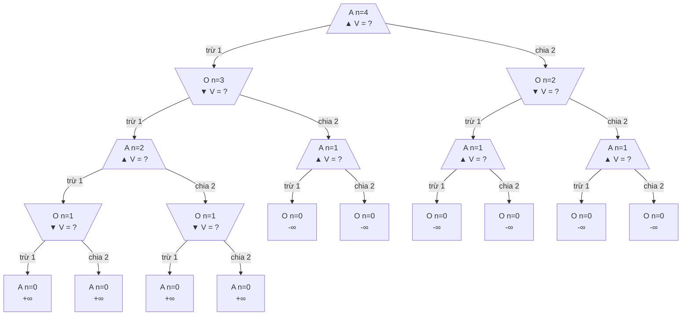

Giá trị ±∞ ở đây là đúng theo code và không gây lỗi vì Minimax chỉ so sánh. Không được dùng ±∞ này cho Expectimax (mục 4.2).

**(c) Tic-tac-toe** (bảng mô hình và số đếm **[Đã chạy]**; 5.478 khớp [Allis 1994][allis]; 255.168 khớp [Lomont 2024][lomont])

| Thành phần | Mô hình |
|---|---|
| State | Bàn 9 ô; lượt suy ra được từ số quân |
| s_start | Bàn trống, X đi |
| Player(s) | X nếu #X = #O, ngược lại O |
| Actions(s) | Các ô trống khi chưa kết thúc; không mở rộng terminal |
| Succ(s,a) | Đặt quân của Player(s) vào ô a |
| IsEnd(s) | Có 3 thẳng hàng hoặc đầy bàn |
| Utility(s) | +1 X thắng, −1 O thắng, 0 hòa |

3⁹ = 19.683 cấu hình thô; 5.478 position đạt được; 765 lớp sau khi bỏ đối xứng; 255.168 ván hoàn chỉnh gồm 131.184 X thắng, 77.904 O thắng, 46.080 hòa; giá trị khi chơi đúng là 0. Đánh số ô trong toàn bộ tài liệu:

```text
0 1 2
3 4 5
6 7 8
```

### 2.4 Câu hỏi có thể gặp

| Câu hỏi | Trả lời ngắn |
|---|---|
| Halving: state chỉ gồm `number` có đủ không? | Không. `V_minmax(+1, 4) = −∞`, `V_minmax(−1, 4) = +∞` **[Đã chạy]** |
| Tic-tac-toe có cần ghi lượt trong state không? | Không bắt buộc, suy ra được từ số quân. Chess và halving thì phải ghi **[Tự suy]** |
| Sao không đặt utility cho việc ăn quân? | Đó là tín hiệu ước lượng, không phải mục tiêu ([g1, PDF p.14](../docs/games1.pdf#page=14)); phần ước lượng thuộc nhóm 11 |
| Zero-sum có nghĩa là chỉ thắng hoặc thua? | Không. Có hòa, và có thang rộng: backgammon từ +192 đến −192 ([AIMA, bản cũ][aimaold]) |
| Slide cờ vua có sai không? | Là đơn giản hóa: (position, turn) không đủ Markov. Shannon đã thấy từ 1950 |
| Perfect information có tự bảo đảm state Markov không? | Không. Một bên là thông tin người chơi quan sát được, một bên là thông tin biểu diễn state giữ lại; state vẫn có thể bỏ sót quyền nhập thành hoặc lịch sử lặp |
| `Player(s)` khác tập `Players` thế nào? | `Player(s)` là hàm trên state; không có nó thì không xác định được miền của π_p, và nó không buộc phải luân phiên **[Tự suy]** |
| Sao chạy trên tree mà không trên graph? | Vì state space khổng lồ ([g1, PDF p.12](../docs/games1.pdf#page=12)) và state thường không "quên" được nhiều ([g1, PDF p.70](../docs/games1.pdf#page=70)). Ở game nhỏ, số state và số node khác nhau rõ rệt như bảng ở mục 2.3 |


## 3. Game evaluation: khi cả hai policy đã cố định, chỉ còn một phép đo

### 3.1 Nói gì trên lớp

> "Chưa cần thông minh. Cho biết cả hai bên sẽ làm gì, hỏi: chơi rất nhiều ván thì trung bình được bao nhiêu?"
>
> "Công thức không có max, không có min. Đầu ra là một con số về một cặp policy, không phải một policy. Đây là phép đo, chưa phải tối ưu hóa."
>
> "Nhóm 8 đã trình bày policy evaluation; đây là đúng vai trò đó: policy cố định, chỉ tính giá trị."

### 3.2 Nội dung hình thức

**Câu hỏi.** "Given two policies π_agent and π_opp, what is the (agent's) expected utility? That is, if the agent and the opponent were to play their (possibly stochastic) policies a large number of times, what would be the average utility?" ([g1, PDF p.26](../docs/games1.pdf#page=26))

**Recurrence**, kèm dòng "Analogy: recurrence for policy evaluation in MDPs" ([g1, PDF p.27](../docs/games1.pdf#page=27)):

```
V_eval(s) = Utility(s)                                        IsEnd(s)
          = Σ_{a∈Actions(s)} π_agent(s,a) V_eval(Succ(s,a))   Player(s) = agent
          = Σ_{a∈Actions(s)} π_opp(s,a)   V_eval(Succ(s,a))   Player(s) = opp
```

**Điều kiện của expectation node:** tại state chưa kết thúc, các trọng số `π_{Player(s)}(s,a)` phải không âm và có tổng bằng 1 trên `Actions(s)`, đúng định nghĩa ở mục 2.2. Vì vậy đây là kỳ vọng, tức tổ hợp lồi của các giá trị con. Điều kiện chuẩn hóa cũng là bước làm cho tổng xác suất các đường đi bằng 1 trong chứng minh path-sum bên dưới.

Ví dụ trên slide viết `π_agent(s) = A` dạng deterministic trong khi recurrence dùng `π_agent(s, a)`; hiểu là xác suất 1, đúng như nhãn cạnh (1) (0) (0) ([g1, PDF p.25](../docs/games1.pdf#page=25)). Slide p.25 vẽ gốc bằng hình tròn vì cả agent cũng theo policy cố định; tam giác chỉ xuất hiện từ Expectimax.

**Cẩn thận:** Game evaluation (`V_eval`) khác hẳn evaluation function `Eval(s)`. `V_eval` là giá trị chính xác của một cặp policy; `Eval(s)` thuộc **nhóm 11** ([g1, PDF p.75](../docs/games1.pdf#page=75)).

**Định lý path-sum** **[Tự suy]** (slide chỉ cho recurrence). Đặt ω = (s₀=s, a₀, s₁, a₁, …, s_n) là đường đi từ s tới end state, và `P(ω) = Π_{i<n} π_{Player(s_i)}(s_i, a_i)`, tích rỗng bằng 1.

*Mệnh đề:* với mọi s trong cây hữu hạn, `V_eval(s) = Σ_{ω∈Paths(s)} P(ω)·Utility(leaf(ω))`, và `Σ_ω P(ω) = 1`.

*Chứng minh, quy nạp theo chiều cao h(s):*

- **Cơ sở** (h = 0, `IsEnd(s)`): chỉ có đường rỗng, P = 1, leaf = s, nên vế phải là `Utility(s) = V_eval(s)`.
- **Bước quy nạp:** Paths(s) phân hoạch theo hành động đầu tiên. Mỗi ω viết duy nhất dạng (s,a)·ω' với ω' ∈ Paths(Succ(s,a)), và P(ω) = π(s,a)·P(ω'). Do đó
  `Σ_ω P(ω)U(leaf ω) = Σ_a π(s,a) Σ_{ω'} P(ω')U(leaf ω') = Σ_a π(s,a) V_eval(Succ(s,a)) = V_eval(s)`.
  Dấu bằng thứ hai dùng giả thiết quy nạp, dấu bằng thứ ba là recurrence. Thay U ≡ 1 cho `Σ_ω P(ω) = Σ_a π(s,a)·1 = 1`; dấu bằng cuối dùng đúng điều kiện chuẩn hóa policy. ∎

Về bản chất đây là tower property của kỳ vọng; thuật toán dùng tính phân phối để không phải nhân lại tiền tố của từng đường đi. **[Đã chạy]** ([code và output Phụ lục C](#kiem-chung-cay-ngau-nhien)) trên 1797 cây ngẫu nhiên với xác suất hữu tỉ: tổng P(path) đúng bằng 1, và đệ quy đúng bằng path-sum.

**Cặp policy sinh ra một Markov chain** **[Tự suy]**. Đặt `P(s'|s) = Σ_a π_{Player(s)}(s,a)·𝟙[Succ(s,a)=s']`, end state là trạng thái hấp thụ. Trên transient states, recurrence là `V = QV + RU`. Vì cây hữu hạn không chu trình nên Q lũy linh; nếu `Q^h = 0` thì `(I−Q)⁻¹ = I + Q + … + Q^{h−1}`. Nhân hai vế được `V = (I−Q)⁻¹RU`. Đây chỉ là path-sum viết bằng ma trận, không cần thêm giả thiết hội tụ hay nguồn ngoài để chứng minh. Với game ba hộp và `π_agent = A`, hàng xác suất hấp thụ tại gốc là `[1/2,1/2,0,0,0,0]`; giá trị bốn transient state là `[0,0,2,5]`, và `Q² = 0` **[Đã chạy trong nghiên cứu trước]**.

So với policy evaluation đã học ([CS221 policy evaluation][cs221pe]) chỉ có ba điều chỉnh **[Tự suy]**: không có reward giữa đường và γ = 1; giá trị ở end state là `Utility(s)` thay vì 0; policy có thể stochastic và luân phiên hai bên.

**Pseudocode.** Slide không có; code "semi-live" không kèm trong PDF. Đoạn dưới viết theo recurrence ([g1, PDF p.27](../docs/games1.pdf#page=27)) **[Tự suy]**, bản Python tương ứng cho 0 **[Đã chạy]**. Lưu ý bỏ nhánh xác suất 0 là tối ưu của nhóm nghiên cứu, không có trong slide.

```python
# Game evaluation (viết từ recurrence CS221 tr.27)
def Veval(s):
    if IsEnd(s): return Utility(s)
    pi = pi_agent if Player(s) == agent else pi_opp
    v = 0
    for a in Actions(s):
        if pi(s, a) > 0:              # tối ưu của tôi: bỏ nhánh xác suất 0
            v += pi(s, a) * Veval(Succ(s, a))
    return v
```

**Chi phí** **[Tự suy]** (không tài liệu nào ghi công thức riêng): cả hai đều stochastic đầy đủ thì phải duyệt cả cây. `π_agent` deterministic và bỏ nhánh xác suất 0 thì còn số node theo `O(Σ_{i=0}^d b_o^i)`, tức `O(b_o^d)` khi `b_o > 1`, với `b_o` là số hành động của opp và giả sử lấy trực tiếp hành động deterministic của agent. Nếu vẫn quét toàn bộ danh sách action để tìm xác suất khác 0, phải tính thêm chi phí quét đó. Cả hai deterministic thì chỉ một đường, `O(m)`. Đây chính là "không phụ thuộc A" của policy evaluation ([CS221 policy evaluation][cs221pe]).

### 3.3 Walkthrough 1: trò ba hộp, `π_agent(s) = A`, `π_opp(s, a) = 1/2`

Số trên slide: giá trị node 0, 2, 5, `V_eval(s_start) = 0` ([g1, PDF p.25](../docs/games1.pdf#page=25)); code cho cùng kết quả **[Đã chạy]**. Mỗi khung gồm bản ASCII dự phòng và bản Mermaid. Cả 5 khung dùng chung id node nên có thể xuất ra SVG/PNG rồi xếp thành animation.

**Frame 0: chỉ biết utility ở lá**

```text
                   () POLICY  V = ?
            /              |              \
      A (1)             B (0)             C (0)
       () ?              () ?              () ?
     /     \           /     \           /     \
    -50    50           1    3           -5    15
```

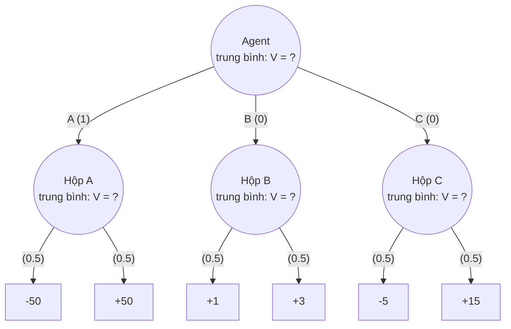

**Frame 1: hộp A: 0.5·(-50) + 0.5·(50) = 0**

```text
                   () POLICY  V = ?
            /              |              \
      A (1)             B (0)             C (0)
       () 0              () ?              () ?
     /     \           /     \           /     \
    -50    50           1    3           -5    15
```

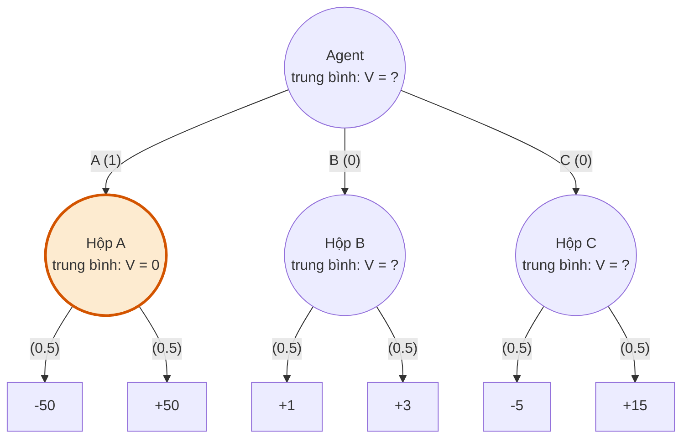

**Frame 2: hộp B: 0.5·(1) + 0.5·(3) = 2**

```text
                   () POLICY  V = ?
            /              |              \
      A (1)             B (0)             C (0)
       () 0              () 2              () ?
     /     \           /     \           /     \
    -50    50           1    3           -5    15
```

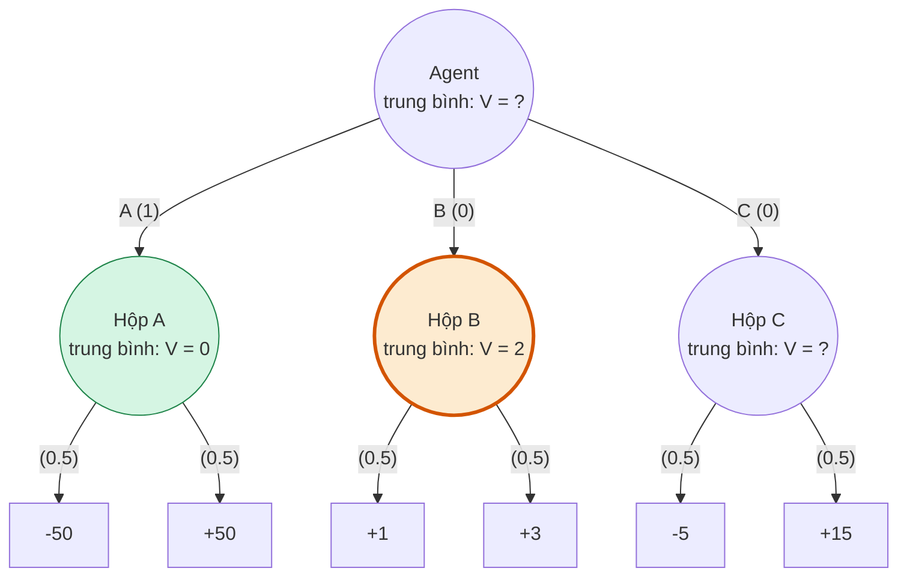

**Frame 3: hộp C: 0.5·(-5) + 0.5·(15) = 5**

```text
                   () POLICY  V = ?
            /              |              \
      A (1)             B (0)             C (0)
       () 0              () 2              () 5
     /     \           /     \           /     \
    -50    50           1    3           -5    15
```

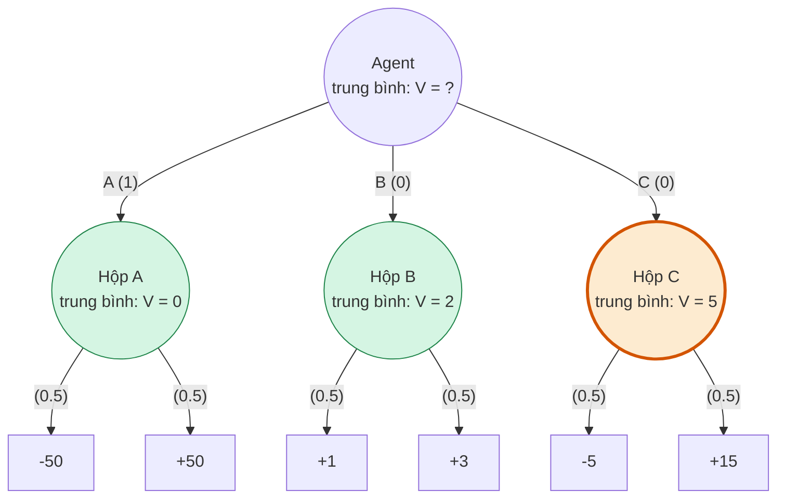

**Frame 4: gốc: 1·0 + 0·2 + 0·5 = 0**

```text
                   () POLICY  V = 0
            /              |              \
    **A (1)**           B (0)             C (0)
       () 0              () 2              () 5
     /     \           /     \           /     \
    -50    50           1    3           -5    15
```

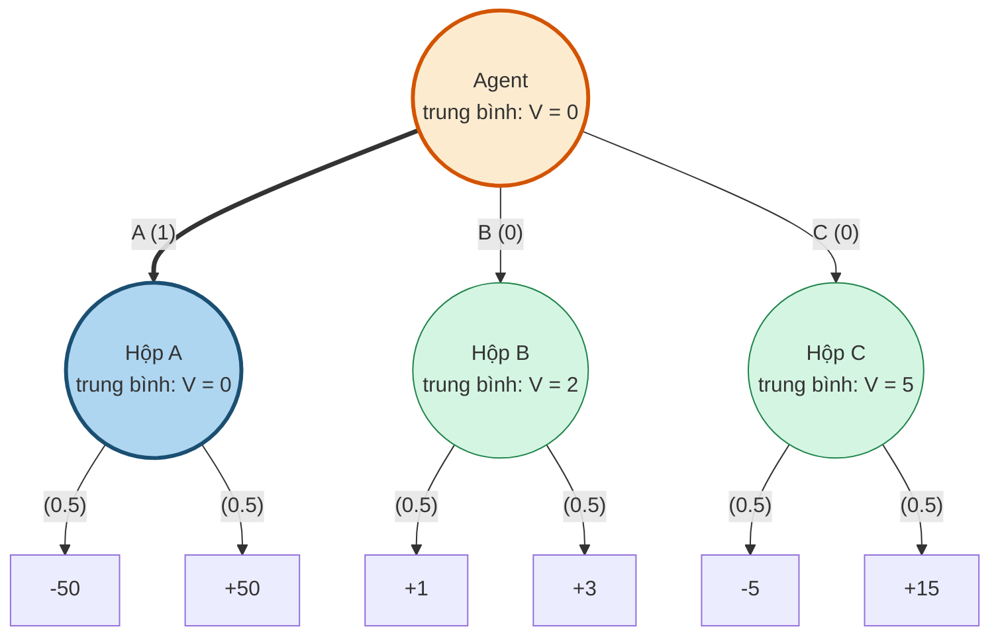

Kiểm tra bằng path-sum: `π_agent = A` cho hai đường có xác suất 1·0,5 và 1·0,5, nên V = 0,5(−50) + 0,5(50) = 0; bốn đường qua B, C có P = 0 nên không đóng góp. Nếu bỏ nhánh xác suất 0 thì chỉ thăm **4 node** (gốc, node A, hai lá), so với 10 node của Expectimax **[Đã chạy]**.

**Câu kiểm tra nhanh cho lớp:** `π_agent` chọn đều ba hộp, đối thủ chọn đều. Giá trị? Đáp án (0 + 2 + 5)/3 = **7/3** **[Đã chạy]**.

### 3.4 Câu hỏi có thể gặp

| Câu hỏi | Trả lời ngắn |
|---|---|
| Vì sao không có max? | Vì `π_agent` đã cho. Không có gì để chọn, chỉ lấy kỳ vọng |
| Mỗi trọng số nằm trong [0,1] đã đủ chưa? | Chưa. Ở mỗi state chưa kết thúc phải có tổng trọng số trên Actions(s) bằng 1; đây là điều kiện để có kỳ vọng và để chứng minh path-sum |
| Giá trị tại node giữa có nghĩa gì? | Expected utility từ node đó trở đi, nếu ván đã đi tới đó và các bên tiếp tục theo policy đã nêu |
| Đây có phải evaluation function không? | Không. Đó là giá trị chính xác cho một cặp policy; chủ đề evaluation functions thuộc nhóm 11 |
| Vì sao cần mục này khi có Expectimax? | Đây là công cụ tính mọi ô của bảng Face off: `V(π_agent, π_opp)` được tính qua game evaluation ([g1, PDF p.48](../docs/games1.pdf#page=48)) |
| Có cần chơi nhiều ván để nó có nghĩa không? | Cách giải thích "large number of times" là luật số lớn ([g1, PDF p.26](../docs/games1.pdf#page=26)). Với một ván, E[U] vẫn là tiêu chuẩn nếu agent chọn quyết định theo expected utility, chứ không phải theo một mục tiêu rủi ro khác (mục 4.2) **[Tự suy]** |
| Thay đổi một xác suất thì sao? | V_eval đổi affine theo một phân phối cục bộ khi giữ mọi phân phối khác cố định; nếu cùng một tham số dùng ở nhiều node thì có thể thành đa thức bậc cao **[Tự suy]** |


## 4. Expectimax: best response trước đối thủ đã biết và phép rút gọn MDP

### 4.1 Nói gì trên lớp

> "Vẫn biết đối thủ tung đồng xu. Nhưng giờ mình được tự chọn hộp. Chỉ đổi đúng một chỗ: tổng theo `π_agent` thành `max`."
>
> "Giá trị 5 không có nghĩa là bạn sẽ được 5 điểm. Kết quả thật là −5 hoặc 15. 5 là kỳ vọng."
>
> "Expectimax không giả định đối thủ ngẫu nhiên. Nó giả định đối thủ theo một phân phối đã biết, và phân phối đó có thể rất đối kháng."

### 4.2 Nội dung hình thức

**Recurrence**, kèm dòng "Analogy: recurrence for value iteration in MDPs" ([g1, PDF p.33](../docs/games1.pdf#page=33)):

```
V_exptmax(s) = Utility(s)                                          IsEnd(s)
             = max_{a∈Actions(s)} V_exptmax(Succ(s,a))             Player(s) = agent
             = Σ_{a∈Actions(s)} π_opp(s,a) V_exptmax(Succ(s,a))    Player(s) = opp
```

**Nhắc điều kiện xác suất:** ở node opp chưa kết thúc, `π_opp(s,a) ≥ 0` và `Σ_{a∈Actions(s)} π_opp(s,a) = 1`. Vì vậy dòng cuối là kỳ vọng theo policy đã biết, không phải một tổng trọng số tùy ý. Khi so sánh với policy stochastic của agent trong chứng minh tối ưu, ta cũng dùng đúng hai điều kiện này để có “tổ hợp lồi không vượt quá max”.

"This computation produces the expectimax value V_exptmax(s) for a state s, which is the maximum expected utility of any agent policy when playing with respect to a fixed and known opponent policy π_opp." ([g1, PDF p.32](../docs/games1.pdf#page=32)). Slide viết `π_exptmax(7)` cho best policy trước `π_7`; `V_exptmax` phụ thuộc `π_opp` một cách ngầm định ([g1, PDF p.47–48](../docs/games1.pdf#page=47)).

**Trích policy** **[Tự suy]** (công thức không có nguyên văn cho Expectimax, là bản sao trực tiếp của ([g1, PDF p.43](../docs/games1.pdf#page=43))). Với `Player(s) = agent`: `π_exptmax(7)(s) ∈ arg max_{a∈Actions(s)} V_exptmax(Succ(s,a))`. Hòa thì chọn tùy ý. Không trích policy ở node opp vì `π_opp` là dữ kiện đầu vào.

**Định lý tối ưu** **[Tự suy]** (tài liệu khóa học không có chứng minh viết sẵn). Cố định `π_opp`. Gọi `V^π(s)` là `V_eval(s)` dưới (π, π_opp). Với mọi s và mọi π_agent, kể cả stochastic: (i) `V^π(s) ≤ V_exptmax(s)`; (ii) đẳng thức xảy ra với π = π_exptmax(7).

*Quy nạp theo chiều cao:*

- **End state:** cả hai đều bằng `Utility(s)`.
- **Node opp:** `V^π(s) = Σ π_opp(s,a) V^π(Succ(s,a)) ≤ Σ π_opp(s,a) V_exptmax(Succ(s,a)) = V_exptmax(s)`. Bất đẳng thức giữ nguyên vì trọng số không âm. Với π_exptmax(7), giả thiết quy nạp cho đẳng thức.
- **Node agent:** `V^π(s) = Σ π(s,a) V^π(Succ(s,a)) ≤ Σ π(s,a) V_exptmax(Succ(s,a)) ≤ max_a V_exptmax(Succ(s,a)) = V_exptmax(s)`. Bất đẳng thức thứ hai đúng vì **tổ hợp lồi không vượt quá max**. Với a* trong arg max, cả hai đều thành đẳng thức. ∎

*Hệ quả cần nói:* tồn tại một policy deterministic tối ưu **đồng thời tại mọi node**; policy này có thể không duy nhất khi các action hòa giá trị; ngẫu nhiên hóa không giúp gì vì tổ hợp lồi ≤ max. **[Đã chạy]** ([code và output Phụ lục C](#kiem-chung-cay-ngau-nhien)) trên 1749 cây ngẫu nhiên: duyệt hết tổng cộng 515.800 policy deterministic, max của chúng đúng bằng `V_exptmax` trên mọi cây; thêm 5 policy stochastic mỗi cây, không policy nào vượt.

**"Fixed" nghĩa chính xác là gì** **[Tự suy]**: `π_opp` là hàm của state, không đổi theo `π_agent`. Vì thế định lý nói về best response, không phải cân bằng: khi đã biết agent chọn C, một đối thủ thích nghi có thể đổi sang −5 ([g1, PDF p.55](../docs/games1.pdf#page=55)).

#### MDP reduction: cố định `π_opp` đã biết trên state đủ thông tin

CS221 nêu chiều ngược lại: MDP là game giữa agent và nature ([g1, PDF p.22](../docs/games1.pdf#page=22)). Bảng rút gọn dưới đây là của nhóm nghiên cứu **[Tự suy]**, không nguồn nào viết tường minh. Xét cây game hữu hạn, state đủ thông tin và policy đối thủ cố định, đã biết, thỏa điều kiện chuẩn hóa. Định nghĩa toán tử "nhảy tới node kế tiếp của agent hoặc end": `D_u` là phân phối trên {agent states} ∪ {end states}, với `D_u = δ_u` nếu u là end hoặc `Player(u) = agent`, và `D_u = Σ_{a'} π_opp(u,a')·D_{Succ(u,a')}` nếu `Player(u) = opp`.

| Thành phần MDP | Định nghĩa từ game |
|---|---|
| States S | {s : chưa kết thúc, Player(s) = agent} ∪ {end states}; state phải chứa đủ thông tin cần thiết |
| Start | s_start nếu chưa kết thúc và agent có lượt; nếu opp đi trước, dùng dạng không gộp bên dưới để giữ reward khi kết thúc ở lượt đầu |
| Actions(s) | Actions(s) của game, tại các nút agent |
| T(s,a,s') | D_{Succ(s,a)}(s'). Khi luân phiên chặt và Succ(s,a) chưa kết thúc: T(s,a,s') = Σ_{a': Succ(Succ(s,a),a')=s'} π_opp(Succ(s,a),a'). Nếu u = Succ(s,a) đã là end: T(s,a,s') = 𝟙[s' = u] |
| Reward R(s,a,s') | Utility(s') nếu IsEnd(s'), ngược lại 0; trả utility một lần khi đi vào terminal, rồi dừng |
| γ | 1 |
| Terminal | V*_MDP(z) = 0 nếu IsEnd(z); đây là giá trị tiếp diễn sau khi utility đã trả qua reward của bước vào z |

*Dạng không gộp, đơn giản hơn:* giữ node opp làm state với một hành động giả `pass`, `T(u, pass, v) = Σ_{a': Succ(u,a')=v} π_opp(u,a')`; phải cộng xác suất nếu nhiều action dẫn tới cùng successor. Reward vẫn là utility khi bước vào end state và 0 ở các bước còn lại.

**Hàm trung gian nối hai quy ước ở terminal. [Tự suy]** Trong Game, `V_exptmax(z) = Utility(z)` tại terminal. Trong MDP đã chuyển đổi, `V*_MDP(z) = 0` vì utility được trả qua reward khi đi vào z; tại z không còn reward tương lai. Trên tập state của MDP rút gọn (các state agent chưa kết thúc và các terminal), đặt:

$$
\widetilde V(z)=
\begin{cases}
\operatorname{Utility}(z), & \operatorname{IsEnd}(z),\\[2mm]
V^*_{\mathrm{MDP}}(z), & \text{nếu z chưa kết thúc}.
\end{cases}
$$

Với mọi chuyển tiếp từ state MDP chưa kết thúc, định nghĩa reward trong bảng cho đúng đẳng thức:

$$
R(s,a,s')+V^*_{\mathrm{MDP}}(s')=\widetilde V(s').
$$

Nếu s' là terminal, vế trái là `Utility(s') + 0`; nếu s' chưa kết thúc, vế trái là `0 + V*_MDP(s')`. Vì γ = 1, Bellman optimality viết gọn thành:

$$
\boxed{
\begin{aligned}
Q^*(s,a)&=\sum_{s'}T(s,a,s')\widetilde V(s'),\\[2mm]
V^*_{\mathrm{MDP}}(s)&=\max_{a\in\operatorname{Actions}(s)}Q^*(s,a).
\end{aligned}
}
$$

**Chứng minh tương đương bằng quy nạp từ terminal. [Tự suy]** Xét trường hợp hai bên luân phiên chặt. Tại terminal z, theo định nghĩa `Ṽ(z) = Utility(z) = V_exptmax(z)`. Giả sử `Ṽ(s') = V_exptmax(s')` đã đúng ở các state rút gọn phía dưới state agent s đang xét. Với hành động a, đặt `u = Succ(s,a)`.

Nếu u chưa kết thúc thì đến lượt đối thủ; nhóm những hành động a' cùng dẫn tới một successor s' được:

$$
\begin{aligned}
V_{\mathrm{exptmax}}(u)
&=\sum_{a'\in\operatorname{Actions}(u)}
  \pi_{\mathrm{opp}}(u,a')\,
  V_{\mathrm{exptmax}}(\operatorname{Succ}(u,a'))\\
&=\sum_{s'}T(s,a,s')V_{\mathrm{exptmax}}(s')\\
&=\sum_{s'}T(s,a,s')\widetilde V(s')
 =Q^*(s,a).
\end{aligned}
$$

Dấu bằng thứ ba dùng giả thiết quy nạp. Nếu a kết thúc ván ngay tại u, thì `T(s,a,·)` là phân phối tập trung ở u, nên `Q*(s,a) = Ṽ(u) = Utility(u) = V_exptmax(u)`; không cần gọi policy đối thủ tại terminal. Vì vậy, ở mọi state agent **chưa kết thúc**:

$$
\begin{aligned}
V_{\mathrm{exptmax}}(s)
&=\max_{a\in\operatorname{Actions}(s)}
  V_{\mathrm{exptmax}}(\operatorname{Succ}(s,a))
\\
&=\max_{a\in\operatorname{Actions}(s)}Q^*(s,a)
=V^*_{\mathrm{MDP}}(s)
=\widetilde V(s).
\end{aligned}
$$

Cây hữu hạn nên quy nạp khép lại. **Kết luận:** `V*_MDP(s) = V_exptmax(s)` ở các state agent chưa kết thúc; `Ṽ(z) = V_exptmax(z)` trên toàn bộ tập state rút gọn, kể cả terminal. Không đồng nhất `V*_MDP(z) = 0` với `V_exptmax(z) = Utility(z)` tại terminal: khác biệt đó đã được bù đúng một lần bằng reward khi đi vào z. Đẳng thức `V_exptmax(u) = Q*(s,a)` cũng chỉ là đẳng thức **về giá trị**, không đồng nhất state u với cặp (s,a). Đây là Bellman optimality sau phép chuyển đổi ([CS188 Sp26 lec09 p.30][cs188l9]). Tương tự, cố định thêm `π_agent` và thay max bằng tổng theo policy đó thì `V_eval` tương ứng Bellman expectation. ∎

**Liên tưởng trực quan sau khi cố định policy:** trong trường hợp hai bên lần lượt hành động, ta có thể xem tầng đối thủ tương tự một tầng chuyển trạng thái xác suất trong MDP từ góc nhìn agent. **Q-state** của MDP là cặp `(s,a)`, còn node đối thủ là state `u = Succ(s,a)` nơi đối phương có lượt; hai khái niệm có thể đóng vai trò tương ứng trong phép tính giá trị nhưng không đồng nhất theo định nghĩa ([CS188 Sp26 lec09, PDF p.17][cs188l9]).

**Giới hạn khi đối chiếu Minimax. [Tự suy]** Phép rút gọn trên dùng một `π_opp` cố định, đã biết để xây dựng `T`. Trong Minimax, policy worst-case không được cấp như dữ kiện đó; nói chung lựa chọn tại node min phải được xác định từ giá trị các con. Vì vậy, không thay trực tiếp node min bằng kỳ vọng theo một `T` cố định được cho trước giống cách làm với Expectimax. Phát biểu này giới hạn **phép rút gọn đang dùng**, không phải một khẳng định rằng mọi cách biểu diễn Minimax liên quan đến MDP đều bất khả thi. Nếu đã cố định một policy đối thủ cụ thể, kể cả `π_min` đã xác định, ta vẫn có thể thực hiện reduction cho bài toán best response trước policy ấy.

*Điều kiện của phép rút gọn* **[Tự suy]**: trong mô hình này, γ = 1 dùng được vì cây game hữu hạn ([định lý hội tụ cho phép đồ thị acyclic][cs221vi]); `π_opp` phải là hàm của s, nếu opp phụ thuộc lịch sử hoặc học dần thì state phải chứa thông tin đó; để có T phải tính được `π_opp`, có khi rất đắt ([lec08 p.14][cs188l8]). Nếu state đầu đã là terminal, Game trả `Utility(s_start)` ngay và không cần bài toán chọn policy trong MDP.

**Một câu nối với MDP đã học:** Expectimax và Bellman optimality mô tả cùng giá trị sau phép rút gọn trên; ở đây ta tính bằng đệ quy cây từ state đang xét. Phép lặp bảng và chứng minh hội tụ của value iteration thuộc **nhóm 9**, không trình bày lại.

#### CS221 và CS188 gọi cùng một phép toán khác nhau

| Khía cạnh | CS221 | CS188 |
|---|---|---|
| Tên node | Node opp trung bình theo `π_opp` | Chance node |
| Nguồn xác suất | `π_opp` stochastic; ngẫu nhiên tự nhiên được tách thành player `coin` (nhóm 11) | Đối thủ **hoặc** môi trường ([N7, PDF p.1](../docs/cs188-fa23-note07.pdf#page=1)) |
| Công thức | `Σ_a π_opp(s,a) V(Succ(s,a))` ([g1, PDF p.33](../docs/games1.pdf#page=33)) | `Σ_{s'} p(s'∣s) V(s')` ([N7, PDF p.1](../docs/cs188-fa23-note07.pdf#page=1)) |
| Thứ tự bài | Từ Game evaluation đi lên; tương tự value iteration | "Generalization of minimax" ([N7, PDF p.1](../docs/cs188-fa23-note07.pdf#page=1)) |

Hai công thức bằng nhau khi đặt `p(s'∣s) = Σ_{a: Succ(s,a)=s'} π_opp(s,a)` **[Tự suy]**. Xác suất có thể là đối thủ thật sự tung đồng xu, niềm tin về một đối thủ deterministic, hoặc thiên nhiên: niềm tin xác suất về hành động không đòi đối thủ thật sự tung đồng xu ([N7, PDF p.1](../docs/cs188-fa23-note07.pdf#page=1)).

Hai bẫy khi trả lời **[Tự suy]**:

- **"Minimax là trường hợp đặc biệt của Expectimax"** ([N7, PDF p.1](../docs/cs188-fa23-note07.pdf#page=1)) là liên hệ hình thức: đặt xác suất 1 vào một con đạt min thì phép lấy kỳ vọng cho cùng giá trị min. Trong bài toán Minimax, policy chọn con đó không mặc nhiên là dữ kiện đã biết; nó phải phù hợp với giá trị các con. Câu "No analogy in MDPs" của CS221 ([g1, PDF p.41](../docs/games1.pdf#page=41)) được hiểu ở phạm vi phép thay lượt đối thủ bằng `T` đã cho trước, không phải một định lý cấm mọi biểu diễn MDP. Khi trình bày nên nói "cùng khung đệ quy, khác toán tử tại node đối thủ".
- **Dùng chance node cho niềm tin:** recurrence cần phân phối điều kiện đúng theo state đủ thông tin, không đòi độc lập vô điều kiện giữa các lượt. Nếu đối thủ có một "kiểu" cố định chưa biết, quan sát trước làm đổi niềm tin ở lượt sau; state phải chứa history/belief cần thiết, thay vì cứ dùng lại xác suất ban đầu.

Khác Expectiminimax, đúng một dòng: Expectimax chỉ có node max và node trung bình; Expectiminimax giữ cả max, min và node chance riêng, **thuộc nhóm 11** ([g1, PDF p.63](../docs/games1.pdf#page=63)).

#### Pseudocode, thứ tự duyệt và chi phí

Bản CS188, đọc từ ảnh ([N7, PDF p.2](../docs/cs188-fa23-note07.pdf#page=2)):

```
def value(state):
    if the state is a terminal state: return the state's utility
    if the agent is MAX: return max-value(state)
    if the agent is EXP: return exp-value(state)

def max-value(state):                 def exp-value(state):
    initialize v = -∞                     initialize v = 0
    for each successor of state:          for each successor of state:
        v = max(v, value(successor))          p = probability(successor)
    return v                                  v += p * value(successor)
                                          return v
```

Bản viết theo recurrence CS221 **[Tự suy]**, **[Đã chạy]** cho (5, C). Gọi `pi_exptmax` như dưới sẽ tính lại cây con mỗi khi đến lượt; thực tế nên để hàm ở gốc trả về cả value lẫn action.

```python
# Expectimax (viết từ recurrence CS221 tr.33)
def Vexptmax(s):
    if IsEnd(s): return Utility(s)
    if Player(s) == agent:
        return max(Vexptmax(Succ(s, a)) for a in Actions(s))
    return sum(pi_opp(s, a) * Vexptmax(Succ(s, a)) for a in Actions(s))

def pi_exptmax(s):                    # chỉ gọi khi Player(s) == agent
    return argmax(Actions(s), key=lambda a: Vexptmax(Succ(s, a)))
```

**Chi phí** **[Tự suy]**: không nguồn nào ghi công thức riêng cho Expectimax; cùng phép duyệt post-order DFS nên thời gian Θ(số node), tới `O(b^m) = O(b^{2d})`. Với các nhánh có xác suất dương, phép tính chính xác theo recurrence cần giá trị của từng con. Chủ đề pruning thuộc **nhóm 11** ([N7, PDF p.3](../docs/cs188-fa23-note07.pdf#page=3)). Với `b_a` hành động agent, `b_o` hành động opp, d cặp lượt: số lá = (b_a·b_o)^d; trò ba hộp 3·2 = 6 lá, tổng 1 + 3 + 6 = 10 node.

#### Vì sao được lấy trung bình: cardinal utility

Đây là một lựa chọn mô hình cần nói rõ: ta tối đa **expected utility**, không mặc nhiên tối đa tiền hoặc điểm thô. Mỗi cặp policy tạo một lottery trên các end state (định lý path-sum, mục 3.2). Nếu số đã cho thật sự là utility để so sánh các lottery bằng kỳ vọng, Expectimax chọn lottery được ưa thích nhất. Cách diễn giải qua nhiều ván của ([g1, PDF p.26](../docs/games1.pdf#page=26)) giúp nhìn thấy trung bình; đối với một ván, cần chấp nhận expected utility là tiêu chuẩn quyết định. Đây là nền tảng cardinal utility được CS188 nhắc ở [lec08, PDF p.23–24][cs188l8]; báo cáo không dạy lại hệ tiên đề.

**Biến đổi utility** **[Tự suy]**: `U' = aU + b` (a > 0) thì `V' = aV + b` và arg max không đổi. Với f đơn điệu tăng chặt, Minimax có `f(max xᵢ) = max f(xᵢ)` nên quyết định không đổi; Expectimax thì nói chung `f(Σ pᵢxᵢ) ≠ Σ pᵢf(xᵢ)`, nên quy nạp gãy ngay tại node trung bình. Đó là khác biệt giữa ordinal utility (thứ tự) và cardinal utility (độ lớn để lấy kỳ vọng). Ví dụ kiểm tra tay **[Tự suy, cùng cấu trúc hình ở lec08 p.24]**: hai lottery xác suất 1/2 là {0,40} và {20,30}, có kỳ vọng 20 và 25 nên chọn phải; đổi utility thành x² trên miền không âm cho 800 và 650 nên chọn trái.

Trên trò ba hộp, `π_opp = 1/2`, thứ tự lá luôn là −50 < −5 < 1 < 3 < 15 < 50 **[Đã chạy]**:

| f(U) | Lá A (−50, 50) | Lá B (1, 3) | Lá C (−5, 15) | E[A] | E[B] | E[C] | Expectimax | Minimax |
|---|---|---|---|---|---|---|---|---|
| U | −50, 50 | 1, 3 | −5, 15 | 0 | 2 | **5** | C | B |
| 2U+7 (affine) | −93, 107 | 9, 13 | −3, 37 | 7 | 11 | **17** | C | B |
| (U+50)² | 0, 10000 | 2601, 2809 | 2025, 4225 | **5000** | 2705 | 3125 | **A** | B |
| sign(U)·\|U\|^{1/3} | −3.684, 3.684 | 1, 1.442 | −1.710, 2.466 | 0 | **1.221** | 0.378 | **B** | B |
| −exp(−U/5) | −22026, −4.5·10⁻⁵ | −0.819, −0.549 | −2.718, −0.050 | ≈ −11013 | **−0.684** | −1.384 | **B** | B |

Cùng game, cùng thứ tự, cùng mô hình đối thủ, Expectimax đổi sang A, B hay giữ C tùy hình dạng f, còn cột Minimax không đổi. −exp(−U/5) là hàm lõm, tức agent sợ rủi ro, nên chọn B.

**Cảnh báo ±∞.** CS221 đặt utility của chess là +∞/0/−∞ ([g1, PDF p.15](../docs/games1.pdf#page=15)) và code halving nhân với ∞ ([game.py][gamepy]). Với Minimax không sao vì chỉ cần thứ tự. Với Expectimax và Game evaluation, kỳ vọng có thể là ∞−∞: 0,5·(+∞) + 0,5·(−∞) cho `nan` trong Python **[Đã chạy]**, và nếu chỉ có +∞ cùng các kết cục hữu hạn thì mọi xác suất thắng dương đều cho +∞, làm mất phân biệt độ lớn xác suất thắng. Trong seminar, mọi ví dụ cần lấy trung bình đều dùng số hữu hạn như +1/0/−1. Về toán học, kỳ vọng mở rộng đôi khi tồn tại, nhưng không được dùng biểu thức có cả phần dương và âm vô hạn như một giá trị hữu hạn để so sánh.

#### Mô hình sai thì sao: ngưỡng lật quyết định và regret

Đặt p = xác suất đối thủ chọn số nhỏ hơn, cùng p cho mọi hộp (giả định đơn giản hóa). Ngưỡng là của nhóm nghiên cứu, không có trên slide; slide chỉ nêu ba trường hợp p = 0, 1/2, 1 ([g1, PDF p.6](../docs/games1.pdf#page=6)) **[Tự suy]**, **[Đã chạy]**:

```text
V_A(p) = −50p + 50(1−p) = 50 − 100p
V_B(p) =   1p +  3(1−p) =  3 −   2p
V_C(p) =  −5p + 15(1−p) = 15 −  20p

A = C:  50 − 100p = 15 − 20p  ⇔  35 = 80p  ⇔  p = 7/16 = 0.4375   (giá trị chung 6.25)
C = B:  15 −  20p =  3 −  2p  ⇔  12 = 18p  ⇔  p = 2/3             (giá trị chung 5/3)
A = B:  50 − 100p =  3 −  2p  ⇔  47 = 98p  ⇔  p = 47/98 ≈ 0.4796 (không phải biên: tại đây C cao hơn)
```

| p | V_A | V_B | V_C | Tốt nhất |
|---|---|---|---|---|
| 0 (cùng phe) | 50 | 3 | 15 | A |
| 1/4 | 25 | 2.5 | 10 | A |
| 7/16 | 6.25 | 2.125 | 6.25 | A = C |
| 1/2 (uniform, slide) | 0 | 2 | 5 | **C** |
| 3/5 | −10 | 1.8 | 3 | C |
| 2/3 | −16.67 | 1.667 | 1.667 | C = B |
| 3/4 | −25 | 1.5 | 0 | B |
| 1 (đối thủ min) | −50 | 1 | −5 | **B** (khớp minimax) |

**p < 7/16 chọn A, 7/16 < p < 2/3 chọn C, p > 2/3 chọn B.** Quanh p = 1/2: `V_C − V_A = 5` với độ dốc 80 nên chỉ cần lệch 1/16; `V_C − V_B = 3` với độ dốc 18 nên cần lệch 1/6. Khoảng cách tới biên bằng chênh lệch giá trị chia độ dốc, và độ dốc đến từ **độ trải** của lá.

Mô hình trộn: đối thủ chơi `π_min` với xác suất ε, chơi đều với xác suất 1−ε, tức p = 1/2 + ε/2. Vẫn là Expectimax với một `π_opp` đã biết **[Đã chạy]**:

| ε | A | B | C | Tốt nhất |
|---:|---:|---:|---:|---|
| 0 | 0 | 2 | 5 | C |
| 1/5 | -10 | 9/5 | 3 | C |
| 1/3 | -50/3 | 5/3 | 5/3 | B và C hòa |
| 1/2 | -25 | 3/2 | 0 | B |
| 1 | -50 | 1 | -5 | B |

Câu trả lời cho "thực tế dùng cái nào": chỉ cần tin đối thủ có ác ý trên một phần ba số lần thì B đã tốt hơn C. Quiz CS188 có đối thủ 80% đối kháng, 20% ngẫu nhiên, đáp án "Expectimax!" ([lec08 p.14][cs188l8]); áp vào trò ba hộp, p = 0,9 cho A = −40, B = 6/5, C = −3, nên chọn B. Đây là áp dụng số của nhóm nghiên cứu, không phải cách slide dùng số đó.

Quyết định đổi đột ngột nhưng giá trị liên tục theo p, nên đứng gần ngưỡng thì lật sai gần như không mất gì; thiệt hại lớn đến khi mô hình sai **rất xa**. Regret = giá trị tốt nhất − giá trị lựa chọn, là phần mở rộng ngoài bài giảng **[Đã chạy]**:

| Chọn | Thực tế p=0 | p=1/2 | p=1 | Regret lớn nhất trên [0,1] |
|---|---|---|---|---|
| A | 0 | 5 | **51** | 51 |
| B | 47 | 3 | 0 | 47 |
| C | 35 | 0 | 6 | 35 |

**Bảng Pacman, và vị trí thật của nó.** Bảng này **không nằm trong `cs188-sp26-lec07.pdf` cục bộ**, file đó không dạy Expectimax và kết thúc bằng "Next Time: Uncertainty!» ([L7, PDF p.38](../docs/cs188-sp26-lec07.pdf#page=38)); ([L7, PDF p.19](../docs/cs188-sp26-lec07.pdf#page=19)) chỉ ghi nhãn demo. Bảng nằm ở [CS188 Sp26 lec08 p.17][cs188l8], nhưng khi render bằng poppler các ô bị trống; muốn có ảnh hiện số thì dùng [CS188 Fa23 lec07 p.25][cs188fa23l7]. Số liệu nguyên văn, "Results from playing 5 games":

  | | Adversarial Ghost | Random Ghost |
  |---|---|---|
  | **Minimax Pacman** | Won 5/5, Avg. Score: 483 | Won 5/5, Avg. Score: 493 |
  | **Expectimax Pacman** | Won 1/5, Avg. Score: −303 | Won 5/5, Avg. Score: 503 |

Giới hạn áp dụng: kết quả có cấu hình tìm kiếm/ước lượng riêng của demo (Pacman depth 4, ghost depth 2; [lec08, PDF p.17][cs188l8]); các cơ chế này thuộc **nhóm 11**. Tiêu đề liên quan: **Dangerous Optimism** là "Assuming chance when the world is adversarial", **Dangerous Pessimism** là "Assuming the worst case when it's not likely" ([lec08 p.16][cs188l8]). Đây là **demo 5 ván, không phải thực nghiệm thống kê**: không có độ lệch chuẩn, không có seed, một bản đồ. Chỉ phù hợp định tính với các property của CS221; 503 so với 493 không đủ để kết luận gì. Cùng mẫu 2×2 **[Tự suy]**: bi quan khi đối thủ ngẫu nhiên mất ít (2 so với 5; 493 so với 503), lạc quan khi đối thủ đối kháng mất nhiều (−5; −303).

**Mô hình đối thủ đến từ đâu** (mở rộng tùy chọn, không dạy kỹ thuật học). Có thể lấy từ quan sát, dữ liệu người chơi hoặc mô phỏng. Ví dụ nghiên cứu Maia dự đoán nước đi người chơi đạt hơn 52%, so với Stockfish 33–41% và Leela tối đa 46% trong thiết lập của bài ([McIlroy-Young et al. 2020, PDF p.5–6][maia]). Dùng một mô hình như vậy làm `π_opp(s,a)` cho Expectimax là **đề xuất của nhóm nghiên cứu**, chưa phải kết quả đã được bài Maia kiểm nghiệm; báo cáo không đưa thêm phương pháp học ngoài phạm vi.

### 4.3 Walkthrough 2: trò ba hộp, `π_opp(s, a) = 1/2`

Số trên slide: node 0, 2, 5, `V_exptmax(s_start) = 5`, chọn nhánh phải ([g1, PDF p.31](../docs/games1.pdf#page=31)). Bốn khung đầu trùng phép tính với Game evaluation, chỉ khung cuối khác, nên có thể dùng chung animation.

**Frame 0: chỉ biết utility ở lá**

```text
                    /\ MAX  V = ?
            /              |              \
        A                 B                 C
       () ?              () ?              () ?
     /     \           /     \           /     \
    -50    50           1    3           -5    15
```

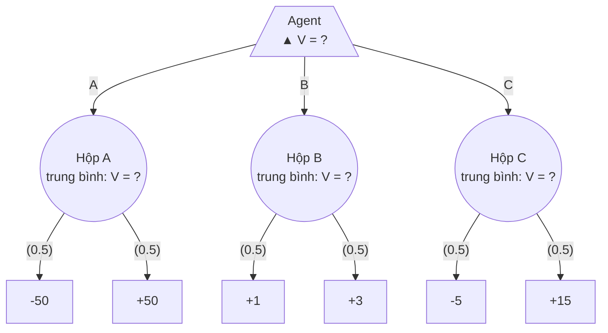

**Frame 1: hộp A: 0.5·(-50) + 0.5·(50) = 0**

```text
                    /\ MAX  V = ?
            /              |              \
        A                 B                 C
       () 0              () ?              () ?
     /     \           /     \           /     \
    -50    50           1    3           -5    15
```

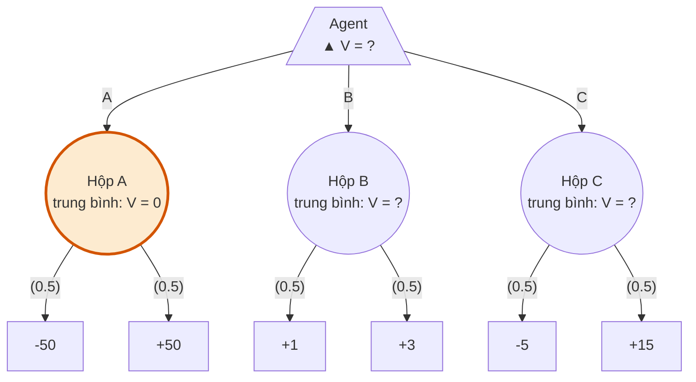

**Frame 2: hộp B: 0.5·(1) + 0.5·(3) = 2**

```text
                    /\ MAX  V = ?
            /              |              \
        A                 B                 C
       () 0              () 2              () ?
     /     \           /     \           /     \
    -50    50           1    3           -5    15
```

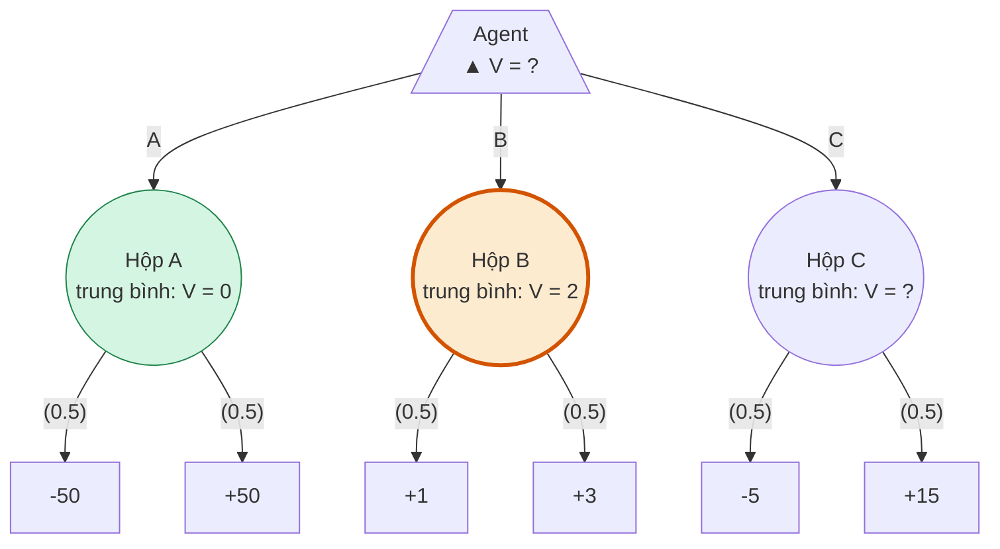

**Frame 3: hộp C: 0.5·(-5) + 0.5·(15) = 5**

```text
                    /\ MAX  V = ?
            /              |              \
        A                 B                 C
       () 0              () 2              () 5
     /     \           /     \           /     \
    -50    50           1    3           -5    15
```

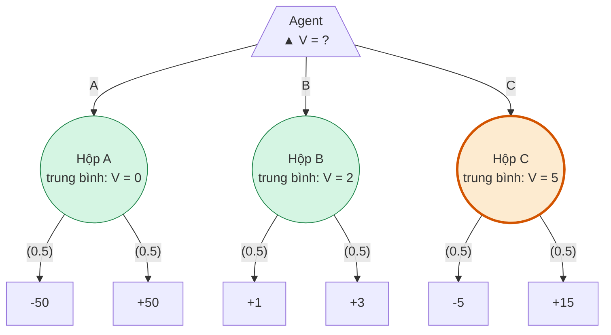

**Frame 4: gốc: max(0, 2, 5) = 5 → chọn C**

```text
                    /\ MAX  V = 5
            /              |              \
        A                 B               **C**
       () 0              () 2              () 5
     /     \           /     \           /     \
    -50    50           1    3           -5    15
```

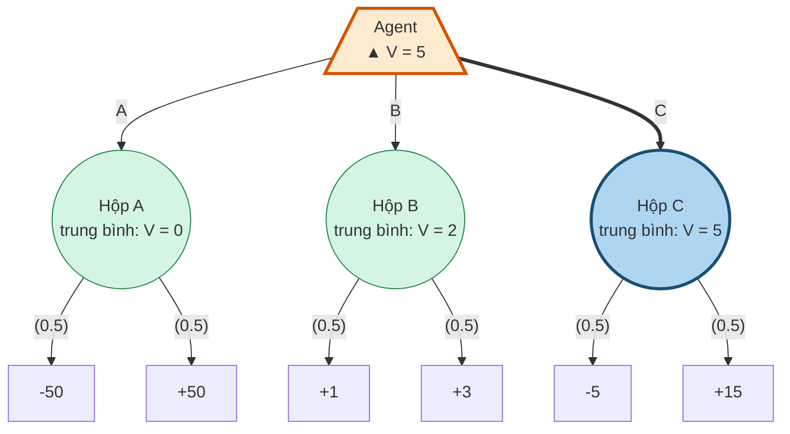

Thứ tự DFS thật **[Đã chạy]**: node cha chỉ biết giá trị con sau khi con trả về; stack chỉ giữ đường từ gốc tới node hiện tại.

```
gọi gốc (max), v = −∞
  gọi nút A (exp), v = 0
    lá −50  → v = −25
    lá  50  → v = 0   → trả 0     gốc: best = 0  (A)
  gọi nút B
    lá   1  → v = 0.5
    lá   3  → v = 2   → trả 2     gốc: best = 2  (B)
  gọi nút C
    lá  −5  → v = −2.5
    lá  15  → v = 5   → trả 5     gốc: best = 5  (C)
trả (5, C). Tổng cộng 10 nút được thăm; stack sâu tối đa 3 frame.
```

**Câu kiểm tra nhanh:** đối thủ chọn số bên trái với xác suất 0,9. Chọn hộp nào? A = −40, B = 6/5, C = −3, chọn B **[Đã chạy]**. **Bài tập số khác** ([N7, PDF p.2](../docs/cs188-fa23-note07.pdf#page=2)): cây {3,12,9}, {2,4,6}, {15,6,0}, xác suất 1/3 mỗi con, cho 8, 4, 7; gốc = 8.

Thế cờ P ở mục 5.7 là phiên bản lớn của walkthrough này.

### 4.4 Câu hỏi có thể gặp

| Câu hỏi | Trả lời ngắn |
|---|---|
| Expectimax giả định đối thủ ngẫu nhiên? | Sai. Giả định phân phối **đã biết**; có thể rất đối kháng, ví dụ p = 0,9 chọn số nhỏ |
| `V_exptmax = 5` là được 5 điểm? | Không. Kết quả thật là −5 hoặc 15; 5 là kỳ vọng |
| Expectimax chính là value iteration? | Cùng phương trình, khác cách giải. Slide viết "recurrence for value iteration" ([g1, PDF p.33](../docs/games1.pdf#page=33)), còn phép lặp và bảng thì khác |
| Vì sao γ = 1 mà không vấn đề gì? | Cây hữu hạn, mọi đường đều kết thúc ([CS221 VI p.15-16][cs221vi]) |
| Game cho utility ở terminal, sao MDP lại cho giá trị 0? | MDP đã trả utility qua reward khi đi vào terminal, nên phần tiếp diễn bằng 0. Hàm trung gian Ṽ giữ utility ở terminal để nối hai quy ước mà không cộng utility hai lần |
| Vì sao phép MDP reduction trên không thay trực tiếp được node min? | Expectimax có `π_opp` đã biết để xây dựng `T`; Minimax chưa được cấp policy worst-case ấy. Đây là giới hạn của phép rút gọn với `T` cho trước, không phải cấm mọi biểu diễn MDP **[Tự suy]** |
| Node đối thủ có phải Q-state không? | Không đồng nhất. Q-state là cặp (s,a); node đối thủ là state u. Sau khi cố định policy, tầng đối thủ có thể đóng vai trò tương tự bước chuyển xác suất của MDP |
| Vì sao `V_exptmax(s) ≥ V_minmax(s)`? | `V_minmax = V(π_max, π_min) ≤ V(π_max, π_opp) ≤ V_exptmax`. Ví dụ 1 ≤ 2 ≤ 5. Bất đẳng thức giữa các giá trị tính toán đúng với mọi mô hình `π_opp`; muốn diễn giải `V_exptmax` thành hiệu quả thực tế thì mô hình phải đúng **[Tự suy]** |
| Agent có nên ngẫu nhiên hóa không? | Không bao giờ lợi hơn: tổ hợp lồi ≤ max. Chuyện ngẫu nhiên hóa có lợi thuộc Simultaneous games, nhóm 11 |
| Có cần zero-sum để chạy Expectimax? | Không. Recurrence chỉ dùng utility của agent **[Tự suy]** |
| Chỉ cần thứ tự các kết cục là đủ? | Chỉ với Minimax. Expectimax cần độ lớn |
| `π_exptmax(7)` có phải cân bằng không? | Không. Đó là best response với một `π_opp`; đối thủ biết điều đó có thể đổi và làm ta còn −5 |
| Nhân U với 2 và cộng 7 thì sao? | Giá trị đổi từ 5 thành 17, quyết định không đổi |
| Có cần bảng không? | Không, chỉ cần stack. Đổi lại state lặp sẽ bị tính lại |

## 5. Minimax bảo đảm kết quả trước mọi đối thủ

**Minimax tìm chiến lược có mức bảo đảm tốt nhất khi không có một policy đối thủ để tin cậy.** Thuật toán vẫn sinh cùng cây trạng thái đã dùng ở Game evaluation và Expectimax; nó giữ phép `max` tại lượt agent và thay kỳ vọng tại lượt đối thủ bằng `min`. Vì vậy, Minimax chọn hộp B với giá trị 1, trong khi Expectimax chống đối thủ chọn đều chọn C với kỳ vọng 5. Hai kết quả trả lời hai câu hỏi khác nhau: “Tôi bảo đảm được bao nhiêu?” và “Tôi đạt trung bình bao nhiêu dưới mô hình này?”. Phần này đi từ recurrence đến cách chạy, rồi chứng minh chính xác phạm vi bảo đảm. Ba ví dụ chọn hộp, halving và tic-tac-toe làm rõ cùng một cơ chế ở các độ sâu khác nhau. ([g1, PDF p.37](../docs/games1.pdf#page=37)) ([g1, PDF p.39](../docs/games1.pdf#page=39)) ([g1, PDF p.41](../docs/games1.pdf#page=41)) ([g1, PDF p.53](../docs/games1.pdf#page=53))

### 5.1. Thay mô hình đối thủ bằng trường hợp xấu nhất

**Lời dẫn có thể nói:** “Ở Expectimax, ta đã biết cách đối thủ chọn nước. Bây giờ bỏ thông tin đó. Với mỗi nước của mình, ta chuẩn bị cho cách đáp trả bất lợi nhất của họ; rồi chọn nước có kết quả bảo đảm cao nhất.” Cụm “bất lợi nhất” luôn tính theo **utility của agent**. Do zero-sum, đối thủ tối đa hóa lợi ích của họ chính là tối thiểu hóa utility này; không đổi dấu thêm một lần nữa ở mỗi tầng. ([g1, PDF p.14](../docs/games1.pdf#page=14)) ([g1, PDF p.37](../docs/games1.pdf#page=37))

Giữ cách viết $V_{\mathrm{minmax}}$ của CS221 cho tên hàm và đọc là “giá trị minimax”. Trong game hữu hạn, hai người, deterministic, perfect information và zero-sum đang xét:

$$
V_{\mathrm{minmax}}(s)=
\begin{cases}
\operatorname{Utility}(s), & \operatorname{IsEnd}(s),\\[2mm]
\displaystyle\max_{a\in\operatorname{Actions}(s)}
V_{\mathrm{minmax}}(\operatorname{Succ}(s,a)),
& \operatorname{Player}(s)=\mathrm{agent},\\[3mm]
\displaystyle\min_{a\in\operatorname{Actions}(s)}
V_{\mathrm{minmax}}(\operatorname{Succ}(s,a)),
& \operatorname{Player}(s)=\mathrm{opp}.
\end{cases}
\tag{M}
$$

Đây là recurrence của khóa học. Trong phần giải thích và chứng minh dưới đây, dùng viết tắt cục bộ $V^*(s)=V_{\mathrm{minmax}}(s)$, không định nghĩa thêm một loại giá trị mới. Terminal phải được kiểm tra trước khi xét người chơi; tại đó không còn nước nào cần tối ưu. Ở mỗi trạng thái chưa kết thúc, ta giả định có ít nhất một hành động hợp lệ. Tại lượt agent, chọn một hành động trong tập đạt cực đại; tại lượt đối thủ, chọn một hành động trong tập đạt cực tiểu:

$$
\begin{aligned}
\pi_{\max}(s)&\in\operatorname*{arg\,max}_{a\in\operatorname{Actions}(s)}
V^*(\operatorname{Succ}(s,a)),\\
\pi_{\min}(s)&\in\operatorname*{arg\,min}_{a\in\operatorname{Actions}(s)}
V^*(\operatorname{Succ}(s,a)).
\end{aligned}
\tag{P}
$$

Viết $\in\arg\max$, thay vì coi `argmax` luôn trả về một hành động duy nhất, giúp nói rõ trường hợp hòa. **Giá trị $V^*$ là duy nhất trên cây hữu hạn; policy tối ưu có thể có nhiều lựa chọn.** Một quy tắc phá hòa cố định sẽ chọn ra một policy cụ thể. ([g1, PDF p.41](../docs/games1.pdf#page=41)) ([g1, PDF p.42](../docs/games1.pdf#page=42)) ([g1, PDF p.43](../docs/games1.pdf#page=43))

Minimax không nhận $\pi_{\mathrm{opp}}$ làm đầu vào. Điều đó không có nghĩa policy biến mất khỏi bài toán: nó là **đầu ra được trích từ giá trị**. So với Expectimax, điểm thay đổi nằm đúng ở lượt đối thủ:

$$
\underbrace{\sum_a\pi_{\mathrm{opp}}(s,a)
V_{\mathrm{exptmax}}(\operatorname{Succ}(s,a))}_{\text{kỳ vọng dưới policy đã biết}}
\quad\longrightarrow\quad
\underbrace{\min_aV^*(\operatorname{Succ}(s,a))}_{\text{đánh giá theo đáp trả bất lợi nhất}}.
$$

**[Tự suy]** Có thể viết $\min_a v_a=\min_{p\in\Delta(A)}\sum_a p_a v_a$: mọi trung bình có trọng số đều ít nhất bằng số nhỏ nhất, và phân phối đặt toàn bộ khối lượng vào một phần tử nhỏ nhất đạt cận đó. Bởi vậy, cho đối thủ quyền randomize không làm trường hợp xấu nhất xấu hơn một lựa chọn thuần. Cùng lý do, agent không tăng được mức bảo đảm bằng cách randomize tại một nút: trung bình không vượt cực đại. Lập luận này dựa vào việc hai bên đi lần lượt và biết trạng thái; không được suy rộng sang các lớp game khác. CS188 mô tả Minimax như một trường hợp của phép tính kỳ vọng với xác suất 1 ở con nhỏ nhất; cần bổ sung rằng phân phối 1/0 ấy được **suy ra từ giá trị các con**, không phải mô hình đối thủ đã được cấp như trong Expectimax. ([N7, PDF p.1](../docs/cs188-fa23-note07.pdf#page=1))

### 5.2. DFS sinh giả định rồi trả giá trị từ lá lên

Đoạn giả mã sau giữ terminal test trong hàm `value` và chọn `max` hay `min` bằng `Player(state)`. Cách viết đó thể hiện đúng recurrence, kể cả khi luật game cho một bên đi thêm lượt. Hàm `minimax_decision` chỉ dùng khi gốc là lượt agent; nó trả cả hành động lẫn giá trị để tránh lẫn “tính giá trị” với “chọn nước”. Quy tắc phá hòa trong đoạn này là **hành động xuất hiện đầu tiên**. ([L7, PDF p.16](../docs/cs188-sp26-lec07.pdf#page=16)) ([L7, PDF p.17](../docs/cs188-sp26-lec07.pdf#page=17)) ([N6, PDF p.5](../docs/cs188-fa23-note06.pdf#page=5))

```python
def value(state):
    if IsEnd(state):
        return Utility(state)

    if Player(state) == agent:
        v = -inf
        for action in Actions(state):
            child_value = value(Succ(state, action))
            v = max(v, child_value)
        return v

    if Player(state) == opp:
        v = +inf
        for action in Actions(state):
            child_value = value(Succ(state, action))
            v = min(v, child_value)
        return v

    raise ValueError("unknown player")


def minimax_decision(state):
    if IsEnd(state):
        return None, Utility(state)
    assert Player(state) == agent

    best_action = None
    best_value = -inf
    for action in Actions(state):
        candidate = value(Succ(state, action))
        if best_action is None or candidate > best_value:
            best_action, best_value = action, candidate
    return best_action, best_value
```

Điều kiện `best_action is None` còn làm đoạn chọn nước hoạt động khi mọi nhánh đều bằng $-\infty$, như một số trạng thái của halving theo mã khóa học. Nếu chỉ cập nhật khi `candidate > -inf`, hàm có thể trả `None` dù vẫn có hành động hợp lệ. Đây là chi tiết cài đặt, không thay đổi định nghĩa Minimax.

**Thuật toán duyệt xuống trước, nhưng quyết định được hình thành khi trả lên.** Khi đi xuống, vòng `for` thử từng hành động để hỏi “nếu đi nước này thì sao”; nó chưa cam kết chơi nước đó. Tới lá, luật game cấp utility. Frame cha nhận kết quả, cập nhật `v`, rồi tiếp tục với nhánh còn lại. Vì phải biết giá trị các con trước khi kết luận giá trị cha, phép tính là **DFS theo thứ tự hậu tự — postorder**. Thứ tự vào node là preorder của DFS, còn thứ tự node hoàn tất là postorder; hai cột này sẽ khác nhau trong bảng Q. ([N6, PDF p.5](../docs/cs188-fa23-note06.pdf#page=5))

**Nhắc lại slide hai hướng ở mục 1.2.** Lệnh `value(Succ(state, action))` thực hiện **Forward Expansion** từ state hiện tại theo luật chơi; cập nhật `v = max(...)` hoặc `v = min(...)` khi lời gọi trả về thực hiện **Backward Induction** theo giá trị. Thuật toán không gọi một hàm sinh predecessor và không bắt đầu từ một goal đã chọn trước. “Đi xuống” và “truyền ngược lên” được xen kẽ bởi đệ quy, nên không cần lưu toàn bộ cây mới suy được giá trị gốc.

Một frame trên call stack giữ trạng thái hiện tại, vị trí đang duyệt trong danh sách hành động và giá trị tốt nhất đã thấy. Stack luôn mô tả một đường giả định từ gốc đến node hiện tại. Khi một nhánh hoàn tất, phần cần giữ lại ở cha chỉ là giá trị trả về và hành động tương ứng nếu muốn xuất policy. Vì vậy, **cây đang được xét chứa mọi đường chơi, còn một ván chơi thật chỉ đi qua một đường**. Lời giải không phải toàn bộ đường đi đến một lá đẹp: nó là policy cho biết phải làm gì tại mỗi trạng thái có thể gặp. ([g1, PDF p.11](../docs/games1.pdf#page=11)) ([g1, PDF p.21](../docs/games1.pdf#page=21))

**[Tự suy]** Câu “nước hiện tại được chọn dựa trên giả định tương lai chơi tối ưu” không tạo vòng tròn. Đặt $h(s)$ là số ply lớn nhất còn lại đến terminal. Ở $h=0$, utility đã biết; khi tính một state có chiều cao $h$, mọi successor có chiều cao nhỏ hơn và đã được giải đúng. Cực đại hoặc cực tiểu của những giá trị đó xác định một cách duy nhất giá trị cha. Đây là quy nạp theo chiều cao, cũng là nguyên lý tối ưu của bài toán con. Nó đòi hỏi state chứa đủ thông tin để luật chơi, lượt và utility tương lai không còn phụ thuộc vào lịch sử bị bỏ quên.

### 5.3. Năm khung hình chọn hộp đưa mức bảo đảm 1 lên gốc

**Lời nói trước khi chiếu:** “Hộp A có số 50, nhưng người chọn số là đối thủ. Hãy giải từng hộp từ góc nhìn họ trước khi mình chọn hộp.” Agent lấy `max`, đối thủ lấy `min`; mọi nhãn số vẫn theo góc nhìn agent. Năm khung dưới đây giữ nguyên cây của hai phần trước để lớp nhìn đúng phần thay đổi. Các số khớp ví dụ của CS221 và lần chạy lại `verify_examples.py`. ([g1, PDF p.39](../docs/games1.pdf#page=39)) ([g1, PDF p.40](../docs/games1.pdf#page=40)) **[Đã chạy]**

**Frame 0: chỉ biết utility ở lá**

```text
                    /\ MAX  V = ?
            /              |              \
        A                 B                 C
       \/ ?              \/ ?              \/ ?
     /     \           /     \           /     \
    -50    50           1    3           -5    15
```

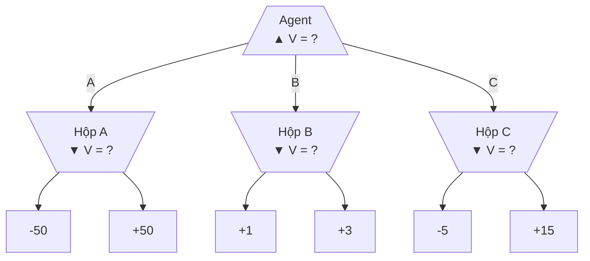

**Frame 1: hộp A: min(-50, 50) = -50**

```text
                    /\ MAX  V = ?
            /              |              \
        A                 B                 C
      \/ -50             \/ ?              \/ ?
     /     \           /     \           /     \
    -50    50           1    3           -5    15
```

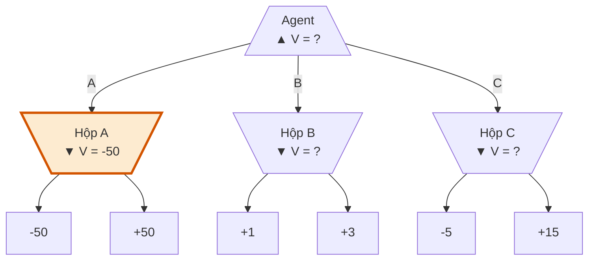

**Frame 2: hộp B: min(1, 3) = 1**

```text
                    /\ MAX  V = ?
            /              |              \
        A                 B                 C
      \/ -50            \/ +1              \/ ?
     /     \           /     \           /     \
    -50    50           1    3           -5    15
```

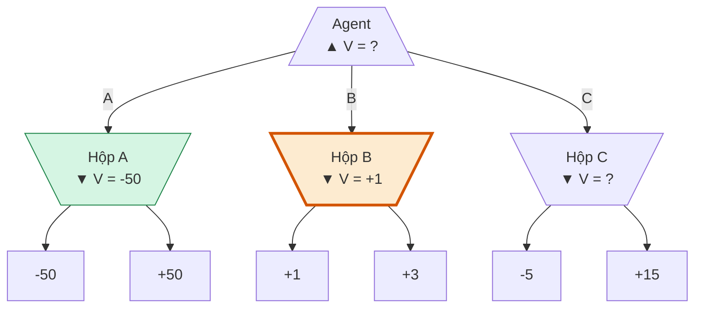

**Frame 3: hộp C: min(-5, 15) = -5**

```text
                    /\ MAX  V = ?
            /              |              \
        A                 B                 C
      \/ -50            \/ +1             \/ -5
     /     \           /     \           /     \
    -50    50           1    3           -5    15
```

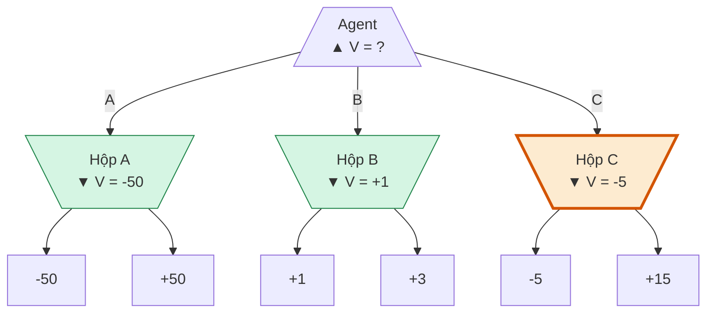

**Frame 4: gốc: max(-50, +1, -5) = +1 → chọn B**

```text
                    /\ MAX  V = +1
            /              |              \
        A               **B**               C
      \/ -50            \/ +1             \/ -5
     /     \           /     \           /     \
    -50    50           1    3           -5    15
```

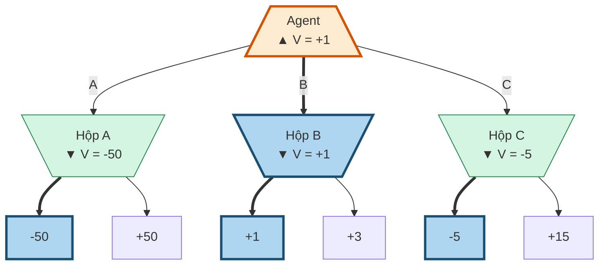

Nhánh A trả $\min(-50,50)=-50$; nhánh B trả $\min(1,3)=1$; nhánh C trả $\min(-5,15)=-5$. Gốc lấy $\max(-50,1,-5)=1$, nên chọn B. **Giá trị 1 là kết quả khi đối thủ đáp trả tối ưu, đồng thời là cận dưới khi đối thủ đáp trả bất kỳ.** Nếu đối thủ chọn 3 trong B, agent nhận 3; nếu đối thủ chọn đều, agent nhận kỳ vọng 2. Không được gọi 1 là “điểm chắc chắn nhận đúng trong mọi ván”. ([g1, PDF p.51](../docs/games1.pdf#page=51)) ([g1, PDF p.52](../docs/games1.pdf#page=52))

Để nối animation với code, bảng dưới đây ghi các lần gọi và trả về; các dòng ghép hai sự kiện liên tiếp chỉ để bảng gọn. `root.v` là biến tích lũy, chưa phải kết luận cuối cho đến khi xét xong mọi con.

| Bước | Sự kiện | Stack đang hoạt động | Cập nhật |
|---:|---|---|---|
| 1 | vào gốc MAX | `root` | `root.v = −∞` |
| 2 | vào A, MIN | `root → A` | `A.v = +∞` |
| 3–4 | lá −50 trả về A | `root → A` | `A.v = −50` |
| 5–6 | lá 50 trả về A | `root → A` | `A.v = min(−50,50) = −50` |
| 7–8 | A trả −50 về gốc | `root` | `root.v = −50` |
| 9 | vào B, MIN | `root → B` | `B.v = +∞` |
| 10–11 | lá 1 trả về B | `root → B` | `B.v = 1` |
| 12–13 | lá 3 trả về B | `root → B` | `B.v = min(1,3) = 1` |
| 14–15 | B trả 1 về gốc | `root` | `root.v = max(−50,1) = 1` |
| 16 | vào C, MIN | `root → C` | `C.v = +∞` |
| 17–18 | lá −5 trả về C | `root → C` | `C.v = −5` |
| 19–20 | lá 15 trả về C | `root → C` | `C.v = min(−5,15) = −5` |
| 21–22 | C trả −5 về gốc | `root` | `root.v = max(1,−5) = 1` |
| 23 | gốc hoàn tất | rỗng | trả giá trị 1, chọn B |

Thứ tự hoàn tất node là $-50,50,A,1,3,B,-5,15,C,\mathrm{root}$. Animation nhóm các node để dễ quan sát; bảng sự kiện cho biết trình tự thực thi tuần tự. Đây cũng là lý do không nên nói “Minimax tính mọi node cùng một tầng đồng thời”.

### 5.4. Bảng đối đầu và chứng minh xác định mức bảo đảm chặt nhất

Khi so sánh policy, cần quay lại hàm Game evaluation: **$V(\pi_a,\pi_o;s)$ là expected utility khi hai policy đều đã cố định**, bắt đầu ở $s$. Viết $V(\pi_a,\pi_o)$ nghĩa là từ $s_{\mathrm{start}}$. Trong ký hiệu CS221, $\pi_7$ là “một đối thủ cụ thể”; ở ví dụ này nó chọn đều hai số trong mỗi hộp, không phải người chơi thứ bảy. Đặt $\pi_E=\pi_{\mathrm{exptmax}(7)}$, policy Expectimax tối ưu chống đúng $\pi_7$. ([g1, PDF p.47](../docs/games1.pdf#page=47)) ([g1, PDF p.48](../docs/games1.pdf#page=48))

| Policy agent | Đối thủ $\pi_{\min}$ | Đối thủ $\pi_7$, chọn đều |
|---|---:|---:|
| $\pi_{\max}$: chọn B | $V(\pi_{\max},\pi_{\min})=\mathbf{1}$ | $V(\pi_{\max},\pi_7)=\mathbf{2}$ |
| $\pi_E$: chọn C | $V(\pi_E,\pi_{\min})=\mathbf{-5}$ | $V(\pi_E,\pi_7)=\mathbf{5}$ |

Bốn số này là bảng Face off của khóa học, đã tính lại bằng cùng giao diện `Game`. Đọc theo một hàng: đối thủ đổi thì kết quả của cùng một agent đổi. Đọc theo một cột: khi đã cố định đối thủ, có thể so sánh hai agent. **Minimax tốt nhất trong cột đối thủ Minimax; Expectimax tốt nhất trong cột mô hình mà nó được tối ưu để chống.** ([g1, PDF p.55](../docs/games1.pdf#page=55)) **[Đã chạy]**

Ba tính chất của slide ghép thành chuỗi:

$$
\boxed{
V(\pi_E,\pi_{\min})
\le V(\pi_{\max},\pi_{\min})
\le V(\pi_{\max},\pi_7)
\le V(\pi_E,\pi_7)
}
\tag{C}
$$

Trên ví dụ chọn hộp, chuỗi là **$-5\le1\le2\le5$**. Vế đầu là “không policy agent nào vượt $\pi_{\max}$ khi gặp $\pi_{\min}$”; vế giữa là “đối thủ bất kỳ không kéo $\pi_{\max}$ xuống dưới giá trị Minimax”; vế cuối là “chống mô hình đã biết, best response không kém Minimax”. Mỗi dấu có thể trở thành dấu bằng trong một game khác. ([g1, PDF p.49](../docs/games1.pdf#page=49)) ([g1, PDF p.51](../docs/games1.pdf#page=51)) ([g1, PDF p.53](../docs/games1.pdf#page=53)) ([g1, PDF p.55](../docs/games1.pdf#page=55))

#### Chứng minh đủ ba tính chất bằng quy nạp theo chiều cao

**Phần sau là [Tự suy] để triển khai gợi ý chứng minh của slide.** Khóa học nêu ba tính chất và gợi ý quy nạp từ lá; các bước chi tiết dưới đây được viết cho báo cáo. Giả thiết: cây có chiều cao hữu hạn, mỗi node có hữu hạn hành động, utility hữu hạn và state đủ thông tin. Policy tùy ý có thể stochastic; policy thuần tương ứng xác suất 1 ở một hành động. Các policy $\pi_{\max}$, $\pi_{\min}$ được chọn theo (P) ở **mọi state**, không chỉ trên đường đi từ gốc. Quy nạp dùng $h(s)$, chiều dài lớn nhất còn lại đến terminal. ([g1, PDF p.50](../docs/games1.pdf#page=50))

Để giảm ký hiệu, đặt $s_a=\operatorname{Succ}(s,a)$. Với $J_{\alpha,\beta}(s)=V(\alpha,\beta;s)$, recurrence Game evaluation cho:

$$
J_{\alpha,\beta}(s)=
\begin{cases}
U(s), & \operatorname{IsEnd}(s),\\
\sum_a\alpha(s,a)J_{\alpha,\beta}(s_a), & \operatorname{Player}(s)=\mathrm{agent},\\
\sum_a\beta(s,a)J_{\alpha,\beta}(s_a), & \operatorname{Player}(s)=\mathrm{opp}.
\end{cases}
$$

Các tổng có trọng số không âm, tổng trọng số bằng 1. Với policy thuần, tổng rút thành giá trị của con được chọn. Tại terminal, mọi cách chơi đều trả $U(s)=V^*(s)$, nên đây là cơ sở quy nạp chung cho các mệnh đề sau.

**Bổ đề: hai policy Minimax hiện thực hóa đúng giá trị Minimax.** Với mọi state:

$$
J_{\pi_{\max},\pi_{\min}}(s)=V^*(s).
\tag{L0}
$$

Giả sử mệnh đề đúng ở mọi successor. Nếu agent đến lượt, $\pi_{\max}$ chọn một $a^*$ đạt cực đại. Theo giả thiết quy nạp rồi định nghĩa policy,

$$
J_{\pi_{\max},\pi_{\min}}(s)
=J_{\pi_{\max},\pi_{\min}}(s_{a^*})
=V^*(s_{a^*})
=\max_a V^*(s_a)=V^*(s).
$$

Nếu đối thủ đến lượt, $\pi_{\min}$ chọn một $b^*$ đạt cực tiểu và cùng lập luận cho:

$$
J_{\pi_{\max},\pi_{\min}}(s)
=J_{\pi_{\max},\pi_{\min}}(s_{b^*})
=V^*(s_{b^*})
=\min_a V^*(s_a)=V^*(s).
$$

Hai trường hợp khép quy nạp. $\square$

**Tính chất 1: $\pi_{\max}$ là tốt nhất trước đối thủ $\pi_{\min}$.** Ta chứng minh mệnh đề mạnh hơn, tại mọi state và với mọi policy agent $\alpha$:

$$
J_{\alpha,\pi_{\min}}(s)\le V^*(s).
\tag{T1}
$$

Ở lượt agent, áp dụng giả thiết quy nạp từng con rồi dùng “trung bình không vượt cực đại”:

$$
\begin{aligned}
J_{\alpha,\pi_{\min}}(s)
&=\sum_a\alpha(s,a)J_{\alpha,\pi_{\min}}(s_a)\\
&\le\sum_a\alpha(s,a)V^*(s_a)\\
&\le\max_aV^*(s_a)=V^*(s).
\end{aligned}
$$

Ở lượt đối thủ, $b^*=\pi_{\min}(s)$ được xác định bằng cực tiểu của $V^*$, nên:

$$
J_{\alpha,\pi_{\min}}(s)
=J_{\alpha,\pi_{\min}}(s_{b^*})
\le V^*(s_{b^*})
=\min_aV^*(s_a)=V^*(s).
$$

Kết hợp (L0), tại gốc được đúng dạng slide:
$$
V(\alpha,\pi_{\min})
\le V(\pi_{\max},\pi_{\min}).
$$
Vậy agent không thể cải thiện bằng việc đơn phương đổi policy khi đối thủ giữ $\pi_{\min}$. Chứng minh đã bao gồm policy stochastic vì bước trung bình dùng được cho mọi phân phối hợp lệ. $\square$ ([g1, PDF p.49](../docs/games1.pdf#page=49))

**Tính chất 2: $V^*$ là cận dưới trước mọi đối thủ.** Với mọi policy đối thủ $\beta$, ta chứng minh:

$$
J_{\pi_{\max},\beta}(s)\ge V^*(s).
\tag{T2}
$$

Ở lượt agent, $a^*=\pi_{\max}(s)$, nên:

$$
J_{\pi_{\max},\beta}(s)
=J_{\pi_{\max},\beta}(s_{a^*})
\ge V^*(s_{a^*})
=\max_aV^*(s_a)=V^*(s).
$$

Ở lượt đối thủ, áp dụng giả thiết quy nạp rồi “trung bình không thấp hơn cực tiểu”:

$$
\begin{aligned}
J_{\pi_{\max},\beta}(s)
&=\sum_a\beta(s,a)J_{\pi_{\max},\beta}(s_a)\\
&\ge\sum_a\beta(s,a)V^*(s_a)\\
&\ge\min_aV^*(s_a)=V^*(s).
\end{aligned}
$$

Kết hợp (L0) cho:
$$
V(\pi_{\max},\pi_{\min})
\le V(\pi_{\max},\beta).
$$
Điểm cần nhấn mạnh khi trình bày: **đối thủ hoàn hảo là trường hợp đạt đúng cận dưới, không phải điều kiện để bảo đảm có hiệu lực**. Đối thủ ngẫu nhiên, mắc sai lầm hay thay đổi cách chọn vẫn không làm $\pi_{\max}$ nhận thấp hơn cận đó trong mô hình đang xét. $\square$ ([g1, PDF p.51](../docs/games1.pdf#page=51)) ([g1, PDF p.52](../docs/games1.pdf#page=52))

**Tính chất 3: biết policy đối thủ thì Expectimax chống đúng policy ấy không kém Minimax.** Cố định $\pi_7$; đặt $V_E(s)=V_{\mathrm{exptmax}(7)}(s)$ và trích $\pi_E$ bằng `argmax` của $V_E$. Cần chứng minh đủ hai điều:

$$
J_{\pi_E,\pi_7}(s)=V_E(s),
\qquad
J_{\alpha,\pi_7}(s)\le V_E(s)
\quad\text{với mọi }\alpha.
\tag{T3}
$$

Đối với đẳng thức, ở lượt agent, $\pi_E$ chọn một $a_E$ đạt cực đại, nên:
$$
J_{\pi_E,\pi_7}(s)
=J_{\pi_E,\pi_7}(s_{a_E})
=V_E(s_{a_E})
=\max_aV_E(s_a)=V_E(s).
$$
Ở lượt đối thủ, policy không thay đổi; áp dụng giả thiết quy nạp trong tổng cho:
$$
J_{\pi_E,\pi_7}(s)
=\sum_a\pi_7(s,a)J_{\pi_E,\pi_7}(s_a)
=\sum_a\pi_7(s,a)V_E(s_a)=V_E(s).
$$

Đối với bất đẳng thức và policy agent bất kỳ $\alpha$, ở lượt agent:
$$
\begin{aligned}
J_{\alpha,\pi_7}(s)
&=\sum_a\alpha(s,a)J_{\alpha,\pi_7}(s_a)\\
&\le\sum_a\alpha(s,a)V_E(s_a)\\
&\le\max_aV_E(s_a)=V_E(s).
\end{aligned}
$$
Ở lượt đối thủ, chỉ cần cộng các bất đẳng thức quy nạp với đúng trọng số $\pi_7$:
$$
J_{\alpha,\pi_7}(s)
=\sum_a\pi_7(s,a)J_{\alpha,\pi_7}(s_a)
\le\sum_a\pi_7(s,a)V_E(s_a)=V_E(s).
$$

Cuối cùng thế $\alpha=\pi_{\max}$, dùng đẳng thức vừa chứng minh:
$$
V(\pi_{\max},\pi_7)
\le V_E(s_{\mathrm{start}})
=V(\pi_E,\pi_7).
$$
Đó là tính chất 3. Dấu $\le$ không khẳng định Expectimax luôn tốt hơn hẳn; cả hai có thể chọn cùng policy hoặc đạt cùng giá trị. Kết luận cũng gắn với **đúng policy $\pi_7$** đã dùng trong phép tính. $\square$ ([g1, PDF p.53](../docs/games1.pdf#page=53))

**Mức bảo đảm còn đúng theo từng đường chơi. [Tự suy]** Khi agent theo $\pi_{\max}$, giá trị $V^*$ không giảm dọc đường chơi. Ở lượt agent, con được chọn có $V^*(s_{a^*})=V^*(s)$. Ở lượt đối thủ, bất kỳ hành động nào cũng đi tới con có $V^*(s_a)\ge\min_bV^*(s_b)=V^*(s)$. Tới terminal $z$, $V^*(z)=U(z)$; do đó:

$$
\boxed{U(z)\ge V^*(s_{\mathrm{start}})
\quad\text{với mọi terminal }z\text{ có thể gặp khi agent theo }\pi_{\max}.}
$$

Đây là bảo đảm mạnh hơn một bất đẳng thức về kỳ vọng. Nếu đối thủ đổi cách chơi dựa trên lịch sử, kết quả vẫn đúng trên cây đã khai triển theo lịch sử: tại mỗi lượt của họ, mọi cạnh đều thỏa bất đẳng thức trên. Không cần giả sử các lựa chọn liên tiếp độc lập vô điều kiện.

**Mức bảo đảm đó là chặt nhất. [Tự suy]** Tính chất 2 cho biết $\pi_{\max}$ bảo đảm ít nhất $V^*$; tính chất 1 cho biết đối thủ $\pi_{\min}$ ngăn mọi agent bảo đảm nhiều hơn $V^*$. Có thể viết đầy đủ trên không gian policy:

$$
\max_{\alpha}\min_{\beta}V(\alpha,\beta)
=\min_{\beta}\max_{\alpha}V(\alpha,\beta)
=V^*(s_{\mathrm{start}}).
$$

Thật vậy, gọi hai vế tối ưu đầu là $L$ và $R$. Bất đẳng thức yếu $L\le R$ đúng vì với mọi $\alpha,\beta$, $\min_{\beta'}V(\alpha,\beta')\le V(\alpha,\beta)\le\max_{\alpha'}V(\alpha',\beta)$, rồi tối ưu hai phía. Tính chất 2 cho $V^*\le\min_\beta V(\pi_{\max},\beta)\le L$; tính chất 1 cho $R\le\max_\alpha V(\alpha,\pi_{\min})\le V^*$. Vậy $V^*\le L\le R\le V^*$, nên tất cả bằng nhau. **Các policy ở đây là kế hoạch phản ứng có điều kiện trên cùng một cây.** Đổi thứ tự hai toán tử trên policy không có nghĩa được đổi người đi trước hay cho một người thấy thông tin mà luật không cung cấp.

**Hai policy nhất quán với nhau ở mọi bài toán con. [Tự suy]** Tính chất 1 nói $\pi_{\max}$ là best response với $\pi_{\min}$, còn tính chất 2 nói $\pi_{\min}$ là best response của phía tối thiểu hóa với $\pi_{\max}$. Đây là nghĩa chính xác của nhận xét “fixed point” giữa hai best response. Nó mô tả kết quả, không yêu cầu thuật toán lặp để hội tụ: cây hữu hạn được giải trong một lượt từ lá lên gốc. Tính nhất quán ở mọi state mạnh hơn việc chỉ có hai policy không muốn đổi khi nhìn từ gốc; một lựa chọn kém ở nhánh không bao giờ được đi tới vẫn có thể bị che khuất trong phép so sánh chỉ tại gốc.

### 5.5. Halving biến recurrence thành 19 lời gọi và một quy luật có chứng minh

Ở phần Modeling đã có cây N = 4 chưa back up. Bây giờ dùng đúng luật đó để tính: state là `(player, n)`, hành động `-` trừ 1, `/` lấy $\lfloor n/2\rfloor$, mỗi hành động đổi người đến lượt. **Người đến lượt khi số bằng 0 thắng; người vừa đưa số về 0 thua.** Mã CS221 ghi `Utility = player * inf` ở terminal. Ở ví dụ thuần Minimax này, chỉ `min` và `max` so sánh $\pm\infty$, nên phép tính có nghĩa; các chứng minh kỳ vọng ở mục trước dùng utility hữu hạn để tránh $\infty-\infty$. Nếu chỉ cần biểu diễn thắng/thua, thay $\pm\infty$ bằng $\pm1$ cho cùng các tập hành động tối ưu của halving. ([g1, PDF p.19](../docs/games1.pdf#page=19)) ([mã `game.py` của CS221](https://web.stanford.edu/class/archive/cs/cs221/cs221.1196/semilive/games1/game.py))

**[Đã chạy]** N = 4 tạo **19 lời gọi**, kể cả các terminal lặp, khi duyệt `-` rồi `/` và không gộp trạng thái. Bảng dưới dùng cách phá hòa của mã khóa học: Python so sánh tuple `(value, action)`, nên tại MAX hòa chọn `/`, tại MIN hòa chọn `-`. Điều này khác giả mã first-tie của mục 5.2, nhưng không làm đổi bất kỳ giá trị Minimax nào.

| Bước | Lời gọi `V(player, n)` | Lượt | Stack | Giá trị các con | Trả về | Ghi chú |
|---:|---|---|---:|---|---|---|
| 1 | `V(+1, 4)` | agent ▲ | 1 | `-`→-∞, `/`→-∞ | **-∞** | max; chọn `/` |
| 2 | `V(-1, 3)` | opp ▼ | 2 | `-`→+∞, `/`→-∞ | **-∞** | min; chọn `/` |
| 3 | `V(+1, 2)` | agent ▲ | 3 | `-`→+∞, `/`→+∞ | **+∞** | max; chọn `/` |
| 4 | `V(-1, 1)` | opp ▼ | 4 | `-`→+∞, `/`→+∞ | **+∞** | min; chọn `-` |
| 5 | `V(+1, 0)` | hết | 5 | (IsEnd) | **+∞** | Utility = player·∞ |
| 6 | `V(+1, 0)` | hết | 5 | (IsEnd) | **+∞** | Utility = player·∞ |
| 7 | `V(-1, 1)` | opp ▼ | 4 | `-`→+∞, `/`→+∞ | **+∞** | min; chọn `-` |
| 8 | `V(+1, 0)` | hết | 5 | (IsEnd) | **+∞** | Utility = player·∞ |
| 9 | `V(+1, 0)` | hết | 5 | (IsEnd) | **+∞** | Utility = player·∞ |
| 10 | `V(+1, 1)` | agent ▲ | 3 | `-`→-∞, `/`→-∞ | **-∞** | max; chọn `/` |
| 11 | `V(-1, 0)` | hết | 4 | (IsEnd) | **-∞** | Utility = player·∞ |
| 12 | `V(-1, 0)` | hết | 4 | (IsEnd) | **-∞** | Utility = player·∞ |
| 13 | `V(-1, 2)` | opp ▼ | 2 | `-`→-∞, `/`→-∞ | **-∞** | min; chọn `-` |
| 14 | `V(+1, 1)` | agent ▲ | 3 | `-`→-∞, `/`→-∞ | **-∞** | max; chọn `/` |
| 15 | `V(-1, 0)` | hết | 4 | (IsEnd) | **-∞** | Utility = player·∞ |
| 16 | `V(-1, 0)` | hết | 4 | (IsEnd) | **-∞** | Utility = player·∞ |
| 17 | `V(+1, 1)` | agent ▲ | 3 | `-`→-∞, `/`→-∞ | **-∞** | max; chọn `/` |
| 18 | `V(-1, 0)` | hết | 4 | (IsEnd) | **-∞** | Utility = player·∞ |
| 19 | `V(-1, 0)` | hết | 4 | (IsEnd) | **-∞** | Utility = player·∞ |

Ý nghĩa: cả hai nước đầu đều thua. `-` đưa đối thủ về 3, đối thủ `/` thành 1 thì mình buộc phải đưa số về 0. `/` đưa đối thủ về 2, đối thủ đưa về 1 và mình cũng phải đưa số về 0.

**Khung hình backup của cây N = 4**

A là agent (+1), O là opp (-1). Nhãn `A n=3` nghĩa là agent đến lượt khi số bằng 3. Trong Mermaid, cạnh `trừ 1` là hành động `-`, cạnh `chia 2` là hành động `/`. Các khung gom theo chiều cao để tiện làm animation; thứ tự DFS thật nằm trong bảng trên.

Khung 0 của cây đã xuất hiện trong Modeling, chỉ mang utility ở lá. Bốn khung tiếp theo cho thấy lần lượt những node đã được back up; chúng nhóm theo chiều cao để dễ diễn giải, còn thứ tự thực thi DFS là bảng 19 lời gọi vừa nêu.

**Frame 1: backup các node có chiều cao 1**

```text
/\ MAX A n=4 V=?
|-- [-] \/ MIN O n=3 V=?
|   |-- [-] /\ MAX A n=2 V=?
|   |   |-- [-] \/ MIN O n=1 V=+inf   (chọn: -)   <== vừa tính
|   |   |   |-- [-] [] END A n=0 V=+inf
|   |   |   `-- [/] [] END A n=0 V=+inf
|   |   `-- [/] \/ MIN O n=1 V=+inf   (chọn: -)   <== vừa tính
|   |       |-- [-] [] END A n=0 V=+inf
|   |       `-- [/] [] END A n=0 V=+inf
|   `-- [/] /\ MAX A n=1 V=-inf   (chọn: /)   <== vừa tính
|       |-- [-] [] END O n=0 V=-inf
|       `-- [/] [] END O n=0 V=-inf
`-- [/] \/ MIN O n=2 V=?
    |-- [-] /\ MAX A n=1 V=-inf   (chọn: /)   <== vừa tính
    |   |-- [-] [] END O n=0 V=-inf
    |   `-- [/] [] END O n=0 V=-inf
    `-- [/] /\ MAX A n=1 V=-inf   (chọn: /)   <== vừa tính
        |-- [-] [] END O n=0 V=-inf
        `-- [/] [] END O n=0 V=-inf
```

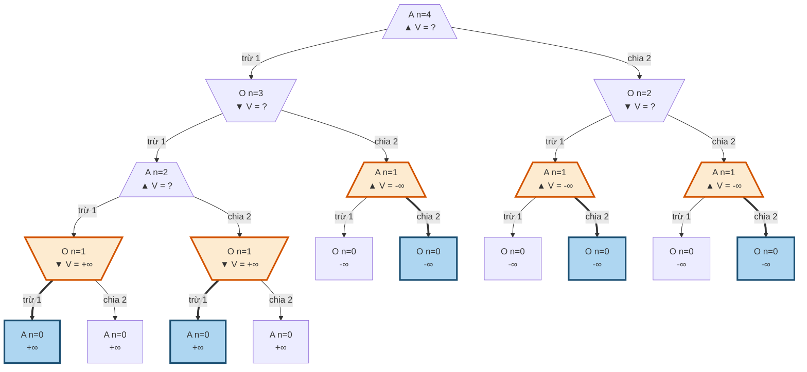

**Frame 2: backup các node có chiều cao 2**

```text
/\ MAX A n=4 V=?
|-- [-] \/ MIN O n=3 V=?
|   |-- [-] /\ MAX A n=2 V=+inf   (chọn: /)   <== vừa tính
|   |   |-- [-] \/ MIN O n=1 V=+inf   (chọn: -)
|   |   |   |-- [-] [] END A n=0 V=+inf
|   |   |   `-- [/] [] END A n=0 V=+inf
|   |   `-- [/] \/ MIN O n=1 V=+inf   (chọn: -)
|   |       |-- [-] [] END A n=0 V=+inf
|   |       `-- [/] [] END A n=0 V=+inf
|   `-- [/] /\ MAX A n=1 V=-inf   (chọn: /)
|       |-- [-] [] END O n=0 V=-inf
|       `-- [/] [] END O n=0 V=-inf
`-- [/] \/ MIN O n=2 V=-inf   (chọn: -)   <== vừa tính
    |-- [-] /\ MAX A n=1 V=-inf   (chọn: /)
    |   |-- [-] [] END O n=0 V=-inf
    |   `-- [/] [] END O n=0 V=-inf
    `-- [/] /\ MAX A n=1 V=-inf   (chọn: /)
        |-- [-] [] END O n=0 V=-inf
        `-- [/] [] END O n=0 V=-inf
```

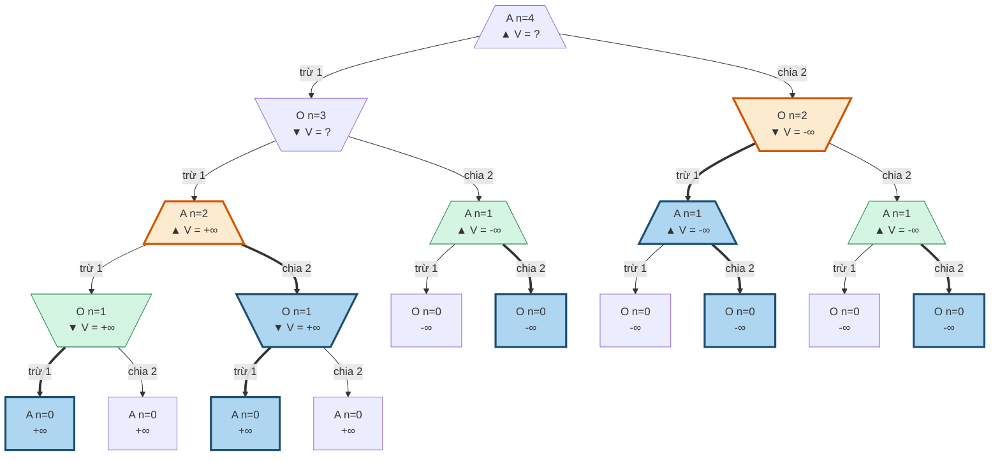

**Frame 3: backup các node có chiều cao 3**

```text
/\ MAX A n=4 V=?
|-- [-] \/ MIN O n=3 V=-inf   (chọn: /)   <== vừa tính
|   |-- [-] /\ MAX A n=2 V=+inf   (chọn: /)
|   |   |-- [-] \/ MIN O n=1 V=+inf   (chọn: -)
|   |   |   |-- [-] [] END A n=0 V=+inf
|   |   |   `-- [/] [] END A n=0 V=+inf
|   |   `-- [/] \/ MIN O n=1 V=+inf   (chọn: -)
|   |       |-- [-] [] END A n=0 V=+inf
|   |       `-- [/] [] END A n=0 V=+inf
|   `-- [/] /\ MAX A n=1 V=-inf   (chọn: /)
|       |-- [-] [] END O n=0 V=-inf
|       `-- [/] [] END O n=0 V=-inf
`-- [/] \/ MIN O n=2 V=-inf   (chọn: -)
    |-- [-] /\ MAX A n=1 V=-inf   (chọn: /)
    |   |-- [-] [] END O n=0 V=-inf
    |   `-- [/] [] END O n=0 V=-inf
    `-- [/] /\ MAX A n=1 V=-inf   (chọn: /)
        |-- [-] [] END O n=0 V=-inf
        `-- [/] [] END O n=0 V=-inf
```

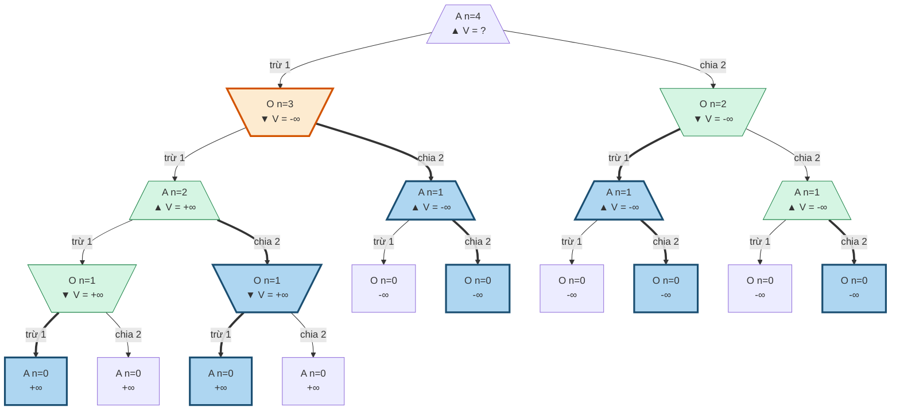

**Frame 4: backup các node có chiều cao 4**

```text
/\ MAX A n=4 V=-inf   (chọn: /)   <== vừa tính
|-- [-] \/ MIN O n=3 V=-inf   (chọn: /)
|   |-- [-] /\ MAX A n=2 V=+inf   (chọn: /)
|   |   |-- [-] \/ MIN O n=1 V=+inf   (chọn: -)
|   |   |   |-- [-] [] END A n=0 V=+inf
|   |   |   `-- [/] [] END A n=0 V=+inf
|   |   `-- [/] \/ MIN O n=1 V=+inf   (chọn: -)
|   |       |-- [-] [] END A n=0 V=+inf
|   |       `-- [/] [] END A n=0 V=+inf
|   `-- [/] /\ MAX A n=1 V=-inf   (chọn: /)
|       |-- [-] [] END O n=0 V=-inf
|       `-- [/] [] END O n=0 V=-inf
`-- [/] \/ MIN O n=2 V=-inf   (chọn: -)
    |-- [-] /\ MAX A n=1 V=-inf   (chọn: /)
    |   |-- [-] [] END O n=0 V=-inf
    |   `-- [/] [] END O n=0 V=-inf
    `-- [/] /\ MAX A n=1 V=-inf   (chọn: /)
        |-- [-] [] END O n=0 V=-inf
        `-- [/] [] END O n=0 V=-inf
```

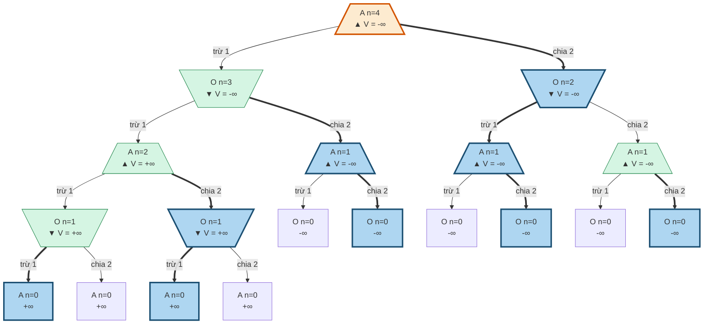

Sau back up, $V(+1,4)=-\infty$. Nếu agent trừ 1, đối thủ nhận 3 và chia 2 để để lại 1; agent phải đưa về 0 và thua. Nếu agent chia 2, đối thủ nhận 2 rồi đưa về 1; kết cục vẫn như vậy. **Hai hành động ở gốc đều thua trước đối thủ tối ưu**, nên nước được in ra chỉ thể hiện cách phá hòa, không phải một nước cứu được ván.

**Từ ví dụ đến quy luật tổng quát. [Tự suy, đã kiểm chứng bằng code]** Gọi $L$ là tập số mà người đang đến lượt sẽ thua nếu hai bên tối ưu. Ta có $0\notin L$ vì được để lại 0 là thắng, và $1\in L$ vì cả hai hành động đều đưa đối phương tới 0. Một số dương thuộc $L$ đúng khi **cả hai successor đều không thuộc $L$**. Đây chính là recurrence Minimax được viết theo nhãn thắng/thua tương đối với người đang đến lượt.

Ta chứng minh bằng quy nạp mạnh hai điều: mọi số lẻ $n\ge3$ đều không thuộc $L$; với mọi $h\ge1$, $2h\in L\iff h\notin L$. Xét số lẻ $n=2h+1\ge3$. Nếu $h\in L$, hành động `/` đưa đối thủ vào số thua, nên $n\notin L$. Nếu $h\notin L$, vì $1\in L$ nên $h\ge2$. Xét $2h=n-1<n$: nó chỉ tới $2h-1$ và $h$. Số $2h-1$ lẻ, ít nhất bằng 3 và nhỏ hơn $n$, nên theo giả thiết quy nạp không thuộc $L$; $h$ cũng không thuộc $L$ theo trường hợp đang xét. Vậy $2h\in L$, và hành động `-` từ $n$ đưa đối thủ vào số thua. Điều thứ nhất được chứng minh.

Xét số chẵn $2h$. Với $h=1$, cả hai nước từ 2 đều tới $1\in L$, nên $2\notin L$; điều này đúng với $2h\in L\iff h\notin L$. Với $h\ge2$, hành động `-` dẫn tới số lẻ $2h-1\ge3$, đã biết không thuộc $L$; do đó $2h$ thua đúng khi hành động `/` cũng dẫn tới số không thuộc $L$, tức $h\notin L$. Hai trường hợp khép quy nạp mạnh.

Viết duy nhất $n=2^k m$ với $m$ lẻ, ta có quy luật:

$$
\boxed{n\in L\iff
\bigl(m=1\ \text{và }k\text{ chẵn}\bigr)
\ \text{hoặc}\ 
\bigl(m\ge3\ \text{và }k\text{ lẻ}\bigr).}
$$

Mỗi lần nhân đôi đổi nhãn thắng/thua. Điểm gốc của họ lũy thừa hai là $1\in L$; điểm gốc của các họ còn lại là số lẻ ít nhất bằng 3, không thuộc $L$. Vì vậy, “mọi số lẻ đều thắng” phải có ngoại lệ 1. Ví dụ, các số thua từ 1 đến 20 là **1, 4, 6, 10, 14, 16, 18**. Công thức đã khớp recurrence quy hoạch động cho **N = 1..100.000**; đây là kiểm chứng hữu hạn bổ sung, còn chứng minh trên mới bao phủ mọi N dương. Quy luật và chứng minh là phần mở rộng tự xây dựng, không phải đáp án được in trong slide. **[Đã chạy]**

Với **N = 15** của mã khóa học, người đi trước thắng, và nước đầu thắng duy nhất là **`-`**. Trừ 1 đưa đối thủ vào 14, một số thua; chia 2 đưa đối thủ vào 7, một số thắng. Một ván minh họa khi agent chọn đúng và đối thủ dùng cách phá hòa của mã là:

```text
(A,15) --trừ 1--> (O,14) --trừ 1--> (A,13)
       --chia 2--> (O,6) --trừ 1--> (A,5)
       --trừ 1--> (O,4) --trừ 1--> (A,3)
       --chia 2--> (O,1) --trừ 1--> (A,0) : A thắng
```

Có thể đọc trực tiếp thành chuỗi số **15 → 14 → 13 → 6 → 5 → 4 → 3 → 1 → 0**, agent thực hiện các nước **trừ 1, chia 2, trừ 1, chia 2** ở các lượt của mình. Nếu mở đầu sai bằng chia 2, một chuỗi phản bác là **15 → 7 → 6 → 5 → 4 → 3 → 1 → 0**, kết thúc ở lượt đối thủ với 0 nên agent thua. Ghi chú đã đối chiếu mã gốc bằng các input tương ứng và nhận đúng hai kết quả này. Trong cây thuần, N = 15 tạo 331 lời gọi; số tăng nhanh dù bản thân quy luật cuối cùng rất ngắn. ([mã nguồn của CS221](https://web.stanford.edu/class/archive/cs/cs221/cs221.1196/semilive/games1/game.py)) **[Đã chạy]**

### 5.6. Thế Q cho thấy một nước đe dọa có thể mở đường thua

**Quy ước riêng của hai thế cờ tiếp theo:** X là agent MAX, O là đối thủ MIN, nhưng **O đi trước**. Utility tính cho X: thắng $+1$, hòa 0, thua $-1$. Vì vậy, ở Q có ba O và hai X, đến lượt X là hoàn toàn hợp lệ. Nếu giữ thói quen gọi quân đi trước là X thì phải đổi tên cả hai quân và cách diễn giải; không được chỉ đổi lượt trên một bàn không hợp lệ. Các ô được đánh số 0..8, đọc theo hàng:

```text
0 1 2
3 4 5
6 7 8
```

Q có bốn ô trống, đủ nhỏ để trình bày toàn bộ cây **61 node** và đầy đủ thứ tự lời gọi. Nước X2 và X4 cùng tạo đe dọa trên đường chéo 2–4–6. Tuy nhiên, X2 ép O vào trung tâm, nơi O tạo hai đe dọa đồng thời; X4 chiếm trung tâm trước và ép O tới góc 2, nơi không sinh đe dọa như vậy. **“Ép đối thủ phải chặn” chưa đủ để kết luận một nước tốt; cần xem chính nước chặn ấy tạo ra gì.** Các số, board và trace bên dưới được sinh bởi code, không lấy từ slide của khóa học. **[Đã chạy]**

```text
Q
. . .
O . X
X O O
X đi, 4 ô trống
```

Hai nước X2 và X4 cùng tạo đe dọa trên **một đường chéo** (2, 4, 6). Nhìn bề ngoài chúng tương đương nhau. Kết quả, từ [verify_examples.py](<../research_notes/Seminar Games 1 nhóm 10/verify_examples.py>) và [analysis.py, mục 12](#phụ-lục-b-analysispy-và-output-thật):

| Nước | Tạo đe dọa? | Minimax | Expectimax | Số node trong nhánh |
|---|---|---:|---:|---:|
| X0 | không | 0 | 0 | 16 |
| X1 | không | 0 | 0 | 16 |
| X2 | có, tại ô 4 | **-1** | 1/3 | 14 |
| X4 | có, tại ô 2 | 0 | **2/3** | 14 |

Vì sao X2 thua: nó ép O vào ô 4. O chặn xong thì có hai đường đe dọa cùng lúc (0, 4, 8 và 1, 4, 7), X chỉ chặn được một.

```text
Q         X2        O4 (chặn)      X0 (chặn 1)   O1
. . .     . . X     . . X          X . X         X O X
O . X     O . X     O O X          O O X         O O X
X O O     X O O     X O O          X O O         X O O
X đi      dọa ô 4   O dọa 0 và 1                 O thắng
```

Vì sao X4 an toàn: X tự chiếm ô 4 và ép O vào ô 2, nơi O không tạo được đe dọa nào.

```text
Q         X4        O2 (chặn)   X0        O1
. . .     . . .     . . O       X . O     X O O
O . X     O X X     O X X       O X X     O X X
X O O     X O O     X O O       X O O     X O O
X đi      dọa ô 2   O hết dọa             hòa
```

**Quyết định cuối:** `V(Q) = max(0, 0, -1, 0) = 0`. Minimax coi X0, X1, X4 như nhau và theo thứ tự DFS sẽ chọn X0. Điều duy nhất nó cấm là X2. Expectimax chọn X4 (2/3).

**Khung hình cấp gốc (dùng làm animation chính)**

**Frame 0: gốc gọi 4 lời gọi con, chưa có giá trị**

```text
gốc:      X0        X1        X2        X4
. . .     X . .     . X .     . . X     . . .
O . X     O . X     O . X     O . X     O X X
X O O     X O O     X O O     X O O     X O O
V=?       V=?       V=?       V=?       V=?
```

```mermaid
graph TD
  q111[/". . .<br/>O . X<br/>X O O<br/>▲ V = ?"\]
  q112[\"X . .<br/>O . X<br/>X O O<br/>▼ V = ?"/]
  q113[\". X .<br/>O . X<br/>X O O<br/>▼ V = ?"/]
  q114[\". . X<br/>O . X<br/>X O O<br/>▼ V = ?"/]
  q115[\". . .<br/>O X X<br/>X O O<br/>▼ V = ?"/]
  q111 -->|"X0"| q112
  q111 -->|"X1"| q113
  q111 -->|"X2"| q114
  q111 -->|"X4"| q115
  classDef done fill:#d5f5e3,stroke:#1e8449
  classDef now fill:#fdebd0,stroke:#d35400,stroke-width:3px
  classDef pick fill:#aed6f1,stroke:#1b4f72,stroke-width:3px
```

**Frame 1: DFS xong nhánh X0 (bước 2 đến 17), trả về 0**

```text
gốc:      X0        X1        X2        X4
. . .     X . .     . X .     . . X     . . .
O . X     O . X     O . X     O . X     O X X
X O O     X O O     X O O     X O O     X O O
V=?       V=0       V=?       V=?       V=?
```

```mermaid
graph TD
  q111[/". . .<br/>O . X<br/>X O O<br/>▲ V = ?"\]
  q112[\"X . .<br/>O . X<br/>X O O<br/>▼ V = 0"/]
  q113[\". X .<br/>O . X<br/>X O O<br/>▼ V = ?"/]
  q114[\". . X<br/>O . X<br/>X O O<br/>▼ V = ?"/]
  q115[\". . .<br/>O X X<br/>X O O<br/>▼ V = ?"/]
  q111 -->|"X0"| q112
  q111 -->|"X1"| q113
  q111 -->|"X2"| q114
  q111 -->|"X4"| q115
  classDef done fill:#d5f5e3,stroke:#1e8449
  classDef now fill:#fdebd0,stroke:#d35400,stroke-width:3px
  classDef pick fill:#aed6f1,stroke:#1b4f72,stroke-width:3px
  class q112 now
```

**Frame 2: DFS xong nhánh X1 (bước 18 đến 33), trả về 0**

```text
gốc:      X0        X1        X2        X4
. . .     X . .     . X .     . . X     . . .
O . X     O . X     O . X     O . X     O X X
X O O     X O O     X O O     X O O     X O O
V=?       V=0       V=0       V=?       V=?
```

```mermaid
graph TD
  q111[/". . .<br/>O . X<br/>X O O<br/>▲ V = ?"\]
  q112[\"X . .<br/>O . X<br/>X O O<br/>▼ V = 0"/]
  q113[\". X .<br/>O . X<br/>X O O<br/>▼ V = 0"/]
  q114[\". . X<br/>O . X<br/>X O O<br/>▼ V = ?"/]
  q115[\". . .<br/>O X X<br/>X O O<br/>▼ V = ?"/]
  q111 -->|"X0"| q112
  q111 -->|"X1"| q113
  q111 -->|"X2"| q114
  q111 -->|"X4"| q115
  classDef done fill:#d5f5e3,stroke:#1e8449
  classDef now fill:#fdebd0,stroke:#d35400,stroke-width:3px
  classDef pick fill:#aed6f1,stroke:#1b4f72,stroke-width:3px
  class q112 done
  class q113 now
```

**Frame 3: DFS xong nhánh X2 (bước 34 đến 47), trả về -1**

```text
gốc:      X0        X1        X2        X4
. . .     X . .     . X .     . . X     . . .
O . X     O . X     O . X     O . X     O X X
X O O     X O O     X O O     X O O     X O O
V=?       V=0       V=0       V=-1      V=?
```

```mermaid
graph TD
  q111[/". . .<br/>O . X<br/>X O O<br/>▲ V = ?"\]
  q112[\"X . .<br/>O . X<br/>X O O<br/>▼ V = 0"/]
  q113[\". X .<br/>O . X<br/>X O O<br/>▼ V = 0"/]
  q114[\". . X<br/>O . X<br/>X O O<br/>▼ V = -1"/]
  q115[\". . .<br/>O X X<br/>X O O<br/>▼ V = ?"/]
  q111 -->|"X0"| q112
  q111 -->|"X1"| q113
  q111 -->|"X2"| q114
  q111 -->|"X4"| q115
  classDef done fill:#d5f5e3,stroke:#1e8449
  classDef now fill:#fdebd0,stroke:#d35400,stroke-width:3px
  classDef pick fill:#aed6f1,stroke:#1b4f72,stroke-width:3px
  class q112,q113 done
  class q114 now
```

**Frame 4: DFS xong nhánh X4 (bước 48 đến 61), trả về 0**

```text
gốc:      X0        X1        X2        X4
. . .     X . .     . X .     . . X     . . .
O . X     O . X     O . X     O . X     O X X
X O O     X O O     X O O     X O O     X O O
V=?       V=0       V=0       V=-1      V=0
```

```mermaid
graph TD
  q111[/". . .<br/>O . X<br/>X O O<br/>▲ V = ?"\]
  q112[\"X . .<br/>O . X<br/>X O O<br/>▼ V = 0"/]
  q113[\". X .<br/>O . X<br/>X O O<br/>▼ V = 0"/]
  q114[\". . X<br/>O . X<br/>X O O<br/>▼ V = -1"/]
  q115[\". . .<br/>O X X<br/>X O O<br/>▼ V = 0"/]
  q111 -->|"X0"| q112
  q111 -->|"X1"| q113
  q111 -->|"X2"| q114
  q111 -->|"X4"| q115
  classDef done fill:#d5f5e3,stroke:#1e8449
  classDef now fill:#fdebd0,stroke:#d35400,stroke-width:3px
  classDef pick fill:#aed6f1,stroke:#1b4f72,stroke-width:3px
  class q112,q113,q114 done
  class q115 now
```

**Frame 5: gốc: max(0, 0, -1, 0) = 0. Chỉ X2 thua; DFS gặp X0 đầu tiên nên first-tie chọn X0**

```text
gốc:      X0        X1        X2        X4
. . .     X . .     . X .     . . X     . . .
O . X     O . X     O . X     O . X     O X X
X O O     X O O     X O O     X O O     X O O
V=0       V=0       V=0       V=-1      V=0
```

```mermaid
graph TD
  q111[/". . .<br/>O . X<br/>X O O<br/>▲ V = 0"\]
  q112[\"X . .<br/>O . X<br/>X O O<br/>▼ V = 0"/]
  q113[\". X .<br/>O . X<br/>X O O<br/>▼ V = 0"/]
  q114[\". . X<br/>O . X<br/>X O O<br/>▼ V = -1"/]
  q115[\". . .<br/>O X X<br/>X O O<br/>▼ V = 0"/]
  q111 ==>|"X0"| q112
  q111 -->|"X1"| q113
  q111 -->|"X2"| q114
  q111 -->|"X4"| q115
  classDef done fill:#d5f5e3,stroke:#1e8449
  classDef now fill:#fdebd0,stroke:#d35400,stroke-width:3px
  classDef pick fill:#aed6f1,stroke:#1b4f72,stroke-width:3px
  class q112,q113,q114,q115 done
  class q111 now
  class q112 pick
```

**Phóng to nhánh X2: nơi bẫy xuất hiện**

**Nhánh X2, frame 0: chỉ biết các lá**

```mermaid
graph TD
  t83[\". . X<br/>O . X<br/>X O O<br/>▼ V = ?"/]
  t84[/"O . X<br/>O . X<br/>X O O<br/>▲ V = ?"\]
  t85[\"O X X<br/>O . X<br/>X O O<br/>▼ V = ?"/]
  t86["O X X<br/>O O X<br/>X O O<br/>-1"]
  t87["O . X<br/>O X X<br/>X O O<br/>+1"]
  t88[/". O X<br/>O . X<br/>X O O<br/>▲ V = ?"\]
  t89[\"X O X<br/>O . X<br/>X O O<br/>▼ V = ?"/]
  t90["X O X<br/>O O X<br/>X O O<br/>-1"]
  t91[". O X<br/>O X X<br/>X O O<br/>+1"]
  t92[/". . X<br/>O O X<br/>X O O<br/>▲ V = ?"\]
  t93[\"X . X<br/>O O X<br/>X O O<br/>▼ V = ?"/]
  t94["X O X<br/>O O X<br/>X O O<br/>-1"]
  t95[\". X X<br/>O O X<br/>X O O<br/>▼ V = ?"/]
  t96["O X X<br/>O O X<br/>X O O<br/>-1"]
  t83 -->|"O0"| t84
  t83 -->|"O1"| t88
  t83 -->|"O4"| t92
  t84 -->|"X1"| t85
  t84 -->|"X4"| t87
  t85 -->|"O4"| t86
  t88 -->|"X0"| t89
  t88 -->|"X4"| t91
  t89 -->|"O4"| t90
  t92 -->|"X0"| t93
  t92 -->|"X1"| t95
  t93 -->|"O1"| t94
  t95 -->|"O0"| t96
  classDef done fill:#d5f5e3,stroke:#1e8449
  classDef now fill:#fdebd0,stroke:#d35400,stroke-width:3px
  classDef pick fill:#aed6f1,stroke:#1b4f72,stroke-width:3px
```

**Nhánh X2, frame 1: backup chiều cao 1**

```mermaid
graph TD
  t83[\". . X<br/>O . X<br/>X O O<br/>▼ V = ?"/]
  t84[/"O . X<br/>O . X<br/>X O O<br/>▲ V = ?"\]
  t85[\"O X X<br/>O . X<br/>X O O<br/>▼ V = -1"/]
  t86["O X X<br/>O O X<br/>X O O<br/>-1"]
  t87["O . X<br/>O X X<br/>X O O<br/>+1"]
  t88[/". O X<br/>O . X<br/>X O O<br/>▲ V = ?"\]
  t89[\"X O X<br/>O . X<br/>X O O<br/>▼ V = -1"/]
  t90["X O X<br/>O O X<br/>X O O<br/>-1"]
  t91[". O X<br/>O X X<br/>X O O<br/>+1"]
  t92[/". . X<br/>O O X<br/>X O O<br/>▲ V = ?"\]
  t93[\"X . X<br/>O O X<br/>X O O<br/>▼ V = -1"/]
  t94["X O X<br/>O O X<br/>X O O<br/>-1"]
  t95[\". X X<br/>O O X<br/>X O O<br/>▼ V = -1"/]
  t96["O X X<br/>O O X<br/>X O O<br/>-1"]
  t83 -->|"O0"| t84
  t83 -->|"O1"| t88
  t83 -->|"O4"| t92
  t84 -->|"X1"| t85
  t84 -->|"X4"| t87
  t85 ==>|"O4"| t86
  t88 -->|"X0"| t89
  t88 -->|"X4"| t91
  t89 ==>|"O4"| t90
  t92 -->|"X0"| t93
  t92 -->|"X1"| t95
  t93 ==>|"O1"| t94
  t95 ==>|"O0"| t96
  classDef done fill:#d5f5e3,stroke:#1e8449
  classDef now fill:#fdebd0,stroke:#d35400,stroke-width:3px
  classDef pick fill:#aed6f1,stroke:#1b4f72,stroke-width:3px
  class t85,t89,t93,t95 now
  class t86,t90,t94,t96 pick
```

**Nhánh X2, frame 2: backup chiều cao 2**

```mermaid
graph TD
  t83[\". . X<br/>O . X<br/>X O O<br/>▼ V = ?"/]
  t84[/"O . X<br/>O . X<br/>X O O<br/>▲ V = +1"\]
  t85[\"O X X<br/>O . X<br/>X O O<br/>▼ V = -1"/]
  t86["O X X<br/>O O X<br/>X O O<br/>-1"]
  t87["O . X<br/>O X X<br/>X O O<br/>+1"]
  t88[/". O X<br/>O . X<br/>X O O<br/>▲ V = +1"\]
  t89[\"X O X<br/>O . X<br/>X O O<br/>▼ V = -1"/]
  t90["X O X<br/>O O X<br/>X O O<br/>-1"]
  t91[". O X<br/>O X X<br/>X O O<br/>+1"]
  t92[/". . X<br/>O O X<br/>X O O<br/>▲ V = -1"\]
  t93[\"X . X<br/>O O X<br/>X O O<br/>▼ V = -1"/]
  t94["X O X<br/>O O X<br/>X O O<br/>-1"]
  t95[\". X X<br/>O O X<br/>X O O<br/>▼ V = -1"/]
  t96["O X X<br/>O O X<br/>X O O<br/>-1"]
  t83 -->|"O0"| t84
  t83 -->|"O1"| t88
  t83 -->|"O4"| t92
  t84 -->|"X1"| t85
  t84 ==>|"X4"| t87
  t85 ==>|"O4"| t86
  t88 -->|"X0"| t89
  t88 ==>|"X4"| t91
  t89 ==>|"O4"| t90
  t92 ==>|"X0"| t93
  t92 -->|"X1"| t95
  t93 ==>|"O1"| t94
  t95 ==>|"O0"| t96
  classDef done fill:#d5f5e3,stroke:#1e8449
  classDef now fill:#fdebd0,stroke:#d35400,stroke-width:3px
  classDef pick fill:#aed6f1,stroke:#1b4f72,stroke-width:3px
  class t85,t89,t93,t95 done
  class t84,t88,t92 now
  class t87,t86,t91,t90,t93,t94,t96 pick
```

**Nhánh X2, frame 3: backup chiều cao 3**

```mermaid
graph TD
  t83[\". . X<br/>O . X<br/>X O O<br/>▼ V = -1"/]
  t84[/"O . X<br/>O . X<br/>X O O<br/>▲ V = +1"\]
  t85[\"O X X<br/>O . X<br/>X O O<br/>▼ V = -1"/]
  t86["O X X<br/>O O X<br/>X O O<br/>-1"]
  t87["O . X<br/>O X X<br/>X O O<br/>+1"]
  t88[/". O X<br/>O . X<br/>X O O<br/>▲ V = +1"\]
  t89[\"X O X<br/>O . X<br/>X O O<br/>▼ V = -1"/]
  t90["X O X<br/>O O X<br/>X O O<br/>-1"]
  t91[". O X<br/>O X X<br/>X O O<br/>+1"]
  t92[/". . X<br/>O O X<br/>X O O<br/>▲ V = -1"\]
  t93[\"X . X<br/>O O X<br/>X O O<br/>▼ V = -1"/]
  t94["X O X<br/>O O X<br/>X O O<br/>-1"]
  t95[\". X X<br/>O O X<br/>X O O<br/>▼ V = -1"/]
  t96["O X X<br/>O O X<br/>X O O<br/>-1"]
  t83 -->|"O0"| t84
  t83 -->|"O1"| t88
  t83 ==>|"O4"| t92
  t84 -->|"X1"| t85
  t84 ==>|"X4"| t87
  t85 ==>|"O4"| t86
  t88 -->|"X0"| t89
  t88 ==>|"X4"| t91
  t89 ==>|"O4"| t90
  t92 ==>|"X0"| t93
  t92 -->|"X1"| t95
  t93 ==>|"O1"| t94
  t95 ==>|"O0"| t96
  classDef done fill:#d5f5e3,stroke:#1e8449
  classDef now fill:#fdebd0,stroke:#d35400,stroke-width:3px
  classDef pick fill:#aed6f1,stroke:#1b4f72,stroke-width:3px
  class t84,t85,t88,t89,t92,t93,t95 done
  class t83 now
  class t92,t87,t86,t91,t90,t93,t94,t96 pick
```

**Nhánh X4 khi đã tính xong**

```mermaid
graph TD
  t97[\". . .<br/>O X X<br/>X O O<br/>▼ V = 0"/]
  t98[/"O . .<br/>O X X<br/>X O O<br/>▲ V = +1"\]
  t99[\"O X .<br/>O X X<br/>X O O<br/>▼ V = 0"/]
  t100["O X O<br/>O X X<br/>X O O<br/>0"]
  t101["O . X<br/>O X X<br/>X O O<br/>+1"]
  t102[/". O .<br/>O X X<br/>X O O<br/>▲ V = +1"\]
  t103[\"X O .<br/>O X X<br/>X O O<br/>▼ V = 0"/]
  t104["X O O<br/>O X X<br/>X O O<br/>0"]
  t105[". O X<br/>O X X<br/>X O O<br/>+1"]
  t106[/". . O<br/>O X X<br/>X O O<br/>▲ V = 0"\]
  t107[\"X . O<br/>O X X<br/>X O O<br/>▼ V = 0"/]
  t108["X O O<br/>O X X<br/>X O O<br/>0"]
  t109[\". X O<br/>O X X<br/>X O O<br/>▼ V = 0"/]
  t110["O X O<br/>O X X<br/>X O O<br/>0"]
  t97 -->|"O0"| t98
  t97 -->|"O1"| t102
  t97 ==>|"O2"| t106
  t98 -->|"X1"| t99
  t98 ==>|"X2"| t101
  t99 ==>|"O2"| t100
  t102 -->|"X0"| t103
  t102 ==>|"X2"| t105
  t103 ==>|"O2"| t104
  t106 ==>|"X0"| t107
  t106 -->|"X1"| t109
  t107 ==>|"O1"| t108
  t109 ==>|"O0"| t110
  classDef done fill:#d5f5e3,stroke:#1e8449
  classDef now fill:#fdebd0,stroke:#d35400,stroke-width:3px
  classDef pick fill:#aed6f1,stroke:#1b4f72,stroke-width:3px
  class t97,t98,t99,t102,t103,t106,t107,t109 done
  class t106,t101,t100,t105,t104,t107,t108,t110 pick
```

**Thứ tự thăm DFS kèm board trên một dòng, thụt lề theo độ sâu** (ASCII fallback của toàn cây; `/` ngăn cách các hàng)

```text
#1  gốc .../O.X/XOO X V=0
    #2  X0  X../O.X/XOO O V=0
        #3  O1  XO./O.X/XOO X V=0
            #4  X2  XOX/O.X/XOO O V=-1
                #5  O4  XOX/OOX/XOO . V=-1
            #6  X4  XO./OXX/XOO O V=0
                #7  O2  XOO/OXX/XOO . V=0
        #8  O2  X.O/O.X/XOO X V=0
            #9  X1  XXO/O.X/XOO O V=0
                #10 O4  XXO/OOX/XOO . V=0
            #11 X4  X.O/OXX/XOO O V=0
                #12 O1  XOO/OXX/XOO . V=0
        #13 O4  X../OOX/XOO X V=0
            #14 X1  XX./OOX/XOO O V=0
                #15 O2  XXO/OOX/XOO . V=0
            #16 X2  X.X/OOX/XOO O V=-1
                #17 O1  XOX/OOX/XOO . V=-1
    #18 X1  .X./O.X/XOO O V=0
        #19 O0  OX./O.X/XOO X V=0
            #20 X2  OXX/O.X/XOO O V=-1
                #21 O4  OXX/OOX/XOO . V=-1
            #22 X4  OX./OXX/XOO O V=0
                #23 O2  OXO/OXX/XOO . V=0
        #24 O2  .XO/O.X/XOO X V=0
            #25 X0  XXO/O.X/XOO O V=0
                #26 O4  XXO/OOX/XOO . V=0
            #27 X4  .XO/OXX/XOO O V=0
                #28 O0  OXO/OXX/XOO . V=0
        #29 O4  .X./OOX/XOO X V=0
            #30 X0  XX./OOX/XOO O V=0
                #31 O2  XXO/OOX/XOO . V=0
            #32 X2  .XX/OOX/XOO O V=-1
                #33 O0  OXX/OOX/XOO . V=-1
    #34 X2  ..X/O.X/XOO O V=-1
        #35 O0  O.X/O.X/XOO X V=+1
            #36 X1  OXX/O.X/XOO O V=-1
                #37 O4  OXX/OOX/XOO . V=-1
            #38 X4  O.X/OXX/XOO . V=+1
        #39 O1  .OX/O.X/XOO X V=+1
            #40 X0  XOX/O.X/XOO O V=-1
                #41 O4  XOX/OOX/XOO . V=-1
            #42 X4  .OX/OXX/XOO . V=+1
        #43 O4  ..X/OOX/XOO X V=-1
            #44 X0  X.X/OOX/XOO O V=-1
                #45 O1  XOX/OOX/XOO . V=-1
            #46 X1  .XX/OOX/XOO O V=-1
                #47 O0  OXX/OOX/XOO . V=-1
    #48 X4  .../OXX/XOO O V=0
        #49 O0  O../OXX/XOO X V=+1
            #50 X1  OX./OXX/XOO O V=0
                #51 O2  OXO/OXX/XOO . V=0
            #52 X2  O.X/OXX/XOO . V=+1
        #53 O1  .O./OXX/XOO X V=+1
            #54 X0  XO./OXX/XOO O V=0
                #55 O2  XOO/OXX/XOO . V=0
            #56 X2  .OX/OXX/XOO . V=+1
        #57 O2  ..O/OXX/XOO X V=0
            #58 X0  X.O/OXX/XOO O V=0
                #59 O1  XOO/OXX/XOO . V=0
            #60 X1  .XO/OXX/XOO O V=0
                #61 O0  OXO/OXX/XOO . V=0
```

**Board ASCII của từng node theo số bước** (dòng đầu là số bước và người đến lượt; `.` nghĩa là đã kết thúc)

```text
#1 X     #2 O     #3 X     #4 O     #5 .     #6 O
...      X..      XO.      XOX      XOX      XO.
O.X      O.X      O.X      O.X      OOX      OXX
XOO      XOO      XOO      XOO      XOO      XOO
v=0      v=0      v=0      v=-1     v=-1     v=0

#7 .     #8 X     #9 O     #10 .    #11 O    #12 .
XOO      X.O      XXO      XXO      X.O      XOO
OXX      O.X      O.X      OOX      OXX      OXX
XOO      XOO      XOO      XOO      XOO      XOO
v=0      v=0      v=0      v=0      v=0      v=0

#13 X    #14 O    #15 .    #16 O    #17 .    #18 O
X..      XX.      XXO      X.X      XOX      .X.
OOX      OOX      OOX      OOX      OOX      O.X
XOO      XOO      XOO      XOO      XOO      XOO
v=0      v=0      v=0      v=-1     v=-1     v=0

#19 X    #20 O    #21 .    #22 O    #23 .    #24 X
OX.      OXX      OXX      OX.      OXO      .XO
O.X      O.X      OOX      OXX      OXX      O.X
XOO      XOO      XOO      XOO      XOO      XOO
v=0      v=-1     v=-1     v=0      v=0      v=0

#25 O    #26 .    #27 O    #28 .    #29 X    #30 O
XXO      XXO      .XO      OXO      .X.      XX.
O.X      OOX      OXX      OXX      OOX      OOX
XOO      XOO      XOO      XOO      XOO      XOO
v=0      v=0      v=0      v=0      v=0      v=0

#31 .    #32 O    #33 .    #34 O    #35 X    #36 O
XXO      .XX      OXX      ..X      O.X      OXX
OOX      OOX      OOX      O.X      O.X      O.X
XOO      XOO      XOO      XOO      XOO      XOO
v=0      v=-1     v=-1     v=-1     v=+1     v=-1

#37 .    #38 .    #39 X    #40 O    #41 .    #42 .
OXX      O.X      .OX      XOX      XOX      .OX
OOX      OXX      O.X      O.X      OOX      OXX
XOO      XOO      XOO      XOO      XOO      XOO
v=-1     v=+1     v=+1     v=-1     v=-1     v=+1

#43 X    #44 O    #45 .    #46 O    #47 .    #48 O
..X      X.X      XOX      .XX      OXX      ...
OOX      OOX      OOX      OOX      OOX      OXX
XOO      XOO      XOO      XOO      XOO      XOO
v=-1     v=-1     v=-1     v=-1     v=-1     v=0

#49 X    #50 O    #51 .    #52 .    #53 X    #54 O
O..      OX.      OXO      O.X      .O.      XO.
OXX      OXX      OXX      OXX      OXX      OXX
XOO      XOO      XOO      XOO      XOO      XOO
v=+1     v=0      v=0      v=+1     v=+1     v=0

#55 .    #56 .    #57 X    #58 O    #59 .    #60 O
XOO      .OX      ..O      X.O      XOO      .XO
OXX      OXX      OXX      OXX      OXX      OXX
XOO      XOO      XOO      XOO      XOO      XOO
v=0      v=+1     v=0      v=0      v=0      v=0

#61 .
OXO
OXX
XOO
v=0
```

**Bảng từng bước đầy đủ.** "Stack" là độ sâu call stack, với gốc bằng 1.

| Bước vào | Đường đi | Board | Lượt | Stack | Giá trị các con | Trả về | Thứ tự trả |
|---:|---|---|---|---:|---|---|---:|
| 1 | gốc | `.../O.X/XOO` | X ▲ | 1 | X0→0, X1→0, X2→-1, X4→0 | **0** | 61 |
| 2 | X0 | `X../O.X/XOO` | O ▼ | 2 | O1→0, O2→0, O4→0 | **0** | 16 |
| 3 | X0 O1 | `XO./O.X/XOO` | X ▲ | 3 | X2→-1, X4→0 | **0** | 5 |
| 4 | X0 O1 X2 | `XOX/O.X/XOO` | O ▼ | 4 | O4→-1 | **-1** | 2 |
| 5 | X0 O1 X2 O4 | `XOX/OOX/XOO` | hết | 5 | O thắng | **-1** | 1 |
| 6 | X0 O1 X4 | `XO./OXX/XOO` | O ▼ | 4 | O2→0 | **0** | 4 |
| 7 | X0 O1 X4 O2 | `XOO/OXX/XOO` | hết | 5 | hòa | **0** | 3 |
| 8 | X0 O2 | `X.O/O.X/XOO` | X ▲ | 3 | X1→0, X4→0 | **0** | 10 |
| 9 | X0 O2 X1 | `XXO/O.X/XOO` | O ▼ | 4 | O4→0 | **0** | 7 |
| 10 | X0 O2 X1 O4 | `XXO/OOX/XOO` | hết | 5 | hòa | **0** | 6 |
| 11 | X0 O2 X4 | `X.O/OXX/XOO` | O ▼ | 4 | O1→0 | **0** | 9 |
| 12 | X0 O2 X4 O1 | `XOO/OXX/XOO` | hết | 5 | hòa | **0** | 8 |
| 13 | X0 O4 | `X../OOX/XOO` | X ▲ | 3 | X1→0, X2→-1 | **0** | 15 |
| 14 | X0 O4 X1 | `XX./OOX/XOO` | O ▼ | 4 | O2→0 | **0** | 12 |
| 15 | X0 O4 X1 O2 | `XXO/OOX/XOO` | hết | 5 | hòa | **0** | 11 |
| 16 | X0 O4 X2 | `X.X/OOX/XOO` | O ▼ | 4 | O1→-1 | **-1** | 14 |
| 17 | X0 O4 X2 O1 | `XOX/OOX/XOO` | hết | 5 | O thắng | **-1** | 13 |
| 18 | X1 | `.X./O.X/XOO` | O ▼ | 2 | O0→0, O2→0, O4→0 | **0** | 32 |
| 19 | X1 O0 | `OX./O.X/XOO` | X ▲ | 3 | X2→-1, X4→0 | **0** | 21 |
| 20 | X1 O0 X2 | `OXX/O.X/XOO` | O ▼ | 4 | O4→-1 | **-1** | 18 |
| 21 | X1 O0 X2 O4 | `OXX/OOX/XOO` | hết | 5 | O thắng | **-1** | 17 |
| 22 | X1 O0 X4 | `OX./OXX/XOO` | O ▼ | 4 | O2→0 | **0** | 20 |
| 23 | X1 O0 X4 O2 | `OXO/OXX/XOO` | hết | 5 | hòa | **0** | 19 |
| 24 | X1 O2 | `.XO/O.X/XOO` | X ▲ | 3 | X0→0, X4→0 | **0** | 26 |
| 25 | X1 O2 X0 | `XXO/O.X/XOO` | O ▼ | 4 | O4→0 | **0** | 23 |
| 26 | X1 O2 X0 O4 | `XXO/OOX/XOO` | hết | 5 | hòa | **0** | 22 |
| 27 | X1 O2 X4 | `.XO/OXX/XOO` | O ▼ | 4 | O0→0 | **0** | 25 |
| 28 | X1 O2 X4 O0 | `OXO/OXX/XOO` | hết | 5 | hòa | **0** | 24 |
| 29 | X1 O4 | `.X./OOX/XOO` | X ▲ | 3 | X0→0, X2→-1 | **0** | 31 |
| 30 | X1 O4 X0 | `XX./OOX/XOO` | O ▼ | 4 | O2→0 | **0** | 28 |
| 31 | X1 O4 X0 O2 | `XXO/OOX/XOO` | hết | 5 | hòa | **0** | 27 |
| 32 | X1 O4 X2 | `.XX/OOX/XOO` | O ▼ | 4 | O0→-1 | **-1** | 30 |
| 33 | X1 O4 X2 O0 | `OXX/OOX/XOO` | hết | 5 | O thắng | **-1** | 29 |
| 34 | X2 | `..X/O.X/XOO` | O ▼ | 2 | O0→+1, O1→+1, O4→-1 | **-1** | 46 |
| 35 | X2 O0 | `O.X/O.X/XOO` | X ▲ | 3 | X1→-1, X4→+1 | **+1** | 36 |
| 36 | X2 O0 X1 | `OXX/O.X/XOO` | O ▼ | 4 | O4→-1 | **-1** | 34 |
| 37 | X2 O0 X1 O4 | `OXX/OOX/XOO` | hết | 5 | O thắng | **-1** | 33 |
| 38 | X2 O0 X4 | `O.X/OXX/XOO` | hết | 4 | X thắng | **+1** | 35 |
| 39 | X2 O1 | `.OX/O.X/XOO` | X ▲ | 3 | X0→-1, X4→+1 | **+1** | 40 |
| 40 | X2 O1 X0 | `XOX/O.X/XOO` | O ▼ | 4 | O4→-1 | **-1** | 38 |
| 41 | X2 O1 X0 O4 | `XOX/OOX/XOO` | hết | 5 | O thắng | **-1** | 37 |
| 42 | X2 O1 X4 | `.OX/OXX/XOO` | hết | 4 | X thắng | **+1** | 39 |
| 43 | X2 O4 | `..X/OOX/XOO` | X ▲ | 3 | X0→-1, X1→-1 | **-1** | 45 |
| 44 | X2 O4 X0 | `X.X/OOX/XOO` | O ▼ | 4 | O1→-1 | **-1** | 42 |
| 45 | X2 O4 X0 O1 | `XOX/OOX/XOO` | hết | 5 | O thắng | **-1** | 41 |
| 46 | X2 O4 X1 | `.XX/OOX/XOO` | O ▼ | 4 | O0→-1 | **-1** | 44 |
| 47 | X2 O4 X1 O0 | `OXX/OOX/XOO` | hết | 5 | O thắng | **-1** | 43 |
| 48 | X4 | `.../OXX/XOO` | O ▼ | 2 | O0→+1, O1→+1, O2→0 | **0** | 60 |
| 49 | X4 O0 | `O../OXX/XOO` | X ▲ | 3 | X1→0, X2→+1 | **+1** | 50 |
| 50 | X4 O0 X1 | `OX./OXX/XOO` | O ▼ | 4 | O2→0 | **0** | 48 |
| 51 | X4 O0 X1 O2 | `OXO/OXX/XOO` | hết | 5 | hòa | **0** | 47 |
| 52 | X4 O0 X2 | `O.X/OXX/XOO` | hết | 4 | X thắng | **+1** | 49 |
| 53 | X4 O1 | `.O./OXX/XOO` | X ▲ | 3 | X0→0, X2→+1 | **+1** | 54 |
| 54 | X4 O1 X0 | `XO./OXX/XOO` | O ▼ | 4 | O2→0 | **0** | 52 |
| 55 | X4 O1 X0 O2 | `XOO/OXX/XOO` | hết | 5 | hòa | **0** | 51 |
| 56 | X4 O1 X2 | `.OX/OXX/XOO` | hết | 4 | X thắng | **+1** | 53 |
| 57 | X4 O2 | `..O/OXX/XOO` | X ▲ | 3 | X0→0, X1→0 | **0** | 59 |
| 58 | X4 O2 X0 | `X.O/OXX/XOO` | O ▼ | 4 | O1→0 | **0** | 56 |
| 59 | X4 O2 X0 O1 | `XOO/OXX/XOO` | hết | 5 | hòa | **0** | 55 |
| 60 | X4 O2 X1 | `.XO/OXX/XOO` | O ▼ | 4 | O0→0 | **0** | 58 |
| 61 | X4 O2 X1 O0 | `OXO/OXX/XOO` | hết | 5 | hòa | **0** | 57 |

**Toàn cây Q trong Mermaid** (61 node, rộng; nên dùng làm hình tham chiếu hoặc phụ lục, không nên chiếu làm slide chính)

```mermaid
graph TD
  t50[/". . .<br/>O . X<br/>X O O<br/>▲ V = 0"\]
  t51[\"X . .<br/>O . X<br/>X O O<br/>▼ V = 0"/]
  t52[/"X O .<br/>O . X<br/>X O O<br/>▲ V = 0"\]
  t53[\"X O X<br/>O . X<br/>X O O<br/>▼ V = -1"/]
  t54["X O X<br/>O O X<br/>X O O<br/>-1"]
  t55[\"X O .<br/>O X X<br/>X O O<br/>▼ V = 0"/]
  t56["X O O<br/>O X X<br/>X O O<br/>0"]
  t57[/"X . O<br/>O . X<br/>X O O<br/>▲ V = 0"\]
  t58[\"X X O<br/>O . X<br/>X O O<br/>▼ V = 0"/]
  t59["X X O<br/>O O X<br/>X O O<br/>0"]
  t60[\"X . O<br/>O X X<br/>X O O<br/>▼ V = 0"/]
  t61["X O O<br/>O X X<br/>X O O<br/>0"]
  t62[/"X . .<br/>O O X<br/>X O O<br/>▲ V = 0"\]
  t63[\"X X .<br/>O O X<br/>X O O<br/>▼ V = 0"/]
  t64["X X O<br/>O O X<br/>X O O<br/>0"]
  t65[\"X . X<br/>O O X<br/>X O O<br/>▼ V = -1"/]
  t66["X O X<br/>O O X<br/>X O O<br/>-1"]
  t67[\". X .<br/>O . X<br/>X O O<br/>▼ V = 0"/]
  t68[/"O X .<br/>O . X<br/>X O O<br/>▲ V = 0"\]
  t69[\"O X X<br/>O . X<br/>X O O<br/>▼ V = -1"/]
  t70["O X X<br/>O O X<br/>X O O<br/>-1"]
  t71[\"O X .<br/>O X X<br/>X O O<br/>▼ V = 0"/]
  t72["O X O<br/>O X X<br/>X O O<br/>0"]
  t73[/". X O<br/>O . X<br/>X O O<br/>▲ V = 0"\]
  t74[\"X X O<br/>O . X<br/>X O O<br/>▼ V = 0"/]
  t75["X X O<br/>O O X<br/>X O O<br/>0"]
  t76[\". X O<br/>O X X<br/>X O O<br/>▼ V = 0"/]
  t77["O X O<br/>O X X<br/>X O O<br/>0"]
  t78[/". X .<br/>O O X<br/>X O O<br/>▲ V = 0"\]
  t79[\"X X .<br/>O O X<br/>X O O<br/>▼ V = 0"/]
  t80["X X O<br/>O O X<br/>X O O<br/>0"]
  t81[\". X X<br/>O O X<br/>X O O<br/>▼ V = -1"/]
  t82["O X X<br/>O O X<br/>X O O<br/>-1"]
  t83[\". . X<br/>O . X<br/>X O O<br/>▼ V = -1"/]
  t84[/"O . X<br/>O . X<br/>X O O<br/>▲ V = +1"\]
  t85[\"O X X<br/>O . X<br/>X O O<br/>▼ V = -1"/]
  t86["O X X<br/>O O X<br/>X O O<br/>-1"]
  t87["O . X<br/>O X X<br/>X O O<br/>+1"]
  t88[/". O X<br/>O . X<br/>X O O<br/>▲ V = +1"\]
  t89[\"X O X<br/>O . X<br/>X O O<br/>▼ V = -1"/]
  t90["X O X<br/>O O X<br/>X O O<br/>-1"]
  t91[". O X<br/>O X X<br/>X O O<br/>+1"]
  t92[/". . X<br/>O O X<br/>X O O<br/>▲ V = -1"\]
  t93[\"X . X<br/>O O X<br/>X O O<br/>▼ V = -1"/]
  t94["X O X<br/>O O X<br/>X O O<br/>-1"]
  t95[\". X X<br/>O O X<br/>X O O<br/>▼ V = -1"/]
  t96["O X X<br/>O O X<br/>X O O<br/>-1"]
  t97[\". . .<br/>O X X<br/>X O O<br/>▼ V = 0"/]
  t98[/"O . .<br/>O X X<br/>X O O<br/>▲ V = +1"\]
  t99[\"O X .<br/>O X X<br/>X O O<br/>▼ V = 0"/]
  t100["O X O<br/>O X X<br/>X O O<br/>0"]
  t101["O . X<br/>O X X<br/>X O O<br/>+1"]
  t102[/". O .<br/>O X X<br/>X O O<br/>▲ V = +1"\]
  t103[\"X O .<br/>O X X<br/>X O O<br/>▼ V = 0"/]
  t104["X O O<br/>O X X<br/>X O O<br/>0"]
  t105[". O X<br/>O X X<br/>X O O<br/>+1"]
  t106[/". . O<br/>O X X<br/>X O O<br/>▲ V = 0"\]
  t107[\"X . O<br/>O X X<br/>X O O<br/>▼ V = 0"/]
  t108["X O O<br/>O X X<br/>X O O<br/>0"]
  t109[\". X O<br/>O X X<br/>X O O<br/>▼ V = 0"/]
  t110["O X O<br/>O X X<br/>X O O<br/>0"]
  t50 ==>|"X0"| t51
  t50 -->|"X1"| t67
  t50 -->|"X2"| t83
  t50 -->|"X4"| t97
  t51 ==>|"O1"| t52
  t51 -->|"O2"| t57
  t51 -->|"O4"| t62
  t52 -->|"X2"| t53
  t52 ==>|"X4"| t55
  t53 ==>|"O4"| t54
  t55 ==>|"O2"| t56
  t57 ==>|"X1"| t58
  t57 -->|"X4"| t60
  t58 ==>|"O4"| t59
  t60 ==>|"O1"| t61
  t62 ==>|"X1"| t63
  t62 -->|"X2"| t65
  t63 ==>|"O2"| t64
  t65 ==>|"O1"| t66
  t67 ==>|"O0"| t68
  t67 -->|"O2"| t73
  t67 -->|"O4"| t78
  t68 -->|"X2"| t69
  t68 ==>|"X4"| t71
  t69 ==>|"O4"| t70
  t71 ==>|"O2"| t72
  t73 ==>|"X0"| t74
  t73 -->|"X4"| t76
  t74 ==>|"O4"| t75
  t76 ==>|"O0"| t77
  t78 ==>|"X0"| t79
  t78 -->|"X2"| t81
  t79 ==>|"O2"| t80
  t81 ==>|"O0"| t82
  t83 -->|"O0"| t84
  t83 -->|"O1"| t88
  t83 ==>|"O4"| t92
  t84 -->|"X1"| t85
  t84 ==>|"X4"| t87
  t85 ==>|"O4"| t86
  t88 -->|"X0"| t89
  t88 ==>|"X4"| t91
  t89 ==>|"O4"| t90
  t92 ==>|"X0"| t93
  t92 -->|"X1"| t95
  t93 ==>|"O1"| t94
  t95 ==>|"O0"| t96
  t97 -->|"O0"| t98
  t97 -->|"O1"| t102
  t97 ==>|"O2"| t106
  t98 -->|"X1"| t99
  t98 ==>|"X2"| t101
  t99 ==>|"O2"| t100
  t102 -->|"X0"| t103
  t102 ==>|"X2"| t105
  t103 ==>|"O2"| t104
  t106 ==>|"X0"| t107
  t106 -->|"X1"| t109
  t107 ==>|"O1"| t108
  t109 ==>|"O0"| t110
  classDef done fill:#d5f5e3,stroke:#1e8449
  classDef now fill:#fdebd0,stroke:#d35400,stroke-width:3px
  classDef pick fill:#aed6f1,stroke:#1b4f72,stroke-width:3px
  class t50,t51,t52,t53,t55,t57,t58,t60,t62,t63,t65,t67,t68,t69,t71,t73,t74,t76,t78,t79,t81,t83,t84,t85,t88,t89,t92,t93,t95,t97,t98,t99,t102,t103,t106,t107,t109 done
  class t51,t52,t55,t54,t56,t58,t59,t61,t63,t64,t66,t68,t71,t70,t72,t74,t75,t77,t79,t80,t82,t92,t87,t86,t91,t90,t93,t94,t96,t106,t101,t100,t105,t104,t107,t108,t110 pick
```

Cột “Bước vào” đánh số preorder DFS: gốc số 1 được vào đầu tiên. Cột “Thứ tự trả” đánh số postorder: lá số 5 hoàn tất đầu tiên, còn gốc hoàn tất thứ 61. Các giá trị đã điền trong bảng là kết quả biết **sau khi hoàn tất lời gọi**, không phải thông tin mà chương trình có ngay lúc bước vào node. Nhờ vậy, bảng không giả định trước chính đáp án đang cần tính.

Đọc nhánh bẫy X2 qua ba phép tính là đủ để hiểu 14 node của nó. Tại node #35, $\max(-1,+1)=+1$; tại #39, cũng $\max(-1,+1)=+1$. Nhưng tại #43 sau O4, X chỉ còn hai lựa chọn cùng thua, nên $\max(-1,-1)=-1$. Do đó node #34 của O lấy $\min(+1,+1,-1)=-1$, chọn O4. Ngược lại, nhánh X4 cho O ba giá trị $+1,+1,0$, nên O lấy 0: X bảo đảm hòa. ([g1, PDF p.41](../docs/games1.pdf#page=41)) **[Đã chạy]**

**Q phân biệt thứ hạng, chưa tạo hai quyết định bắt buộc khác nhau.** Minimax chấm các nước X0, X1, X4 cùng 0 và chỉ chấm X2 là $-1$. First-tie chọn X0, nhưng X4 vẫn là nước Minimax tối ưu. Expectimax chống O chọn đều chấm tương ứng $0,0,1/3,2/3$, nên chọn X4. Vì vậy, nếu phát biểu “ở Q, Minimax và Expectimax không thể chọn cùng nước” thì sai: hai tập nước tối ưu vẫn giao nhau ở X4. Q có nhiệm vụ dạy DFS và lý do một đe dọa lại thua; thế P sau đây mới chứng minh **hai tập nước tối ưu không giao nhau**.

Ở chính Q, nếu buộc xét riêng X2 thì Expectimax dùng $(+1+1-1)/3=1/3$ còn Minimax dùng $\min(+1,+1,-1)=-1$. Với X4, Expectimax dùng $(+1+1+0)/3=2/3$, còn Minimax lấy 0. Hai phép gộp dùng cùng giá trị tiếp diễn tại lượt X trong thế nhỏ này; chúng khác nhau ở việc đánh giá ba đáp trả của O. Đây là cách nói ngắn và chính xác khi lớp hỏi vì sao cùng một nhánh có hai con số.

### 5.7. Thế P khiến hai tập nước tốt nhất tách hẳn nhau

P có sáu ô trống và vẫn là game O đi trước, X là agent. Với đối thủ chọn đều, Expectimax chọn X2 hoặc X8 với kỳ vọng **$13/15$**; trước đối thủ tối ưu, hai nước ấy đều thua. Minimax chọn X0 hoặc X6 để bảo đảm hòa. Cây đầy đủ có **1.421 node**, nên phần trình bày tập trung vào sáu nước đầu và đường phản bác, còn Q ở trên đã cung cấp bảng trace đầy đủ của cùng loại thuật toán. **[Đã chạy]**

```text
P
. . .
O . X
. O .
X đi, 6 ô trống
```

**Câu hỏi cho lớp:** "Đối thủ là một máy random. Bạn đi ô nào? Giờ đối thủ là thầy thì sao?"

```text
P: X đi   X0            X1              X2
. . .     X . .         . X .           . . X
O . X     O . X         O . X           O . X
. O .     . O .         . O .           . O .
          mm=0 ex=3/5   mm=-1 ex=2/15   mm=-1 ex=13/15
```

```text
X4             X6             X8
. . .          . . .          . . .
O X X          O . X          O . X
. O .          X O .          . O X
mm=-1 ex=2/3   mm=0 ex=7/15   mm=-1 ex=13/15
```

| Nước X | Minimax | Expectimax (O random) | P(thắng) | P(hòa) | P(thua) | Nếu X tiếp tục theo Expectimax |
|---|---:|---:|---:|---:|---:|---|
| 0 | **0** | 3/5 | 2/3 | 4/15 | 1/15 | Minimax chọn |
| 1 | -1 | 2/15 | 1/3 | 7/15 | 1/5 | |
| 2 | -1 | **13/15** | 14/15 | 0 | 1/15 | Expectimax chọn |
| 4 | -1 | 2/3 | 11/15 | 1/5 | 1/15 | |
| 6 | **0** | 7/15 | 7/15 | 8/15 | 0 | Minimax chọn |
| 8 | -1 | **13/15** | 14/15 | 0 | 1/15 | Expectimax chọn |

Nguồn: [verify_examples.py](<../research_notes/Seminar Games 1 nhóm 10/verify_examples.py>) và [analysis.py, mục 2 và 3](#phụ-lục-b-analysispy-và-output-thật).

**Minimax đọc thế P như sau**

```mermaid
graph TD
  p116[/". . .<br/>O . X<br/>. O .<br/>▲ V = 0"\]
  p117[\"X . .<br/>O . X<br/>. O .<br/>▼ V = 0"/]
  p118[\". X .<br/>O . X<br/>. O .<br/>▼ V = -1"/]
  p119[\". . X<br/>O . X<br/>. O .<br/>▼ V = -1"/]
  p120[\". . .<br/>O X X<br/>. O .<br/>▼ V = -1"/]
  p121[\". . .<br/>O . X<br/>X O .<br/>▼ V = 0"/]
  p122[\". . .<br/>O . X<br/>. O X<br/>▼ V = -1"/]
  p116 ==>|"X0"| p117
  p116 -->|"X1"| p118
  p116 -->|"X2"| p119
  p116 -->|"X4"| p120
  p116 -->|"X6"| p121
  p116 -->|"X8"| p122
  classDef done fill:#d5f5e3,stroke:#1e8449
  classDef now fill:#fdebd0,stroke:#d35400,stroke-width:3px
  classDef pick fill:#aed6f1,stroke:#1b4f72,stroke-width:3px
  class p117,p118,p119,p120,p121,p122 done
  class p116 now
  class p117 pick
```

**Expectimax đọc cùng thế P như sau**

```mermaid
graph TD
  p123[/". . .<br/>O . X<br/>. O .<br/>▲ V = 13/15"\]
  p124(("X . .<br/>O . X<br/>. O .<br/>trung bình: V = 3/5"))
  p125((". X .<br/>O . X<br/>. O .<br/>trung bình: V = 2/15"))
  p126((". . X<br/>O . X<br/>. O .<br/>trung bình: V = 13/15"))
  p127((". . .<br/>O X X<br/>. O .<br/>trung bình: V = 2/3"))
  p128((". . .<br/>O . X<br/>X O .<br/>trung bình: V = 7/15"))
  p129((". . .<br/>O . X<br/>. O X<br/>trung bình: V = 13/15"))
  p123 -->|"X0"| p124
  p123 -->|"X1"| p125
  p123 ==>|"X2"| p126
  p123 -->|"X4"| p127
  p123 -->|"X6"| p128
  p123 -->|"X8"| p129
  classDef done fill:#d5f5e3,stroke:#1e8449
  classDef now fill:#fdebd0,stroke:#d35400,stroke-width:3px
  classDef pick fill:#aed6f1,stroke:#1b4f72,stroke-width:3px
  class p124,p125,p126,p127,p128,p129 done
  class p123 now
  class p126 pick
```

**Vì sao ô 2 vừa "thua" vừa "gần như luôn thắng".** Đối với O hoàn hảo chỉ có một đường, và từng nước đều bị ép:

```text
P         X2        O8        X6        O4
. . .     . . X     . . X     . . X     . . X
O . X     O . X     O . X     O . X     O O X
. O .     . O .     . O O     X O O     X O O
          mm=-1     mm=-1     mm=-1     mm=-1
```

Sau X2, O có 5 nước trả lời. Bốn nước không chặn ô 8 đều cho X thắng ngay (giá trị +1). Chỉ O8 là đúng, và từ đó Minimax cho -1, còn Expectimax vẫn còn 1/3 vì O random có thể bỏ lỡ tiếp. Vậy `V_exptmax(X2) = (1 + 1 + 1 + 1 + 1/3) / 5 = 13/15` — [analysis.py, mục 4](#phụ-lục-b-analysispy-và-output-thật). Thế Q ở Phần A chính là hậu duệ của P khi X đi ô 6 và O đi ô 8, nên hai phần kể cùng một câu chuyện, và X2 trong Q dẫn tới đúng bàn cuối của chuỗi trên.

**Bảng 2×2 trên thế P, cùng cấu trúc với bảng của trò chọn hộp**

| | đối thủ `π_min` | đối thủ đều |
|---|---:|---:|
| agent `π_max` | 0 | 3/5 (phá hòa theo nước đầu tiên); từ 1/3 đến 3/5 tùy phá hòa |
| agent `π_exptmax` | -1 | 13/15 |

**Cách đọc bảng xác suất cần nói rõ.** Các cột $P(\mathrm{thắng})$, $P(\mathrm{hòa})$, $P(\mathrm{thua})$ ở bảng sáu hành động đều giả sử **sau nước đầu, X tiếp tục theo Expectimax**, O tiếp tục chọn đều. Vì thế, hàng X0 có xác suất thua $1/15$ không hề phản bác bảo đảm của Minimax: continuation trong hàng đó đã thay policy. Nếu X giữ policy Minimax ở mọi lượt từ P, mọi lá reachable đều có utility ít nhất 0, đúng với tính chất 2 và chứng minh theo đường chơi.

**Kỳ vọng không phải xác suất thắng.** Với X2, $P(\mathrm{thắng})=14/15$, $P(\mathrm{thua})=1/15$, không có hòa; expected utility là $14/15-1/15=13/15$. Với X0 và continuation Expectimax, kỳ vọng là $2/3-1/15=3/5$, còn xác suất thắng là $2/3$. Hai đại lượng chỉ trùng nhau trong những trường hợp đặc biệt của thang utility và phân phối kết cục.

Trong bảng 2×2 của P, $V(\pi_{\max},\mathrm{uniform})=3/5$ khi dùng first-tie ở **mọi state**. Nếu chọn các hành động hòa Minimax theo cách khác ở những bài toán con, giá trị này có thể nằm từ $1/3$ tới $3/5$. Bởi vậy, không được lấy kỳ vọng $7/15$ của hàng X6 trong bảng sáu nước, vốn dùng continuation Expectimax, để gọi đó là kết quả của một policy Minimax thuần. Bảng 2×2 đánh giá trọn policy từ đầu đến cuối, không chỉ nước đầu. Các khoảng phá hòa đã được liệt kê bằng số hữu tỉ chính xác. **[Đã chạy]**

Chuỗi ba tính chất trở thành:
$$
\boxed{-1\le0\le V(\pi_{\max},\mathrm{uniform})\le13/15,
\qquad V(\pi_{\max},\mathrm{uniform})\in[1/3,3/5].}
$$

Nước X2 có vẻ rất mạnh trước đối thủ random vì sau nó, O có năm nước nhưng chỉ **O8** tránh được thua ngay. Dù O đã chặn đúng một lần, họ vẫn còn phải tìm tiếp những nước đúng. Minimax chỉ cần biết đường phản bác tồn tại và đối thủ có thể chọn nó; Expectimax tính xác suất các đáp trả dưới mô hình đều. **Một nhánh “thua khi bị phản bác đúng” vẫn có thể có kỳ vọng cao trước đối thủ mắc sai lầm.** Đây là đánh đổi mô hình, không phải bằng chứng một thuật toán thông minh hơn thuật toán kia.

**[Đã chạy; kết quả vét cạn, không phải định lý cấu trúc]** Trong tập thế cờ hợp lệ X đến lượt của tic-tac-toe này, khi X đi trước có 2.423 thế chưa kết thúc và không có thế nào mà hai tập `argmax` tách hẳn. Khi O đi trước có 2.097 thế X đến lượt; có 20 thế tách hẳn, gồm 16 thế sáu ô trống và 4 thế tám ô trống, gộp thành ba lớp đối xứng. Vì vậy, không thể thay P bằng một thế ba hoặc bốn ô trống mà vẫn giữ yêu cầu hai tập nước tối ưu không giao nhau. Ở bốn ô trống vẫn có đảo thứ hạng giữa một số cặp nước, như Q, nhưng đó là phát biểu yếu hơn. Việc vét cạn chỉ xác nhận hiện tượng trong toàn bộ tập thế của game nhỏ đã định nghĩa; báo cáo không gán cho nó một lời giải thích lý thuyết chưa được chứng minh.

**Lời chốt có thể nói sau khi lớp bỏ phiếu:** “Minimax hỏi: trong đáp trả bất lợi nhất, ta giữ được gì? Expectimax hỏi: dưới cách chọn nước đã biết, kỳ vọng là bao nhiêu? P cho hai câu trả lời khác nhau, và cả hai đều cần được đọc cùng giả định của mình.”

### 5.8. Minimax tính đúng toàn cây nhưng chi phí tăng theo số ply

Mỗi node của Minimax thuần cần giá trị mọi successor; bởi vậy thời gian tỷ lệ với **số node thực sự của cây đã khai triển**. Với cây đều hệ số phân nhánh $b>1$, độ sâu tối đa $m$ ply, số node là:

$$
1+b+b^2+\cdots+b^m=\frac{b^{m+1}-1}{b-1}=\Theta(b^m).
$$

Do đó thời gian thường viết $O(b^m)$. Đó là ước lượng theo kích thước cây, không phải công thức đếm chính xác cho mọi game; nhánh có thể ngắn hơn, số hành động có thể giảm dần và game dừng ngay khi có người thắng. **Thứ tự xét hành động không thay đổi số node được duyệt của Minimax thuần.** ([L7, PDF p.20](../docs/cs188-sp26-lec07.pdf#page=20)) ([N6, PDF p.5](../docs/cs188-fa23-note06.pdf#page=5))

Hai tài liệu dùng ký hiệu độ sâu khác nhau. Trong mục này, **một ply là một hành động của một người chơi**. CS188 dùng $m$ cho độ sâu tính bằng ply; CS221 dùng $d$ cho số lượt của **mỗi người** trong game hai người đi luân phiên, tức $m=2d$. Vì vậy:

$$
\boxed{O(b^m)=O(b^{2d})\quad\text{khi }m=2d.}
$$

Đây là cùng một chi phí, không phải hai kết luận trái nhau. CS221 ghi cờ vua $b\approx35,d\approx50$; CS188 ghi $b\approx35,m\approx100$; cả hai dẫn tới quy mô $35^{100}\approx2{,}55\times10^{154}$. Đây là phép ước lượng bằng cây đều, không phải số ván cờ vua đã được đếm chính xác. ([g1, PDF p.69](../docs/games1.pdf#page=69)) ([g1, PDF p.70](../docs/games1.pdf#page=70)) ([L7, PDF p.20](../docs/cs188-sp26-lec07.pdf#page=20))

| Quy ước | Độ sâu | Thời gian | Giả định bộ nhớ |
|---|---|---|---|
| CS221 | $d$ lượt mỗi người, hai người luân phiên | $O(b^{2d})$ | $O(d)$, theo ngăn xếp và cách sinh con lần lượt |
| CS188 | $m$ ply | $O(b^m)$ | $O(bm)$, tính các con chờ xét trong mỗi frame |
| Cài đặt sinh từng successor | $m$ ply | $O(b^m)$ | $O(m)$ frame/iterator, khi state được tính như kích thước hằng |

Không gian $O(m)$ và $O(bm)$ khác ở những gì được giữ trong frame. Nếu mỗi frame sinh sẵn danh sách tối đa b successor, các node anh em chờ xử lý tạo chi phí $O(bm)$. Nếu chỉ sinh từng successor qua iterator và giữ lượng dữ liệu hằng mỗi tầng, chi phí phụ trợ là $O(m)$; nếu mỗi frame phải giữ bản sao state kích thước $S$, phải tính thêm phần lưu state tương ứng. **Không gian tuyến tính theo độ sâu không có nghĩa thời gian tuyến tính:** DFS bỏ được nhánh đã xử lý khỏi bộ nhớ nhưng vẫn đã tốn công duyệt nhánh đó. Hai cách sinh con và hai cận được AIMA phân biệt rõ. ([AIMA, giả mã và phân tích Minimax, tr. 150](https://aima.eecs.berkeley.edu/~russell/aima/errata/aima-150.pdf))

**[Đã chạy]** Với tic-tac-toe chuẩn từ bàn trống, X đi trước, dừng ngay khi có người thắng, Minimax thuần cho gốc 0 và các số đếm:

| Đại lượng | Kết quả | Ý nghĩa |
|---|---:|---|
| Lời gọi `value`, tính cả gốc | **549.946** | node của cây, có lặp trạng thái |
| Terminal được thăm | **255.168** | đường chơi hoàn tất khác nhau |
| X thắng / O thắng / hòa | 131.184 / 77.904 / 46.080 | đếm mọi đường, không phải xác suất dưới policy |
| Trạng thái khác nhau | **5.478** | cùng board có thể đến từ nhiều lịch sử |
| Frame tối đa | 10 | gốc cộng tối đa 9 ply |
| Giá trị Minimax | **0** | hai bên tối ưu bảo đảm hòa |

Các số 131.184, 77.904 và 46.080 đếm các lá của **toàn cây**, không phải tỉ lệ kết quả khi hai bên chơi tối ưu, cũng không tự động là xác suất khi mỗi bên chọn đều hành động tại mỗi lượt. Lá ở độ sâu khác nhau có xác suất khác nhau; đường đến lá có xác suất là tích các xác suất hành động có điều kiện trên đường ấy. Đây là một ứng dụng trực tiếp của phần Game evaluation.

Số node theo ply 0..9 là **1, 9, 72, 504, 3.024, 15.120, 54.720, 148.176, 200.448, 127.872**. Ply 9 ít node hơn ply 8 vì có ván đã kết thúc trước khi kín bàn. Cận dùng b tối đa $9^9=387.420.489$ lớn hơn số node thực tế khoảng 704,5 lần; đó không phải lỗi của recurrence mà là độ lỏng của mô hình cây đều. Lần chạy lại `verify_examples.py` trong phiên này mất khoảng **0,84 giây có bộ đếm**; các lần đo trước khác nhau theo mã và máy, nên số node mới là đại lượng tái lập đáng ưu tiên. **[Đã chạy]**

Quy mô cờ vua lớn hơn hoàn toàn. Lấy đúng ước lượng $35^{100}$ và giả định máy xử lý $2\times10^8$ node mỗi giây, phép chia cho số giây trong năm cho khoảng **$4,0\times10^{138}$ năm**. Đây chỉ là phép ngoại suy quy mô với tốc độ giả định không đổi, không phải benchmark thực tế. Chỉ tăng tốc phần cứng gấp đôi khi $b=35$ thêm được $\log_{35}2\approx0,195$ ply trong cùng ngân sách; gấp 1.000 lần thêm khoảng 1,94 ply. **[Tự suy bằng phép tính]** ([g1, PDF p.69](../docs/games1.pdf#page=69)) ([L7, PDF p.20](../docs/cs188-sp26-lec07.pdf#page=20))

**Giữ riêng số đo lịch sử với số đo chạy lại. [Đã chạy]** Lần nghiên cứu trước đo Minimax thuần không bộ đếm nặng với trung vị **0.800 s**, các lần `[0.798,0.8,0.8,0.8,0.8]`, tương đương **687.585 node/s**; bản lưu state đo **12.4 ms**. Đây là số đo của phiên đó trên Intel i5-13500HX/Python 3.13.17, không phải hằng số của thuật toán. Con số khoảng 0,84 s ở trên là lần kiểm lại có bộ đếm. Phụ lục B giữ nguyên output lịch sử để không trộn thời gian mới với tốc độ cũ.

**Bảng ngoại suy quy mô trong ghi chú, giữ nguyên giả định và số. [Tự suy/Đã chạy]** Mỗi hàng chỉ lấy $b^m$ rồi chia tốc độ cố định. Hai cột năm lần lượt dùng 687.585 node/s và **giả định** 200 triệu node/s; cột sau không mô tả tốc độ cố định thực tế của Deep Blue. Các lựa chọn 70, 100, 211 ply là những kịch bản độ dài khác nhau, không được coi là một số node chính xác của các game thật.

| Kịch bản cây đều | b | m (ply) | $b^m$ | Theo tốc độ Python lịch sử | Theo giả định 200M/s |
|---|---:|---:|---:|---:|---:|
| Chess, giả định chính của CS221/CS188 | 35 | 100 | $2.55\times10^{154}$ | Cỡ $10^{141}$ năm | Cỡ $10^{138}$ năm |
| Biến thể độ dài 70 ply trong ghi chú | 35 | 70 | $1.21\times10^{108}$ | Cỡ $10^{94}$ năm | Cỡ $10^{92}$ năm |
| Kịch bản dùng b tối đa của Go và 100 ply | 361 | 100 | $5.63\times10^{255}$ | Cỡ $10^{242}$ năm | Cỡ $10^{239}$ năm |
| Kịch bản 250 nhánh, 211 ply trong ghi chú | 250 | 211 | $9.23\times10^{505}$ | Cỡ $10^{492}$ năm | Cỡ $10^{490}$ năm |

CS221/CS188 trực tiếp cho giả định chess 35 và 100 ply ([g1, PDF p.69](../docs/games1.pdf#page=69)), ([L7, PDF p.20](../docs/cs188-sp26-lec07.pdf#page=20)); g1 ghi branching của Go **tối đa** 361 ([g1, PDF p.70](../docs/games1.pdf#page=70)). Các hàng còn lại là phép thử độ nhạy về quy mô của nghiên cứu trước, không khẳng định b trung bình hay độ dài chuẩn của môn học. Ghi chú ban đầu gắn một số kịch bản với bảng Wikipedia; ở đây chỉ giữ chúng như giả định số để tính, không dùng nguồn thứ cấp đó để xác nhận thông số game.

**Vì sao các số nổi tiếng khác nhau.** Shannon ước lượng $10^{120}$ biến thể từ khoảng $10^3$ cách cho một cặp nước và 40 cặp; Allis dùng khoảng $35^{80}\approx10^{123}$ cho chess và $250^{150}\approx10^{360}$ cho Go, còn hai bộ slide dùng $35^{100}\approx10^{154}$ cho chess. Đây là ước lượng dưới các giả định độ dài khác nhau, không phải các phép đếm mâu thuẫn. Tic-tac-toe cũng có $9!=362.880$ chuỗi đặt đủ quân nếu bỏ điều kiện dừng sớm, nhưng chỉ có **255.168** ván khi dừng ngay lúc thắng; tổng node đầy đủ trước điều kiện dừng sớm là **986.410**, còn thực tế là **549.946**. ([Shannon 1950, §2][shannon]; [Allis 1994, §6.2–6.3][allis]; các số tic-tac-toe do nhóm nghiên cứu enumerate.)

### 5.9. Các mở rộng ngắn giữ đúng câu hỏi của Minimax

**Độ chính xác của mô hình đối thủ có thể đổi nước tốt nhất ngay trong thế P. [Đã chạy]** Xét một policy O được định nghĩa ở **mỗi lượt O**: với xác suất q, chọn đều trong các hành động đạt cực tiểu theo $V_{\mathrm{minmax}}$ của state đó; với xác suất $1-q$, chọn đều trong mọi hành động hợp lệ. Cơ chế được lấy mẫu lại tại từng lượt, không phải chọn “O hoàn hảo” hoặc “O random” một lần cho cả ván. X dùng Expectimax để best-respond với **đúng policy hỗn hợp ấy**, nên cả các quyết định X ở những lượt sau cũng được tính lại theo q. Đây vẫn là mô hình policy đối thủ đã biết trong game deterministic của phần này.

| q | 0 | 0.1 | 0.2 | 0.3 | 0.4 | 0.5 | 0.7 | 0.9 | 1 |
|---|---:|---:|---:|---:|---:|---:|---:|---:|---:|
| V(ô 0) | 0.6000 | 0.5490 | 0.4960 | 0.4410 | 0.3840 | 0.3250 | 0.2010 | 0.0690 | 0.0000 |
| V(ô 2) | 0.8667 | 0.7760 | 0.6640 | 0.5307 | 0.3760 | 0.2000 | -0.2160 | -0.7173 | -1.0000 |

Bảng cho giá trị sau một nước đầu cố định, rồi X tiếp tục best-respond với policy hỗn hợp vừa định nghĩa. Điểm chuyển là $q_*\approx0,392496$. Với $0\le q<q_*$, các nước tối ưu là X2 và X8; tại $q=q_*$, X0, X2, X8 hòa; với $q_*<q<1$, X0 là nước tối ưu duy nhất; tại **q = 1, X0 và X6 lại cùng tối ưu** vì trở về giá trị Minimax. Đừng gộp khoảng cuối thành “q lớn hơn ngưỡng chỉ chọn X0” rồi bỏ mất endpoint q = 1. q ở đây cũng không có nghĩa “xác suất X thua” hay “xác suất O không mắc lỗi cả ván”: đó là tham số của từng quyết định O.

**Đối thủ vừa có chủ đích vừa ngẫu nhiên vẫn là một policy đã biết nếu mô hình được cho. [Tự suy]** Trong trò chọn hộp, giả sử tại hộp đã chọn, đối thủ lấy số nhỏ nhất với xác suất p, còn xác suất $1-p$ chọn đều hai số. Kỳ vọng của A, B, C lần lượt là $-50p$, $2-p$, $5-10p$. B luôn hơn A trên $[0,1]$; B và C bằng nhau tại $p=1/3$. Vì vậy chọn C nếu $p<1/3$, chọn B nếu $p>1/3$, hòa B/C tại ngưỡng. Đây vẫn là **Expectimax chống một policy đối thủ cụ thể** trong chính game hiện tại. p là xác suất của cơ chế chọn số, không phải xác suất thắng. Ví dụ giúp trả lời “biết đối thủ một phần thì sao?” mà không đổi lớp thuật toán. **[Đã chạy]**

**Mức bảo đảm tốt không đồng nghĩa khai thác tốt nhất đối thủ yếu. [Tự suy]** Xét hai nhánh A = $\{0,M\}$ và B = $\{1,1\}$, với $M>2$. Minimax chọn B, bảo đảm 1; trước đối thủ chọn đều, Expectimax chọn A và nhận kỳ vọng $M/2$. Chênh lệch $M/2-1$ tăng không bị chặn khi tăng M. Bởi vậy, không có hệ số nhỏ cố định nào cho biết “Minimax chỉ hy sinh một chút kỳ vọng” nếu không thêm giả thiết về utility và đối thủ. Ngược lại, ví dụ ba hộp đã cho cái giá của việc tin sai mô hình: agent chọn C với kỳ vọng dự kiến 5 có thể nhận $-5$ trước $\pi_{\min}$, thấp hơn mức bảo đảm 1 của B.

**Minimax vẫn tận dụng được sai lầm đã xảy ra. [Tự suy]** Khi đối thủ đi vào một state có $V^*$ cao hơn, policy $\pi_{\max}$ từ state đó giữ được giá trị mới; điều này theo ngay tính đơn điệu dọc đường chơi. Điều Minimax thuần chưa làm là chủ động đánh đổi mức bảo đảm để đặt bẫy có xác suất thành công cao. P cho thấy chính đánh đổi ấy: X2 chấp nhận một đường thua để có nhiều đáp trả sai của đối thủ, còn X0/X6 giữ hòa trước mọi đáp trả.

**Các lượt không bắt buộc xen kẽ vẫn dùng được cùng recurrence. [Tự suy]** Nếu một luật cho agent đi thêm lượt, `Player(Succ(s,a))` có thể tiếp tục là agent; chỉ cần dispatch theo `Player(state)`, không cứng hóa MAX rồi MIN bằng chẵn/lẻ độ sâu. Đây là sửa cách đọc mô hình, không phải đổi công thức (M). Với hai người đi không luân phiên đều, không còn tự động dùng $m=2d$; phải đếm ply thật. Chỉ mở rộng ở mức này, không phát triển các lớp game nhiều bên có utility riêng.

**Gộp cùng một state đòi hỏi state đủ thông tin. [Tự suy]** Tic-tac-toe có 549.946 node cây nhưng chỉ 5.478 state vì những dãy nước khác nhau có thể đến cùng một trạng thái. Giá trị có thể được dùng lại trên đồ thị hữu hạn không chu trình nếu state giữ đủ lượt và thông tin mà luật terminal cần. Với game phụ thuộc lặp thế, “cùng hình bàn cờ” chưa đủ để gộp; với chu trình, DFS đệ quy còn cần xử lý điều kiện dừng. Phần chính giữ cách chạy trên cây của CS221; đây chỉ là lưu ý mô hình hóa khi nối với kiến thức tìm kiếm đã học. ([g1, PDF p.12](../docs/games1.pdf#page=12))

**Phá hòa không thay đổi thắng/hòa/thua nhưng thay đổi hành vi. [Tự suy]** Với utility chỉ $+1,0,-1$, hai nước đều ép thắng có giá trị như nhau, dù một nước thắng nhanh hơn; trong thế chắc thua, kéo dài và thua ngay cũng có thể cùng $-1$. Có thể ưu tiên thời gian trong các hành động hòa, nhưng phải nêu đó là tiêu chí bổ sung. Nếu sửa utility thành “kết quả trừ phạt thời gian” mà mức phạt quá lớn, một chiến thắng chậm có thể bị xếp dưới một trận hòa nhanh; lúc ấy đã đổi bài toán, không chỉ phá hòa. P cho thêm một hệ quả: giữa các nước cùng giá trị Minimax, chọn khác nhau có thể cho kỳ vọng khác nhau trước đối thủ random.

**Ngưỡng an toàn của các giải thích này là lớp game hữu hạn đã mô hình hóa.** Lập luận quy nạp bảo đảm có policy thuần tối ưu và giá trị của mọi state trong lớp đó; nó không tự cho một phép tính nhanh ở game lớn, cũng không tự trả lời mô hình đối thủ nào sát thực tế. Hai việc “xác định đại lượng đúng” và “tính nổi đại lượng đó” cần được phân biệt khi đánh giá một thuật toán.

### 5.10. Câu hỏi phản biện và câu trả lời có thể dùng trực tiếp

| Câu hỏi | Câu trả lời ngắn có căn cứ |
|---|---|
| **Tại sao bỏ hộp có lá 50?** | Vì agent chỉ chọn hộp, còn đối thủ chọn số. Giá trị A là −50 trước đáp trả tối ưu; B bảo đảm 1. |
| **Minimax có chọn “lá xấu nhất” không?** | Ở mỗi node đối thủ nó lấy con có giá trị nhỏ nhất, nhưng trong cây sâu còn có những lượt agent lấy `max`. Phải back up xen kẽ đúng người chơi; không lấy lá thấp nhất của cả nhánh rồi bỏ qua quyền chọn của agent trong tương lai. |
| **Có phản ví dụ cho cách lấy lá xấu nhất không?** | Có. `max(A=min(max(−100,10),max(8,20)), B=min(5,6))` cho A = 10, B = 5 nên Minimax chọn A. Nếu lấy lá nhỏ nhất của A thì được −100 và sẽ chọn sai B. Lá −100 là lựa chọn agent tự tránh được. **[Tự suy]** |
| **Đối thủ ngẫu nhiên có làm mất bảo đảm không?** | Không. Tính chất 2 áp dụng cho mọi policy; hơn nữa mọi lá reachable khi agent theo $\pi_{\max}$ có utility ít nhất $V^*$. |
| **Vậy có nên luôn dùng Minimax?** | Nếu mục tiêu là mức bảo đảm trước đối thủ chưa biết thì đúng. Nếu có mô hình đáng tin và mục tiêu là expected utility dưới mô hình đó, Expectimax cho best response theo tính chất 3. |
| **Giá trị Minimax có bằng điểm ván thật không?** | Khi cả hai theo policy Minimax thì bằng. Khi chỉ agent theo $\pi_{\max}$, nó là cận dưới; đối thủ sai có thể làm agent đạt nhiều hơn. |
| **Tại sao biết tương lai tối ưu mà không vòng tròn?** | Mỗi lời gọi dùng cây con có chiều cao nhỏ hơn; terminal biết utility. Quy nạp từ lá khép toàn bộ lập luận. |
| **Tại sao DFS đã vào gốc ở bước 1 mà cuối bảng Q mới biết giá trị gốc?** | Bước 1 là vào frame; gốc chỉ hoàn tất sau khi cả bốn nhánh trả về. Hai thứ tự là preorder và postorder của cùng DFS. |
| **Giá trị duy nhất thì policy có duy nhất không?** | Không. Q có ba nước Minimax tối ưu, P có hai. Quy tắc phá hòa chọn một policy cụ thể và có thể đổi kỳ vọng trước đối thủ yếu. |
| **X2 ở Q đe dọa ngay sao lại thua?** | Vì nước chặn O4 đồng thời tạo hai đe dọa của O tại 0 và 1. X chỉ chặn được một. X4 không tặng O nước vào trung tâm đó. |
| **Q có phải ví dụ Minimax và Expectimax chọn hai tập nước tách nhau?** | Không. Expectimax chọn X4 và X4 cũng thuộc tập Minimax tối ưu. P mới có hai tập tách hẳn: {0,6} và {2,8}. |
| **Tại sao X0 trong bảng P có xác suất thua mà lại là nước Minimax?** | Bảng xác suất dùng continuation Expectimax. Bảo đảm chỉ áp dụng khi giữ policy Minimax ở mọi lượt, không chỉ chọn một nước đầu có nhãn Minimax. |
| **Có phải kỳ vọng 13/15 là xác suất thắng?** | Không. Tại P sau X2, xác suất thắng là 14/15, thua 1/15; utility kỳ vọng là 13/15. |
| **$V(\pi_E,\pi_{\min})$ luôn là worst case của Expectimax chứ?** | Không trong game sâu. Đó là kết quả trước policy $\pi_{\min}$ được trích từ $V^*$; policy ấy tối ưu chống $\pi_{\max}$, chưa chắc là best response chống $\pi_E$. Worst case của Expectimax phải là $\min_{\beta}V(\pi_E,\beta)$. Trong trò chọn hộp hai tầng và thế P, các giá trị nêu trên tình cờ hiện thực hóa được đường phản bác. |
| **Randomize có tăng mức bảo đảm không?** | Trong lớp game đang xét thì không: trung bình các giá trị con không hơn max và không kém min; một lựa chọn thuần đã đạt các cực trị. |
| **“Fixed point” có nghĩa lặp đến hội tụ?** | Không. Nó nói hai policy là best response của nhau ở mọi state. Cây hữu hạn cho phép giải bằng một lượt bottom-up. |
| **Halving N = 4 sao người đưa về 0 lại thua?** | Vì luật khóa học trao thắng cho người được để lại 0. Mã terminal là `player * inf`, với `player` là người đang đến lượt. Đọc ngược luật sẽ đổi bài toán. |
| **Halving N = 15 nên đi gì?** | Trừ 1 về 14 là nước đầu thắng duy nhất; chia 2 về 7 đưa đối thủ vào thế thắng. |
| **Cần nhớ $O(b^m)$ hay $O(b^{2d})$?** | Cả hai cùng một công thức nếu $m=2d$. Luôn nói rõ độ sâu theo số ply hay số lượt mỗi người. |
| **Bộ nhớ $O(m)$ hay $O(bm)$?** | Tùy frame sinh từng con hay giữ sẵn các con chờ xét. Nêu cách cài đặt đi kèm; không coi hai nguồn mâu thuẫn chỉ vì bỏ mất giả định này. |
| **Có cùng state thì lưu lại được, sao game lớn vẫn khó?** | Gộp trạng thái chỉ bỏ tính lặp; số trạng thái cần giải vẫn có thể quá lớn, và state phải đủ thông tin mới được gộp. |
| **Tại sao không dùng BFS?** | Cả hai vẫn cần giá trị các lá để kết luận toàn cây. DFS giữ stack theo một đường, trong khi BFS phải giữ cả tầng; postorder DFS thuận tiện cho trả giá trị. |

**Lời kết phần Minimax:** “Điều quan trọng nhất của Minimax là phát biểu được một bảo đảm và chứng minh được bảo đảm ấy. Hộp B cho thấy giá trị sàn, halving cho thấy giá trị xuất hiện từ đệ quy, Q cho thấy vì sao phải xét trọn đáp trả, và P cho thấy một mức bảo đảm tốt không phải lúc nào cũng là kỳ vọng cao nhất. Khi chọn thuật toán, hãy nói rõ mình biết gì về đối thủ và đang tối ưu đại lượng nào.”


**Câu bàn giao một câu cho nhóm 11:** “Ta đã xác định giá trị và policy đúng cho game; nhóm 11 sẽ tiếp nối với Games 2 và vấn đề tính toán khi cây quá lớn.”

## Tổ chức buổi seminar: run sheet và hoạt động trực tiếp

**Thời lượng làm việc: khoảng 70 phút, theo cập nhật của người trình bày ngày 2026-11-07.** Lịch dưới đây dành 64 phút cho nội dung và hoạt động, 4 phút hỏi đáp, 2 phút đệm cho chuyển người, bỏ phiếu hoặc demo chậm. Việc dành chỗ cho hỏi đáp là đề xuất của báo cáo; chưa có thông tin 70 phút có tách riêng hỏi đáp hay không. Bản phân công Excel không ghi thời lượng; cập nhật từ người trình bày là căn cứ mới để lập lịch. Các mốc vẫn cần được diễn tập có bấm giờ.

### Phân vai và run sheet 70 phút

**Phân vai.** Người 1 phụ trách Overview, Expectimax, bảng đối đầu và chứng minh, thế P, quy mô và câu bàn giao. Người 2 phụ trách Modeling, Game evaluation, cách chạy Minimax, halving và thế Q. Mỗi người có **32 phút nội dung**, cùng tham gia phần hỏi đáp và điều phối. Hai bạn có thể đổi vai; chưa gán cố định Người 1/Người 2 cho Võ Nhất Bảo hay Phạm Lê Huy Hoàng.

| Thời gian | Phút | Người | Phần | Nội dung cần nói và chiếu | Điểm phải đạt trước khi chuyển |
|---|---:|---|---|---|---|
| 00:00–07:00 | 7 | 1 | Overview | Năm slide: State-Space Search (1 phút), đường đi/policy (1), bỏ phiếu ba hộp (2), Forward Expansion/Backward Induction (1), hai câu nối kiểm tra luật và heuristic/Δ (2) | Lớp phân biệt diễn biến hợp lệ với policy tối ưu; hiểu hai hướng xử lý thông tin và giới hạn của cầu nối heuristic/CSP |
| 07:00–17:00 | 10 | 2 | Modeling | Giới hạn lớp game; sáu thành phần; policy và điều kiện chuẩn hóa; kiểm tra luật trong Actions(s); mô hình ba hộp và halving; đọc đúng luật số 0; state khác board; đánh số ô tic-tac-toe | Xác định được người đang có lượt, hành động hợp lệ, terminal và utility; ở đây chưa giải cây halving bằng Minimax |
| 17:00–25:00 | 8 | 2 | Game evaluation | Recurrence; năm frame ba hộp; path-sum và chứng minh quy nạp; câu kiểm tra 7/3 | Cả hai policy cố định, kết quả ví dụ là 0; phân biệt phép đo với tối ưu hóa |
| 25:00–37:00 | 12 | 1 | Expectimax | Đổi tổng tại agent thành max; năm frame cho 5; trích policy; chứng minh best response; MDP reduction; utility hữu hạn/cardinal; ngưỡng đổi lựa chọn theo mô hình | Nói rõ 5 là kỳ vọng trước policy đã biết và không phải mức bảo đảm |
| 37:00–41:00 | 4 | 2 | Minimax: thuật toán | Recurrence, pseudocode và trích policy; năm frame ba hộp; nối animation với DFS postorder | Chọn B, giá trị 1; hiểu đi xuống là thử giả định, giá trị truyền lên mới tạo quyết định |
| 41:00–47:00 | 6 | 1 | Minimax: bảo đảm | Bảng 2×2; ba tính chất; cơ sở quy nạp chung và các bước bất đẳng thức; bảo đảm từng đường chơi; chuỗi −5 ≤ 1 ≤ 2 ≤ 5 | Phân biệt tốt nhất trước π_min, mức sàn trước mọi đối thủ và best response trước π_7 |
| 47:00–52:00 | 5 | 2 | Minimax: halving | N = 4: khung backup, liên hệ bảng 19 lời gọi; cho lớp chọn nước đầu N = 15; giải thích quy luật thắng/thua | Đọc đúng utility theo +1; hiểu vì sao N = 15 phải trừ 1 và N = 16 là thế thua |
| 52:00–57:00 | 5 | 2 | Minimax: thế Q | Bỏ phiếu X2/X4; sáu frame cấp gốc; phóng to bẫy X2 và so với X4; chỉ cách đọc một hàng trace | X2 thua vì fork; X4 hòa; toàn bảng 61 bước có sẵn để tra cứu |
| 57:00–62:00 | 5 | 1 | Minimax và Expectimax: thế P | Bỏ phiếu “máy random hay thầy”; hai cây; các xác suất chính xác; bảng 2×2 và quy tắc phá hòa | Minimax chọn {0,6}, Expectimax chọn {2,8}; phân biệt nước đầu với policy trọn ván |
| 62:00–64:00 | 2 | 1 | Quy mô và bàn giao | 549.946 node so với 5.478 state; m = 2d; O(b^m); ước lượng chess; câu bàn giao cho nhóm 11 | Tồn tại giá trị khác với tính được trong tài nguyên thực tế |
| 64:00–68:00 | 4 | Chung | Hỏi đáp | Ưu tiên câu hỏi của thầy/lớp; mở chứng minh hoặc trace dự phòng khi cần | Trả lời theo giả thiết, recurrence và nguồn, không mở thêm chủ đề ngoài phạm vi |
| 68:00–70:00 | 2 | Chung | Đệm | Bù phần chậm; nếu đúng giờ thì tiếp tục hỏi đáp | Kết thúc trong khoảng thời gian được giao |

**Tổng theo mục:** Overview 7 phút; Modeling 10; Game evaluation 8; Expectimax 12; Minimax và kết 27; hỏi đáp 4; đệm 2. Các hoạt động đã nằm trong từng khung giờ, không cộng thêm một lần nữa. Nhịp dự kiến là 17 phút đầu chốt bài toán và mô hình, phút 37 bắt đầu Minimax, phút 57 vào thế P, phút 64 bắt đầu hỏi đáp.

**Nhịp mở đầu cần tập đúng 7 phút:** 00:00–01:00 state space; 01:00–02:00 đường đi và policy; 02:00–04:00 ba hộp; 04:00–05:00 hai hướng mở rộng/truyền giá trị; 05:00–07:00 hai câu nối về hành động hợp lệ và heuristic. Timeline lịch sử và các đính chính nguồn vẫn nằm trong tài liệu chuẩn bị, không đưa thêm vào bảy phút này.

### Chọn mức chi tiết để 70 phút có chiều sâu

Ở Game evaluation, trình bày đầy đủ bước quy nạp path-sum; ở Expectimax, giữ chứng minh tổ hợp lồi không vượt max và phép rút gọn MDP. Với ba tính chất Minimax, dùng một cơ sở quy nạp chung rồi chỉ rõ toán tử và chiều bất đẳng thức ở từng loại node, thay vì đọc lại mọi dòng ký hiệu ba lần. Giữ các bản chứng minh đầy đủ trong file làm phần tra cứu khi thầy hỏi.

Ở halving, chiếu đủ các frame N = 4 và dùng bảng 19 lời gọi để nối một vài thời điểm vào/trả với call stack; không đọc tuần tự cả 19 dòng. Khung 5 phút mặc định chỉ chơi nước mở đầu N = 15, rồi giải thích quy luật và ý chính chứng minh; chứng minh quy luật đầy đủ đã có ở mục 5.5. Nếu muốn đấu trọn ván theo Hoạt động 2, dùng tối đa 2 phút đệm và thay phần giải thích chứng minh quy luật trên lớp bằng kết quả cùng nguồn tra cứu. Với Q, dùng frame cấp gốc và hai nhánh X2/X4; toàn cây, 61 board và bảng 61 bước dành cho câu hỏi cần kiểm tra một đường cụ thể.

Các bảng biến đổi utility, độ nhạy p, phần mô hình q của P và lịch sử đính chính là nội dung mở rộng có thể lựa chọn, không cần đọc hết. Trong 12 phút Expectimax, giữ một ví dụ cardinal utility và một ngưỡng đổi lựa chọn; Maia, bảng Pacman và các hàng còn lại để ở slide dự phòng. Trong thế P, ưu tiên hai tập nước tối ưu, xác suất và ý nghĩa của bảng đối đầu trước bảng q. Code và output phục vụ tái lập, không đọc từng dòng trong giờ.

**Nếu chậm:** dùng 2 phút đệm trước; sau đó rút phần mở rộng utility/mô hình đối thủ, demo trọn ván và lịch sử bổ sung. Giữ đủ năm mục, ba recurrence, bảng 2×2, ý chứng minh ba tính chất và sự khác biệt Q/P. Không dành thời gian tăng thêm để giảng nội dung nhóm 11 hoặc CSP.

Hoạt động 5 ("Cây người") là lựa chọn thay thế khung 02:00–05:00: gộp trò ba hộp và minh họa hai hướng vào một hoạt động 3 phút. Không cộng thêm vào lịch và vẫn giữ hai phút 05:00–07:00 cho cầu nối kiểm tra luật/heuristic. Chỉ dùng nếu đã tổ chức thử và việc mời 10 người không làm trễ mốc 07:00.

**Slide tối thiểu cho phần hình:** 5 slide mở đầu ở mục 1.1 (đã gồm ba hộp, bảng hai hướng và cầu nối kiểm tra luật/heuristic), 5 khung cho Game evaluation và thêm 1 khung cuối cho Expectimax, 5 khung cho Minimax, 1 bảng 2×2, 5 khung cho N = 4, 6 khung cho Q, 2 cây cho P và 1 bảng 2×2 của P.

**Việc nên làm trước buổi học:** tập trọn lịch 70 phút với hai người; chốt phần hỏi đáp có nằm trong thời lượng này không; hỏi trước nếu muốn mời thầy tham gia; tải sẵn `game.py` và ảnh/ASCII. Modeling chỉ giới thiệu luật và mô hình halving; việc chạy thuật toán, bảng lời gọi và chứng minh quy luật nằm ở Minimax, giữ đúng thứ tự năm mục thầy giao.

### Năm hoạt động với câu hỏi, đáp án và phương án dự phòng

**[Tự suy: thiết kế hoạt động, chưa thử ở lớp thật.]** Các đáp án đã được tính chính xác trong code tham chiếu. Hoạt động 1 mở mạch bài; 3 và 4 kiểm tra lớp có phân biệt được giá trị worst-case và expected utility hay chưa.

**Hoạt động 1: "Ba hộp, ba đối thủ" (02:00–04:00 của phần mở đầu, 2 phút, không cần công cụ)**

1. Chiếu ba hộp. Mọi người giơ 1, 2 hay 3 ngón tay để chọn A, B, C. Đếm nhanh.
2. Lật ba thẻ "Bạn thân", "Đồng xu", "Đối thủ" và bảng ở trên.
3. Mỗi hộp đều thắng dưới một giả định. Câu chốt: "Mỗi giả định về đối thủ cho một hộp tốt nhất khác nhau. Hôm nay là ba thuật toán cho ba giả định đó."

**Hoạt động 2: "Lớp đấu với Minimax" (3 đến 4 phút)**

1. Tải [game.py](https://web.stanford.edu/class/archive/cs/cs221/cs221.1196/semilive/games1/game.py), chạy `python3 game.py`, chiếu terminal. Đã chạy thử được bằng Python 3.13.
2. Lớp là người chơi +1, bỏ phiếu `-` hay `/` ở mỗi lượt.
3. Tại N = 15 chỉ `-` thắng. Nếu lớp chọn `/`, máy in ngay `value = -inf`: máy biết mình thắng từ lượt đó, xem phụ lục A2. Nếu lớp chơi đúng, máy in `value = inf` và mọi nước của máy đều thua.
4. Sau trận mới hé lộ quy luật "số lẻ từ 3 trở lên" và cho lớp đoán N = 16 (người đi trước thua).

**Hoạt động 3: "Hai ô trên một đường" (thế Q, 2 phút)**

Hỏi X2 hay X4, cho bỏ phiếu rồi lật khung cấp gốc. Mục tiêu là để lớp tự thấy vì sao phải nhìn sâu thay vì nhìn đe dọa trước mắt.

**Hoạt động 4: "Máy random hay thầy?" (thế P, cao trào, 3 đến 5 phút)**

1. Bỏ phiếu: đối thủ là máy random, đi ô nào? Sau đó bỏ phiếu lại khi đối thủ là thầy.
2. Lật cây Minimax rồi cây Expectimax.
3. Nếu thầy đồng ý, mời thầy đóng vai O sau khi X đi ô 2. Nếu thầy đi chuỗi O8, O4 thì đó là minh họa sống của Minimax. Cần hỏi ý kiến thầy trước để tránh đặt thầy vào thế khó.

**Hoạt động 5 (tùy chọn thay một phần minh họa Overview, khoảng 3 phút): "Cây người"**

Mười sinh viên đứng thành cây trò chọn hộp: 6 lá cầm số, 3 đối thủ, 1 agent. Giá trị được truyền miệng từ lá lên gốc. Chạy hai lần: lần đầu đối thủ lấy trung bình, lần sau lấy min.

**Phương án dự phòng:** nếu mạng lỗi thì hoạt động 1, 3, 4, 5 không cần mạng. Hoạt động 2 chỉ cần tải sẵn `game.py`.

Lưu ý cho Hoạt động 2: `value` mà bản `game.py` in ra luôn theo **agent +1**, kể cả khi máy đang điều khiển −1. Vì vậy `value = -inf` có nghĩa là lớp (+1) thua và máy (−1) thắng; đọc dấu theo góc nhìn máy sẽ làm đảo ý nghĩa demo. Quy ước halving của bản lưu trữ phải được nói rõ trước khi bắt đầu.

### Câu kiểm tra nhanh cho từng mục

| Mục | Câu hỏi | Đáp án |
|---|---|---|
| Overview | Oẳn tù tì và poker có thuộc mô hình hôm nay không? | Không. Oẳn tù tì không đi lần lượt, poker không quan sát được đầy đủ — [g1, PDF p.14](../docs/games1.pdf#page=14) |
| Modeling | Halving: state chỉ gồm `number` có đủ không? | Không. `V(+1, 4) = -∞`, `V(-1, 4) = +∞` |
| Game evaluation | `π_agent` chọn đều ba hộp, đối thủ chọn đều. Giá trị? | (0 + 2 + 5)/3 = 7/3 |
| Expectimax | Đối thủ chọn số bên trái với xác suất 0.9. Chọn hộp nào? | A = -40, B = 6/5, C = -3, nên chọn B |
| Minimax | Cây CS188: (3, 12, 8), (2, 4, 6), (14, 5, 2). Giá trị gốc? | Các min là 3, 2, 2; gốc = 3 — cây từ [CS188 Sp26 Lecture 7](../docs/cs188-sp26-lec07.pdf) |

### Công cụ phục vụ trình bày

Các kiểm tra giao diện dưới đây do nghiên cứu trước ghi nhận ngày **2026-11-07**, không phải bảo đảm rằng giao diện hay mạng tại lớp sẽ giống hệt. Hai người trình bày cần mở thử trên máy dùng để chiếu. Dùng ASCII hoặc ảnh xuất sẵn nếu renderer khác phiên bản.

| Công cụ | Cách dùng trong phạm vi nhóm 10 | Hạn chế đã ghi nhận |
|---|---|---|
| [Minimax Visualizer của Sarose550](https://sarose550.github.io/Minimax-Visualizer/) | Options → Load Tree: `(((-50)(50))((1)(3))((-5)(15)))`; Run → Minimax; đối chiếu gốc 1, ba con −50, 1, −5 | Menu có thêm chủ đề của nhóm 11; chỉ dùng Minimax. Không có chế độ node trung bình để chạy Game evaluation/Expectimax |
| [RavensMove](https://ravensmove.com/tools/minimax-algorithm-visualizer) | Nhập Q hoặc P và đối chiếu điểm từng nước với bảng trong mục 5 | Không trích bộ đếm `NODES`: Q = 16, P = 250 của công cụ không phải 61, 1421 lượt thăm của phép duyệt toàn cây; cách đếm chưa được xác minh |
| [Virtual Labs Tic-Tac-Toe](https://ai-amrt.vlabs.ac.in/exp/mini-max-algorithm/simulation/index.html) | Bật `Step-by-step Minimax`, bấm `Next step` để xem một ván người đấu máy | Máy O là MAX và dùng điểm có thời gian; không đọc điểm đó như thang X = +1/O = −1 của tài liệu này |

Không cần phụ thuộc video Pacman trực tiếp: nghiên cứu trước chưa tìm được link demo còn dùng được, nên bảng số liệu có nguồn ở mục 4 là phương án trình bày đã chuẩn bị. Cây Q 61 node nên để ở tài liệu/slide dự phòng; khi chiếu, dùng các frame cấp gốc rồi phóng to X2 và X4. Mỗi khối Mermaid là một frame độc lập, có thể xuất ảnh rồi xếp liên tiếp; **34 khối trong báo cáo được giữ nguyên nội dung đã render trong ghi chú**, và ASCII gốc được giữ kèm theo. Riêng nhánh X2 có bốn Mermaid nhưng không có bốn ASCII tương ứng trong ghi chú; bản DFS toàn cây và bảng từng node ngay sau đó là fallback đầy đủ cho nhánh này.

## Phụ lục: mã nguồn và cách tái lập các số liệu

### Phụ lục A: code tham chiếu ba thuật toán và ba game

Code sau được mang nguyên từ `verify_examples.py` của nhóm nghiên cứu. Chỉ dùng Python standard library và `Fraction` để giữ kỳ vọng chính xác. `+1` luôn là agent; `−1` là opp. `pi_max` và `pi_min` cùng dùng hàm chọn tham lam theo Minimax nhưng khác miền state; mọi lần hòa lấy hành động đầu tiên. Với tic-tac-toe từ bàn trống, X đi trước; riêng P/Q là các subgame của biến thể **O đi trước**. Với halving, code này dùng ±∞ đúng bản CS221 và **chỉ chạy Minimax**; muốn chạy Game evaluation/Expectimax trên halving phải đổi terminal utility sang ±1 như đã giải thích ở mục 4.

Lưu khối dưới thành `verify_examples.py`, rồi chạy `python3 verify_examples.py`. Bản có sẵn trong dự án: [verify_examples.py](<../research_notes/Seminar Games 1 nhóm 10/verify_examples.py>).

```python
#!/usr/bin/env python3
"""Games 1 reference: game evaluation, expectimax, minimax on one interface (stdlib only)."""
import time
from fractions import Fraction as F

class Game:                                  # Actions, Succ, IsEnd, Utility, Player as in the slides
    def actions(s, st): raise NotImplementedError
    def succ(s, st, a): raise NotImplementedError
    def is_end(s, st): raise NotImplementedError
    def utility(s, st): raise NotImplementedError
    def player(s, st): raise NotImplementedError      # +1 agent (max), -1 opp

def game_eval(g, st, pi_a, pi_o):            # both policies fixed
    if g.is_end(st): return g.utility(st)
    pi = pi_a if g.player(st) == 1 else pi_o
    return sum(p * game_eval(g, g.succ(st, a), pi_a, pi_o) for a, p in pi(g, st).items())

def expectimax(g, st, pi_o):                 # opponent policy known
    if g.is_end(st): return g.utility(st)
    if g.player(st) == 1: return max(expectimax(g, g.succ(st, a), pi_o) for a in g.actions(st))
    return sum(p * expectimax(g, g.succ(st, a), pi_o) for a, p in pi_o(g, st).items())

def minimax(g, st):                          # opponent assumed worst-case
    if g.is_end(st): return g.utility(st)
    vals = [minimax(g, g.succ(st, a)) for a in g.actions(st)]
    return max(vals) if g.player(st) == 1 else min(vals)

def uniform(g, st): return {a: F(1, len(g.actions(st))) for a in g.actions(st)}
def greedy(value):                           # value -> deterministic policy (ties: first action)
    def pi(g, st):
        pick = max if g.player(st) == 1 else min
        return {pick(g.actions(st), key=lambda a: value(g, g.succ(st, a))): F(1)}
    return pi
pi_max = pi_min = greedy(minimax)
pi_exp = greedy(lambda g, st: expectimax(g, st, uniform))

class Buckets(Game):                         # games1.pdf slide 4; state = choices so far
    BINS = {"A": (-50, 50), "B": (1, 3), "C": (-5, 15)}
    def actions(s, st): return list(s.BINS) if not st else [0, 1]
    def succ(s, st, a): return st + (a,)
    def is_end(s, st): return len(st) == 2
    def utility(s, st): return s.BINS[st[0]][st[1]]
    def player(s, st): return -1 if st else 1

class Halving(Game):                         # games1.pdf slide 18; state = (player, number)
    def actions(s, st): return ["-", "/"]
    def succ(s, st, a): return (-st[0], st[1] - 1 if a == "-" else st[1] // 2)
    def is_end(s, st): return st[1] == 0
    def utility(s, st): return st[0] * float("inf")   # the player left with 0 wins
    def player(s, st): return st[0]

LINES = [(0,1,2), (3,4,5), (6,7,8), (0,3,6), (1,4,7), (2,5,8), (0,4,8), (2,4,6)]
class TicTacToe(Game):                       # state = (board, player); X = agent = +1
    def __init__(s): s.visits, s.ends, s.seen = 0, 0, set()
    def win(s, b): return next((b[i] for i, j, k in LINES if b[i] != "." and b[i] == b[j] == b[k]), None)
    def actions(s, st): return [i for i, c in enumerate(st[0]) if c == "."]
    def succ(s, st, a): return (st[0][:a] + "OX"[st[1] == 1] + st[0][a+1:], -st[1])
    def utility(s, st): return {"X": 1, "O": -1, None: 0}[s.win(st[0])]
    def player(s, st): return st[1]
    def is_end(s, st):
        s.visits += 1; s.seen.add(st); done = s.win(st[0]) is not None or "." not in st[0]
        s.ends += done; return done

def table(g, st, value):
    return {a: str(value(g, g.succ(st, a))) for a in g.actions(st)}

if __name__ == "__main__":
    g, s0 = Buckets(), ()
    pi_A = lambda g, st: {"A": F(1)}
    print("BUCKETS eval(A, uniform) =", game_eval(g, s0, pi_A, uniform),
          "| expectimax =", expectimax(g, s0, uniform), "| minimax =", minimax(g, s0))
    for na, a in (("pi_max", pi_max), ("pi_exp", pi_exp)):
        print(f"  {na}: vs pi_min = {game_eval(g, s0, a, pi_min)}, vs uniform = {game_eval(g, s0, a, uniform)}")
    h = Halving()
    print("HALVING agent wins at N =", [n for n in range(1, 41) if minimax(h, (1, n)) > 0])
    print("        agent loses at N =", [n for n in range(1, 41) if minimax(h, (1, n)) < 0])
    t = TicTacToe(); s = ("." * 9, 1); t0 = time.perf_counter(); v = minimax(t, s); dt = time.perf_counter() - t0
    print(f"TTT empty board: value={v}, node visits={t.visits}, terminal visits={t.ends}, "
          f"unique states={len(t.seen)}, runtime={dt:.2f}s (with counters)")
    for name, b in (("P (6 empty)", "...O.X.O."), ("Q (4 empty)", "...O.XXOO")):
        st = (b, 1)
        print(f"TTT {name} {b}\n  minimax   :", table(t, st, minimax))
        print("  expectimax:", table(t, st, lambda g, x: expectimax(g, x, uniform)))
    st = ("...O.X.O.", 1)
    for na, a in (("pi_max", pi_max), ("pi_exp", pi_exp)):
        print(f"  P {na}: vs pi_min = {game_eval(t, st, a, pi_min)}, vs uniform = {game_eval(t, st, a, uniform)}")
```

**Output của lần nghiên cứu trước, giữ nguyên để đối chiếu.** Chỉ các giá trị, policy và số đếm là bất biến; `runtime` phụ thuộc máy, Python và cách instrument. Việc chạy lại ở phiên hoàn thiện báo cáo đã đối chiếu các kết quả chính xác; không dùng runtime cũ như benchmark của máy khác.

```text
BUCKETS eval(A, uniform) = 0 | expectimax = 5 | minimax = 1
  pi_max: vs pi_min = 1, vs uniform = 2
  pi_exp: vs pi_min = -5, vs uniform = 5
HALVING agent wins at N = [2, 3, 5, 7, 8, 9, 11, 12, 13, 15, 17, 19, 20, 21, 23, 25, 27, 28, 29, 31, 32, 33, 35, 36, 37, 39]
        agent loses at N = [1, 4, 6, 10, 14, 16, 18, 22, 24, 26, 30, 34, 38, 40]
TTT empty board: value=0, node visits=549946, terminal visits=255168, unique states=5478, runtime=0.83s (with counters)
TTT P (6 empty) ...O.X.O.
  minimax   : {0: '0', 1: '-1', 2: '-1', 4: '-1', 6: '0', 8: '-1'}
  expectimax: {0: '3/5', 1: '2/15', 2: '13/15', 4: '2/3', 6: '7/15', 8: '13/15'}
TTT Q (4 empty) ...O.XXOO
  minimax   : {0: '0', 1: '0', 2: '-1', 4: '0'}
  expectimax: {0: '0', 1: '0', 2: '1/3', 4: '2/3'}
  P pi_max: vs pi_min = 0, vs uniform = 3/5
  P pi_exp: vs pi_min = -1, vs uniform = 13/15
```

### Phụ lục A2: demo halving N = 15 bằng code CS221 lưu trữ

Nguồn là [CS221 `game.py`, bản cs221.1196](https://web.stanford.edu/class/archive/cs/cs221/cs221.1196/semilive/games1/game.py); **chưa xác nhận bản này trùng bản môn học hiện tại**. Các log dưới đây do nghiên cứu trước chạy, không phải output in trong PDF. Nếu máy không có mạng, dùng bảng bước và code tham chiếu ở trên thay cho tải file trong giờ.

Mở đầu sai bằng `/` thì thua:

```text
========== (1, 15)
Input action:========== (-1, 7)
minimax says action = -, value = -inf
========== (1, 6)
Input action:========== (-1, 5)
minimax says action = -, value = -inf
========== (1, 4)
Input action:========== (-1, 3)
minimax says action = /, value = -inf
========== (1, 1)
Input action:utility = -inf
```

Chơi đúng từ đầu thì thắng (`-`, `/`, `-`, `/`):

```text
========== (1, 15)
Input action:========== (-1, 14)
minimax says action = -, value = inf
========== (1, 13)
Input action:========== (-1, 6)
minimax says action = -, value = inf
========== (1, 5)
Input action:========== (-1, 4)
minimax says action = -, value = inf
========== (1, 3)
Input action:========== (-1, 1)
minimax says action = -, value = inf
utility = inf
```

<a id="phụ-lục-b-analysispy-và-output-thật"></a>

### Phụ lục B: analysis.py và output thật

Đây là script bổ sung nguyên bản của ghi chú để tái lập tìm kiếm mọi thế cờ, cách phá hòa, mô phỏng, quy luật halving, số đếm và phép quy đổi quy mô. Nó tự cài tic-tac-toe riêng, nên kiểm tra chéo được với code ở Phụ lục A. Script có phần đo runtime và Monte Carlo: thời gian sẽ khác, tần suất mô phỏng chỉ xấp xỉ xác suất hữu tỉ. Những phép tính này là **[Đã chạy] của nhóm nghiên cứu**, không phải kết quả được khóa học công bố. Tên `mm`, `ex` trong code lần lượt là `V_minmax`, `V_exptmax` trong ký hiệu toán học thống nhất.

```python
#!/usr/bin/env python3
"""Supplementary numbers for minh_hoa_tung_buoc.md (independent of verify_examples.py). Stdlib only."""
import random, statistics, time
from collections import Counter
from fractions import Fraction as F
from functools import lru_cache
LINES = [(0,1,2),(3,4,5),(6,7,8),(0,3,6),(1,4,7),(2,5,8),(0,4,8),(2,4,6)]
def win(b): return next((b[i] for i,j,k in LINES if b[i]!="." and b[i]==b[j]==b[k]), None)
def end(b): return win(b) is not None or "." not in b
def util(b): return {"X":1,"O":-1,None:0}[win(b)]
def put(b,i,c): return b[:i]+c+b[i+1:]
def other(p): return "O" if p=="X" else "X"
def moves(b): return [i for i,c in enumerate(b) if c=="."]
@lru_cache(None)
def mm(b,p):
    if end(b): return util(b)
    v=[mm(put(b,i,p),other(p)) for i in moves(b)]
    return max(v) if p=="X" else min(v)
@lru_cache(None)
def ex(b,p):                    # X maximises, O uniform random
    if end(b): return F(util(b))
    v=[ex(put(b,i,p),other(p)) for i in moves(b)]
    return max(v) if p=="X" else sum(v)/len(v)
def reach(first):
    seen=set()
    def go(b,p):
        if (b,p) in seen: return
        seen.add((b,p))
        if not end(b):
            for i in moves(b): go(put(b,i,p),other(p))
    go("."*9,first); return seen
SYM=[(0,1,2,3,4,5,6,7,8),(6,3,0,7,4,1,8,5,2),(8,7,6,5,4,3,2,1,0),(2,5,8,1,4,7,0,3,6),
     (2,1,0,5,4,3,8,7,6),(6,7,8,3,4,5,0,1,2),(0,3,6,1,4,7,2,5,8),(8,5,2,7,4,1,6,3,0)]
def canon(b): return min("".join(b[i] for i in s) for s in SYM)

print("== 1. Exhaustive search: X-to-move positions where argmax sets of minimax and expectimax are disjoint")
for first in "XO":
    states=[b for b,p in reach(first) if p=="X" and not end(b)]
    total,disj,inv=Counter(),Counter(),Counter(); cls=set()
    for b in states:
        e=b.count("."); total[e]+=1; ms=moves(b)
        mv={i:mm(put(b,i,"X"),"O") for i in ms}; xv={i:ex(put(b,i,"X"),"O") for i in ms}
        M={i for i in ms if mv[i]==max(mv.values())}; E={i for i in ms if xv[i]==max(xv.values())}
        if not M&E: disj[e]+=1; cls.add(canon(b))
        if any(mv[r]<mv[k] and xv[r]>xv[k] for r in ms for k in ms): inv[e]+=1
    print(f" {first} moves first: states={len(states)} by_empties={sorted(total.items())}")
    print(f"   disjoint={sorted(disj.items())} classes_under_symmetry={sorted(cls)}")
    print(f"   ranking inversions={sorted(inv.items())}")

P,Q="...O.X.O.","...O.XXOO"
print("== 2. Per-move values"); 
for name,b in (("empty",".........",),("edge-open",".......O."),("P",P),("P2","...O.X..O"),("Q",Q)):
    print(f" {name} {b}: "+", ".join(f"{i}: mm={mm(put(b,i,'X'),'O')} ex={ex(put(b,i,'X'),'O')}" for i in moves(b)))

def outcome(b,p):               # (win,draw,loss) for X following first expectimax-best move vs uniform O
    if end(b): u=util(b); return (F(u==1),F(u==0),F(u==-1))
    if p=="X":
        i=max(moves(b),key=lambda i:ex(put(b,i,"X"),"O")); return outcome(put(b,i,"X"),"O")
    r=[outcome(put(b,i,"O"),"X") for i in moves(b)]
    return tuple(sum(x[k] for x in r)/len(r) for k in range(3))
print("== 3. Win/draw/loss vs uniform O after each first move in P (X continues by expectimax)")
for i in moves(P):
    w,d,l=outcome(put(P,i,"X"),"O"); print(f" move {i}: win={w} draw={d} loss={l} EV={w-l}")
print("== 4. O replies after X's move in P")
for i in (0,2,6,8):
    b=put(P,i,"X"); print(f" X{i}: "+", ".join(f"O{j}: mm={mm(put(b,j,'O'),'X')} ex={ex(put(b,j,'O'),'X')}" for j in moves(b)))

# Tie-break ranges for the 2x2 table: best/worst case over all deterministic tie-breaks.
def vrange(b,p,agent,opp,pick):
    if end(b): return F(util(b))
    ms=moves(b); ch=[put(b,i,p) for i in ms]; q=other(p)
    if p=="X":
        key={"mm":lambda c:mm(c,q),"ex":lambda c:ex(c,q)}[agent]; t=max(map(key,ch))
        return pick(vrange(c,q,agent,opp,pick) for c in ch if key(c)==t)
    if opp=="uni": return sum(vrange(c,q,agent,opp,pick) for c in ch)/len(ch)
    t=min(mm(c,q) for c in ch)
    return pick(vrange(c,q,agent,opp,pick) for c in ch if mm(c,q)==t)
print("== 5. 2x2 table on P, [worst,best] over tie-breaks")
for a in ("mm","ex"):
    for o in ("min","uni"):
        print(f" agent={a} opp={o}: [{vrange(P,'X',a,o,min)}, {vrange(P,'X',a,o,max)}]")

def simulate(b,policy,n,seed):
    rng=random.Random(seed); tot=0
    for _ in range(n):
        s,p=b,"X"
        while not end(s):
            if p=="X":
                best=policy(s); s=put(s,best,"X")
            else: s=put(s,rng.choice(moves(s)),"O")
            p=other(p)
        tot+=util(s)
    return tot/n
print("== 6. Monte Carlo vs uniform O, 200000 games each, seed 221")
print(" minimax first-tie:", simulate(P,lambda s:max(moves(s),key=lambda i:mm(put(s,i,'X'),'O')),200000,221))
print(" expectimax first-tie:", simulate(P,lambda s:max(moves(s),key=lambda i:ex(put(s,i,'X'),'O')),200000,221))

def mixval(q):                  # opp: prob q uniform over minimax-optimal replies, else uniform over all
    @lru_cache(None)
    def v(b,p):
        if end(b): return F(util(b))
        ms=moves(b); ch={i:put(b,i,p) for i in ms}; pq=other(p)
        if p=="X": return max(v(c,pq) for c in ch.values())
        t=min(mm(c,pq) for c in ch.values()); opt=[c for c in ch.values() if mm(c,pq)==t]
        return q*sum(v(c,pq) for c in opt)/len(opt)+(1-q)*sum(v(c,pq) for c in ch.values())/len(ch)
    return {i:v(put(P,i,"X"),"O") for i in moves(P)}
def rootbest(q):
    r=mixval(q); t=max(r.values()); return sorted(i for i in r if r[i]==t),r
print("== 7. Opponent mix on P: prob q optimal, 1-q uniform")
for q in (F(0),F(1,10),F(1,5),F(3,10),F(2,5),F(1,2),F(3,5),F(7,10),F(4,5),F(9,10),F(1)):
    best,r=rootbest(q); print(f" q={float(q):.2f} best={best} v0={float(r[0]):.4f} v2={float(r[2]):.4f} v6={float(r[6]):.4f} v8={float(r[8]):.4f}")
lo,hi=F(0),F(1)
for _ in range(40):
    m=(lo+hi)/2
    if 0 in rootbest(m)[0] or 6 in rootbest(m)[0]: hi=m
    else: lo=m
print(f" switch away from corner-gamble at q ~= {float(hi):.6f}")

print("== 8. Buckets under opponent mix p (adversarial) / 1-p (uniform)")
B={"A":(-50,50),"B":(1,3),"C":(-5,15)}
for p in (F(0),F(1,5),F(1,3),F(1,2),F(1)):
    r={k:p*min(v)+(1-p)*F(sum(v),2) for k,v in B.items()}; print(f" p={p}: {[(k,str(x)) for k,x in r.items()]}")
print(" cooperative:",{k:max(v) for k,v in B.items()}," random:",{k:str(F(sum(v),2)) for k,v in B.items()}," adversarial:",{k:min(v) for k,v in B.items()})

print("== 9. Halving: DP vs recursive minimax vs theorem")
def solve(n,zero_wins=True):
    W=[zero_wins]+[False]*n
    for k in range(1,n+1): W[k]=(not W[k-1]) or (not W[k//2])
    return W
def theorem(n):
    k=0
    while n%2==0: n//=2; k+=1
    return (k%2==0) if n==1 else (k%2==1)   # True => mover loses
def rec(pl,n):
    if n==0: return pl
    v=[rec(-pl,n-1),rec(-pl,n//2)]
    return max(v) if pl==1 else min(v)
W=solve(100000)
print(" theorem matches DP for N=1..100000:",all((not W[n])==theorem(n) for n in range(1,100001)))
print(" recursive minimax matches DP for N=1..64:",all((rec(1,n)==1)==W[n] for n in range(1,65)))
print(" mover loses N<=64:",[n for n in range(1,65) if not W[n]])
A=solve(100000,False)
def v2(n):
    k=0
    while n%2==0: n//=2; k+=1
    return k
print(" alternative reading (player who moves to 0 wins), mover loses N<=40:",[n for n in range(1,41) if not A[n]])
print(" alt pattern v2(n) odd matches DP for N=1..100000:",all((not A[n])==(v2(n)%2==1) for n in range(1,100001)))
@lru_cache(None)
def calls(n): return 1 if n==0 else 1+calls(n-1)+calls(n//2)
print(" recursive calls without memo:",{n:calls(n) for n in (4,5,6,7,15,30,64,100)})
print(" winning first moves:",{n:[a for a,m in (("-",n-1),("/",n//2)) if not W[m]] for n in (2,3,5,7,8,9,11,12,13,15,17,19,20,21)})

print("== 10. Tic-tac-toe scale")
class C: nodes=0
def plain(b,p):
    C.nodes+=1
    if end(b): return util(b)
    v=[plain(put(b,i,p),other(p)) for i in moves(b)]
    return max(v) if p=="X" else min(v)
ts=[]
for _ in range(5):
    C.nodes=0; t=time.perf_counter(); v=plain("."*9,"X"); ts.append(time.perf_counter()-t)
rate=C.nodes/statistics.median(ts)
print(f" value={v} nodes={C.nodes} runtimes={[round(t,3) for t in ts]} median={statistics.median(ts):.3f}s rate={rate:.0f} nodes/s")
depth,term=Counter(),Counter(); uniq=set()
def walk(b,p,d):
    depth[d]+=1; uniq.add(b)
    if end(b): term[win(b)]+=1; return
    for i in moves(b): walk(put(b,i,p),other(p),d+1)
walk("."*9,"X",0)
print(" nodes by ply:",sorted(depth.items())); print(" terminals:",dict(term),sum(term.values()))
print(" unique boards:",len(uniq)," unique terminal:",sum(end(b) for b in uniq))
print(f" 9^9 / real nodes = {9**9/C.nodes:.1f}; real nodes / unique states = {C.nodes/len(uniq):.1f}")
print(" 9! =",362880," sum of 9P k, k=0..9 =",sum(__import__('math').perm(9,k) for k in range(10))," 9^9 =",9**9)
mm.cache_clear(); t=time.perf_counter(); v=mm("."*9,"X"); dt=time.perf_counter()-t
print(f" memoized minimax: value={v} cached_states={mm.cache_info().currsize} runtime={dt*1000:.1f} ms")
YEAR=365.25*24*3600
print("== 11. Extrapolation b^m")
for name,b,m in (("chess CS188/CS221",35,100),("chess Wikipedia avg length",35,70),("go CS221 note b=361,m=100",361,100),("go Wikipedia",250,211)):
    n=b**m; print(f" {name}: b={b} m={m} b^m~1e{len(str(n))-1} ({int(str(n)[:3])/100:.2f}e{len(str(n))-1}) python_years~1e{len(str(n//int(rate*YEAR)))-1} deepblue_years~1e{len(str(n//int(2e8*YEAR)))-1}")
print(" 35^100 digits:",len(str(35**100)))
for m in (2,4,6,8,10,12,20):
    print(f" 35^{m}={35**m:.3e}: python {35**m/rate:.3g}s; 200M/s {35**m/2e8:.3g}s")
import math
for sec,lab in ((1,"1s"),(60,"1min"),(3600,"1h"),(86400,"1day")):
    print(f" reachable plies at b=35 in {lab}: python {math.log(rate*sec,35):.1f}; 200M/s {math.log(2e8*sec,35):.1f}")

print("== 12. Quick-check answers and tree sizes")
B3=[F(sum(v),2) for v in B.values()]
print(" eval, agent uniform over bins, opp uniform:",sum(B3)/3)
print(" expectimax, opp picks left with prob 0.9:",{k:str(F(9,10)*x+F(1,10)*y) for k,(x,y) in B.items()})
T=[[3,12,8],[2,4,6],[14,5,2]]; print(" CS188 tree minimax: mins",[min(x) for x in T],"root",max(min(x) for x in T))
print(" CS188 Note 7 expectimax: chance",[str(F(sum(x),3)) for x in [[3,12,9],[2,4,6],[15,6,0]]])
print(" halving V(+1,4), V(-1,4):",rec(1,4)*float("inf"),rec(-1,4)*float("inf"))
def size(b,p): return 1 if end(b) else 1+sum(size(put(b,i,p),other(p)) for i in moves(b))
def uniq_states(b,p,s):
    s.add(b)
    if not end(b):
        for i in moves(b): uniq_states(put(b,i,p),other(p),s)
    return s
print(" tree nodes: Q",size(Q,"X"),{i:size(put(Q,i,"X"),"O") for i in moves(Q)}," P",size(P,"X"))
print(" unique boards: Q",len(uniq_states(Q,"X",set()))," P",len(uniq_states(P,"X",set())))
print(" 35^100 begins:",str(35**100)[:20],"digits",len(str(35**100)))
```

Output thật:

```text
== 1. Exhaustive search: X-to-move positions where argmax sets of minimax and expectimax are disjoint
 X moves first: states=2423 by_empties=[(1, 222), (3, 1372), (5, 756), (7, 72), (9, 1)]
   disjoint=[] classes_under_symmetry=[]
   ranking inversions=[(5, 24), (7, 8)]
 O moves first: states=2097 by_empties=[(2, 696), (4, 1140), (6, 252), (8, 9)]
   disjoint=[(6, 16), (8, 4)] classes_under_symmetry=['.......O.', '...O.X..O', '...O.X.O.']
   ranking inversions=[(4, 40), (6, 60), (8, 4)]
== 2. Per-move values
 empty .........: 0: mm=0 ex=191/192, 1: mm=0 ex=379/384, 2: mm=0 ex=191/192, 3: mm=0 ex=379/384, 4: mm=0 ex=95/96, 5: mm=0 ex=379/384, 6: mm=0 ex=191/192, 7: mm=0 ex=379/384, 8: mm=0 ex=191/192
 edge-open .......O.: 0: mm=-1 ex=101/105, 1: mm=0 ex=26/35, 2: mm=-1 ex=101/105, 3: mm=-1 ex=88/105, 4: mm=0 ex=33/35, 5: mm=-1 ex=88/105, 6: mm=0 ex=92/105, 8: mm=0 ex=92/105
 P ...O.X.O.: 0: mm=0 ex=3/5, 1: mm=-1 ex=2/15, 2: mm=-1 ex=13/15, 4: mm=-1 ex=2/3, 6: mm=0 ex=7/15, 8: mm=-1 ex=13/15
 P2 ...O.X..O: 0: mm=0 ex=2/15, 1: mm=-1 ex=1/5, 2: mm=-1 ex=1/3, 4: mm=-1 ex=8/15, 6: mm=0 ex=2/5, 7: mm=-1 ex=1/15
 Q ...O.XXOO: 0: mm=0 ex=0, 1: mm=0 ex=0, 2: mm=-1 ex=1/3, 4: mm=0 ex=2/3
== 3. Win/draw/loss vs uniform O after each first move in P (X continues by expectimax)
 move 0: win=2/3 draw=4/15 loss=1/15 EV=3/5
 move 1: win=1/3 draw=7/15 loss=1/5 EV=2/15
 move 2: win=14/15 draw=0 loss=1/15 EV=13/15
 move 4: win=11/15 draw=1/5 loss=1/15 EV=2/3
 move 6: win=7/15 draw=8/15 loss=0 EV=7/15
 move 8: win=14/15 draw=0 loss=1/15 EV=13/15
== 4. O replies after X's move in P
 X0: O1: mm=0 ex=2/3, O2: mm=0 ex=2/3, O4: mm=0 ex=2/3, O6: mm=1 ex=1, O8: mm=0 ex=0
 X2: O0: mm=1 ex=1, O1: mm=1 ex=1, O4: mm=1 ex=1, O6: mm=1 ex=1, O8: mm=-1 ex=1/3
 X6: O0: mm=1 ex=1, O1: mm=0 ex=2/3, O2: mm=0 ex=0, O4: mm=0 ex=0, O8: mm=0 ex=2/3
 X8: O0: mm=1 ex=1, O1: mm=1 ex=1, O2: mm=-1 ex=1/3, O4: mm=1 ex=1, O6: mm=1 ex=1
== 5. 2x2 table on P, [worst,best] over tie-breaks
 agent=mm opp=min: [0, 0]
 agent=mm opp=uni: [1/3, 3/5]
 agent=ex opp=min: [-1, -1]
 agent=ex opp=uni: [13/15, 13/15]
== 6. Monte Carlo vs uniform O, 200000 games each, seed 221
 minimax first-tie: 0.601075
 expectimax first-tie: 0.86749
== 7. Opponent mix on P: prob q optimal, 1-q uniform
 q=0.00 best=[2, 8] v0=0.6000 v2=0.8667 v6=0.4667 v8=0.8667
 q=0.10 best=[2, 8] v0=0.5490 v2=0.7760 v6=0.4260 v8=0.7760
 q=0.20 best=[2, 8] v0=0.4960 v2=0.6640 v6=0.3840 v8=0.6640
 q=0.30 best=[2, 8] v0=0.4410 v2=0.5307 v6=0.3407 v8=0.5307
 q=0.40 best=[0] v0=0.3840 v2=0.3760 v6=0.2960 v8=0.3760
 q=0.50 best=[0] v0=0.3250 v2=0.2000 v6=0.2500 v8=0.2000
 q=0.60 best=[0] v0=0.2640 v2=0.0027 v6=0.2027 v8=0.0027
 q=0.70 best=[0] v0=0.2010 v2=-0.2160 v6=0.1540 v8=-0.2160
 q=0.80 best=[0] v0=0.1360 v2=-0.4560 v6=0.1040 v8=-0.4560
 q=0.90 best=[0] v0=0.0690 v2=-0.7173 v6=0.0527 v8=-0.7173
 q=1.00 best=[0, 6] v0=0.0000 v2=-1.0000 v6=0.0000 v8=-1.0000
 switch away from corner-gamble at q ~= 0.392496
== 8. Buckets under opponent mix p (adversarial) / 1-p (uniform)
 p=0: [('A', '0'), ('B', '2'), ('C', '5')]
 p=1/5: [('A', '-10'), ('B', '9/5'), ('C', '3')]
 p=1/3: [('A', '-50/3'), ('B', '5/3'), ('C', '5/3')]
 p=1/2: [('A', '-25'), ('B', '3/2'), ('C', '0')]
 p=1: [('A', '-50'), ('B', '1'), ('C', '-5')]
 cooperative: {'A': 50, 'B': 3, 'C': 15}  random: {'A': '0', 'B': '2', 'C': '5'}  adversarial: {'A': -50, 'B': 1, 'C': -5}
== 9. Halving: DP vs recursive minimax vs theorem
 theorem matches DP for N=1..100000: True
 recursive minimax matches DP for N=1..64: True
 mover loses N<=64: [1, 4, 6, 10, 14, 16, 18, 22, 24, 26, 30, 34, 38, 40, 42, 46, 50, 54, 56, 58, 62, 64]
 alternative reading (player who moves to 0 wins), mover loses N<=40: [2, 6, 8, 10, 14, 18, 22, 24, 26, 30, 32, 34, 38, 40]
 alt pattern v2(n) odd matches DP for N=1..100000: True
 recursive calls without memo: {4: 19, 5: 27, 6: 39, 7: 51, 15: 331, 30: 2919, 64: 54675, 100: 411315}
 winning first moves: {2: ['-', '/'], 3: ['/'], 5: ['-'], 7: ['-'], 8: ['/'], 9: ['/'], 11: ['-'], 12: ['/'], 13: ['/'], 15: ['-'], 17: ['-'], 19: ['-'], 20: ['/'], 21: ['/']}
== 10. Tic-tac-toe scale
 value=0 nodes=549946 runtimes=[0.798, 0.8, 0.8, 0.8, 0.8] median=0.800s rate=687585 nodes/s
 nodes by ply: [(0, 1), (1, 9), (2, 72), (3, 504), (4, 3024), (5, 15120), (6, 54720), (7, 148176), (8, 200448), (9, 127872)]
 terminals: {'X': 131184, None: 46080, 'O': 77904} 255168
 unique boards: 5478  unique terminal: 958
 9^9 / real nodes = 704.5; real nodes / unique states = 100.4
 9! = 362880  sum of 9P k, k=0..9 = 986410  9^9 = 387420489
 memoized minimax: value=0 cached_states=5478 runtime=12.4 ms
== 11. Extrapolation b^m
 chess CS188/CS221: b=35 m=100 b^m~1e154 (2.55e154) python_years~1e141 deepblue_years~1e138
 chess Wikipedia avg length: b=35 m=70 b^m~1e108 (1.21e108) python_years~1e94 deepblue_years~1e92
 go CS221 note b=361,m=100: b=361 m=100 b^m~1e255 (5.63e255) python_years~1e242 deepblue_years~1e239
 go Wikipedia: b=250 m=211 b^m~1e505 (9.23e505) python_years~1e492 deepblue_years~1e490
 35^100 digits: 155
 35^2=1.225e+03: python 0.00178s; 200M/s 6.12e-06s
 35^4=1.501e+06: python 2.18s; 200M/s 0.0075s
 35^6=1.838e+09: python 2.67e+03s; 200M/s 9.19s
 35^8=2.252e+12: python 3.28e+06s; 200M/s 1.13e+04s
 35^10=2.759e+15: python 4.01e+09s; 200M/s 1.38e+07s
 35^12=3.379e+18: python 4.91e+12s; 200M/s 1.69e+10s
 35^20=7.610e+30: python 1.11e+25s; 200M/s 3.8e+22s
 reachable plies at b=35 in 1s: python 3.8; 200M/s 5.4
 reachable plies at b=35 in 1min: python 4.9; 200M/s 6.5
 reachable plies at b=35 in 1h: python 6.1; 200M/s 7.7
 reachable plies at b=35 in 1day: python 7.0; 200M/s 8.6
== 12. Quick-check answers and tree sizes
 eval, agent uniform over bins, opp uniform: 7/3
 expectimax, opp picks left with prob 0.9: {'A': '-40', 'B': '6/5', 'C': '-3'}
 CS188 tree minimax: mins [3, 2, 2] root 3
 CS188 Note 7 expectimax: chance ['8', '4', '7']
 halving V(+1,4), V(-1,4): -inf inf
 tree nodes: Q 61 {0: 16, 1: 16, 2: 14, 4: 14}  P 1421
 unique boards: Q 34  P 242
 35^100 begins: 25515520672986852924 digits 155
```

<a id="kiem-chung-cay-ngau-nhien"></a>

### Phụ lục C: tái lập phép kiểm tra path-sum và best response

Đoạn sau được trích từ mã kiểm chứng của nghiên cứu trước, giữ nguyên bộ sinh số ngẫu nhiên và seed `20261109`, chỉ thêm hai dòng import để chạy độc lập. Nó kiểm tra recurrence bằng `Fraction`; các phép thử hữu hạn này hỗ trợ rà lỗi cài đặt, không thay thế chứng minh quy nạp trong seminar. Phiên hoàn thiện báo cáo đã chạy lại đúng đoạn này. Lưu thành `random_tree_verification.py`, chạy `python3 random_tree_verification.py`.

```python
import random, itertools
from fractions import Fraction as F
# --- random game trees
class N: pass
def gen(d,rng,player='agent'):
    n=N()
    if d==0 or (d<4 and rng.random()<.15):
        n.u=rng.randint(-20,20); n.kids=None; return n
    k=rng.randint(2,3); n.player=player; n.kids=[gen(d-1,rng,'opp' if player=='agent' else 'agent') for _ in range(k)]
    w=[rng.randint(1,6) for _ in range(k)]; s=sum(w); n.p=[F(x,s) for x in w]
    return n
def veval(n,pi=None):
    if n.kids is None: return F(n.u)
    if n.player=='opp': return sum(q*veval(c,pi) for q,c in zip(n.p,n.kids))
    return sum(q*veval(c,pi) for q,c in zip(pi[id(n)] if pi else n.p,n.kids))
def paths(n,prob=F(1),pi=None):
    if n.kids is None: return [(prob,n.u)]
    out=[]
    ws=n.p if (n.player=='opp' or pi is None) else pi[id(n)]
    for q,c in zip(ws,n.kids): out+=paths(c,prob*q,pi)
    return out
def vex(n):
    if n.kids is None: return F(n.u)
    vs=[vex(c) for c in n.kids]
    return max(vs) if n.player=='agent' else sum(q*v for q,v in zip(n.p,vs))
def agentnodes(n):
    if n.kids is None: return []
    r=[n] if n.player=='agent' else []
    for c in n.kids: r+=agentnodes(c)
    return r
rng=random.Random(20261109)
ok1=ok2=ok3=ok4=0;T=2000;enum=0
for t in range(T):
    r=gen(rng.choice([2,3,4]),rng)
    if r.kids is None: continue
    ps=paths(r); assert sum(p for p,_ in ps)==1; ok1+=1
    assert sum(p*u for p,u in ps)==veval(r); ok2+=1
    nodes=agentnodes(r); nk=[range(len(x.kids)) for x in nodes]
    size=1
    for x in nk: size*=len(x)
    v=vex(r)
    if size<=4096:
        best=None
        for combo in itertools.product(*nk):
            pi={id(x):[F(1) if i==c else F(0) for i in range(len(x.kids))] for x,c in zip(nodes,combo)}
            val=veval(r,pi); best=val if best is None or val>best else best
        assert best==v; ok3+=1; enum+=size
        # random stochastic policy never beats
        for _ in range(5):
            pi={}
            for x in nodes:
                w=[rng.randint(0,5)+1 for _ in x.kids]; s=sum(w); pi[id(x)]=[F(a,s) for a in w]
            assert veval(r,pi)<=v
        ok4+=1
print("random trees: path-prob sum=1",ok1,"recursion=path-sum",ok2,"brute-force best=expectimax",ok3,"policies enumerated",enum,"stochastic<=",ok4)
```

Output chạy lại:

```text
random trees: path-prob sum=1 1797 recursion=path-sum 1797 brute-force best=expectimax 1749 policies enumerated 515800 stochastic<= 1749
```

## Nguồn và cách đối chiếu

| Mã nguồn | Tài liệu | Cách dùng |
|---|---|---|
| g1 | [games1.pdf](../docs/games1.pdf), 97 trang | Khung chính. Nhóm 10: PDF p.1–56; ranh giới từ p.57 là phần nhóm 11. Riêng việc ánh xạ Overview p.1–8 là suy luận từ bố cục |
| L7 | [cs188-sp26-lec07.pdf](../docs/cs188-sp26-lec07.pdf), 38 trang | Bổ sung taxonomy, Minimax, pseudocode và chi phí; phần dùng trong seminar chủ yếu p.1–20 |
| N6 | [cs188-fa23-note06.pdf](../docs/cs188-fa23-note06.pdf), 7 trang | Định nghĩa, post-order và Minimax p.1–5, dừng trước nội dung nhóm 11 |
| N7 | [cs188-fa23-note07.pdf](../docs/cs188-fa23-note07.pdf), 6 trang | Expectimax p.1–2 và phần đối chiếu cuối tài liệu |
| X | [Danh sách nhóm CSAI.xlsx](<../docs/Danh sách nhóm CSAI.xlsx>), sheet “Trang tính 1” | Nhóm 10 dòng 28–29; nhóm 11 dòng 30–31; nhóm 12 dòng 32–33. Ngày serial 46335 = 2026-11-09; không có thời lượng/rubric |
| T1/T2 | [Transcript nghiên cứu](<../docs/ChatGPT-Nghiên cứu Game 1 AI-20261107-1016.md>); [transcript tìm tài liệu](<../docs/ChatGPT_Tìm-tài-liệu-Games-1_20261107-1237.md>) | Chỉ dùng để biết bối cảnh và các điều chưa chốt; không làm nguồn thẩm quyền cho lý thuyết |

Mọi `p.N` trong báo cáo là **trang PDF tính từ 1**; riêng `games1.pdf`, số in ở chân slide bằng trang PDF trừ 1. Ghi chú văn bản, trang trắng và số trang có thể làm kết quả trích text bị lệch, nên khi lấy hình phải mở đúng trang PDF. Hai bộ slide CS221/CS188 có thuật ngữ và quy ước depth khác nhau; báo cáo dùng bảng ký hiệu đầu file để đối chiếu, không trộn công thức theo tên biến.

Báo cáo tiếp nối session Claude Code **“Seminar nhóm 10 game AI”**, ID `960dc642-df1c-4e34-9dcc-a8bee2337d2a`, từ các bản nháp `p0.md`–`p4.md` và năm bộ ghi chú trong [research_notes](<../research_notes/Seminar Games 1 nhóm 10/>). Các bản nháp được dùng làm đầu vào; nội dung và sơ đồ cần trình bày đã được đưa vào ngay trong file này để không phụ thuộc các file tạm `/tmp`.

## Các việc nhóm cần chốt trước buổi trình bày

- **Chốt cách tính thời lượng và tiêu chí:** người trình bày đã cập nhật có khoảng 70 phút; lịch hiện dành 64 phút nội dung, 4 phút hỏi đáp và 2 phút đệm. Cần chốt hỏi đáp có tính trong 70 phút không và tiêu chí chấm; Excel/hai transcript không cung cấp các chi tiết này. Nếu cần bám ảnh ghi chú “lời giải là đường đi”, cần xác nhận lại nội dung gốc: ảnh được thuật lại chưa phải chỉ thị nguyên văn có đủ ngữ cảnh.
- **Trao đổi với nhóm 11:** ai trình bày slide độ phức tạp (`g1` đặt tại PDF p.69 trong phần của họ, CS188 đặt cạnh Minimax); ai dùng ba hộp, vì ví dụ kế tiếp của họ kế thừa trò này; thống nhất câu bàn giao.
- **Chốt quy ước halving với thầy nếu dùng để tương tác:** báo cáo theo code CS221 lưu trữ, người đến lượt với 0 thắng; chưa có xác nhận từ đáp án của học phần hiện tại. Quy luật số được nhóm nghiên cứu tự chứng minh, không trình bày như theorem có sẵn của khóa học.
- **Thống nhất ký hiệu với các nhóm Search/MDP trước đó:** đặc biệt `Succ` so với `T`, `V_eval` so với thuật ngữ của nhóm 8, và `m = 2d`. Trên mọi thế P/Q phải ghi O đi trước và trên bảng đối đầu phải ghi cách phá hòa.
- **Diễn tập hai người có bấm giờ:** chọn lịch phù hợp, gán tên cho Người 1/2, thử hoạt động trên máy chiếu, mở thử công cụ; chuẩn bị ảnh/ASCII offline. Nếu mời thầy đóng vai O, trao đổi trước khi thực hiện.
- **Giữ đúng mức xác minh:** chưa tái lập dữ liệu Pacman gốc; bảng chỉ có 5 ván. Bản gốc tiếng Đức của Zermelo/von Neumann chưa được đọc, phát biểu lịch sử dựa vào nghiên cứu kèm bản dịch/thư mục. Bản `game.py` hiện hành và khả năng render Mermaid trên phần mềm trình chiếu cụ thể vẫn cần kiểm tra. Không biến các điểm này thành khẳng định đã được giảng viên xác nhận.


[aimaold]: https://aima.cs.berkeley.edu/4th-ed/pdfs/newchap06.pdf
[allis]: https://project.dke.maastrichtuniversity.nl/games/files/phd/SearchingForSolutions.pdf
[alphago]: https://deepmind.google/research/alphago/
[campbell]: https://www.cs.oswego.edu/~mgrzenda/CSC466/Paper%20Sources/Deep%20Blue.pdf
[cs188fa23l7]: https://inst.eecs.berkeley.edu/~cs188/archive/fa23/assets/lectures/cs188-fa23-lec07.pdf
[cs188l8]: https://inst.eecs.berkeley.edu/~cs188/sp26/assets/lectures/cs188-sp26-lec08.pdf
[cs188l9]: https://inst.eecs.berkeley.edu/~cs188/sp26/assets/lectures/cs188-sp26-lec09.pdf
[cs221pe]: https://stanford-cs221.github.io/spring2024-extra/modules/mdps/policy-evaluation.pdf
[cs221vi]: https://stanford-cs221.github.io/autumn2021-extra/modules/mdps/value-iteration.pdf
[fide]: https://handbook.fide.com/chapter/E012023
[gamepy]: https://web.stanford.edu/class/archive/cs/cs221/cs221.1196/semilive/games1/game.py
[lomont]: https://www.lomont.org/posts/2024/minimaltictactoe/
[maia]: https://arxiv.org/abs/2006.01855
[samuel]: https://zoo.cs.yale.edu/classes/cs458/lectures/Samuels.pdf
[schaeffer]: https://www.cs.mcgill.ca/~dprecup/courses/AI/Materials/checkers_is_solved.pdf
[shannon]: https://vision.unipv.it/IA1/ProgrammingaComputerforPlayingChess.pdf
[silver]: https://storage.googleapis.com/deepmind-media/alphago/AlphaGoNaturePaper.pdf
[sw]: https://ageconsearch.umn.edu/record/263784/files/canterbury-nz-092.pdf
[trompgo]: https://tromp.github.io/go.html
[vn28]: https://doi.org/10.1007/BF01448847
