# Minh họa từng bước: Game evaluation, Expectimax, Minimax (Games 1, nhóm 10)

Quy ước nguồn: "slide N" là số in ở góc phải slide trong [games1.pdf](/home/bao/Projects/Game1/docs/games1.pdf); trang PDF tương ứng là N+1 (đã kiểm tra trên ảnh render của slide 24 và 54). Mọi số gắn nhãn [verify_examples.py](./verify_examples.py) hoặc [analysis.py](#phụ-lục-b-analysispy-và-output-thật) đều do code chạy ra trên máy này (Intel i5-13500HX, Python 3.13.17); output thật nằm ở mục Code. Khung hình và bảng trace được sinh bằng chương trình từ giá trị tính được, không gõ tay.

## 1. Ví dụ xuyên suốt: trò chọn hộp, qua cả ba thuật toán

### Takeaway
Ba thuật toán chạy trên cùng một cây và chỉ khác phép toán tại node: Game evaluation cho 0, Expectimax cho 5 (chọn C), Minimax cho 1 (chọn B). Code khớp hoàn toàn với slide, kể cả bảng 2×2 (1, 2, -5, 5); không có sai lệch về số.

### Cited Findings

**Luật chơi và các policy đúng theo slide**

- Bạn chọn một trong ba hộp, tôi chọn một số trong hộp đó, bạn muốn số lớn nhất; A = {-50, 50}, B = {1, 3}, C = {-5, 15} — [games1.pdf, slide 4](/home/bao/Projects/Game1/docs/games1.pdf).
- Ghi chú của slide 4 nêu đúng ba kiểu suy nghĩ: đối thủ hợp tác thì chọn A (mong 50), đối thủ chống lại thì chọn B (chắc 1), đối thủ ngẫu nhiên đều thì chọn C (kỳ vọng 5) — [games1.pdf, slide 4](/home/bao/Projects/Game1/docs/games1.pdf).
- Game evaluation dùng `π_agent(s) = A`, `π_opp(s, a) = 1/2`, kết quả `V_eval(s_start) = 0`, với giá trị node 0, 2, 5 — [games1.pdf, slide 24](/home/bao/Projects/Game1/docs/games1.pdf).
- Expectimax dùng `π_opp(s, a) = 1/2`, kết quả 5 — [games1.pdf, slide 30](/home/bao/Projects/Game1/docs/games1.pdf). Minimax cho -50, 1, -5 ở tầng đối thủ và 1 ở gốc — [games1.pdf, slide 38](/home/bao/Projects/Game1/docs/games1.pdf).
- Code tính ra: eval = 0, expectimax = 5, minimax = 1 — [verify_examples.py](./verify_examples.py).

**Ký hiệu trong khung hình**

- Mermaid: hình thang hẹp đỉnh kèm `▲` là max, hình thang hẹp đáy kèm `▼` là min, hình tròn là node lấy trung bình, chữ nhật là lá. Màu cam là node vừa tính, xanh lá là node đã tính, xanh dương và mũi tên đậm là nhánh được chọn.
- ASCII: `/\` là max, `\/` là min, `()` là node lấy trung bình. Dấu `**A**` là nhánh được chọn.

**Walkthrough 1: Game evaluation (hai policy đều cố định, chỉ lấy trung bình có trọng số)**

Lời dẫn: "Chưa cần thông minh. Cho biết cả hai bên sẽ làm gì, hỏi: trung bình ván này được bao nhiêu?"

**Frame 0: chỉ biết utility ở lá**

```text
                   () POLICY  V = ?
            /              |              \
      A (1)             B (0)             C (0)
       () ?              () ?              () ?
     /     \           /     \           /     \
    -50    50           1    3           -5    15
```

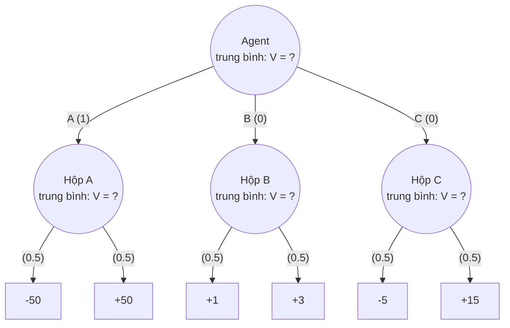

**Frame 1: hộp A: 0.5·(-50) + 0.5·(50) = 0**

```text
                   () POLICY  V = ?
            /              |              \
      A (1)             B (0)             C (0)
       () 0              () ?              () ?
     /     \           /     \           /     \
    -50    50           1    3           -5    15
```

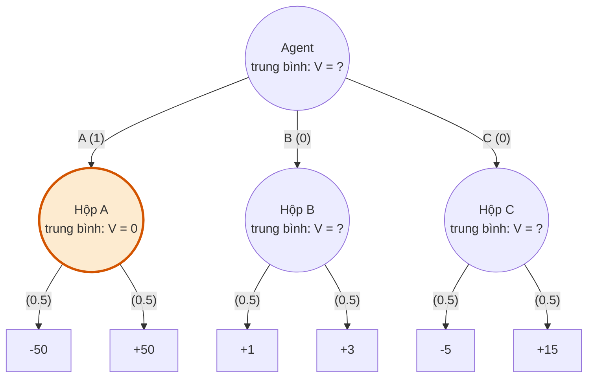

**Frame 2: hộp B: 0.5·(1) + 0.5·(3) = 2**

```text
                   () POLICY  V = ?
            /              |              \
      A (1)             B (0)             C (0)
       () 0              () 2              () ?
     /     \           /     \           /     \
    -50    50           1    3           -5    15
```

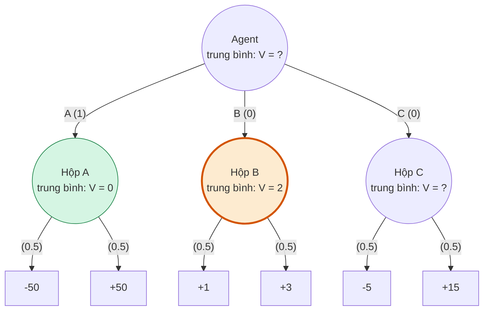

**Frame 3: hộp C: 0.5·(-5) + 0.5·(15) = 5**

```text
                   () POLICY  V = ?
            /              |              \
      A (1)             B (0)             C (0)
       () 0              () 2              () 5
     /     \           /     \           /     \
    -50    50           1    3           -5    15
```

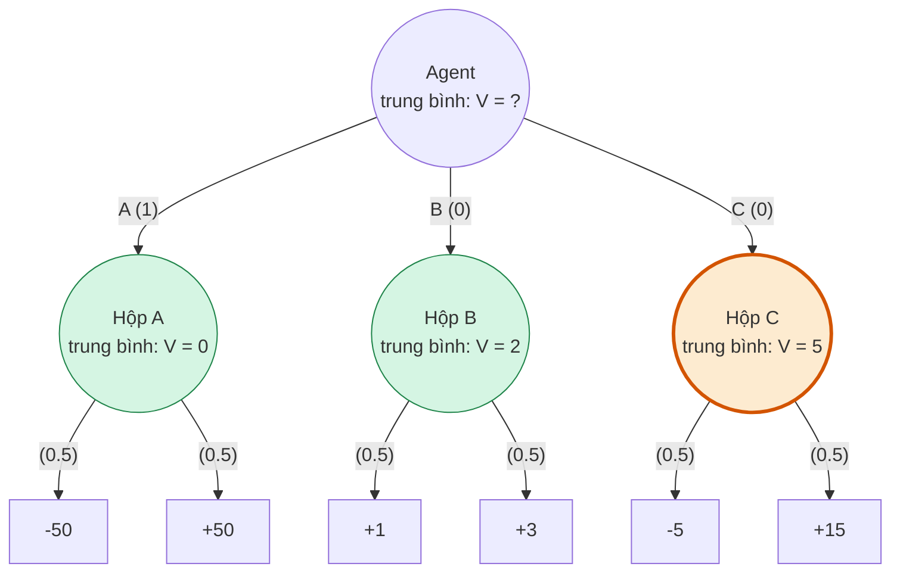

**Frame 4: gốc: 1·0 + 0·2 + 0·5 = 0**

```text
                   () POLICY  V = 0
            /              |              \
    **A (1)**           B (0)             C (0)
       () 0              () 2              () 5
     /     \           /     \           /     \
    -50    50           1    3           -5    15
```

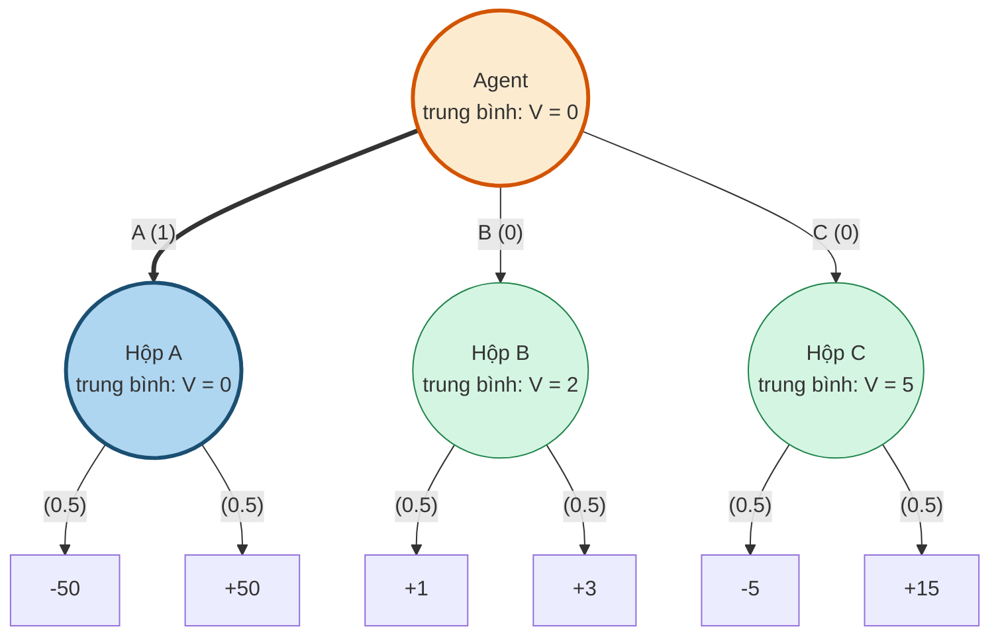

**Walkthrough 2: Expectimax (đổi gốc từ "theo policy" thành `max`)**

Lời dẫn: "Vẫn biết đối thủ tung đồng xu. Nhưng giờ mình được tự chọn hộp." Ba frame đầu giống hệt Game evaluation; chỉ frame cuối khác, nên có thể dùng chung slide animation.

**Frame 0: chỉ biết utility ở lá**

```text
                    /\ MAX  V = ?
            /              |              \
        A                 B                 C
       () ?              () ?              () ?
     /     \           /     \           /     \
    -50    50           1    3           -5    15
```

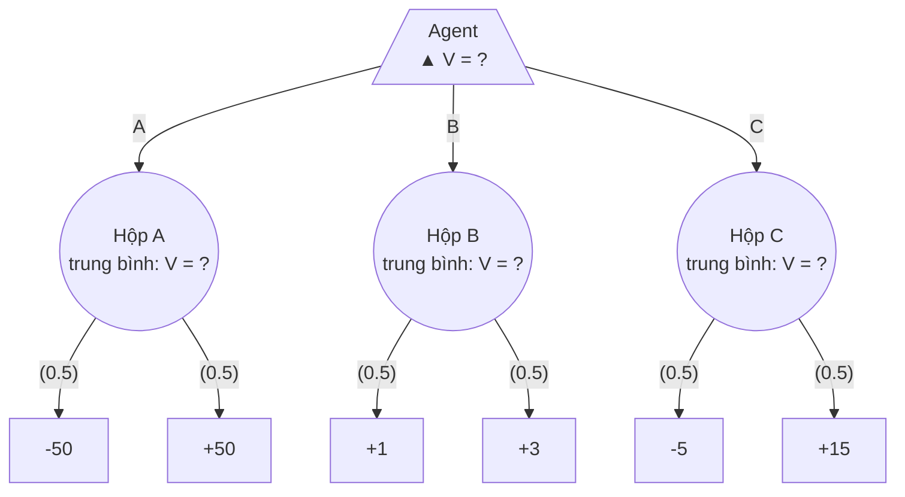

**Frame 1: hộp A: 0.5·(-50) + 0.5·(50) = 0**

```text
                    /\ MAX  V = ?
            /              |              \
        A                 B                 C
       () 0              () ?              () ?
     /     \           /     \           /     \
    -50    50           1    3           -5    15
```

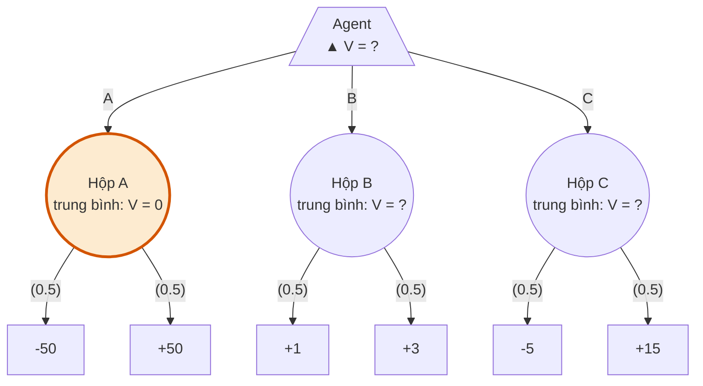

**Frame 2: hộp B: 0.5·(1) + 0.5·(3) = 2**

```text
                    /\ MAX  V = ?
            /              |              \
        A                 B                 C
       () 0              () 2              () ?
     /     \           /     \           /     \
    -50    50           1    3           -5    15
```

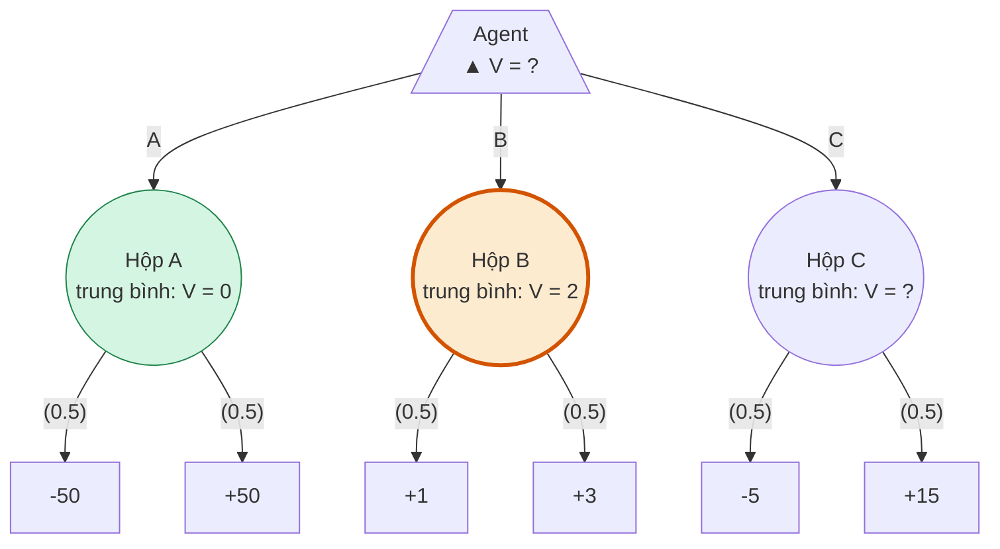

**Frame 3: hộp C: 0.5·(-5) + 0.5·(15) = 5**

```text
                    /\ MAX  V = ?
            /              |              \
        A                 B                 C
       () 0              () 2              () 5
     /     \           /     \           /     \
    -50    50           1    3           -5    15
```

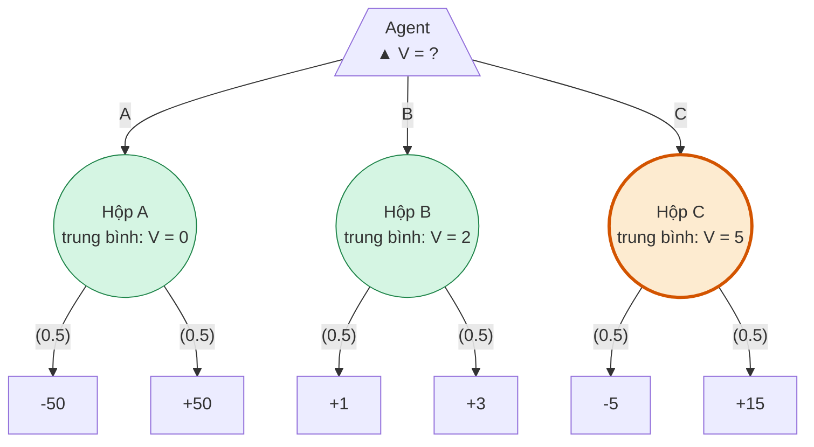

**Frame 4: gốc: max(0, 2, 5) = 5 → chọn C**

```text
                    /\ MAX  V = 5
            /              |              \
        A                 B               **C**
       () 0              () 2              () 5
     /     \           /     \           /     \
    -50    50           1    3           -5    15
```

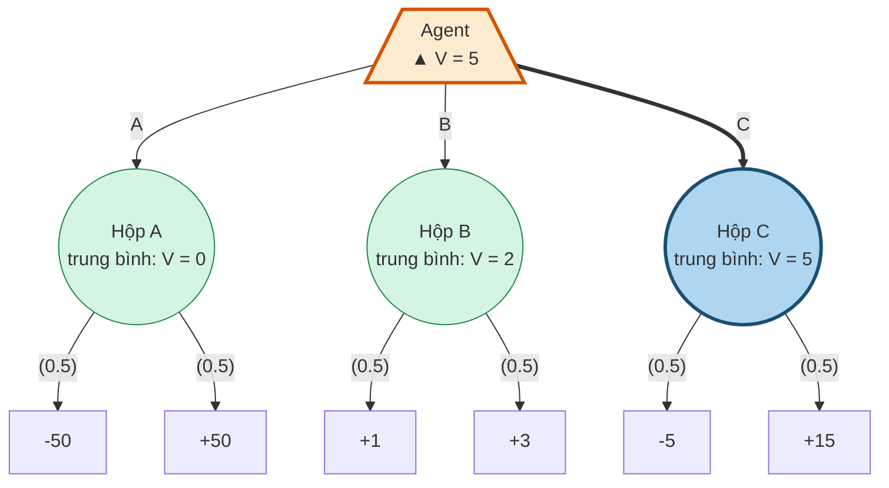

**Walkthrough 3: Minimax (đổi tầng đối thủ từ trung bình thành `min`)**

Lời dẫn: "Giờ không biết đối thủ nghĩ gì, nên giả sử họ tệ nhất cho mình."

**Frame 0: chỉ biết utility ở lá**

```text
                    /\ MAX  V = ?
            /              |              \
        A                 B                 C
       \/ ?              \/ ?              \/ ?
     /     \           /     \           /     \
    -50    50           1    3           -5    15
```

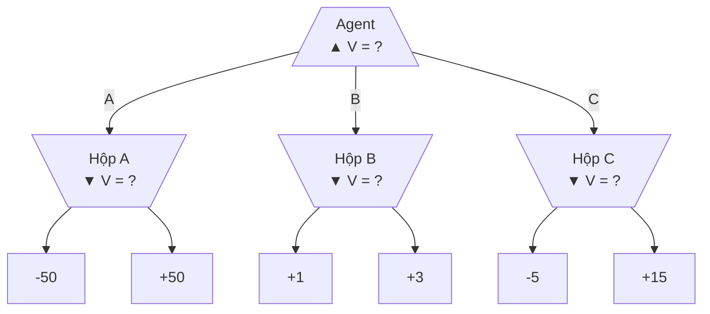

**Frame 1: hộp A: min(-50, 50) = -50**

```text
                    /\ MAX  V = ?
            /              |              \
        A                 B                 C
      \/ -50             \/ ?              \/ ?
     /     \           /     \           /     \
    -50    50           1    3           -5    15
```

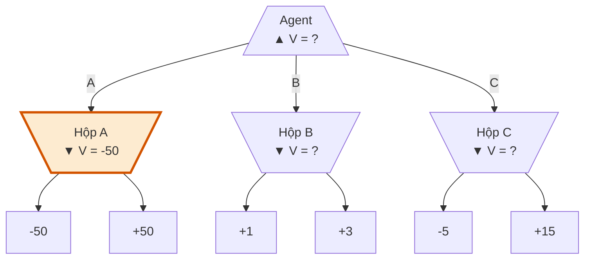

**Frame 2: hộp B: min(1, 3) = 1**

```text
                    /\ MAX  V = ?
            /              |              \
        A                 B                 C
      \/ -50            \/ +1              \/ ?
     /     \           /     \           /     \
    -50    50           1    3           -5    15
```

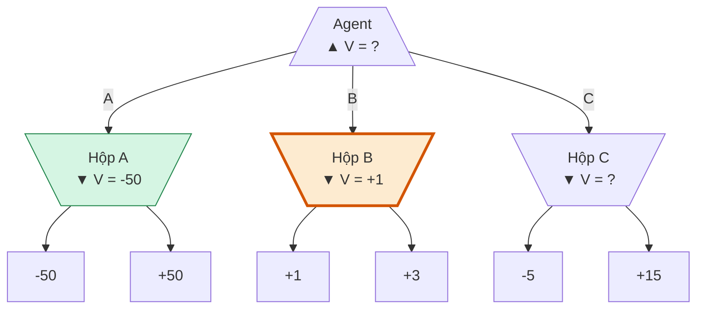

**Frame 3: hộp C: min(-5, 15) = -5**

```text
                    /\ MAX  V = ?
            /              |              \
        A                 B                 C
      \/ -50            \/ +1             \/ -5
     /     \           /     \           /     \
    -50    50           1    3           -5    15
```

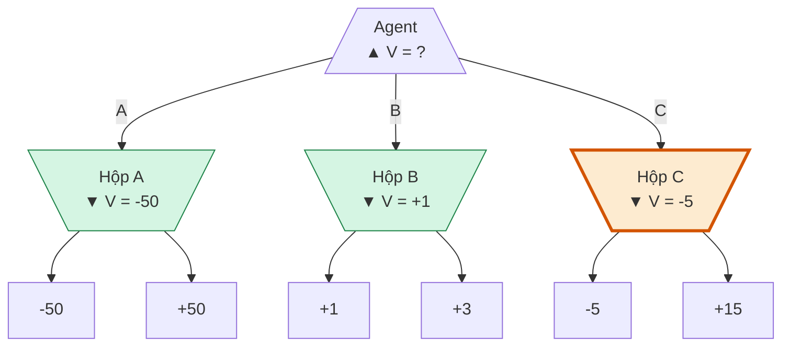

**Frame 4: gốc: max(-50, +1, -5) = +1 → chọn B**

```text
                    /\ MAX  V = +1
            /              |              \
        A               **B**               C
      \/ -50            \/ +1             \/ -5
     /     \           /     \           /     \
    -50    50           1    3           -5    15
```

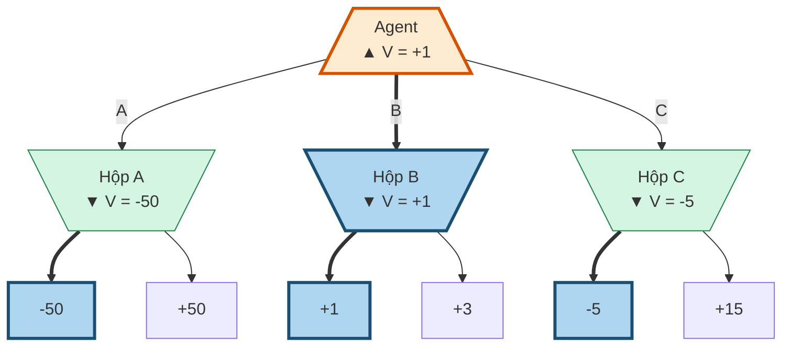

**Một bảng để nhớ cả ba**

| Thuật toán | Node agent | Node đối thủ | Cần biết gì | A | B | C | Gốc | Chọn |
|---|---|---|---|---:|---:|---:|---:|---|
| Game evaluation | theo `π_agent` | theo `π_opp` (trung bình) | cả hai policy | 0 | 2 | 5 | 0 | A (bị áp đặt) |
| Expectimax | `max` | theo `π_opp` (trung bình) | policy đối thủ | 0 | 2 | 5 | 5 | C |
| Minimax | `max` | `min` | không cần policy nào | -50 | 1 | -5 | 1 | B |

**Bảng 2×2 agent policy so với opponent policy**

| | đối thủ `π_min` | đối thủ `π_7` (đều) |
|---|---:|---:|
| agent `π_max` (chọn B) | 1 | 2 |
| agent `π_exptmax(7)` (chọn C) | -5 | 5 |

- Slide cho đúng bốn giá trị này và chuỗi `V(π_exptmax, π_min) ≤ V(π_max, π_min) ≤ V(π_max, π_7) ≤ V(π_exptmax, π_7)` — [games1.pdf, slide 54](/home/bao/Projects/Game1/docs/games1.pdf). Code cho `pi_max: 1, 2` và `pi_exp: -5, 5` — [verify_examples.py](./verify_examples.py).
- Ba tính chất của Minimax trên slide: `π_max` tốt nhất khi gặp `π_min`; giá trị minimax là mức sàn trước mọi đối thủ; và `π_max` không tối ưu nếu biết đối thủ — [games1.pdf, slide 48, 50, 52](/home/bao/Projects/Game1/docs/games1.pdf).

**Đối chiếu với slide**

| Mục | Slide | Code | Kết luận |
|---|---|---|---|
| `V_eval(s_start)` | 0 | 0 | Khớp |
| `V_exptmax(s_start)` | 5 | 5 | Khớp |
| `V_minmax(s_start)` | 1 | 1 | Khớp |
| Bảng 2×2 | 1, 2, -5, 5 | 1, 2, -5, 5 | Khớp |

Không có sai lệch về số. Có một khác biệt ký hiệu nên biết: slide 24 vẽ gốc bằng hình tròn vì cả agent cũng theo policy cố định, còn slide 30 và 38 mới có tam giác — [games1.pdf, slide 24, 30, 38](/home/bao/Projects/Game1/docs/games1.pdf).

**Mở rộng ngắn cho phần hỏi đáp: đối thủ có ác ý một phần**

Nếu đối thủ chơi `min` với xác suất p và chơi đều với xác suất 1-p, đây vẫn là Expectimax với một `π_opp` đã biết. Kết quả từ [analysis.py, mục 8](#phụ-lục-b-analysispy-và-output-thật):

| p | A | B | C | Tốt nhất |
|---:|---:|---:|---:|---|
| 0 | 0 | 2 | 5 | C |
| 1/5 | -10 | 9/5 | 3 | C |
| 1/3 | -50/3 | 5/3 | 5/3 | B và C hòa |
| 1/2 | -25 | 3/2 | 0 | B |
| 1 | -50 | 1 | -5 | B |

### Inferences
- Thông điệp dễ nhớ nhất: "Cùng một cây, chỉ đổi phép toán: trung bình, rồi max, rồi min." Vì frame 0 đến 3 của Evaluation và Expectimax trùng nhau, nhóm có thể làm một animation duy nhất và chỉ đổi frame cuối.
- Mốc p = 1/3 trả lời câu hỏi lớp hay hỏi "vậy thực tế dùng cái nào?": chỉ cần tin đối thủ có ác ý từ một phần ba số lần trở lên thì B đã tốt hơn C.

### Gaps
- Không có điểm nào chưa kiểm chứng được trong phần này.

## 2. Ví dụ mô hình hóa: halving game

### Takeaway
Với luật của khóa học (ai bị để lại với 0 thì thắng), người đi trước thua đúng khi N = 2^k·m (m lẻ) thỏa: m = 1 và k chẵn, hoặc m ≥ 3 và k lẻ. Quy tắc này có chứng minh ngắn và đã được kiểm tra đến N = 100000. Với N = 15 của khóa học, người đi trước thắng và nước đầu thắng duy nhất là `-`.

### Cited Findings

**Mô hình đúng như khóa học**

| Thành phần | Định nghĩa | Nguồn |
|---|---|---|
| Luật | Bắt đầu từ N, hai bên luân phiên trừ 1 hoặc thay bằng ⌊N/2⌋; người bị để lại với 0 thắng | [games1.pdf, slide 18](/home/bao/Projects/Game1/docs/games1.pdf) |
| `s_start` | `(+1, N)` | [game.py của CS221](https://web.stanford.edu/class/archive/cs/cs221/cs221.1196/semilive/games1/game.py) |
| `Actions(s)` | `['-', '/']`, luôn có hai hành động, kể cả khi hai hành động dẫn tới cùng một số | [game.py](https://web.stanford.edu/class/archive/cs/cs221/cs221.1196/semilive/games1/game.py) |
| `Succ(s, a)` | `(-player, number-1)` hoặc `(-player, number//2)` | [game.py](https://web.stanford.edu/class/archive/cs/cs221/cs221.1196/semilive/games1/game.py) |
| `IsEnd(s)` | `number == 0` | [game.py](https://web.stanford.edu/class/archive/cs/cs221/cs221.1196/semilive/games1/game.py) |
| `Utility(s)` | `player * float('inf')` | [game.py](https://web.stanford.edu/class/archive/cs/cs221/cs221.1196/semilive/games1/game.py) |
| `Player(s)` | `player` | [game.py](https://web.stanford.edu/class/archive/cs/cs221/cs221.1196/semilive/games1/game.py) |

- Điểm dễ hiểu sai: vì `Utility = player·∞` tại `number == 0`, người **đến lượt** khi số bằng 0 là người thắng. Người đưa số về 0 thì thua — [game.py](https://web.stanford.edu/class/archive/cs/cs221/cs221.1196/semilive/games1/game.py). Vì vậy không nên diễn đạt thành "người đưa số về 0 thắng".
- Khóa học có đưa kết quả mong đợi không? Slide chỉ ghi `[semi-live solution: HalvingGame]` và `[semi-live solution: minimaxPolicy]`, không in kết quả — [games1.pdf, slide 18, 44](/home/bao/Projects/Game1/docs/games1.pdf). Mã nguồn đặt `N=15`, người chơi +1 là `humanPolicy`, người chơi -1 là `minimaxPolicy` và không ghi đáp án — [game.py](https://web.stanford.edu/class/archive/cs/cs221/cs221.1196/semilive/games1/game.py).

**Trace Minimax với N = 4: bảng 19 lời gọi theo đúng thứ tự DFS**

Chọn N = 4 vì bảng vừa một slide (19 lời gọi, [analysis.py, mục 9](#phụ-lục-b-analysispy-và-output-thật)) và kết quả bất ngờ: có hẳn hai lựa chọn mà người đi trước vẫn thua. Khi hòa, cột ghi chú áp dụng đúng cách phá hòa của khóa học: `max(choices)` và `min(choices)` so sánh tuple `(value, action)`, nên hòa ở max chọn `/`, hòa ở min chọn `-` — [game.py](https://web.stanford.edu/class/archive/cs/cs221/cs221.1196/semilive/games1/game.py).

| Bước | Lời gọi `V(player, n)` | Lượt | Stack | Giá trị các con | Trả về | Ghi chú |
|---:|---|---|---:|---|---|---|
| 1 | `V(+1, 4)` | agent ▲ | 1 | `-`→-∞, `/`→-∞ | **-∞** | max; chọn `/` |
| 2 | `V(-1, 3)` | opp ▼ | 2 | `-`→+∞, `/`→-∞ | **-∞** | min; chọn `/` |
| 3 | `V(+1, 2)` | agent ▲ | 3 | `-`→+∞, `/`→+∞ | **+∞** | max; chọn `/` |
| 4 | `V(-1, 1)` | opp ▼ | 4 | `-`→+∞, `/`→+∞ | **+∞** | min; chọn `-` |
| 5 | `V(+1, 0)` | hết | 5 | (IsEnd) | **+∞** | Utility = player·∞ |
| 6 | `V(+1, 0)` | hết | 5 | (IsEnd) | **+∞** | Utility = player·∞ |
| 7 | `V(-1, 1)` | opp ▼ | 4 | `-`→+∞, `/`→+∞ | **+∞** | min; chọn `-` |
| 8 | `V(+1, 0)` | hết | 5 | (IsEnd) | **+∞** | Utility = player·∞ |
| 9 | `V(+1, 0)` | hết | 5 | (IsEnd) | **+∞** | Utility = player·∞ |
| 10 | `V(+1, 1)` | agent ▲ | 3 | `-`→-∞, `/`→-∞ | **-∞** | max; chọn `/` |
| 11 | `V(-1, 0)` | hết | 4 | (IsEnd) | **-∞** | Utility = player·∞ |
| 12 | `V(-1, 0)` | hết | 4 | (IsEnd) | **-∞** | Utility = player·∞ |
| 13 | `V(-1, 2)` | opp ▼ | 2 | `-`→-∞, `/`→-∞ | **-∞** | min; chọn `-` |
| 14 | `V(+1, 1)` | agent ▲ | 3 | `-`→-∞, `/`→-∞ | **-∞** | max; chọn `/` |
| 15 | `V(-1, 0)` | hết | 4 | (IsEnd) | **-∞** | Utility = player·∞ |
| 16 | `V(-1, 0)` | hết | 4 | (IsEnd) | **-∞** | Utility = player·∞ |
| 17 | `V(+1, 1)` | agent ▲ | 3 | `-`→-∞, `/`→-∞ | **-∞** | max; chọn `/` |
| 18 | `V(-1, 0)` | hết | 4 | (IsEnd) | **-∞** | Utility = player·∞ |
| 19 | `V(-1, 0)` | hết | 4 | (IsEnd) | **-∞** | Utility = player·∞ |

Ý nghĩa: cả hai nước đầu đều thua. `-` đưa đối thủ về 3, đối thủ `/` thành 1 thì mình buộc phải đưa số về 0. `/` đưa đối thủ về 2, đối thủ đưa về 1 và mình cũng phải đưa số về 0.

**Khung hình backup của cây N = 4**

A là agent (+1), O là opp (-1). Nhãn `A n=3` nghĩa là agent đến lượt khi số bằng 3. Trong Mermaid, cạnh `trừ 1` là hành động `-`, cạnh `chia 2` là hành động `/`. Các khung gom theo chiều cao để tiện làm animation; thứ tự DFS thật nằm trong bảng trên.

**Frame 0: chỉ có lá (n=0); người bị để lại với 0 thắng**

```text
/\ MAX A n=4 V=?
|-- [-] \/ MIN O n=3 V=?
|   |-- [-] /\ MAX A n=2 V=?
|   |   |-- [-] \/ MIN O n=1 V=?
|   |   |   |-- [-] [] END A n=0 V=+inf
|   |   |   `-- [/] [] END A n=0 V=+inf
|   |   `-- [/] \/ MIN O n=1 V=?
|   |       |-- [-] [] END A n=0 V=+inf
|   |       `-- [/] [] END A n=0 V=+inf
|   `-- [/] /\ MAX A n=1 V=?
|       |-- [-] [] END O n=0 V=-inf
|       `-- [/] [] END O n=0 V=-inf
`-- [/] \/ MIN O n=2 V=?
    |-- [-] /\ MAX A n=1 V=?
    |   |-- [-] [] END O n=0 V=-inf
    |   `-- [/] [] END O n=0 V=-inf
    `-- [/] /\ MAX A n=1 V=?
        |-- [-] [] END O n=0 V=-inf
        `-- [/] [] END O n=0 V=-inf
```

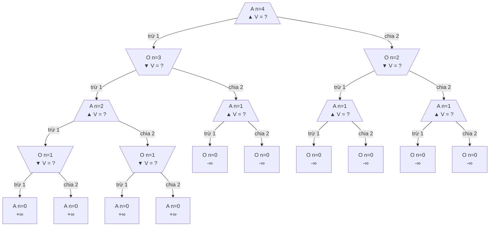

**Frame 1: backup các node có chiều cao 1**

```text
/\ MAX A n=4 V=?
|-- [-] \/ MIN O n=3 V=?
|   |-- [-] /\ MAX A n=2 V=?
|   |   |-- [-] \/ MIN O n=1 V=+inf   (chọn: -)   <== vừa tính
|   |   |   |-- [-] [] END A n=0 V=+inf
|   |   |   `-- [/] [] END A n=0 V=+inf
|   |   `-- [/] \/ MIN O n=1 V=+inf   (chọn: -)   <== vừa tính
|   |       |-- [-] [] END A n=0 V=+inf
|   |       `-- [/] [] END A n=0 V=+inf
|   `-- [/] /\ MAX A n=1 V=-inf   (chọn: /)   <== vừa tính
|       |-- [-] [] END O n=0 V=-inf
|       `-- [/] [] END O n=0 V=-inf
`-- [/] \/ MIN O n=2 V=?
    |-- [-] /\ MAX A n=1 V=-inf   (chọn: /)   <== vừa tính
    |   |-- [-] [] END O n=0 V=-inf
    |   `-- [/] [] END O n=0 V=-inf
    `-- [/] /\ MAX A n=1 V=-inf   (chọn: /)   <== vừa tính
        |-- [-] [] END O n=0 V=-inf
        `-- [/] [] END O n=0 V=-inf
```

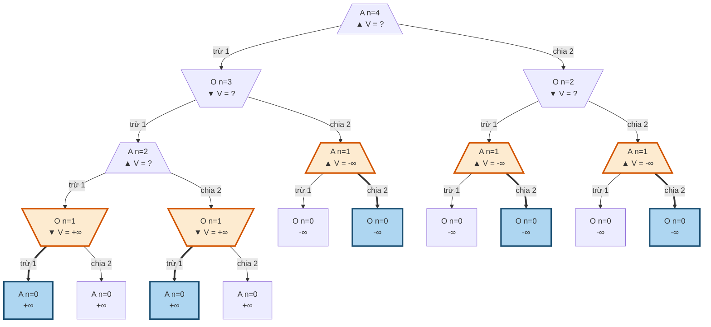

**Frame 2: backup các node có chiều cao 2**

```text
/\ MAX A n=4 V=?
|-- [-] \/ MIN O n=3 V=?
|   |-- [-] /\ MAX A n=2 V=+inf   (chọn: /)   <== vừa tính
|   |   |-- [-] \/ MIN O n=1 V=+inf   (chọn: -)
|   |   |   |-- [-] [] END A n=0 V=+inf
|   |   |   `-- [/] [] END A n=0 V=+inf
|   |   `-- [/] \/ MIN O n=1 V=+inf   (chọn: -)
|   |       |-- [-] [] END A n=0 V=+inf
|   |       `-- [/] [] END A n=0 V=+inf
|   `-- [/] /\ MAX A n=1 V=-inf   (chọn: /)
|       |-- [-] [] END O n=0 V=-inf
|       `-- [/] [] END O n=0 V=-inf
`-- [/] \/ MIN O n=2 V=-inf   (chọn: -)   <== vừa tính
    |-- [-] /\ MAX A n=1 V=-inf   (chọn: /)
    |   |-- [-] [] END O n=0 V=-inf
    |   `-- [/] [] END O n=0 V=-inf
    `-- [/] /\ MAX A n=1 V=-inf   (chọn: /)
        |-- [-] [] END O n=0 V=-inf
        `-- [/] [] END O n=0 V=-inf
```

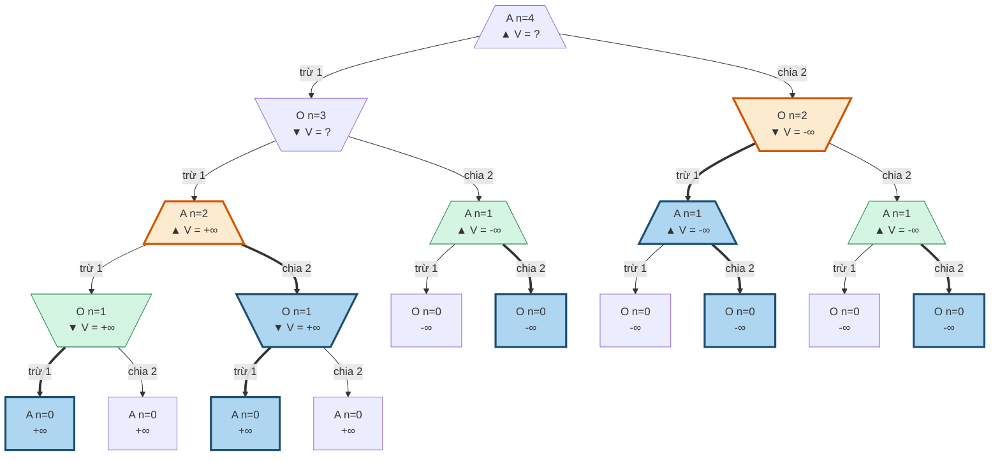

**Frame 3: backup các node có chiều cao 3**

```text
/\ MAX A n=4 V=?
|-- [-] \/ MIN O n=3 V=-inf   (chọn: /)   <== vừa tính
|   |-- [-] /\ MAX A n=2 V=+inf   (chọn: /)
|   |   |-- [-] \/ MIN O n=1 V=+inf   (chọn: -)
|   |   |   |-- [-] [] END A n=0 V=+inf
|   |   |   `-- [/] [] END A n=0 V=+inf
|   |   `-- [/] \/ MIN O n=1 V=+inf   (chọn: -)
|   |       |-- [-] [] END A n=0 V=+inf
|   |       `-- [/] [] END A n=0 V=+inf
|   `-- [/] /\ MAX A n=1 V=-inf   (chọn: /)
|       |-- [-] [] END O n=0 V=-inf
|       `-- [/] [] END O n=0 V=-inf
`-- [/] \/ MIN O n=2 V=-inf   (chọn: -)
    |-- [-] /\ MAX A n=1 V=-inf   (chọn: /)
    |   |-- [-] [] END O n=0 V=-inf
    |   `-- [/] [] END O n=0 V=-inf
    `-- [/] /\ MAX A n=1 V=-inf   (chọn: /)
        |-- [-] [] END O n=0 V=-inf
        `-- [/] [] END O n=0 V=-inf
```

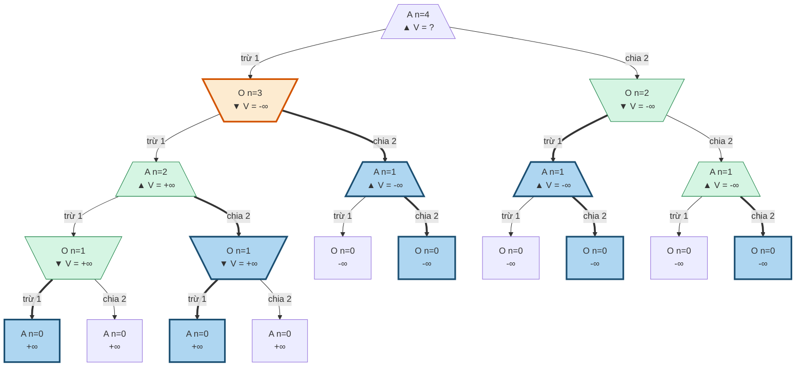

**Frame 4: backup các node có chiều cao 4**

```text
/\ MAX A n=4 V=-inf   (chọn: /)   <== vừa tính
|-- [-] \/ MIN O n=3 V=-inf   (chọn: /)
|   |-- [-] /\ MAX A n=2 V=+inf   (chọn: /)
|   |   |-- [-] \/ MIN O n=1 V=+inf   (chọn: -)
|   |   |   |-- [-] [] END A n=0 V=+inf
|   |   |   `-- [/] [] END A n=0 V=+inf
|   |   `-- [/] \/ MIN O n=1 V=+inf   (chọn: -)
|   |       |-- [-] [] END A n=0 V=+inf
|   |       `-- [/] [] END A n=0 V=+inf
|   `-- [/] /\ MAX A n=1 V=-inf   (chọn: /)
|       |-- [-] [] END O n=0 V=-inf
|       `-- [/] [] END O n=0 V=-inf
`-- [/] \/ MIN O n=2 V=-inf   (chọn: -)
    |-- [-] /\ MAX A n=1 V=-inf   (chọn: /)
    |   |-- [-] [] END O n=0 V=-inf
    |   `-- [/] [] END O n=0 V=-inf
    `-- [/] /\ MAX A n=1 V=-inf   (chọn: /)
        |-- [-] [] END O n=0 V=-inf
        `-- [/] [] END O n=0 V=-inf
```

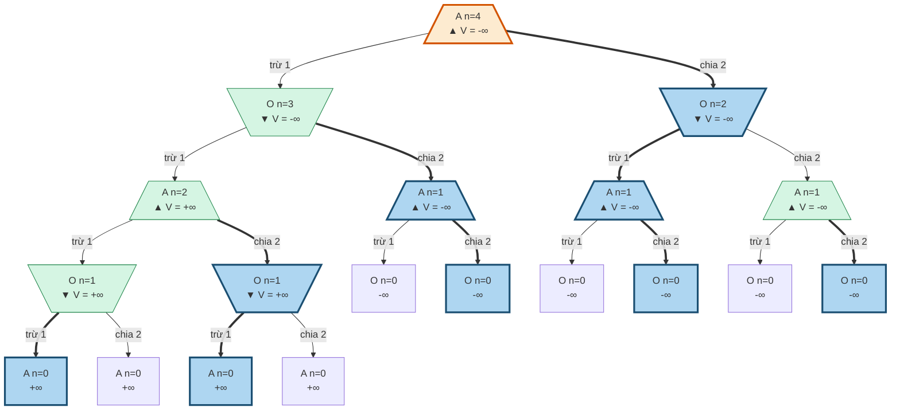

**Ai thắng với N = 1..64** (A: người đi trước thắng, **O**: người đi sau thắng), [analysis.py, mục 9](#phụ-lục-b-analysispy-và-output-thật), đã đối chiếu với Minimax đệ quy cho N = 1..64:

| N | 1 | 2 | 3 | 4 | 5 | 6 | 7 | 8 | 9 | 10 | 11 | 12 | 13 | 14 | 15 | 16 |
|---|---|---|---|---|---|---|---|---|---|---|---|---|---|---|---|---|
| 1–16 | **O** | A | A | **O** | A | **O** | A | A | A | **O** | A | A | A | **O** | A | **O** |
| 17–32 | A | **O** | A | A | A | **O** | A | **O** | A | **O** | A | A | A | **O** | A | A |
| 33–48 | A | **O** | A | A | A | **O** | A | **O** | A | **O** | A | A | A | **O** | A | A |
| 49–64 | A | **O** | A | A | A | **O** | A | **O** | A | **O** | A | A | A | **O** | A | **O** |

Người đi trước thua tại N = 1, 4, 6, 10, 14, 16, 18, 22, 24, 26, 30, 34, 38, 40, 42, 46, 50, 54, 56, 58, 62, 64.

**Định lý và chứng minh**

Gọi L là tập các số mà người đến lượt sẽ thua. Khi đó 0 ∉ L (bị để lại với 0 là thắng) và 1 ∈ L (mọi nước đều đưa số về 0, đối thủ thắng).

1. **Mọi số lẻ n ≥ 3 không thuộc L.** Đặt h = (n-1)/2 ≥ 1. Nếu h ∈ L thì đi `/` tới h là thắng. Nếu h ∉ L thì h ≥ 2, nên xét n-1 = 2h. Hai nước từ 2h dẫn tới 2h-1 và h. Số 2h-1 lẻ và ≥ 3 nên theo quy nạp không thuộc L, còn h không thuộc L theo giả thiết. Vậy 2h ∈ L, và đi `-` từ n tới 2h là thắng.
2. **Với mọi h ≥ 1: 2h ∈ L khi và chỉ khi h ∉ L.** Nếu h = 1 thì cả hai nước từ 2 đều dẫn tới 1 ∈ L, nên 2 ∉ L, đúng với mệnh đề. Nếu h ≥ 2 thì nước `-` dẫn tới 2h-1 ∉ L theo bước 1, nên kết quả chỉ phụ thuộc nước `/` dẫn tới h.
3. **Kết luận.** Mỗi lần nhân đôi thì đổi phe. Viết n = 2^k·m với m lẻ. Nếu m = 1: vì 1 ∈ L nên n ∈ L khi k chẵn. Nếu m ≥ 3: vì m ∉ L nên n ∈ L khi k lẻ. ∎

Kiểm chứng: định lý khớp với quy hoạch động cho toàn bộ N = 1..100000 — [analysis.py, mục 9](#phụ-lục-b-analysispy-và-output-thật).

Nếu đọc sai luật thành "người đưa số về 0 thắng", người đi trước sẽ thua tại N = 2, 6, 8, 10, 14, 18, 22, 24, 26, 30, 32, 34, 38, 40, tức khi số mũ của 2 trong N là lẻ; quy tắc này cũng khớp đến N = 100000 — [analysis.py, mục 9](#phụ-lục-b-analysispy-và-output-thật). Vậy cách đọc luật làm đổi đáp án, ví dụ N = 4 và N = 8 đổi người thắng.

**Chi phí đệ quy không memo:** số lời gọi là 19 (N=4), 331 (N=15), 2919 (N=30), 54675 (N=64), 411315 (N=100) — [analysis.py, mục 9](#phụ-lục-b-analysispy-và-output-thật).

### Inferences
- Câu dễ nhớ cho lớp: "Số lẻ từ 3 trở lên thì người đến lượt luôn thắng; số chẵn thì nhìn nửa của nó và đảo kết quả."
- Bài học mô hình hóa: state phải chứa cả lượt đi. Cùng số 4 nhưng `V(+1, 4) = -∞` còn `V(-1, 4) = +∞`, nên nếu state chỉ có `number` thì không định nghĩa được `Player(s)`.

### Gaps
- Tôi không tìm thấy nơi khóa học công bố đáp án cho N = 15 hay quy luật người thắng; quy luật và chứng minh ở đây là của ghi chú này, đã kiểm chứng bằng code nhưng chưa được đối chiếu với tài liệu khóa học hay giảng viên.
- File `game.py` ở trên thuộc bản lưu trữ cs221.1196. Tôi không kiểm tra được bản Spring 2026 có dùng đúng mã này không.

## 3. Ví dụ giàu nội dung: tic-tac-toe, bẫy và khoảnh khắc Minimax khác Expectimax

### Takeaway
Tìm được cả hai điều mong muốn: thế cờ Q (4 ô trống) có hai nước cùng tạo đe dọa trên một đường, nhưng một nước thua và một nước hòa; thế cờ P (6 ô trống) có Minimax chọn ô 0 hoặc 6 (giá trị 0), còn Expectimax chọn ô 2 hoặc 8 (13/15), là những nước Minimax chấm là thua. Vét cạn cho thấy hai thuật toán chỉ bất đồng thật sự khi X đi sau, và chỉ ở 6 hoặc 8 ô trống, nên không có ví dụ như vậy ở 3 đến 5 ô trống.

### Cited Findings

**Quy ước.** X là agent (max), O là đối thủ. Utility: X thắng +1, hòa 0, O thắng -1. Trong P và Q **O đi trước**, nên khi đến lượt X thì O luôn nhiều hơn X một quân. Nếu muốn giữ thói quen "X đi trước" thì chỉ cần đổi tên hai quân. Số ô:

```text
0 1 2
3 4 5
6 7 8
```

**Kết quả tìm kiếm vét cạn** (mọi thế X đến lượt, chưa kết thúc, đạt được từ bàn trống), [analysis.py, mục 1](#phụ-lục-b-analysispy-và-output-thật):

| Ai đi trước | Số thế X đến lượt | Tập nước tốt nhất của hai thuật toán không giao nhau | Có cặp nước bị đảo thứ hạng |
|---|---:|---|---|
| X | 2423 | 0 thế | 24 thế ở 5 ô trống, 8 thế ở 7 ô trống |
| O | 2097 | 20 thế: 16 ở 6 ô trống, 4 ở 8 ô trống (3 lớp theo đối xứng) | 40 thế ở 4 ô trống, 60 ở 6, 4 ở 8 |

Ba lớp bất đồng thật sự, [analysis.py, mục 1 và 2](#phụ-lục-b-analysispy-và-output-thật):

| Thế (O đi trước) | Minimax chọn | Giá trị kỳ vọng nước đó | Expectimax chọn | Giá trị kỳ vọng | Giá trị Minimax của nước đó | Chênh lệch kỳ vọng |
|---|---|---:|---|---:|---:|---:|
| **P** `...O.X.O.` | 0, 6 | tốt nhất 3/5 | 2, 8 | 13/15 | -1 | 4/15 |
| `...O.X..O` | 0, 6 | tốt nhất 2/5 | 4 | 8/15 | -1 | 2/15 |
| `.......O.` (O mở ở cạnh) | 1, 4, 6, 8 | tốt nhất 33/35 | 0, 2 | 101/105 | -1 | 2/105 |

Ngoài ra, ở bàn trống mọi nước đều có giá trị Minimax 0, trong khi Expectimax chọn góc (191/192), hơn trung tâm (95/96) và cạnh (379/384). Đó là phá hòa chứ chưa phải bất đồng thật sự — [analysis.py, mục 2](#phụ-lục-b-analysispy-và-output-thật).

### Phần A: thế Q, trace đầy đủ (4 ô trống, 61 node)

```text
Q
. . .
O . X
X O O
X đi, 4 ô trống
```

Hai nước X2 và X4 cùng tạo đe dọa trên **một đường chéo** (2, 4, 6). Nhìn bề ngoài chúng tương đương nhau. Kết quả, từ [verify_examples.py](./verify_examples.py) và [analysis.py, mục 12](#phụ-lục-b-analysispy-và-output-thật):

| Nước | Tạo đe dọa? | Minimax | Expectimax | Số node trong nhánh |
|---|---|---:|---:|---:|
| X0 | không | 0 | 0 | 16 |
| X1 | không | 0 | 0 | 16 |
| X2 | có, tại ô 4 | **-1** | 1/3 | 14 |
| X4 | có, tại ô 2 | 0 | **2/3** | 14 |

Vì sao X2 thua: nó ép O vào ô 4. O chặn xong thì có hai đường đe dọa cùng lúc (0, 4, 8 và 1, 4, 7), X chỉ chặn được một.

```text
Q         X2        O4 (chặn)      X0 (chặn 1)   O1
. . .     . . X     . . X          X . X         X O X
O . X     O . X     O O X          O O X         O O X
X O O     X O O     X O O          X O O         X O O
X đi      dọa ô 4   O dọa 0 và 1                 O thắng
```

Vì sao X4 an toàn: X tự chiếm ô 4 và ép O vào ô 2, nơi O không tạo được đe dọa nào.

```text
Q         X4        O2 (chặn)   X0        O1
. . .     . . .     . . O       X . O     X O O
O . X     O X X     O X X       O X X     O X X
X O O     X O O     X O O       X O O     X O O
X đi      dọa ô 2   O hết dọa             hòa
```

**Quyết định cuối:** `V(Q) = max(0, 0, -1, 0) = 0`. Minimax coi X0, X1, X4 như nhau và theo thứ tự DFS sẽ chọn X0. Điều duy nhất nó cấm là X2. Expectimax chọn X4 (2/3).

**Khung hình cấp gốc (dùng làm animation chính)**

**Frame 0: gốc gọi 4 lời gọi con, chưa có giá trị**

```text
gốc:      X0        X1        X2        X4
. . .     X . .     . X .     . . X     . . .
O . X     O . X     O . X     O . X     O X X
X O O     X O O     X O O     X O O     X O O
V=?       V=?       V=?       V=?       V=?
```

```mermaid
graph TD
  q111[/". . .<br/>O . X<br/>X O O<br/>▲ V = ?"\]
  q112[\"X . .<br/>O . X<br/>X O O<br/>▼ V = ?"/]
  q113[\". X .<br/>O . X<br/>X O O<br/>▼ V = ?"/]
  q114[\". . X<br/>O . X<br/>X O O<br/>▼ V = ?"/]
  q115[\". . .<br/>O X X<br/>X O O<br/>▼ V = ?"/]
  q111 -->|"X0"| q112
  q111 -->|"X1"| q113
  q111 -->|"X2"| q114
  q111 -->|"X4"| q115
  classDef done fill:#d5f5e3,stroke:#1e8449
  classDef now fill:#fdebd0,stroke:#d35400,stroke-width:3px
  classDef pick fill:#aed6f1,stroke:#1b4f72,stroke-width:3px
```

**Frame 1: DFS xong nhánh X0 (bước 2 đến 17), trả về 0**

```text
gốc:      X0        X1        X2        X4
. . .     X . .     . X .     . . X     . . .
O . X     O . X     O . X     O . X     O X X
X O O     X O O     X O O     X O O     X O O
V=?       V=0       V=?       V=?       V=?
```

```mermaid
graph TD
  q111[/". . .<br/>O . X<br/>X O O<br/>▲ V = ?"\]
  q112[\"X . .<br/>O . X<br/>X O O<br/>▼ V = 0"/]
  q113[\". X .<br/>O . X<br/>X O O<br/>▼ V = ?"/]
  q114[\". . X<br/>O . X<br/>X O O<br/>▼ V = ?"/]
  q115[\". . .<br/>O X X<br/>X O O<br/>▼ V = ?"/]
  q111 -->|"X0"| q112
  q111 -->|"X1"| q113
  q111 -->|"X2"| q114
  q111 -->|"X4"| q115
  classDef done fill:#d5f5e3,stroke:#1e8449
  classDef now fill:#fdebd0,stroke:#d35400,stroke-width:3px
  classDef pick fill:#aed6f1,stroke:#1b4f72,stroke-width:3px
  class q112 now
```

**Frame 2: DFS xong nhánh X1 (bước 18 đến 33), trả về 0**

```text
gốc:      X0        X1        X2        X4
. . .     X . .     . X .     . . X     . . .
O . X     O . X     O . X     O . X     O X X
X O O     X O O     X O O     X O O     X O O
V=?       V=0       V=0       V=?       V=?
```

```mermaid
graph TD
  q111[/". . .<br/>O . X<br/>X O O<br/>▲ V = ?"\]
  q112[\"X . .<br/>O . X<br/>X O O<br/>▼ V = 0"/]
  q113[\". X .<br/>O . X<br/>X O O<br/>▼ V = 0"/]
  q114[\". . X<br/>O . X<br/>X O O<br/>▼ V = ?"/]
  q115[\". . .<br/>O X X<br/>X O O<br/>▼ V = ?"/]
  q111 -->|"X0"| q112
  q111 -->|"X1"| q113
  q111 -->|"X2"| q114
  q111 -->|"X4"| q115
  classDef done fill:#d5f5e3,stroke:#1e8449
  classDef now fill:#fdebd0,stroke:#d35400,stroke-width:3px
  classDef pick fill:#aed6f1,stroke:#1b4f72,stroke-width:3px
  class q112 done
  class q113 now
```

**Frame 3: DFS xong nhánh X2 (bước 34 đến 47), trả về -1**

```text
gốc:      X0        X1        X2        X4
. . .     X . .     . X .     . . X     . . .
O . X     O . X     O . X     O . X     O X X
X O O     X O O     X O O     X O O     X O O
V=?       V=0       V=0       V=-1      V=?
```

```mermaid
graph TD
  q111[/". . .<br/>O . X<br/>X O O<br/>▲ V = ?"\]
  q112[\"X . .<br/>O . X<br/>X O O<br/>▼ V = 0"/]
  q113[\". X .<br/>O . X<br/>X O O<br/>▼ V = 0"/]
  q114[\". . X<br/>O . X<br/>X O O<br/>▼ V = -1"/]
  q115[\". . .<br/>O X X<br/>X O O<br/>▼ V = ?"/]
  q111 -->|"X0"| q112
  q111 -->|"X1"| q113
  q111 -->|"X2"| q114
  q111 -->|"X4"| q115
  classDef done fill:#d5f5e3,stroke:#1e8449
  classDef now fill:#fdebd0,stroke:#d35400,stroke-width:3px
  classDef pick fill:#aed6f1,stroke:#1b4f72,stroke-width:3px
  class q112,q113 done
  class q114 now
```

**Frame 4: DFS xong nhánh X4 (bước 48 đến 61), trả về 0**

```text
gốc:      X0        X1        X2        X4
. . .     X . .     . X .     . . X     . . .
O . X     O . X     O . X     O . X     O X X
X O O     X O O     X O O     X O O     X O O
V=?       V=0       V=0       V=-1      V=0
```

```mermaid
graph TD
  q111[/". . .<br/>O . X<br/>X O O<br/>▲ V = ?"\]
  q112[\"X . .<br/>O . X<br/>X O O<br/>▼ V = 0"/]
  q113[\". X .<br/>O . X<br/>X O O<br/>▼ V = 0"/]
  q114[\". . X<br/>O . X<br/>X O O<br/>▼ V = -1"/]
  q115[\". . .<br/>O X X<br/>X O O<br/>▼ V = 0"/]
  q111 -->|"X0"| q112
  q111 -->|"X1"| q113
  q111 -->|"X2"| q114
  q111 -->|"X4"| q115
  classDef done fill:#d5f5e3,stroke:#1e8449
  classDef now fill:#fdebd0,stroke:#d35400,stroke-width:3px
  classDef pick fill:#aed6f1,stroke:#1b4f72,stroke-width:3px
  class q112,q113,q114 done
  class q115 now
```

**Frame 5: gốc: max(0, 0, -1, 0) = 0. Chỉ X2 thua; DFS gặp X0 đầu tiên nên first-tie chọn X0**

```text
gốc:      X0        X1        X2        X4
. . .     X . .     . X .     . . X     . . .
O . X     O . X     O . X     O . X     O X X
X O O     X O O     X O O     X O O     X O O
V=0       V=0       V=0       V=-1      V=0
```

```mermaid
graph TD
  q111[/". . .<br/>O . X<br/>X O O<br/>▲ V = 0"\]
  q112[\"X . .<br/>O . X<br/>X O O<br/>▼ V = 0"/]
  q113[\". X .<br/>O . X<br/>X O O<br/>▼ V = 0"/]
  q114[\". . X<br/>O . X<br/>X O O<br/>▼ V = -1"/]
  q115[\". . .<br/>O X X<br/>X O O<br/>▼ V = 0"/]
  q111 ==>|"X0"| q112
  q111 -->|"X1"| q113
  q111 -->|"X2"| q114
  q111 -->|"X4"| q115
  classDef done fill:#d5f5e3,stroke:#1e8449
  classDef now fill:#fdebd0,stroke:#d35400,stroke-width:3px
  classDef pick fill:#aed6f1,stroke:#1b4f72,stroke-width:3px
  class q112,q113,q114,q115 done
  class q111 now
  class q112 pick
```

**Phóng to nhánh X2: nơi bẫy xuất hiện**

**Nhánh X2, frame 0: chỉ biết các lá**

```mermaid
graph TD
  t83[\". . X<br/>O . X<br/>X O O<br/>▼ V = ?"/]
  t84[/"O . X<br/>O . X<br/>X O O<br/>▲ V = ?"\]
  t85[\"O X X<br/>O . X<br/>X O O<br/>▼ V = ?"/]
  t86["O X X<br/>O O X<br/>X O O<br/>-1"]
  t87["O . X<br/>O X X<br/>X O O<br/>+1"]
  t88[/". O X<br/>O . X<br/>X O O<br/>▲ V = ?"\]
  t89[\"X O X<br/>O . X<br/>X O O<br/>▼ V = ?"/]
  t90["X O X<br/>O O X<br/>X O O<br/>-1"]
  t91[". O X<br/>O X X<br/>X O O<br/>+1"]
  t92[/". . X<br/>O O X<br/>X O O<br/>▲ V = ?"\]
  t93[\"X . X<br/>O O X<br/>X O O<br/>▼ V = ?"/]
  t94["X O X<br/>O O X<br/>X O O<br/>-1"]
  t95[\". X X<br/>O O X<br/>X O O<br/>▼ V = ?"/]
  t96["O X X<br/>O O X<br/>X O O<br/>-1"]
  t83 -->|"O0"| t84
  t83 -->|"O1"| t88
  t83 -->|"O4"| t92
  t84 -->|"X1"| t85
  t84 -->|"X4"| t87
  t85 -->|"O4"| t86
  t88 -->|"X0"| t89
  t88 -->|"X4"| t91
  t89 -->|"O4"| t90
  t92 -->|"X0"| t93
  t92 -->|"X1"| t95
  t93 -->|"O1"| t94
  t95 -->|"O0"| t96
  classDef done fill:#d5f5e3,stroke:#1e8449
  classDef now fill:#fdebd0,stroke:#d35400,stroke-width:3px
  classDef pick fill:#aed6f1,stroke:#1b4f72,stroke-width:3px
```

**Nhánh X2, frame 1: backup chiều cao 1**

```mermaid
graph TD
  t83[\". . X<br/>O . X<br/>X O O<br/>▼ V = ?"/]
  t84[/"O . X<br/>O . X<br/>X O O<br/>▲ V = ?"\]
  t85[\"O X X<br/>O . X<br/>X O O<br/>▼ V = -1"/]
  t86["O X X<br/>O O X<br/>X O O<br/>-1"]
  t87["O . X<br/>O X X<br/>X O O<br/>+1"]
  t88[/". O X<br/>O . X<br/>X O O<br/>▲ V = ?"\]
  t89[\"X O X<br/>O . X<br/>X O O<br/>▼ V = -1"/]
  t90["X O X<br/>O O X<br/>X O O<br/>-1"]
  t91[". O X<br/>O X X<br/>X O O<br/>+1"]
  t92[/". . X<br/>O O X<br/>X O O<br/>▲ V = ?"\]
  t93[\"X . X<br/>O O X<br/>X O O<br/>▼ V = -1"/]
  t94["X O X<br/>O O X<br/>X O O<br/>-1"]
  t95[\". X X<br/>O O X<br/>X O O<br/>▼ V = -1"/]
  t96["O X X<br/>O O X<br/>X O O<br/>-1"]
  t83 -->|"O0"| t84
  t83 -->|"O1"| t88
  t83 -->|"O4"| t92
  t84 -->|"X1"| t85
  t84 -->|"X4"| t87
  t85 ==>|"O4"| t86
  t88 -->|"X0"| t89
  t88 -->|"X4"| t91
  t89 ==>|"O4"| t90
  t92 -->|"X0"| t93
  t92 -->|"X1"| t95
  t93 ==>|"O1"| t94
  t95 ==>|"O0"| t96
  classDef done fill:#d5f5e3,stroke:#1e8449
  classDef now fill:#fdebd0,stroke:#d35400,stroke-width:3px
  classDef pick fill:#aed6f1,stroke:#1b4f72,stroke-width:3px
  class t85,t89,t93,t95 now
  class t86,t90,t94,t96 pick
```

**Nhánh X2, frame 2: backup chiều cao 2**

```mermaid
graph TD
  t83[\". . X<br/>O . X<br/>X O O<br/>▼ V = ?"/]
  t84[/"O . X<br/>O . X<br/>X O O<br/>▲ V = +1"\]
  t85[\"O X X<br/>O . X<br/>X O O<br/>▼ V = -1"/]
  t86["O X X<br/>O O X<br/>X O O<br/>-1"]
  t87["O . X<br/>O X X<br/>X O O<br/>+1"]
  t88[/". O X<br/>O . X<br/>X O O<br/>▲ V = +1"\]
  t89[\"X O X<br/>O . X<br/>X O O<br/>▼ V = -1"/]
  t90["X O X<br/>O O X<br/>X O O<br/>-1"]
  t91[". O X<br/>O X X<br/>X O O<br/>+1"]
  t92[/". . X<br/>O O X<br/>X O O<br/>▲ V = -1"\]
  t93[\"X . X<br/>O O X<br/>X O O<br/>▼ V = -1"/]
  t94["X O X<br/>O O X<br/>X O O<br/>-1"]
  t95[\". X X<br/>O O X<br/>X O O<br/>▼ V = -1"/]
  t96["O X X<br/>O O X<br/>X O O<br/>-1"]
  t83 -->|"O0"| t84
  t83 -->|"O1"| t88
  t83 -->|"O4"| t92
  t84 -->|"X1"| t85
  t84 ==>|"X4"| t87
  t85 ==>|"O4"| t86
  t88 -->|"X0"| t89
  t88 ==>|"X4"| t91
  t89 ==>|"O4"| t90
  t92 ==>|"X0"| t93
  t92 -->|"X1"| t95
  t93 ==>|"O1"| t94
  t95 ==>|"O0"| t96
  classDef done fill:#d5f5e3,stroke:#1e8449
  classDef now fill:#fdebd0,stroke:#d35400,stroke-width:3px
  classDef pick fill:#aed6f1,stroke:#1b4f72,stroke-width:3px
  class t85,t89,t93,t95 done
  class t84,t88,t92 now
  class t87,t86,t91,t90,t93,t94,t96 pick
```

**Nhánh X2, frame 3: backup chiều cao 3**

```mermaid
graph TD
  t83[\". . X<br/>O . X<br/>X O O<br/>▼ V = -1"/]
  t84[/"O . X<br/>O . X<br/>X O O<br/>▲ V = +1"\]
  t85[\"O X X<br/>O . X<br/>X O O<br/>▼ V = -1"/]
  t86["O X X<br/>O O X<br/>X O O<br/>-1"]
  t87["O . X<br/>O X X<br/>X O O<br/>+1"]
  t88[/". O X<br/>O . X<br/>X O O<br/>▲ V = +1"\]
  t89[\"X O X<br/>O . X<br/>X O O<br/>▼ V = -1"/]
  t90["X O X<br/>O O X<br/>X O O<br/>-1"]
  t91[". O X<br/>O X X<br/>X O O<br/>+1"]
  t92[/". . X<br/>O O X<br/>X O O<br/>▲ V = -1"\]
  t93[\"X . X<br/>O O X<br/>X O O<br/>▼ V = -1"/]
  t94["X O X<br/>O O X<br/>X O O<br/>-1"]
  t95[\". X X<br/>O O X<br/>X O O<br/>▼ V = -1"/]
  t96["O X X<br/>O O X<br/>X O O<br/>-1"]
  t83 -->|"O0"| t84
  t83 -->|"O1"| t88
  t83 ==>|"O4"| t92
  t84 -->|"X1"| t85
  t84 ==>|"X4"| t87
  t85 ==>|"O4"| t86
  t88 -->|"X0"| t89
  t88 ==>|"X4"| t91
  t89 ==>|"O4"| t90
  t92 ==>|"X0"| t93
  t92 -->|"X1"| t95
  t93 ==>|"O1"| t94
  t95 ==>|"O0"| t96
  classDef done fill:#d5f5e3,stroke:#1e8449
  classDef now fill:#fdebd0,stroke:#d35400,stroke-width:3px
  classDef pick fill:#aed6f1,stroke:#1b4f72,stroke-width:3px
  class t84,t85,t88,t89,t92,t93,t95 done
  class t83 now
  class t92,t87,t86,t91,t90,t93,t94,t96 pick
```

**Nhánh X4 khi đã tính xong**

```mermaid
graph TD
  t97[\". . .<br/>O X X<br/>X O O<br/>▼ V = 0"/]
  t98[/"O . .<br/>O X X<br/>X O O<br/>▲ V = +1"\]
  t99[\"O X .<br/>O X X<br/>X O O<br/>▼ V = 0"/]
  t100["O X O<br/>O X X<br/>X O O<br/>0"]
  t101["O . X<br/>O X X<br/>X O O<br/>+1"]
  t102[/". O .<br/>O X X<br/>X O O<br/>▲ V = +1"\]
  t103[\"X O .<br/>O X X<br/>X O O<br/>▼ V = 0"/]
  t104["X O O<br/>O X X<br/>X O O<br/>0"]
  t105[". O X<br/>O X X<br/>X O O<br/>+1"]
  t106[/". . O<br/>O X X<br/>X O O<br/>▲ V = 0"\]
  t107[\"X . O<br/>O X X<br/>X O O<br/>▼ V = 0"/]
  t108["X O O<br/>O X X<br/>X O O<br/>0"]
  t109[\". X O<br/>O X X<br/>X O O<br/>▼ V = 0"/]
  t110["O X O<br/>O X X<br/>X O O<br/>0"]
  t97 -->|"O0"| t98
  t97 -->|"O1"| t102
  t97 ==>|"O2"| t106
  t98 -->|"X1"| t99
  t98 ==>|"X2"| t101
  t99 ==>|"O2"| t100
  t102 -->|"X0"| t103
  t102 ==>|"X2"| t105
  t103 ==>|"O2"| t104
  t106 ==>|"X0"| t107
  t106 -->|"X1"| t109
  t107 ==>|"O1"| t108
  t109 ==>|"O0"| t110
  classDef done fill:#d5f5e3,stroke:#1e8449
  classDef now fill:#fdebd0,stroke:#d35400,stroke-width:3px
  classDef pick fill:#aed6f1,stroke:#1b4f72,stroke-width:3px
  class t97,t98,t99,t102,t103,t106,t107,t109 done
  class t106,t101,t100,t105,t104,t107,t108,t110 pick
```

**Thứ tự thăm DFS kèm board trên một dòng, thụt lề theo độ sâu** (ASCII fallback của toàn cây; `/` ngăn cách các hàng)

```text
#1  gốc .../O.X/XOO X V=0
    #2  X0  X../O.X/XOO O V=0
        #3  O1  XO./O.X/XOO X V=0
            #4  X2  XOX/O.X/XOO O V=-1
                #5  O4  XOX/OOX/XOO . V=-1
            #6  X4  XO./OXX/XOO O V=0
                #7  O2  XOO/OXX/XOO . V=0
        #8  O2  X.O/O.X/XOO X V=0
            #9  X1  XXO/O.X/XOO O V=0
                #10 O4  XXO/OOX/XOO . V=0
            #11 X4  X.O/OXX/XOO O V=0
                #12 O1  XOO/OXX/XOO . V=0
        #13 O4  X../OOX/XOO X V=0
            #14 X1  XX./OOX/XOO O V=0
                #15 O2  XXO/OOX/XOO . V=0
            #16 X2  X.X/OOX/XOO O V=-1
                #17 O1  XOX/OOX/XOO . V=-1
    #18 X1  .X./O.X/XOO O V=0
        #19 O0  OX./O.X/XOO X V=0
            #20 X2  OXX/O.X/XOO O V=-1
                #21 O4  OXX/OOX/XOO . V=-1
            #22 X4  OX./OXX/XOO O V=0
                #23 O2  OXO/OXX/XOO . V=0
        #24 O2  .XO/O.X/XOO X V=0
            #25 X0  XXO/O.X/XOO O V=0
                #26 O4  XXO/OOX/XOO . V=0
            #27 X4  .XO/OXX/XOO O V=0
                #28 O0  OXO/OXX/XOO . V=0
        #29 O4  .X./OOX/XOO X V=0
            #30 X0  XX./OOX/XOO O V=0
                #31 O2  XXO/OOX/XOO . V=0
            #32 X2  .XX/OOX/XOO O V=-1
                #33 O0  OXX/OOX/XOO . V=-1
    #34 X2  ..X/O.X/XOO O V=-1
        #35 O0  O.X/O.X/XOO X V=+1
            #36 X1  OXX/O.X/XOO O V=-1
                #37 O4  OXX/OOX/XOO . V=-1
            #38 X4  O.X/OXX/XOO . V=+1
        #39 O1  .OX/O.X/XOO X V=+1
            #40 X0  XOX/O.X/XOO O V=-1
                #41 O4  XOX/OOX/XOO . V=-1
            #42 X4  .OX/OXX/XOO . V=+1
        #43 O4  ..X/OOX/XOO X V=-1
            #44 X0  X.X/OOX/XOO O V=-1
                #45 O1  XOX/OOX/XOO . V=-1
            #46 X1  .XX/OOX/XOO O V=-1
                #47 O0  OXX/OOX/XOO . V=-1
    #48 X4  .../OXX/XOO O V=0
        #49 O0  O../OXX/XOO X V=+1
            #50 X1  OX./OXX/XOO O V=0
                #51 O2  OXO/OXX/XOO . V=0
            #52 X2  O.X/OXX/XOO . V=+1
        #53 O1  .O./OXX/XOO X V=+1
            #54 X0  XO./OXX/XOO O V=0
                #55 O2  XOO/OXX/XOO . V=0
            #56 X2  .OX/OXX/XOO . V=+1
        #57 O2  ..O/OXX/XOO X V=0
            #58 X0  X.O/OXX/XOO O V=0
                #59 O1  XOO/OXX/XOO . V=0
            #60 X1  .XO/OXX/XOO O V=0
                #61 O0  OXO/OXX/XOO . V=0
```

**Board ASCII của từng node theo số bước** (dòng đầu là số bước và người đến lượt; `.` nghĩa là đã kết thúc)

```text
#1 X     #2 O     #3 X     #4 O     #5 .     #6 O
...      X..      XO.      XOX      XOX      XO.
O.X      O.X      O.X      O.X      OOX      OXX
XOO      XOO      XOO      XOO      XOO      XOO
v=0      v=0      v=0      v=-1     v=-1     v=0

#7 .     #8 X     #9 O     #10 .    #11 O    #12 .
XOO      X.O      XXO      XXO      X.O      XOO
OXX      O.X      O.X      OOX      OXX      OXX
XOO      XOO      XOO      XOO      XOO      XOO
v=0      v=0      v=0      v=0      v=0      v=0

#13 X    #14 O    #15 .    #16 O    #17 .    #18 O
X..      XX.      XXO      X.X      XOX      .X.
OOX      OOX      OOX      OOX      OOX      O.X
XOO      XOO      XOO      XOO      XOO      XOO
v=0      v=0      v=0      v=-1     v=-1     v=0

#19 X    #20 O    #21 .    #22 O    #23 .    #24 X
OX.      OXX      OXX      OX.      OXO      .XO
O.X      O.X      OOX      OXX      OXX      O.X
XOO      XOO      XOO      XOO      XOO      XOO
v=0      v=-1     v=-1     v=0      v=0      v=0

#25 O    #26 .    #27 O    #28 .    #29 X    #30 O
XXO      XXO      .XO      OXO      .X.      XX.
O.X      OOX      OXX      OXX      OOX      OOX
XOO      XOO      XOO      XOO      XOO      XOO
v=0      v=0      v=0      v=0      v=0      v=0

#31 .    #32 O    #33 .    #34 O    #35 X    #36 O
XXO      .XX      OXX      ..X      O.X      OXX
OOX      OOX      OOX      O.X      O.X      O.X
XOO      XOO      XOO      XOO      XOO      XOO
v=0      v=-1     v=-1     v=-1     v=+1     v=-1

#37 .    #38 .    #39 X    #40 O    #41 .    #42 .
OXX      O.X      .OX      XOX      XOX      .OX
OOX      OXX      O.X      O.X      OOX      OXX
XOO      XOO      XOO      XOO      XOO      XOO
v=-1     v=+1     v=+1     v=-1     v=-1     v=+1

#43 X    #44 O    #45 .    #46 O    #47 .    #48 O
..X      X.X      XOX      .XX      OXX      ...
OOX      OOX      OOX      OOX      OOX      OXX
XOO      XOO      XOO      XOO      XOO      XOO
v=-1     v=-1     v=-1     v=-1     v=-1     v=0

#49 X    #50 O    #51 .    #52 .    #53 X    #54 O
O..      OX.      OXO      O.X      .O.      XO.
OXX      OXX      OXX      OXX      OXX      OXX
XOO      XOO      XOO      XOO      XOO      XOO
v=+1     v=0      v=0      v=+1     v=+1     v=0

#55 .    #56 .    #57 X    #58 O    #59 .    #60 O
XOO      .OX      ..O      X.O      XOO      .XO
OXX      OXX      OXX      OXX      OXX      OXX
XOO      XOO      XOO      XOO      XOO      XOO
v=0      v=+1     v=0      v=0      v=0      v=0

#61 .
OXO
OXX
XOO
v=0
```

**Bảng từng bước đầy đủ.** "Stack" là độ sâu call stack, với gốc bằng 1.

| Bước vào | Đường đi | Board | Lượt | Stack | Giá trị các con | Trả về | Thứ tự trả |
|---:|---|---|---|---:|---|---|---:|
| 1 | gốc | `.../O.X/XOO` | X ▲ | 1 | X0→0, X1→0, X2→-1, X4→0 | **0** | 61 |
| 2 | X0 | `X../O.X/XOO` | O ▼ | 2 | O1→0, O2→0, O4→0 | **0** | 16 |
| 3 | X0 O1 | `XO./O.X/XOO` | X ▲ | 3 | X2→-1, X4→0 | **0** | 5 |
| 4 | X0 O1 X2 | `XOX/O.X/XOO` | O ▼ | 4 | O4→-1 | **-1** | 2 |
| 5 | X0 O1 X2 O4 | `XOX/OOX/XOO` | hết | 5 | O thắng | **-1** | 1 |
| 6 | X0 O1 X4 | `XO./OXX/XOO` | O ▼ | 4 | O2→0 | **0** | 4 |
| 7 | X0 O1 X4 O2 | `XOO/OXX/XOO` | hết | 5 | hòa | **0** | 3 |
| 8 | X0 O2 | `X.O/O.X/XOO` | X ▲ | 3 | X1→0, X4→0 | **0** | 10 |
| 9 | X0 O2 X1 | `XXO/O.X/XOO` | O ▼ | 4 | O4→0 | **0** | 7 |
| 10 | X0 O2 X1 O4 | `XXO/OOX/XOO` | hết | 5 | hòa | **0** | 6 |
| 11 | X0 O2 X4 | `X.O/OXX/XOO` | O ▼ | 4 | O1→0 | **0** | 9 |
| 12 | X0 O2 X4 O1 | `XOO/OXX/XOO` | hết | 5 | hòa | **0** | 8 |
| 13 | X0 O4 | `X../OOX/XOO` | X ▲ | 3 | X1→0, X2→-1 | **0** | 15 |
| 14 | X0 O4 X1 | `XX./OOX/XOO` | O ▼ | 4 | O2→0 | **0** | 12 |
| 15 | X0 O4 X1 O2 | `XXO/OOX/XOO` | hết | 5 | hòa | **0** | 11 |
| 16 | X0 O4 X2 | `X.X/OOX/XOO` | O ▼ | 4 | O1→-1 | **-1** | 14 |
| 17 | X0 O4 X2 O1 | `XOX/OOX/XOO` | hết | 5 | O thắng | **-1** | 13 |
| 18 | X1 | `.X./O.X/XOO` | O ▼ | 2 | O0→0, O2→0, O4→0 | **0** | 32 |
| 19 | X1 O0 | `OX./O.X/XOO` | X ▲ | 3 | X2→-1, X4→0 | **0** | 21 |
| 20 | X1 O0 X2 | `OXX/O.X/XOO` | O ▼ | 4 | O4→-1 | **-1** | 18 |
| 21 | X1 O0 X2 O4 | `OXX/OOX/XOO` | hết | 5 | O thắng | **-1** | 17 |
| 22 | X1 O0 X4 | `OX./OXX/XOO` | O ▼ | 4 | O2→0 | **0** | 20 |
| 23 | X1 O0 X4 O2 | `OXO/OXX/XOO` | hết | 5 | hòa | **0** | 19 |
| 24 | X1 O2 | `.XO/O.X/XOO` | X ▲ | 3 | X0→0, X4→0 | **0** | 26 |
| 25 | X1 O2 X0 | `XXO/O.X/XOO` | O ▼ | 4 | O4→0 | **0** | 23 |
| 26 | X1 O2 X0 O4 | `XXO/OOX/XOO` | hết | 5 | hòa | **0** | 22 |
| 27 | X1 O2 X4 | `.XO/OXX/XOO` | O ▼ | 4 | O0→0 | **0** | 25 |
| 28 | X1 O2 X4 O0 | `OXO/OXX/XOO` | hết | 5 | hòa | **0** | 24 |
| 29 | X1 O4 | `.X./OOX/XOO` | X ▲ | 3 | X0→0, X2→-1 | **0** | 31 |
| 30 | X1 O4 X0 | `XX./OOX/XOO` | O ▼ | 4 | O2→0 | **0** | 28 |
| 31 | X1 O4 X0 O2 | `XXO/OOX/XOO` | hết | 5 | hòa | **0** | 27 |
| 32 | X1 O4 X2 | `.XX/OOX/XOO` | O ▼ | 4 | O0→-1 | **-1** | 30 |
| 33 | X1 O4 X2 O0 | `OXX/OOX/XOO` | hết | 5 | O thắng | **-1** | 29 |
| 34 | X2 | `..X/O.X/XOO` | O ▼ | 2 | O0→+1, O1→+1, O4→-1 | **-1** | 46 |
| 35 | X2 O0 | `O.X/O.X/XOO` | X ▲ | 3 | X1→-1, X4→+1 | **+1** | 36 |
| 36 | X2 O0 X1 | `OXX/O.X/XOO` | O ▼ | 4 | O4→-1 | **-1** | 34 |
| 37 | X2 O0 X1 O4 | `OXX/OOX/XOO` | hết | 5 | O thắng | **-1** | 33 |
| 38 | X2 O0 X4 | `O.X/OXX/XOO` | hết | 4 | X thắng | **+1** | 35 |
| 39 | X2 O1 | `.OX/O.X/XOO` | X ▲ | 3 | X0→-1, X4→+1 | **+1** | 40 |
| 40 | X2 O1 X0 | `XOX/O.X/XOO` | O ▼ | 4 | O4→-1 | **-1** | 38 |
| 41 | X2 O1 X0 O4 | `XOX/OOX/XOO` | hết | 5 | O thắng | **-1** | 37 |
| 42 | X2 O1 X4 | `.OX/OXX/XOO` | hết | 4 | X thắng | **+1** | 39 |
| 43 | X2 O4 | `..X/OOX/XOO` | X ▲ | 3 | X0→-1, X1→-1 | **-1** | 45 |
| 44 | X2 O4 X0 | `X.X/OOX/XOO` | O ▼ | 4 | O1→-1 | **-1** | 42 |
| 45 | X2 O4 X0 O1 | `XOX/OOX/XOO` | hết | 5 | O thắng | **-1** | 41 |
| 46 | X2 O4 X1 | `.XX/OOX/XOO` | O ▼ | 4 | O0→-1 | **-1** | 44 |
| 47 | X2 O4 X1 O0 | `OXX/OOX/XOO` | hết | 5 | O thắng | **-1** | 43 |
| 48 | X4 | `.../OXX/XOO` | O ▼ | 2 | O0→+1, O1→+1, O2→0 | **0** | 60 |
| 49 | X4 O0 | `O../OXX/XOO` | X ▲ | 3 | X1→0, X2→+1 | **+1** | 50 |
| 50 | X4 O0 X1 | `OX./OXX/XOO` | O ▼ | 4 | O2→0 | **0** | 48 |
| 51 | X4 O0 X1 O2 | `OXO/OXX/XOO` | hết | 5 | hòa | **0** | 47 |
| 52 | X4 O0 X2 | `O.X/OXX/XOO` | hết | 4 | X thắng | **+1** | 49 |
| 53 | X4 O1 | `.O./OXX/XOO` | X ▲ | 3 | X0→0, X2→+1 | **+1** | 54 |
| 54 | X4 O1 X0 | `XO./OXX/XOO` | O ▼ | 4 | O2→0 | **0** | 52 |
| 55 | X4 O1 X0 O2 | `XOO/OXX/XOO` | hết | 5 | hòa | **0** | 51 |
| 56 | X4 O1 X2 | `.OX/OXX/XOO` | hết | 4 | X thắng | **+1** | 53 |
| 57 | X4 O2 | `..O/OXX/XOO` | X ▲ | 3 | X0→0, X1→0 | **0** | 59 |
| 58 | X4 O2 X0 | `X.O/OXX/XOO` | O ▼ | 4 | O1→0 | **0** | 56 |
| 59 | X4 O2 X0 O1 | `XOO/OXX/XOO` | hết | 5 | hòa | **0** | 55 |
| 60 | X4 O2 X1 | `.XO/OXX/XOO` | O ▼ | 4 | O0→0 | **0** | 58 |
| 61 | X4 O2 X1 O0 | `OXO/OXX/XOO` | hết | 5 | hòa | **0** | 57 |

**Toàn cây Q trong Mermaid** (61 node, rộng; nên dùng làm hình tham chiếu hoặc phụ lục, không nên chiếu làm slide chính)

```mermaid
graph TD
  t50[/". . .<br/>O . X<br/>X O O<br/>▲ V = 0"\]
  t51[\"X . .<br/>O . X<br/>X O O<br/>▼ V = 0"/]
  t52[/"X O .<br/>O . X<br/>X O O<br/>▲ V = 0"\]
  t53[\"X O X<br/>O . X<br/>X O O<br/>▼ V = -1"/]
  t54["X O X<br/>O O X<br/>X O O<br/>-1"]
  t55[\"X O .<br/>O X X<br/>X O O<br/>▼ V = 0"/]
  t56["X O O<br/>O X X<br/>X O O<br/>0"]
  t57[/"X . O<br/>O . X<br/>X O O<br/>▲ V = 0"\]
  t58[\"X X O<br/>O . X<br/>X O O<br/>▼ V = 0"/]
  t59["X X O<br/>O O X<br/>X O O<br/>0"]
  t60[\"X . O<br/>O X X<br/>X O O<br/>▼ V = 0"/]
  t61["X O O<br/>O X X<br/>X O O<br/>0"]
  t62[/"X . .<br/>O O X<br/>X O O<br/>▲ V = 0"\]
  t63[\"X X .<br/>O O X<br/>X O O<br/>▼ V = 0"/]
  t64["X X O<br/>O O X<br/>X O O<br/>0"]
  t65[\"X . X<br/>O O X<br/>X O O<br/>▼ V = -1"/]
  t66["X O X<br/>O O X<br/>X O O<br/>-1"]
  t67[\". X .<br/>O . X<br/>X O O<br/>▼ V = 0"/]
  t68[/"O X .<br/>O . X<br/>X O O<br/>▲ V = 0"\]
  t69[\"O X X<br/>O . X<br/>X O O<br/>▼ V = -1"/]
  t70["O X X<br/>O O X<br/>X O O<br/>-1"]
  t71[\"O X .<br/>O X X<br/>X O O<br/>▼ V = 0"/]
  t72["O X O<br/>O X X<br/>X O O<br/>0"]
  t73[/". X O<br/>O . X<br/>X O O<br/>▲ V = 0"\]
  t74[\"X X O<br/>O . X<br/>X O O<br/>▼ V = 0"/]
  t75["X X O<br/>O O X<br/>X O O<br/>0"]
  t76[\". X O<br/>O X X<br/>X O O<br/>▼ V = 0"/]
  t77["O X O<br/>O X X<br/>X O O<br/>0"]
  t78[/". X .<br/>O O X<br/>X O O<br/>▲ V = 0"\]
  t79[\"X X .<br/>O O X<br/>X O O<br/>▼ V = 0"/]
  t80["X X O<br/>O O X<br/>X O O<br/>0"]
  t81[\". X X<br/>O O X<br/>X O O<br/>▼ V = -1"/]
  t82["O X X<br/>O O X<br/>X O O<br/>-1"]
  t83[\". . X<br/>O . X<br/>X O O<br/>▼ V = -1"/]
  t84[/"O . X<br/>O . X<br/>X O O<br/>▲ V = +1"\]
  t85[\"O X X<br/>O . X<br/>X O O<br/>▼ V = -1"/]
  t86["O X X<br/>O O X<br/>X O O<br/>-1"]
  t87["O . X<br/>O X X<br/>X O O<br/>+1"]
  t88[/". O X<br/>O . X<br/>X O O<br/>▲ V = +1"\]
  t89[\"X O X<br/>O . X<br/>X O O<br/>▼ V = -1"/]
  t90["X O X<br/>O O X<br/>X O O<br/>-1"]
  t91[". O X<br/>O X X<br/>X O O<br/>+1"]
  t92[/". . X<br/>O O X<br/>X O O<br/>▲ V = -1"\]
  t93[\"X . X<br/>O O X<br/>X O O<br/>▼ V = -1"/]
  t94["X O X<br/>O O X<br/>X O O<br/>-1"]
  t95[\". X X<br/>O O X<br/>X O O<br/>▼ V = -1"/]
  t96["O X X<br/>O O X<br/>X O O<br/>-1"]
  t97[\". . .<br/>O X X<br/>X O O<br/>▼ V = 0"/]
  t98[/"O . .<br/>O X X<br/>X O O<br/>▲ V = +1"\]
  t99[\"O X .<br/>O X X<br/>X O O<br/>▼ V = 0"/]
  t100["O X O<br/>O X X<br/>X O O<br/>0"]
  t101["O . X<br/>O X X<br/>X O O<br/>+1"]
  t102[/". O .<br/>O X X<br/>X O O<br/>▲ V = +1"\]
  t103[\"X O .<br/>O X X<br/>X O O<br/>▼ V = 0"/]
  t104["X O O<br/>O X X<br/>X O O<br/>0"]
  t105[". O X<br/>O X X<br/>X O O<br/>+1"]
  t106[/". . O<br/>O X X<br/>X O O<br/>▲ V = 0"\]
  t107[\"X . O<br/>O X X<br/>X O O<br/>▼ V = 0"/]
  t108["X O O<br/>O X X<br/>X O O<br/>0"]
  t109[\". X O<br/>O X X<br/>X O O<br/>▼ V = 0"/]
  t110["O X O<br/>O X X<br/>X O O<br/>0"]
  t50 ==>|"X0"| t51
  t50 -->|"X1"| t67
  t50 -->|"X2"| t83
  t50 -->|"X4"| t97
  t51 ==>|"O1"| t52
  t51 -->|"O2"| t57
  t51 -->|"O4"| t62
  t52 -->|"X2"| t53
  t52 ==>|"X4"| t55
  t53 ==>|"O4"| t54
  t55 ==>|"O2"| t56
  t57 ==>|"X1"| t58
  t57 -->|"X4"| t60
  t58 ==>|"O4"| t59
  t60 ==>|"O1"| t61
  t62 ==>|"X1"| t63
  t62 -->|"X2"| t65
  t63 ==>|"O2"| t64
  t65 ==>|"O1"| t66
  t67 ==>|"O0"| t68
  t67 -->|"O2"| t73
  t67 -->|"O4"| t78
  t68 -->|"X2"| t69
  t68 ==>|"X4"| t71
  t69 ==>|"O4"| t70
  t71 ==>|"O2"| t72
  t73 ==>|"X0"| t74
  t73 -->|"X4"| t76
  t74 ==>|"O4"| t75
  t76 ==>|"O0"| t77
  t78 ==>|"X0"| t79
  t78 -->|"X2"| t81
  t79 ==>|"O2"| t80
  t81 ==>|"O0"| t82
  t83 -->|"O0"| t84
  t83 -->|"O1"| t88
  t83 ==>|"O4"| t92
  t84 -->|"X1"| t85
  t84 ==>|"X4"| t87
  t85 ==>|"O4"| t86
  t88 -->|"X0"| t89
  t88 ==>|"X4"| t91
  t89 ==>|"O4"| t90
  t92 ==>|"X0"| t93
  t92 -->|"X1"| t95
  t93 ==>|"O1"| t94
  t95 ==>|"O0"| t96
  t97 -->|"O0"| t98
  t97 -->|"O1"| t102
  t97 ==>|"O2"| t106
  t98 -->|"X1"| t99
  t98 ==>|"X2"| t101
  t99 ==>|"O2"| t100
  t102 -->|"X0"| t103
  t102 ==>|"X2"| t105
  t103 ==>|"O2"| t104
  t106 ==>|"X0"| t107
  t106 -->|"X1"| t109
  t107 ==>|"O1"| t108
  t109 ==>|"O0"| t110
  classDef done fill:#d5f5e3,stroke:#1e8449
  classDef now fill:#fdebd0,stroke:#d35400,stroke-width:3px
  classDef pick fill:#aed6f1,stroke:#1b4f72,stroke-width:3px
  class t50,t51,t52,t53,t55,t57,t58,t60,t62,t63,t65,t67,t68,t69,t71,t73,t74,t76,t78,t79,t81,t83,t84,t85,t88,t89,t92,t93,t95,t97,t98,t99,t102,t103,t106,t107,t109 done
  class t51,t52,t55,t54,t56,t58,t59,t61,t63,t64,t66,t68,t71,t70,t72,t74,t75,t77,t79,t80,t82,t92,t87,t86,t91,t90,t93,t94,t96,t106,t101,t100,t105,t104,t107,t108,t110 pick
```

**Kiểm tra chéo độc lập:** công cụ RavensMove cho thế Q điểm 0, 0, -1, 0 và thế P điểm 0, -1, -1, -1, 0, -1, trùng với code — [RavensMove](https://ravensmove.com/tools/minimax-algorithm-visualizer), tôi đã nhập thế cờ và đọc kết quả qua trình duyệt headless. Trình mô phỏng Minimax của Sarose550 nhận cây Q dưới dạng chuỗi và trả về gốc 0 với các con 0, 0, -1, 0 — [Minimax Visualizer](https://sarose550.github.io/Minimax-Visualizer/).

### Phần B: thế P, khoảnh khắc đáng nhớ nhất của seminar

```text
P
. . .
O . X
. O .
X đi, 6 ô trống
```

**Câu hỏi cho lớp:** "Đối thủ là một máy random. Bạn đi ô nào? Giờ đối thủ là thầy thì sao?"

```text
P: X đi   X0            X1              X2
. . .     X . .         . X .           . . X
O . X     O . X         O . X           O . X
. O .     . O .         . O .           . O .
          mm=0 ex=3/5   mm=-1 ex=2/15   mm=-1 ex=13/15
```

```text
X4             X6             X8
. . .          . . .          . . .
O X X          O . X          O . X
. O .          X O .          . O X
mm=-1 ex=2/3   mm=0 ex=7/15   mm=-1 ex=13/15
```

| Nước X | Minimax | Expectimax (O random) | P(thắng) | P(hòa) | P(thua) | Nếu X tiếp tục theo Expectimax |
|---|---:|---:|---:|---:|---:|---|
| 0 | **0** | 3/5 | 2/3 | 4/15 | 1/15 | Minimax chọn |
| 1 | -1 | 2/15 | 1/3 | 7/15 | 1/5 | |
| 2 | -1 | **13/15** | 14/15 | 0 | 1/15 | Expectimax chọn |
| 4 | -1 | 2/3 | 11/15 | 1/5 | 1/15 | |
| 6 | **0** | 7/15 | 7/15 | 8/15 | 0 | Minimax chọn |
| 8 | -1 | **13/15** | 14/15 | 0 | 1/15 | Expectimax chọn |

Nguồn: [verify_examples.py](./verify_examples.py) và [analysis.py, mục 2 và 3](#phụ-lục-b-analysispy-và-output-thật).

**Minimax đọc thế P như sau**

```mermaid
graph TD
  p116[/". . .<br/>O . X<br/>. O .<br/>▲ V = 0"\]
  p117[\"X . .<br/>O . X<br/>. O .<br/>▼ V = 0"/]
  p118[\". X .<br/>O . X<br/>. O .<br/>▼ V = -1"/]
  p119[\". . X<br/>O . X<br/>. O .<br/>▼ V = -1"/]
  p120[\". . .<br/>O X X<br/>. O .<br/>▼ V = -1"/]
  p121[\". . .<br/>O . X<br/>X O .<br/>▼ V = 0"/]
  p122[\". . .<br/>O . X<br/>. O X<br/>▼ V = -1"/]
  p116 ==>|"X0"| p117
  p116 -->|"X1"| p118
  p116 -->|"X2"| p119
  p116 -->|"X4"| p120
  p116 -->|"X6"| p121
  p116 -->|"X8"| p122
  classDef done fill:#d5f5e3,stroke:#1e8449
  classDef now fill:#fdebd0,stroke:#d35400,stroke-width:3px
  classDef pick fill:#aed6f1,stroke:#1b4f72,stroke-width:3px
  class p117,p118,p119,p120,p121,p122 done
  class p116 now
  class p117 pick
```

**Expectimax đọc cùng thế P như sau**

```mermaid
graph TD
  p123[/". . .<br/>O . X<br/>. O .<br/>▲ V = 13/15"\]
  p124(("X . .<br/>O . X<br/>. O .<br/>trung bình: V = 3/5"))
  p125((". X .<br/>O . X<br/>. O .<br/>trung bình: V = 2/15"))
  p126((". . X<br/>O . X<br/>. O .<br/>trung bình: V = 13/15"))
  p127((". . .<br/>O X X<br/>. O .<br/>trung bình: V = 2/3"))
  p128((". . .<br/>O . X<br/>X O .<br/>trung bình: V = 7/15"))
  p129((". . .<br/>O . X<br/>. O X<br/>trung bình: V = 13/15"))
  p123 -->|"X0"| p124
  p123 -->|"X1"| p125
  p123 ==>|"X2"| p126
  p123 -->|"X4"| p127
  p123 -->|"X6"| p128
  p123 -->|"X8"| p129
  classDef done fill:#d5f5e3,stroke:#1e8449
  classDef now fill:#fdebd0,stroke:#d35400,stroke-width:3px
  classDef pick fill:#aed6f1,stroke:#1b4f72,stroke-width:3px
  class p124,p125,p126,p127,p128,p129 done
  class p123 now
  class p126 pick
```

**Vì sao ô 2 vừa "thua" vừa "gần như luôn thắng".** Đối với O hoàn hảo chỉ có một đường, và từng nước đều bị ép:

```text
P         X2        O8        X6        O4
. . .     . . X     . . X     . . X     . . X
O . X     O . X     O . X     O . X     O O X
. O .     . O .     . O O     X O O     X O O
          mm=-1     mm=-1     mm=-1     mm=-1
```

Sau X2, O có 5 nước trả lời. Bốn nước không chặn ô 8 đều cho X thắng ngay (giá trị +1). Chỉ O8 là đúng, và từ đó Minimax cho -1, còn Expectimax vẫn còn 1/3 vì O random có thể bỏ lỡ tiếp. Vậy `V_exptmax(X2) = (1 + 1 + 1 + 1 + 1/3) / 5 = 13/15` — [analysis.py, mục 4](#phụ-lục-b-analysispy-và-output-thật). Thế Q ở Phần A chính là hậu duệ của P khi X đi ô 6 và O đi ô 8, nên hai phần kể cùng một câu chuyện, và X2 trong Q dẫn tới đúng bàn cuối của chuỗi trên.

**Bảng 2×2 trên thế P, cùng cấu trúc với bảng của trò chọn hộp**

| | đối thủ `π_min` | đối thủ đều |
|---|---:|---:|
| agent `π_max` | 0 | 3/5 (phá hòa theo nước đầu tiên); từ 1/3 đến 3/5 tùy phá hòa |
| agent `π_exptmax` | -1 | 13/15 |

- Chuỗi bất đẳng thức của slide vẫn đúng với mọi cách phá hòa: -1 ≤ 0 ≤ (1/3 đến 3/5) ≤ 13/15 — [analysis.py, mục 5](#phụ-lục-b-analysispy-và-output-thật); dạng tổng quát ở [games1.pdf, slide 54](/home/bao/Projects/Game1/docs/games1.pdf).
- Mô phỏng Monte Carlo 200000 ván với seed 221 cho 0.601075 (`π_max`) và 0.86749 (`π_exptmax`), khớp với 3/5 và 13/15 — [analysis.py, mục 6](#phụ-lục-b-analysispy-và-output-thật).

**Đối thủ giỏi đến mức nào thì nên đổi ý?** Giả sử O chơi tối ưu với xác suất q, và chơi đều với xác suất 1-q:

| q | 0 | 0.1 | 0.2 | 0.3 | 0.4 | 0.5 | 0.7 | 0.9 | 1 |
|---|---:|---:|---:|---:|---:|---:|---:|---:|---:|
| V(ô 0) | 0.6000 | 0.5490 | 0.4960 | 0.4410 | 0.3840 | 0.3250 | 0.2010 | 0.0690 | 0.0000 |
| V(ô 2) | 0.8667 | 0.7760 | 0.6640 | 0.5307 | 0.3760 | 0.2000 | -0.2160 | -0.7173 | -1.0000 |

Điểm đổi nằm ở q ≈ 0.392496: dưới mức này chơi ô 2 hoặc 8, trên mức này chơi ô 0 — [analysis.py, mục 7](#phụ-lục-b-analysispy-và-output-thật).

**Liên hệ với CS188.** Slide CS188 có bảng tương tự trên Pacman: Minimax thắng 5/5 ở cả hai loại ghost (điểm trung bình 483 và 493), Expectimax thắng 5/5 với ghost random (503) nhưng chỉ 1/5 với ghost đối kháng (-303); các tiêu đề là "Dangerous Optimism" và "Dangerous Pessimism" — [CS188 Fa23 Lecture 7](https://inst.eecs.berkeley.edu/~cs188/archive/fa23/assets/lectures/cs188-fa23-lec07.pdf). Thí nghiệm này chỉ gồm 5 ván và Pacman dùng tìm kiếm giới hạn độ sâu (phần này thuộc nhóm 11), nên chỉ nên xem là minh họa.

### Inferences
- Cao trào đề xuất: chiếu P, cho lớp bỏ phiếu, rồi lật hai cây Mermaid liên tiếp. Câu chốt: "Minimax hỏi: tệ nhất thì sao? Expectimax hỏi: thường thì sao? Cùng bàn cờ, hai câu hỏi, hai nước đi."
- Không nên nói "Expectimax thông minh hơn". Cả hai đều đúng với giả định của mình, và ở P kẻ thua trong trường hợp xấu nhất chính là Expectimax (-1).
- Vì nước "bẫy" trong Q là nước trông chủ động nhất, bài học có thể tóm lại thành: "Ép đối thủ chặn cũng là tặng đối thủ một nước đi. Hãy xem nước đó đưa họ vào ô nào."

### Gaps
- Yêu cầu ban đầu mong thế bất đồng có khoảng 3 đến 4 ô trống. Vét cạn cho thấy điều đó không tồn tại với định nghĩa "hai tập nước tốt nhất không giao nhau", nên thế P có 6 ô trống và cây đầy đủ 1421 node. Vì vậy P chỉ trình bày theo từng nước chứ không có bảng từng bước. Trong Q (4 ô trống) chỉ có đảo thứ hạng: Expectimax xếp X2 (1/3) trên X0 và X1 (0), dù Minimax xếp ngược lại, nhưng nước tốt nhất của Expectimax là X4 cũng nằm trong nhóm tốt nhất của Minimax.
- Tôi không có giải thích lý thuyết vì sao bất đồng chỉ xuất hiện khi X đi sau; đây là kết quả vét cạn, không phải định lý.

## 4. Minh họa quy mô: Minimax đầy đủ từ bàn trống

### Takeaway
Minimax thăm 549946 node, gặp 255168 lá, chỉ có 5478 trạng thái khác nhau, giá trị gốc 0 (hòa), mất khoảng 0.800 giây bằng Python trên máy này. Cờ vua với b ≈ 35, m ≈ 100 có cỡ 2.55·10^154 node: cả Python ở tốc độ đo được lẫn tốc độ Deep Blue đều vượt xa tuổi vũ trụ.

### Cited Findings

**Số đo trên máy này**

| Đại lượng | Giá trị | Ghi chú |
|---|---:|---|
| Giá trị gốc | 0 | hòa |
| Node được thăm | 549946 | tính cả gốc |
| Lá được thăm | 255168 | X thắng 131184, O thắng 77904, hòa 46080 |
| Trạng thái khác nhau | 5478 | trong đó 958 trạng thái kết thúc |
| Thời gian không memo | 0.800 s | trung vị 5 lần chạy, các lần: 0.798, 0.8, 0.8, 0.8, 0.8 s; 687585 node/s |
| Thời gian có memo | 12.4 ms | 5478 trạng thái được cache |

Nguồn: [analysis.py, mục 10](#phụ-lục-b-analysispy-và-output-thật); `verify_examples.py` độc lập cho cùng các số đếm (có bộ đếm nên chậm hơn đôi chút).

- Số node theo từng ply: ply 0: 1, ply 1: 9, ply 2: 72, ply 3: 504, ply 4: 3024, ply 5: 15120, ply 6: 54720, ply 7: 148176, ply 8: 200448, ply 9: 127872 — [analysis.py, mục 10](#phụ-lục-b-analysispy-và-output-thật). Ply 9 ít hơn ply 8 vì nhiều ván đã kết thúc sớm.
- Con số 255168 ván và 5478 trạng thái trùng với nguồn ngoài — [Wikipedia, Game complexity](https://en.wikipedia.org/wiki/Game_complexity); 255168 cũng trùng với [CS50 AI, Lecture 0](https://cs50.harvard.edu/ai/notes/0/).
- Giới hạn trên `b^m = 9^9 = 387420489` lớn gấp khoảng 704.5 lần số node thật vì `b` giảm dần và ván có thể kết thúc sớm — [analysis.py, mục 10](#phụ-lục-b-analysispy-và-output-thật).

**Vì sao không mở rộng được sang cờ vua**

Công thức: thời gian `O(b^m)` — [CS188 Note 6](/home/bao/Projects/Game1/docs/cs188-fa23-note06.pdf). Năm tính bằng `b^m / tốc độ`. Deep Blue xét 200 triệu vị trí mỗi giây — [CS188 Sp26 Lecture 7](/home/bao/Projects/Game1/docs/cs188-sp26-lec07.pdf). Tuổi vũ trụ khoảng 13.8 tỷ năm — [NASA](https://science.nasa.gov/universe/overview/).

| Trò chơi và giả định | b | m | Số node `b^m` | Python, tốc độ đo được | Tốc độ Deep Blue, 200M/s |
|---|---:|---:|---:|---:|---:|
| Tic-tac-toe (đo thật) | tối đa 9 | tối đa 9 | 549946 (thật) | 0.800 s | không áp dụng |
| Cờ vua, CS188/CS221 | 35 | 100 | 2.55·10^154 | cỡ 10^141 năm | cỡ 10^138 năm |
| Cờ vua, độ dài ván trung bình | 35 | 70 | 1.21·10^108 | cỡ 10^94 năm | cỡ 10^92 năm |
| Go, ghi chú CS221 | 361 | 100 | 5.63·10^255 | cỡ 10^242 năm | cỡ 10^239 năm |
| Go, Wikipedia | 250 | 211 | 9.23·10^505 | cỡ 10^492 năm | cỡ 10^490 năm |

Nguồn của b và m: chess b ≈ 35, m ≈ 100 ở [CS188 Note 6](/home/bao/Projects/Game1/docs/cs188-fa23-note06.pdf); CS221 viết b ≈ 35, d ≈ 50 với 2d ply, nên cũng là 35^100 ở [games1.pdf, slide 68](/home/bao/Projects/Game1/docs/games1.pdf). Chess 70 ply và Go 250/211 ở [Wikipedia, Game complexity](https://en.wikipedia.org/wiki/Game_complexity). Go b = 361 và độ sâu đến 100 ở ghi chú của [games1.pdf, slide 68](/home/bao/Projects/Game1/docs/games1.pdf).

- Số rất dài in trên slide 68 đúng bằng 35^100 (155 chữ số); code so khớp chuỗi và cho kết quả `True` — [games1.pdf, slide 68](/home/bao/Projects/Game1/docs/games1.pdf).
- Với b = 35 và tốc độ đo được, Python đi được khoảng 3.8 ply trong 1 giây và 7.0 ply trong 1 ngày — [analysis.py, mục 11](#phụ-lục-b-analysispy-và-output-thật).

**Các nguồn không thống nhất (không phải lỗi, mà do giả định khác nhau)**

| Điểm | Nguồn A | Nguồn B |
|---|---|---|
| Kích thước cây cờ vua | 35^100 ≈ 2.55·10^154, CS221 và CS188 | 10^120 (khoảng 10^3 khả năng mỗi cặp nước, 40 cặp), [Shannon number](https://en.wikipedia.org/wiki/Shannon_number); 10^123, [Game complexity](https://en.wikipedia.org/wiki/Game_complexity) |
| Bộ nhớ của Minimax | `O(d)`, [games1.pdf, slide 68](/home/bao/Projects/Game1/docs/games1.pdf) | `O(bm)`, [CS188 Sp26 Lecture 7](/home/bao/Projects/Game1/docs/cs188-sp26-lec07.pdf) |
| Go, b | tối đa 361, ghi chú [slide 68](/home/bao/Projects/Game1/docs/games1.pdf) | trung bình 250, [Game complexity](https://en.wikipedia.org/wiki/Game_complexity) |
| Số ván cờ vua | 10^29000, [CS50 AI](https://cs50.harvard.edu/ai/notes/0/) | Xem dòng đầu; nên tránh dùng con số này vì không rõ cách tính |

Tốc độ: nhóm 11 sẽ trình bày cách tăng tốc (alpha-beta, evaluation functions).

### Inferences
- Câu chốt: "Máy tôi giải xong tic-tac-toe trong chưa đầy một giây. Cùng thuật toán đó sẽ cần cỡ 10^141 năm cho cờ vua." Đây cũng là cầu nối sang nhóm 11 mà không cần dạy nội dung của họ.
- Khi trích số `O(d)` với `O(bm)`, nên nói cả hai đều đúng tùy cách đếm: `O(d)` chỉ đếm số frame đệ quy, `O(bm)` đếm cả các con đang được lưu ở mỗi frame.

### Gaps
- Các con số năm chỉ là phép chia cỡ độ lớn. Chúng giả định tốc độ không đổi và cây đồng nhất `b^m`, nên không phải dự báo thật sự.
- Tôi không tìm được nguồn gốc của con số 10^29000 trên trang CS50, nên chỉ ghi nhận mà không dùng.

## 5. Sơ đồ: quy ước, kiểm tra cú pháp

### Takeaway
Tất cả 34 khối Mermaid trong file đều dùng `graph TD`, đã parse và render thành công bằng Mermaid 11.4.1 trong trình duyệt Brave headless, 0 lỗi. Mermaid cổ điển không có tam giác, nên ghi chú dùng hình thang kèm `▲`/`▼`.

### Cited Findings
- Kiểm tra thực tế: script tách từng khối ```` ```mermaid ```` từ chính file này, gọi `mermaid.parse` và `mermaid.render` cho từng khối trên Mermaid 11.4.1 qua Brave headless. Kết quả: 34/34 khối thành công. Script còn dò chuỗi lỗi trong SVG, vì parse thành công vẫn có thể hiển thị sai: nhãn cạnh `"-"` qua được parse nhưng hiện thành dòng "Unsupported markdown: list", nên nhãn trên cạnh trong Mermaid được đổi thành `trừ 1` và `chia 2`. Tôi đã xem ảnh render của các khung đại diện của trò chọn hộp, halving N = 4, thế Q, nhánh X2 và cả hai cây của P.
- Bảng hình dạng dùng trong file:

| Vai trò | Cú pháp Mermaid | Trông như | ASCII |
|---|---|---|---|
| Max | `id[/"▲ ..."\]` | hình thang hẹp đỉnh | `/\ MAX` |
| Min | `id[\"▼ ..."/]` | hình thang hẹp đáy | `\/ MIN` |
| Trung bình | `id(("..."))` | hình tròn | `() AVG` |
| Lá | `id["..."]` | chữ nhật | `[] END` |
| Nhánh được chọn | `==>` và class `pick` | mũi tên đậm, nền xanh dương | `(chon: ...)` hoặc `**A**` |

- Tam giác thật: Mermaid 11.4.1 có cú pháp `A@{ shape: tri, label: "MAX 5" }` và `B@{ shape: flip-tri, label: "MIN 1" }`; tôi đã render thử và ra đúng tam giác. File này không dùng mặc định vì cú pháp đó chỉ chạy trên renderer đủ mới, và tam giác có ít chỗ cho board.
- Slide 30 và 38 của CS221 dùng tam giác hướng lên cho max, hướng xuống cho min; Note 7 của CS188 dùng node tròn cho chance — [games1.pdf, ghi chú slide 30 và 38](/home/bao/Projects/Game1/docs/games1.pdf); [CS188 Note 7](/home/bao/Projects/Game1/docs/cs188-fa23-note07.pdf).
- Làm animation: mỗi khung là một trạng thái độc lập với cùng id node và cùng thứ tự, nên có thể xuất từng khung ra SVG/PNG rồi xếp thành các slide nối tiếp. Chỉ cần chuyển slide bình thường là thấy giá trị hiện dần.

### Inferences
- Trên slide, nên ưu tiên tam giác vẽ tay hoặc SVG để đúng ký hiệu CS221, còn Mermaid dùng làm bản nháp và tài liệu đi kèm.
- Với thế Q, nên chiếu các khung cấp gốc và nhánh X2, không chiếu toàn cây 61 node.

### Gaps
- Chưa thử render trên GitHub, Obsidian, Typora, hay VS Code. Phiên bản Mermaid của các nơi này có thể khác nên chữ có thể tràn hoặc bố cục khác. Nếu renderer không xử lý được, hãy dùng khối ASCII đi kèm.
- Bản ASCII của khung ở Q cấp gốc dùng dải board ngang thay vì cây vì vậy dễ đọc hơn. Toàn cây ở ASCII nằm trong danh sách DFS thụt lề.

## 6. Code tham chiếu và output thật

### Takeaway
[verify_examples.py](./verify_examples.py) dùng chỉ thư viện chuẩn, có 86 dòng (66 dòng lõi gồm interface, ba thuật toán và ba game, phần còn lại để chạy và in), hơi dài hơn mục tiêu 60 dòng vì phải chạy cả ba ví dụ. Mọi kiểm tra đều khớp với slide.

### Cited Findings
- File: `/home/bao/Projects/Game1/research_notes/Seminar Games 1 nhóm 10/verify_examples.py`. Chạy bằng `python3 verify_examples.py`, không có dependency.
- Giao diện chung `Game` (`actions`, `succ`, `is_end`, `utility`, `player`) bám theo định nghĩa của khóa học — [games1.pdf, slide 12](/home/bao/Projects/Game1/docs/games1.pdf). Ba hàm dựa theo ba recurrence — [games1.pdf, slide 26, 32, 40](/home/bao/Projects/Game1/docs/games1.pdf).
- Dùng `Fraction` để kết quả chính xác, tránh sai số làm tròn của số thực khi so sánh giá trị kỳ vọng.

**Phụ lục A: output thật của `verify_examples.py`**

```text
BUCKETS eval(A, uniform) = 0 | expectimax = 5 | minimax = 1
  pi_max: vs pi_min = 1, vs uniform = 2
  pi_exp: vs pi_min = -5, vs uniform = 5
HALVING agent wins at N = [2, 3, 5, 7, 8, 9, 11, 12, 13, 15, 17, 19, 20, 21, 23, 25, 27, 28, 29, 31, 32, 33, 35, 36, 37, 39]
        agent loses at N = [1, 4, 6, 10, 14, 16, 18, 22, 24, 26, 30, 34, 38, 40]
TTT empty board: value=0, node visits=549946, terminal visits=255168, unique states=5478, runtime=0.83s (with counters)
TTT P (6 empty) ...O.X.O.
  minimax   : {0: '0', 1: '-1', 2: '-1', 4: '-1', 6: '0', 8: '-1'}
  expectimax: {0: '3/5', 1: '2/15', 2: '13/15', 4: '2/3', 6: '7/15', 8: '13/15'}
TTT Q (4 empty) ...O.XXOO
  minimax   : {0: '0', 1: '0', 2: '-1', 4: '0'}
  expectimax: {0: '0', 1: '0', 2: '1/3', 4: '2/3'}
  P pi_max: vs pi_min = 0, vs uniform = 3/5
  P pi_exp: vs pi_min = -1, vs uniform = 13/15
```

**Phụ lục A2: chạy nguyên bản `game.py` của CS221 với N = 15** (từ một bản tải về, không chỉnh sửa, input được đưa vào qua stdin)

Mở đầu sai bằng `/` thì thua:

```text
========== (1, 15)
Input action:========== (-1, 7)
minimax says action = -, value = -inf
========== (1, 6)
Input action:========== (-1, 5)
minimax says action = -, value = -inf
========== (1, 4)
Input action:========== (-1, 3)
minimax says action = /, value = -inf
========== (1, 1)
Input action:utility = -inf
```

Chơi đúng từ đầu thì thắng (`-`, `/`, `-`, `/`):

```text
========== (1, 15)
Input action:========== (-1, 14)
minimax says action = -, value = inf
========== (1, 13)
Input action:========== (-1, 6)
minimax says action = -, value = inf
========== (1, 5)
Input action:========== (-1, 4)
minimax says action = -, value = inf
========== (1, 3)
Input action:========== (-1, 1)
minimax says action = -, value = inf
utility = inf
```

### Phụ lục B: analysis.py và output thật

Script bổ sung này tính các số ngoài phạm vi 60 dòng (tìm kiếm vét cạn, phá hòa, Monte Carlo, kiểm tra định lý, quy mô). Nó tự cài tic-tac-toe riêng, nên cũng là một kiểm tra chéo với `verify_examples.py`. Chỉ cần lưu khối dưới thành `analysis.py` để chạy lại.

```python
#!/usr/bin/env python3
"""Supplementary numbers for minh_hoa_tung_buoc.md (independent of verify_examples.py). Stdlib only."""
import random, statistics, time
from collections import Counter
from fractions import Fraction as F
from functools import lru_cache
LINES = [(0,1,2),(3,4,5),(6,7,8),(0,3,6),(1,4,7),(2,5,8),(0,4,8),(2,4,6)]
def win(b): return next((b[i] for i,j,k in LINES if b[i]!="." and b[i]==b[j]==b[k]), None)
def end(b): return win(b) is not None or "." not in b
def util(b): return {"X":1,"O":-1,None:0}[win(b)]
def put(b,i,c): return b[:i]+c+b[i+1:]
def other(p): return "O" if p=="X" else "X"
def moves(b): return [i for i,c in enumerate(b) if c=="."]
@lru_cache(None)
def mm(b,p):
    if end(b): return util(b)
    v=[mm(put(b,i,p),other(p)) for i in moves(b)]
    return max(v) if p=="X" else min(v)
@lru_cache(None)
def ex(b,p):                    # X maximises, O uniform random
    if end(b): return F(util(b))
    v=[ex(put(b,i,p),other(p)) for i in moves(b)]
    return max(v) if p=="X" else sum(v)/len(v)
def reach(first):
    seen=set()
    def go(b,p):
        if (b,p) in seen: return
        seen.add((b,p))
        if not end(b):
            for i in moves(b): go(put(b,i,p),other(p))
    go("."*9,first); return seen
SYM=[(0,1,2,3,4,5,6,7,8),(6,3,0,7,4,1,8,5,2),(8,7,6,5,4,3,2,1,0),(2,5,8,1,4,7,0,3,6),
     (2,1,0,5,4,3,8,7,6),(6,7,8,3,4,5,0,1,2),(0,3,6,1,4,7,2,5,8),(8,5,2,7,4,1,6,3,0)]
def canon(b): return min("".join(b[i] for i in s) for s in SYM)

print("== 1. Exhaustive search: X-to-move positions where argmax sets of minimax and expectimax are disjoint")
for first in "XO":
    states=[b for b,p in reach(first) if p=="X" and not end(b)]
    total,disj,inv=Counter(),Counter(),Counter(); cls=set()
    for b in states:
        e=b.count("."); total[e]+=1; ms=moves(b)
        mv={i:mm(put(b,i,"X"),"O") for i in ms}; xv={i:ex(put(b,i,"X"),"O") for i in ms}
        M={i for i in ms if mv[i]==max(mv.values())}; E={i for i in ms if xv[i]==max(xv.values())}
        if not M&E: disj[e]+=1; cls.add(canon(b))
        if any(mv[r]<mv[k] and xv[r]>xv[k] for r in ms for k in ms): inv[e]+=1
    print(f" {first} moves first: states={len(states)} by_empties={sorted(total.items())}")
    print(f"   disjoint={sorted(disj.items())} classes_under_symmetry={sorted(cls)}")
    print(f"   ranking inversions={sorted(inv.items())}")

P,Q="...O.X.O.","...O.XXOO"
print("== 2. Per-move values"); 
for name,b in (("empty",".........",),("edge-open",".......O."),("P",P),("P2","...O.X..O"),("Q",Q)):
    print(f" {name} {b}: "+", ".join(f"{i}: mm={mm(put(b,i,'X'),'O')} ex={ex(put(b,i,'X'),'O')}" for i in moves(b)))

def outcome(b,p):               # (win,draw,loss) for X following first expectimax-best move vs uniform O
    if end(b): u=util(b); return (F(u==1),F(u==0),F(u==-1))
    if p=="X":
        i=max(moves(b),key=lambda i:ex(put(b,i,"X"),"O")); return outcome(put(b,i,"X"),"O")
    r=[outcome(put(b,i,"O"),"X") for i in moves(b)]
    return tuple(sum(x[k] for x in r)/len(r) for k in range(3))
print("== 3. Win/draw/loss vs uniform O after each first move in P (X continues by expectimax)")
for i in moves(P):
    w,d,l=outcome(put(P,i,"X"),"O"); print(f" move {i}: win={w} draw={d} loss={l} EV={w-l}")
print("== 4. O replies after X's move in P")
for i in (0,2,6,8):
    b=put(P,i,"X"); print(f" X{i}: "+", ".join(f"O{j}: mm={mm(put(b,j,'O'),'X')} ex={ex(put(b,j,'O'),'X')}" for j in moves(b)))

# Tie-break ranges for the 2x2 table: best/worst case over all deterministic tie-breaks.
def vrange(b,p,agent,opp,pick):
    if end(b): return F(util(b))
    ms=moves(b); ch=[put(b,i,p) for i in ms]; q=other(p)
    if p=="X":
        key={"mm":lambda c:mm(c,q),"ex":lambda c:ex(c,q)}[agent]; t=max(map(key,ch))
        return pick(vrange(c,q,agent,opp,pick) for c in ch if key(c)==t)
    if opp=="uni": return sum(vrange(c,q,agent,opp,pick) for c in ch)/len(ch)
    t=min(mm(c,q) for c in ch)
    return pick(vrange(c,q,agent,opp,pick) for c in ch if mm(c,q)==t)
print("== 5. 2x2 table on P, [worst,best] over tie-breaks")
for a in ("mm","ex"):
    for o in ("min","uni"):
        print(f" agent={a} opp={o}: [{vrange(P,'X',a,o,min)}, {vrange(P,'X',a,o,max)}]")

def simulate(b,policy,n,seed):
    rng=random.Random(seed); tot=0
    for _ in range(n):
        s,p=b,"X"
        while not end(s):
            if p=="X":
                best=policy(s); s=put(s,best,"X")
            else: s=put(s,rng.choice(moves(s)),"O")
            p=other(p)
        tot+=util(s)
    return tot/n
print("== 6. Monte Carlo vs uniform O, 200000 games each, seed 221")
print(" minimax first-tie:", simulate(P,lambda s:max(moves(s),key=lambda i:mm(put(s,i,'X'),'O')),200000,221))
print(" expectimax first-tie:", simulate(P,lambda s:max(moves(s),key=lambda i:ex(put(s,i,'X'),'O')),200000,221))

def mixval(q):                  # opp: prob q uniform over minimax-optimal replies, else uniform over all
    @lru_cache(None)
    def v(b,p):
        if end(b): return F(util(b))
        ms=moves(b); ch={i:put(b,i,p) for i in ms}; pq=other(p)
        if p=="X": return max(v(c,pq) for c in ch.values())
        t=min(mm(c,pq) for c in ch.values()); opt=[c for c in ch.values() if mm(c,pq)==t]
        return q*sum(v(c,pq) for c in opt)/len(opt)+(1-q)*sum(v(c,pq) for c in ch.values())/len(ch)
    return {i:v(put(P,i,"X"),"O") for i in moves(P)}
def rootbest(q):
    r=mixval(q); t=max(r.values()); return sorted(i for i in r if r[i]==t),r
print("== 7. Opponent mix on P: prob q optimal, 1-q uniform")
for q in (F(0),F(1,10),F(1,5),F(3,10),F(2,5),F(1,2),F(3,5),F(7,10),F(4,5),F(9,10),F(1)):
    best,r=rootbest(q); print(f" q={float(q):.2f} best={best} v0={float(r[0]):.4f} v2={float(r[2]):.4f} v6={float(r[6]):.4f} v8={float(r[8]):.4f}")
lo,hi=F(0),F(1)
for _ in range(40):
    m=(lo+hi)/2
    if 0 in rootbest(m)[0] or 6 in rootbest(m)[0]: hi=m
    else: lo=m
print(f" switch away from corner-gamble at q ~= {float(hi):.6f}")

print("== 8. Buckets under opponent mix p (adversarial) / 1-p (uniform)")
B={"A":(-50,50),"B":(1,3),"C":(-5,15)}
for p in (F(0),F(1,5),F(1,3),F(1,2),F(1)):
    r={k:p*min(v)+(1-p)*F(sum(v),2) for k,v in B.items()}; print(f" p={p}: {[(k,str(x)) for k,x in r.items()]}")
print(" cooperative:",{k:max(v) for k,v in B.items()}," random:",{k:str(F(sum(v),2)) for k,v in B.items()}," adversarial:",{k:min(v) for k,v in B.items()})

print("== 9. Halving: DP vs recursive minimax vs theorem")
def solve(n,zero_wins=True):
    W=[zero_wins]+[False]*n
    for k in range(1,n+1): W[k]=(not W[k-1]) or (not W[k//2])
    return W
def theorem(n):
    k=0
    while n%2==0: n//=2; k+=1
    return (k%2==0) if n==1 else (k%2==1)   # True => mover loses
def rec(pl,n):
    if n==0: return pl
    v=[rec(-pl,n-1),rec(-pl,n//2)]
    return max(v) if pl==1 else min(v)
W=solve(100000)
print(" theorem matches DP for N=1..100000:",all((not W[n])==theorem(n) for n in range(1,100001)))
print(" recursive minimax matches DP for N=1..64:",all((rec(1,n)==1)==W[n] for n in range(1,65)))
print(" mover loses N<=64:",[n for n in range(1,65) if not W[n]])
A=solve(100000,False)
def v2(n):
    k=0
    while n%2==0: n//=2; k+=1
    return k
print(" alternative reading (player who moves to 0 wins), mover loses N<=40:",[n for n in range(1,41) if not A[n]])
print(" alt pattern v2(n) odd matches DP for N=1..100000:",all((not A[n])==(v2(n)%2==1) for n in range(1,100001)))
@lru_cache(None)
def calls(n): return 1 if n==0 else 1+calls(n-1)+calls(n//2)
print(" recursive calls without memo:",{n:calls(n) for n in (4,5,6,7,15,30,64,100)})
print(" winning first moves:",{n:[a for a,m in (("-",n-1),("/",n//2)) if not W[m]] for n in (2,3,5,7,8,9,11,12,13,15,17,19,20,21)})

print("== 10. Tic-tac-toe scale")
class C: nodes=0
def plain(b,p):
    C.nodes+=1
    if end(b): return util(b)
    v=[plain(put(b,i,p),other(p)) for i in moves(b)]
    return max(v) if p=="X" else min(v)
ts=[]
for _ in range(5):
    C.nodes=0; t=time.perf_counter(); v=plain("."*9,"X"); ts.append(time.perf_counter()-t)
rate=C.nodes/statistics.median(ts)
print(f" value={v} nodes={C.nodes} runtimes={[round(t,3) for t in ts]} median={statistics.median(ts):.3f}s rate={rate:.0f} nodes/s")
depth,term=Counter(),Counter(); uniq=set()
def walk(b,p,d):
    depth[d]+=1; uniq.add(b)
    if end(b): term[win(b)]+=1; return
    for i in moves(b): walk(put(b,i,p),other(p),d+1)
walk("."*9,"X",0)
print(" nodes by ply:",sorted(depth.items())); print(" terminals:",dict(term),sum(term.values()))
print(" unique boards:",len(uniq)," unique terminal:",sum(end(b) for b in uniq))
print(f" 9^9 / real nodes = {9**9/C.nodes:.1f}; real nodes / unique states = {C.nodes/len(uniq):.1f}")
print(" 9! =",362880," sum of 9P k, k=0..9 =",sum(__import__('math').perm(9,k) for k in range(10))," 9^9 =",9**9)
mm.cache_clear(); t=time.perf_counter(); v=mm("."*9,"X"); dt=time.perf_counter()-t
print(f" memoized minimax: value={v} cached_states={mm.cache_info().currsize} runtime={dt*1000:.1f} ms")
YEAR=365.25*24*3600
print("== 11. Extrapolation b^m")
for name,b,m in (("chess CS188/CS221",35,100),("chess Wikipedia avg length",35,70),("go CS221 note b=361,m=100",361,100),("go Wikipedia",250,211)):
    n=b**m; print(f" {name}: b={b} m={m} b^m~1e{len(str(n))-1} ({int(str(n)[:3])/100:.2f}e{len(str(n))-1}) python_years~1e{len(str(n//int(rate*YEAR)))-1} deepblue_years~1e{len(str(n//int(2e8*YEAR)))-1}")
print(" 35^100 digits:",len(str(35**100)))
for m in (2,4,6,8,10,12,20):
    print(f" 35^{m}={35**m:.3e}: python {35**m/rate:.3g}s; 200M/s {35**m/2e8:.3g}s")
import math
for sec,lab in ((1,"1s"),(60,"1min"),(3600,"1h"),(86400,"1day")):
    print(f" reachable plies at b=35 in {lab}: python {math.log(rate*sec,35):.1f}; 200M/s {math.log(2e8*sec,35):.1f}")

print("== 12. Quick-check answers and tree sizes")
B3=[F(sum(v),2) for v in B.values()]
print(" eval, agent uniform over bins, opp uniform:",sum(B3)/3)
print(" expectimax, opp picks left with prob 0.9:",{k:str(F(9,10)*x+F(1,10)*y) for k,(x,y) in B.items()})
T=[[3,12,8],[2,4,6],[14,5,2]]; print(" CS188 tree minimax: mins",[min(x) for x in T],"root",max(min(x) for x in T))
print(" CS188 Note 7 expectimax: chance",[str(F(sum(x),3)) for x in [[3,12,9],[2,4,6],[15,6,0]]])
print(" halving V(+1,4), V(-1,4):",rec(1,4)*float("inf"),rec(-1,4)*float("inf"))
def size(b,p): return 1 if end(b) else 1+sum(size(put(b,i,p),other(p)) for i in moves(b))
def uniq_states(b,p,s):
    s.add(b)
    if not end(b):
        for i in moves(b): uniq_states(put(b,i,p),other(p),s)
    return s
print(" tree nodes: Q",size(Q,"X"),{i:size(put(Q,i,"X"),"O") for i in moves(Q)}," P",size(P,"X"))
print(" unique boards: Q",len(uniq_states(Q,"X",set()))," P",len(uniq_states(P,"X",set())))
print(" 35^100 begins:",str(35**100)[:20],"digits",len(str(35**100)))
```

Output thật:

```text
== 1. Exhaustive search: X-to-move positions where argmax sets of minimax and expectimax are disjoint
 X moves first: states=2423 by_empties=[(1, 222), (3, 1372), (5, 756), (7, 72), (9, 1)]
   disjoint=[] classes_under_symmetry=[]
   ranking inversions=[(5, 24), (7, 8)]
 O moves first: states=2097 by_empties=[(2, 696), (4, 1140), (6, 252), (8, 9)]
   disjoint=[(6, 16), (8, 4)] classes_under_symmetry=['.......O.', '...O.X..O', '...O.X.O.']
   ranking inversions=[(4, 40), (6, 60), (8, 4)]
== 2. Per-move values
 empty .........: 0: mm=0 ex=191/192, 1: mm=0 ex=379/384, 2: mm=0 ex=191/192, 3: mm=0 ex=379/384, 4: mm=0 ex=95/96, 5: mm=0 ex=379/384, 6: mm=0 ex=191/192, 7: mm=0 ex=379/384, 8: mm=0 ex=191/192
 edge-open .......O.: 0: mm=-1 ex=101/105, 1: mm=0 ex=26/35, 2: mm=-1 ex=101/105, 3: mm=-1 ex=88/105, 4: mm=0 ex=33/35, 5: mm=-1 ex=88/105, 6: mm=0 ex=92/105, 8: mm=0 ex=92/105
 P ...O.X.O.: 0: mm=0 ex=3/5, 1: mm=-1 ex=2/15, 2: mm=-1 ex=13/15, 4: mm=-1 ex=2/3, 6: mm=0 ex=7/15, 8: mm=-1 ex=13/15
 P2 ...O.X..O: 0: mm=0 ex=2/15, 1: mm=-1 ex=1/5, 2: mm=-1 ex=1/3, 4: mm=-1 ex=8/15, 6: mm=0 ex=2/5, 7: mm=-1 ex=1/15
 Q ...O.XXOO: 0: mm=0 ex=0, 1: mm=0 ex=0, 2: mm=-1 ex=1/3, 4: mm=0 ex=2/3
== 3. Win/draw/loss vs uniform O after each first move in P (X continues by expectimax)
 move 0: win=2/3 draw=4/15 loss=1/15 EV=3/5
 move 1: win=1/3 draw=7/15 loss=1/5 EV=2/15
 move 2: win=14/15 draw=0 loss=1/15 EV=13/15
 move 4: win=11/15 draw=1/5 loss=1/15 EV=2/3
 move 6: win=7/15 draw=8/15 loss=0 EV=7/15
 move 8: win=14/15 draw=0 loss=1/15 EV=13/15
== 4. O replies after X's move in P
 X0: O1: mm=0 ex=2/3, O2: mm=0 ex=2/3, O4: mm=0 ex=2/3, O6: mm=1 ex=1, O8: mm=0 ex=0
 X2: O0: mm=1 ex=1, O1: mm=1 ex=1, O4: mm=1 ex=1, O6: mm=1 ex=1, O8: mm=-1 ex=1/3
 X6: O0: mm=1 ex=1, O1: mm=0 ex=2/3, O2: mm=0 ex=0, O4: mm=0 ex=0, O8: mm=0 ex=2/3
 X8: O0: mm=1 ex=1, O1: mm=1 ex=1, O2: mm=-1 ex=1/3, O4: mm=1 ex=1, O6: mm=1 ex=1
== 5. 2x2 table on P, [worst,best] over tie-breaks
 agent=mm opp=min: [0, 0]
 agent=mm opp=uni: [1/3, 3/5]
 agent=ex opp=min: [-1, -1]
 agent=ex opp=uni: [13/15, 13/15]
== 6. Monte Carlo vs uniform O, 200000 games each, seed 221
 minimax first-tie: 0.601075
 expectimax first-tie: 0.86749
== 7. Opponent mix on P: prob q optimal, 1-q uniform
 q=0.00 best=[2, 8] v0=0.6000 v2=0.8667 v6=0.4667 v8=0.8667
 q=0.10 best=[2, 8] v0=0.5490 v2=0.7760 v6=0.4260 v8=0.7760
 q=0.20 best=[2, 8] v0=0.4960 v2=0.6640 v6=0.3840 v8=0.6640
 q=0.30 best=[2, 8] v0=0.4410 v2=0.5307 v6=0.3407 v8=0.5307
 q=0.40 best=[0] v0=0.3840 v2=0.3760 v6=0.2960 v8=0.3760
 q=0.50 best=[0] v0=0.3250 v2=0.2000 v6=0.2500 v8=0.2000
 q=0.60 best=[0] v0=0.2640 v2=0.0027 v6=0.2027 v8=0.0027
 q=0.70 best=[0] v0=0.2010 v2=-0.2160 v6=0.1540 v8=-0.2160
 q=0.80 best=[0] v0=0.1360 v2=-0.4560 v6=0.1040 v8=-0.4560
 q=0.90 best=[0] v0=0.0690 v2=-0.7173 v6=0.0527 v8=-0.7173
 q=1.00 best=[0, 6] v0=0.0000 v2=-1.0000 v6=0.0000 v8=-1.0000
 switch away from corner-gamble at q ~= 0.392496
== 8. Buckets under opponent mix p (adversarial) / 1-p (uniform)
 p=0: [('A', '0'), ('B', '2'), ('C', '5')]
 p=1/5: [('A', '-10'), ('B', '9/5'), ('C', '3')]
 p=1/3: [('A', '-50/3'), ('B', '5/3'), ('C', '5/3')]
 p=1/2: [('A', '-25'), ('B', '3/2'), ('C', '0')]
 p=1: [('A', '-50'), ('B', '1'), ('C', '-5')]
 cooperative: {'A': 50, 'B': 3, 'C': 15}  random: {'A': '0', 'B': '2', 'C': '5'}  adversarial: {'A': -50, 'B': 1, 'C': -5}
== 9. Halving: DP vs recursive minimax vs theorem
 theorem matches DP for N=1..100000: True
 recursive minimax matches DP for N=1..64: True
 mover loses N<=64: [1, 4, 6, 10, 14, 16, 18, 22, 24, 26, 30, 34, 38, 40, 42, 46, 50, 54, 56, 58, 62, 64]
 alternative reading (player who moves to 0 wins), mover loses N<=40: [2, 6, 8, 10, 14, 18, 22, 24, 26, 30, 32, 34, 38, 40]
 alt pattern v2(n) odd matches DP for N=1..100000: True
 recursive calls without memo: {4: 19, 5: 27, 6: 39, 7: 51, 15: 331, 30: 2919, 64: 54675, 100: 411315}
 winning first moves: {2: ['-', '/'], 3: ['/'], 5: ['-'], 7: ['-'], 8: ['/'], 9: ['/'], 11: ['-'], 12: ['/'], 13: ['/'], 15: ['-'], 17: ['-'], 19: ['-'], 20: ['/'], 21: ['/']}
== 10. Tic-tac-toe scale
 value=0 nodes=549946 runtimes=[0.798, 0.8, 0.8, 0.8, 0.8] median=0.800s rate=687585 nodes/s
 nodes by ply: [(0, 1), (1, 9), (2, 72), (3, 504), (4, 3024), (5, 15120), (6, 54720), (7, 148176), (8, 200448), (9, 127872)]
 terminals: {'X': 131184, None: 46080, 'O': 77904} 255168
 unique boards: 5478  unique terminal: 958
 9^9 / real nodes = 704.5; real nodes / unique states = 100.4
 9! = 362880  sum of 9P k, k=0..9 = 986410  9^9 = 387420489
 memoized minimax: value=0 cached_states=5478 runtime=12.4 ms
== 11. Extrapolation b^m
 chess CS188/CS221: b=35 m=100 b^m~1e154 (2.55e154) python_years~1e141 deepblue_years~1e138
 chess Wikipedia avg length: b=35 m=70 b^m~1e108 (1.21e108) python_years~1e94 deepblue_years~1e92
 go CS221 note b=361,m=100: b=361 m=100 b^m~1e255 (5.63e255) python_years~1e242 deepblue_years~1e239
 go Wikipedia: b=250 m=211 b^m~1e505 (9.23e505) python_years~1e492 deepblue_years~1e490
 35^100 digits: 155
 35^2=1.225e+03: python 0.00178s; 200M/s 6.12e-06s
 35^4=1.501e+06: python 2.18s; 200M/s 0.0075s
 35^6=1.838e+09: python 2.67e+03s; 200M/s 9.19s
 35^8=2.252e+12: python 3.28e+06s; 200M/s 1.13e+04s
 35^10=2.759e+15: python 4.01e+09s; 200M/s 1.38e+07s
 35^12=3.379e+18: python 4.91e+12s; 200M/s 1.69e+10s
 35^20=7.610e+30: python 1.11e+25s; 200M/s 3.8e+22s
 reachable plies at b=35 in 1s: python 3.8; 200M/s 5.4
 reachable plies at b=35 in 1min: python 4.9; 200M/s 6.5
 reachable plies at b=35 in 1h: python 6.1; 200M/s 7.7
 reachable plies at b=35 in 1day: python 7.0; 200M/s 8.6
== 12. Quick-check answers and tree sizes
 eval, agent uniform over bins, opp uniform: 7/3
 expectimax, opp picks left with prob 0.9: {'A': '-40', 'B': '6/5', 'C': '-3'}
 CS188 tree minimax: mins [3, 2, 2] root 3
 CS188 Note 7 expectimax: chance ['8', '4', '7']
 halving V(+1,4), V(-1,4): -inf inf
 tree nodes: Q 61 {0: 16, 1: 16, 2: 14, 4: 14}  P 1421
 unique boards: Q 34  P 242
 35^100 begins: 25515520672986852924 digits 155
```

### Inferences
- Khi demo, chỉ nên chiếu ba hàm `game_eval`, `expectimax`, `minimax` cạnh nhau. Sự khác biệt giữa ba hàm chỉ nằm ở một hoặc hai dòng, và đó chính là thông điệp của bài.

### Gaps
- Thời gian chạy phụ thuộc máy và thời điểm chạy, nên lần chạy khác sẽ cho số hơi khác.
- Chương trình sinh khung hình Mermaid chỉ dùng để định dạng, không được chép vào đây; bảng và khung hình có thể tạo lại từ các hàm trên.

## 7. Hoạt động trên lớp

### Takeaway
Bộ hoạt động đề xuất: mở đầu bằng bỏ phiếu ba hộp (chỉ cần giơ tay), giữa bài đấu với Minimax bằng halving N = 15 trên đúng mã của khóa học, cao trào là bỏ phiếu thế P. Có ba công cụ trực tuyến dùng được mà không phụ thuộc alpha-beta, trong đó trình mô phỏng của Sarose550 đã nạp được cây trò chọn hộp.

### Cited Findings

**Các giảng viên làm gì**

- CS221 đặt câu hỏi "Which bin should you pick?" ngay từ đầu, viết code bán trực tiếp (`HalvingGame`, `humanPolicy`, `minimaxPolicy`) và cho người chơi đấu với Minimax — [games1.pdf, slide 4, 18, 20, 44](/home/bao/Projects/Game1/docs/games1.pdf); [game.py](https://web.stanford.edu/class/archive/cs/cs221/cs221.1196/semilive/games1/game.py).
- CS188 hỏi "Optimal against a perfect player. Otherwise?" rồi chiếu demo Pacman `min vs exp` — [CS188 Sp26 Lecture 7](/home/bao/Projects/Game1/docs/cs188-sp26-lec07.pdf). Slide Fa23 có video demo và bảng "Assumptions vs. Reality" — [CS188 Fa23 Lecture 7](https://inst.eecs.berkeley.edu/~cs188/archive/fa23/assets/lectures/cs188-fa23-lec07.pdf).
- Project Pacman của CS188 có câu hỏi "tại sao Pacman lao vào con ma gần nhất" khi nghĩ rằng chết là không tránh khỏi, với lệnh `python pacman.py -p MinimaxAgent -l trappedClassic -a depth=3` — [CS188 Project 2](https://inst.eecs.berkeley.edu/~cs188/archive/fa23/projects/proj2/).
- Bài viết của Never Stop Building dạy Minimax trên tic-tac-toe qua sơ đồ trạng thái đánh số, và nêu vấn đề "fight to the death" khi mọi nước đều thua. Trang không nhắc alpha-beta — [Never Stop Building](https://www.neverstopbuilding.com/blog/minimax).
- CS50 AI mô hình tic-tac-toe bằng S0, Players, Actions, Result, Terminal, Utility, trình bày Minimax trước, alpha-beta sau — [CS50 AI, Lecture 0](https://cs50.harvard.edu/ai/notes/0/).

**Công cụ trực tuyến (đã kiểm tra URL trả về HTTP 200 và mở trong Brave headless vào 2026-11-07)**

| Công cụ | Dùng để làm gì | Đã kiểm tra | Cần chú ý |
|---|---|---|---|
| [Minimax Visualizer (Sarose550)](https://sarose550.github.io/Minimax-Visualizer/) | Dựng cây rồi chạy từng bước, tới lui được | Options → Load Tree nạp chuỗi `(((-50)(50))((1)(3))((-5)(15)))`, Run → Minimax cho gốc 1, các con -50, 1, -5 | Tên trang và menu có Alpha-Beta nhưng là mục riêng; chỉ bấm `Minimax`. Không có node trung bình theo menu Run |
| [RavensMove Minimax Visualizer](https://ravensmove.com/tools/minimax-algorithm-visualizer) | Nhập thế cờ, xem điểm từng nước | Điểm của P và Q trùng với code; không có chữ "alpha-beta" trong HTML | Từ chối bàn trống ("No candidate moves"). Bộ đếm `NODES` cho Q = 16, P = 250, không khớp 61 và 1421 của cây đầy đủ, cũng không khớp 34 và 242 trạng thái khác nhau; không trích số này |
| [Virtual Labs Minimax Tic-Tac-Toe](https://ai-amrt.vlabs.ac.in/exp/mini-max-algorithm/simulation/index.html) | Người (X) đấu máy (O), xem trace và cây từng bước | Bật `Step-by-step Minimax` và bấm `Next step` chạy được; không có chữ "alpha" trong HTML và script | Điểm là `10 - depth` và `depth - 10`, với máy (O) là MAX, nên khác quy ước ±1 và X là max của ghi chú — [script.js](https://ai-amrt.vlabs.ac.in/exp/mini-max-algorithm/simulation/js/script.js) |
| [xkcd 832](https://xkcd.com/832/) | Hình kết: bản đồ nước đi tối ưu tic-tac-toe | Trang mở được | Chỉ để tạo ấn tượng, không phải công cụ |

Không đề xuất:

- [abTreePractice](https://pascscha.ch/info2/abTreePractice/) (chuyển hướng tới schaerli.org): tiêu đề trang là "Alpha-Beta Pruning Practice", thuộc nhóm 11.
- Lệnh so sánh `trappedClassic` của CS188 ("ExpectimaxAgent wins about half the time, while your AlphaBetaAgent always loses"): phụ thuộc `AlphaBetaAgent` và cần tự cài project — [CS188 Project 2](https://inst.eecs.berkeley.edu/~cs188/archive/fa23/projects/proj2/).
- `raphsilva.github.io/utilities/minimax/` và `ai.berkeley.edu/lecture_videos.html`: trả về 404 khi kiểm tra.

**Dữ liệu cho các hoạt động** ([analysis.py, mục 8 và 9](#phụ-lục-b-analysispy-và-output-thật))

Bỏ phiếu ba hộp, kết quả theo từng giả định về đối thủ:

| Đối thủ | A | B | C | Tốt nhất |
|---|---:|---:|---:|---|
| Hợp tác (lạc quan) | 50 | 3 | 15 | A |
| Ngẫu nhiên đều (trung bình) | 0 | 2 | 5 | C |
| Đối kháng (xấu nhất) | -50 | 1 | -5 | B |

Đáp án câu hỏi kiểm tra nhanh, tính bằng [analysis.py, mục 12](#phụ-lục-b-analysispy-và-output-thật):

| Mục | Câu hỏi | Đáp án |
|---|---|---|
| Overview | Oẳn tù tì và poker có thuộc mô hình hôm nay không? | Không. Oẳn tù tì không đi lần lượt, poker không quan sát được đầy đủ — [ghi chú slide 12](/home/bao/Projects/Game1/docs/games1.pdf) |
| Modeling | Halving: state chỉ gồm `number` có đủ không? | Không. `V(+1, 4) = -∞`, `V(-1, 4) = +∞` |
| Game evaluation | `π_agent` chọn đều ba hộp, đối thủ chọn đều. Giá trị? | (0 + 2 + 5)/3 = 7/3 |
| Expectimax | Đối thủ chọn số bên trái với xác suất 0.9. Chọn hộp nào? | A = -40, B = 6/5, C = -3, nên chọn B |
| Minimax | Cây CS188: (3, 12, 8), (2, 4, 6), (14, 5, 2). Giá trị gốc? | Các min là 3, 2, 2; gốc = 3 — cây từ [CS188 Sp26 Lecture 7](/home/bao/Projects/Game1/docs/cs188-sp26-lec07.pdf) |

### Inferences

Các hoạt động dưới đây là đề xuất của ghi chú này, chưa thử trên lớp thật.

**Hoạt động 1: "Ba hộp, ba đối thủ" (mở đầu, 3 phút, không cần công cụ)**

1. Chiếu ba hộp. Mọi người giơ 1, 2 hay 3 ngón tay để chọn A, B, C. Đếm nhanh.
2. Lật ba thẻ "Bạn thân", "Đồng xu", "Đối thủ" và bảng ở trên.
3. Mỗi hộp đều thắng dưới một giả định. Câu chốt: "Không có hộp đúng, chỉ có giả định đúng. Hôm nay là ba thuật toán cho ba giả định đó."

**Hoạt động 2: "Lớp đấu với Minimax" (3 đến 4 phút)**

1. Tải [game.py](https://web.stanford.edu/class/archive/cs/cs221/cs221.1196/semilive/games1/game.py), chạy `python3 game.py`, chiếu terminal. Đã chạy thử được bằng Python 3.13.
2. Lớp là người chơi +1, bỏ phiếu `-` hay `/` ở mỗi lượt.
3. Tại N = 15 chỉ `-` thắng. Nếu lớp chọn `/`, máy in ngay `value = -inf`: máy biết mình thắng từ lượt đó, xem phụ lục A2. Nếu lớp chơi đúng, máy in `value = inf` và mọi nước của máy đều thua.
4. Sau trận mới hé lộ quy luật "số lẻ từ 3 trở lên" và cho lớp đoán N = 16 (người đi trước thua).

**Hoạt động 3: "Hai ô trên một đường" (thế Q, 2 phút)**

Hỏi X2 hay X4, cho bỏ phiếu rồi lật khung cấp gốc. Mục tiêu là để lớp tự thấy vì sao phải nhìn sâu thay vì nhìn đe dọa trước mắt.

**Hoạt động 4: "Máy random hay thầy?" (thế P, cao trào, 3 đến 5 phút)**

1. Bỏ phiếu: đối thủ là máy random, đi ô nào? Sau đó bỏ phiếu lại khi đối thủ là thầy.
2. Lật cây Minimax rồi cây Expectimax.
3. Nếu thầy đồng ý, mời thầy đóng vai O sau khi X đi ô 2. Nếu thầy đi chuỗi O8, O4 thì đó là minh họa sống của Minimax. Cần hỏi ý kiến thầy trước để tránh đặt thầy vào thế khó.

**Hoạt động 5 (chỉ khi có 45 phút): "Cây người"**

Mười sinh viên đứng thành cây trò chọn hộp: 6 lá cầm số, 3 đối thủ, 1 agent. Giá trị được truyền miệng từ lá lên gốc. Chạy hai lần: lần đầu đối thủ lấy trung bình, lần sau lấy min.

**Phương án dự phòng:** nếu mạng lỗi thì hoạt động 1, 3, 4, 5 không cần mạng. Hoạt động 2 chỉ cần tải sẵn `game.py`.

### Gaps
- Tôi xác nhận trang tải được và điều khiển chính chạy trong trình duyệt headless, nhưng chưa thử trên máy chiếu hay mạng của HCMUS.
- Không tìm được đường dẫn video demo CS188 còn hoạt động: PDF không chứa link nhúng, và trang video cũ của ai.berkeley.edu trả về 404. Nên dùng bảng số trong slide thay vì video, trừ khi nhóm tìm được bản video.
- Lệnh Pacman Minimax của CS188 cần tự cài `MinimaxAgent`; tôi không chạy thử.
- Chưa có bằng chứng định lượng rằng các hoạt động này cải thiện việc học.

## 8. Lịch trình seminar và giới hạn thời gian

### Takeaway
Không có giới hạn thời gian đã được xác nhận: các transcript ChatGPT chỉ có đề xuất của chính ChatGPT (45 đến 60 phút, 40 đến 50 phút) và câu "nếu chưa có giới hạn về thời gian". Vì vậy dưới đây có cả lịch 30 và 45 phút, chia đều cho 2 người.

### Cited Findings
- Bảng phân nhóm ghi nhóm 10 có 2 thành viên (Võ Nhất Bảo, Phạm Lê Huy Hoàng), đề tài `Games 1 (combined)` gồm Overview, Modeling, Game evaluation, Expectimax, Minimax, ngày ghi dạng số 46335 tương ứng 2026-11-09. Nhóm 11 có cùng ngày và phụ trách `Games 2 (combined)` — [Danh sách nhóm CSAI.xlsx](/home/bao/Projects/Game1/docs/Danh%20s%C3%A1ch%20nh%C3%B3m%20CSAI.xlsx). Bảng này không có cột thời lượng.
- Dữ liệu chưa kiểm chứng từ transcript: "khoảng 45–60 phút, có thể điều chỉnh theo thời lượng thầy cho phép" (dòng 178) và "khoảng 40–50 phút" (dòng 1644) đều là đề xuất của ChatGPT — [transcript Tìm tài liệu](/home/bao/Projects/Game1/docs/ChatGPT_T%C3%ACm-t%C3%A0i-li%E1%BB%87u-Games-1_20261107-1237.md). Transcript còn lại nói "Nếu chưa có giới hạn về thời gian" (dòng 507), tức không biết giới hạn — [transcript Nghiên cứu](/home/bao/Projects/Game1/docs/ChatGPT-Nghi%C3%AAn%20c%E1%BB%A9u%20Game%201%20AI-20261107-1016.md). Tìm theo từ khóa thời lượng (`phút`, `thời gian`, `time limit`, `minutes`), tôi không thấy câu hỏi nào của người dùng nêu giới hạn. Transcript này có một ảnh đính kèm mà bản xuất không lưu nội dung, nên tôi không đọc được ảnh đó.

### Inferences

**Phân vai.** Người 1 phụ trách mở đầu, Expectimax, thế P và phần quy mô. Người 2 phụ trách mô hình hóa, Game evaluation, Minimax và lượt đấu với máy. Chia như vậy để mỗi người đều có một phần tương tác. Hai bạn có thể đổi vai tùy sở trường.

**Lịch 30 phút** (Người 1: 14 phút, Người 2: 15 phút, chung: 1 phút)

| Thời gian | Phút | Người | Phần | Nội dung | Khi chậm |
|---|---:|---|---|---|---|
| 00:00–03:00 | 3 | 1 | Overview | Hoạt động 1: ba hộp, ba đối thủ | Giữ nguyên |
| 03:00–05:00 | 2 | 1 | Overview | Game khác search ở đâu; two-player zero-sum | Giữ nguyên |
| 05:00–09:00 | 4 | 2 | Modeling | Sáu thành phần trên halving; cây N = 4 ở khung cuối | Bỏ bảng 19 dòng |
| 09:00–11:00 | 2 | 2 | Game evaluation | Khung trò chọn hộp, recurrence | Giữ nguyên |
| 11:00–14:00 | 3 | 1 | Expectimax | Chỉ đổi khung cuối; công thức | Giữ nguyên |
| 14:00–18:00 | 4 | 2 | Minimax | Khung Minimax; bảng 2×2 | Giữ nguyên |
| 18:00–21:00 | 3 | 2 | Minimax | Hoạt động 3 và khung cấp gốc của Q | Bỏ phóng to nhánh X2 |
| 21:00–25:00 | 4 | 1 | Cao trào | Hoạt động 4: thế P | Giữ nguyên |
| 25:00–27:00 | 2 | 2 | Minimax | Hoạt động 2 rút gọn: chỉ nước đầu N = 15 | Bỏ trước tiên |
| 27:00–29:00 | 2 | 1 | Kết | Số đo quy mô; chuyển sang nhóm 11 | Chỉ còn 1 câu |
| 29:00–30:00 | 1 | Chung | Kết | Câu hỏi nhanh | Bỏ |

**Lịch 45 phút** (Người 1: 21 phút, Người 2: 21 phút, chung: 3 phút)

| Thời gian | Phút | Người | Phần | Nội dung | Khi chậm |
|---|---:|---|---|---|---|
| 00:00–03:00 | 3 | 1 | Overview | Hoạt động 1 | Giữ nguyên |
| 03:00–06:00 | 3 | 1 | Overview | Game khác search; game tree; zero-sum | Rút còn 2 phút |
| 06:00–09:00 | 3 | 2 | Modeling | Định nghĩa hình thức; policy | Giữ nguyên |
| 09:00–13:00 | 4 | 2 | Modeling | Halving: bảng 19 lời gọi; quy luật N | Bỏ chứng minh |
| 13:00–16:00 | 3 | 2 | Game evaluation | Khung và recurrence; câu hỏi kiểm tra | Bỏ câu hỏi |
| 16:00–20:00 | 4 | 1 | Expectimax | Khung, recurrence; câu hỏi kiểm tra | Bỏ câu hỏi |
| 20:00–25:00 | 5 | 2 | Minimax | Khung, recurrence, cách lấy policy; câu hỏi kiểm tra | Bỏ câu hỏi |
| 25:00–27:00 | 2 | 2 | Minimax | Bảng 2×2 và ba tính chất | Giữ nguyên |
| 27:00–31:00 | 4 | 1 | Minimax | Hoạt động 3; khung Q; nhánh X2 | Bỏ nhánh X2 |
| 31:00–35:00 | 4 | 2 | Minimax | Hoạt động 2: đấu trọn ván N = 15 | Chỉ chơi đến khi lộ `value` |
| 35:00–40:00 | 5 | 1 | Cao trào | Hoạt động 4; điểm đổi q | Bỏ bảng q |
| 40:00–42:00 | 2 | 1 | Kết | Quy mô; chuyển sang nhóm 11 | Giữ nguyên |
| 42:00–45:00 | 3 | Chung | Kết | Câu hỏi, tóm tắt một bảng | Rút còn 1 phút |

Hoạt động 5 ("Cây người") chiếm khoảng 3 phút và không có trong hai bảng trên. Chỉ thêm nếu được hơn 45 phút, hoặc thay cho phần Hoạt động 2.

**Slide tối thiểu cho phần hình:** 1 slide ba hộp, 5 khung cho Evaluation và thêm 1 khung cuối cho Expectimax, 5 khung cho Minimax, 1 bảng 2×2, 5 khung cho N = 4, 6 khung cho Q, 2 cây cho P và 1 bảng 2×2 của P.

**Việc nên làm trước buổi học:** hỏi thầy giới hạn thời gian; hỏi trước nếu muốn mời thầy tham gia; và tải sẵn `game.py`.

### Gaps
- Không có nguồn đáng tin nào về giới hạn thời gian thực tế; cần hỏi trực tiếp giảng viên.
- Các mốc thời gian là ước lượng chưa được chạy thử; nhóm nên tập có bấm giờ ít nhất một lần.
