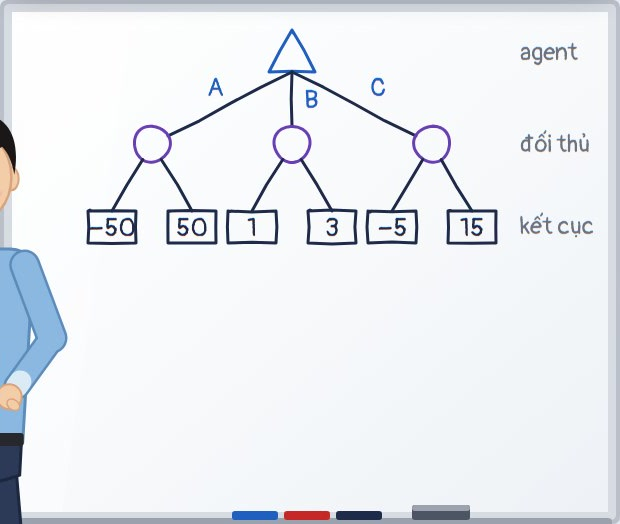
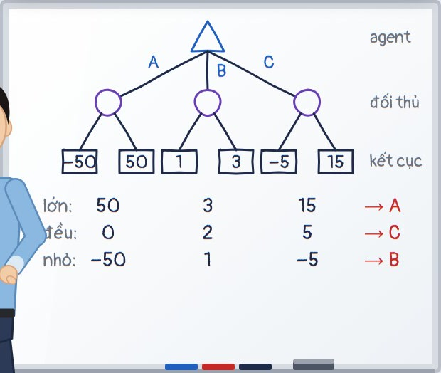
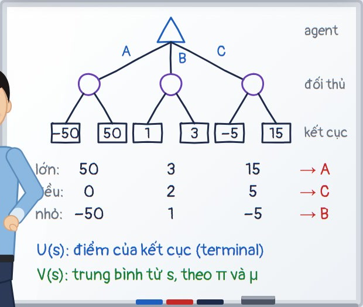
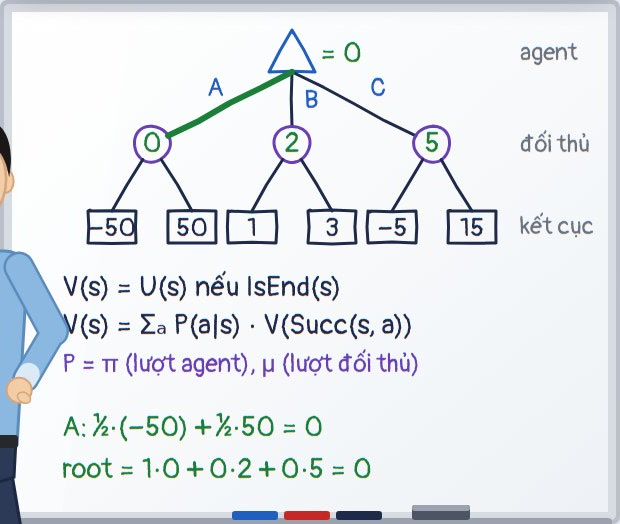
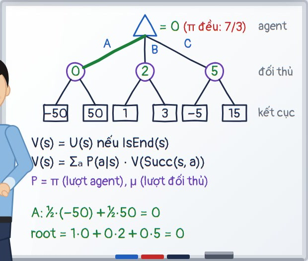
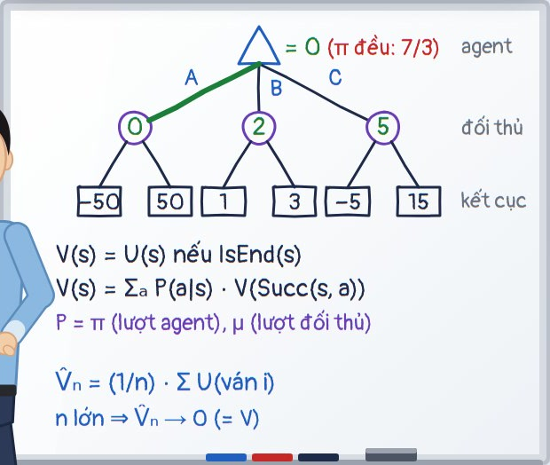

# Kịch bản trình bày phần 1 · Games 1 (slide 1–25)

*Người trình bày: Võ Nhất Bảo · nhóm 10 · phần sau (Expectimax, Minimax) do bạn Phạm Lê Huy Hoàng trình bày.*

Tổng thời lượng theo video tập dượt: **24 phút 1 giây** (mục tiêu 25 phút, tối đa 30 phút). File này sinh từ `video/script.mjs` bằng `node video/tools/compile.mjs`; mốc thời gian khớp với video `video/out/trinh_bay_phan1.mp4`.

Video tập dượt: [video/out/trinh_bay_phan1.mp4](video/out/trinh_bay_phan1.mp4). Xem video một lượt, rồi tập lại với deck thật: bấm → đúng các chỗ **[→]**, chỉ và viết bảng đúng như nhân vật. Góc phải trên của video luôn ghi slide, bước, đồng hồ và việc cần làm ngay lúc đó.

Khi nói thật trước lớp, tốc độ thường chậm hơn giọng đọc máy một chút, nên thời gian thật sẽ khoảng 25–27 phút. Nếu tập thấy vượt 28 phút, xem mục **Nếu trễ giờ** ở cuối.

## Cách đọc kịch bản

| Ký hiệu                        | Làm gì                                                                    |
| -------------------------------- | --------------------------------------------------------------------------- |
| **[→]**                   | bấm phím → (hoặc clicker) đúng lúc này                              |
| **[chỉ: …]**             | chỉ tay hoặc laser vào vùng đó trên màn chiếu                      |
| **[✍ …]**                | đi tới bảng, viết/vẽ đúng nội dung đó, vừa viết vừa nói tiếp |
| **[🧽 …]**                | xóa vùng bảng đó trước khi viết                                     |
| *(nhìn lớp)*, *(dừng …)* | quay lại nhìn cả lớp; dừng chờ lớp trả lời                         |

Khung bảng: chia làm ba vùng từ trên xuống. **Vùng cây** (game ba hộp, vẽ ở slide 6, giữ tới hết phần), **vùng giữa** (ba dòng giả định, sau đó là recurrence), **vùng dưới** (ghi chú ngắn, xóa khi cần).

## Lịch tổng

| Slide | Nội dung                                                 | Bắt đầu |    Thời lượng | Bảng                  |
| ----: | --------------------------------------------------------- | ---------: | ---------------: | ---------------------- |
|     1 | Games 1                                                   |      00:00 |  1 phút 7 giây |                        |
|     2 | Câu hỏi của buổi trình bày                          |      01:07 |         47 giây |                        |
|     3 | Lộ trình                                                |      01:54 |         43 giây |                        |
|     4 | Single-agent search                                       |      02:37 |         52 giây |                        |
|     5 | Plan và policy                                           |      03:29 |         53 giây |                        |
|     6 | Game ba hộp                                              |      04:22 |  2 phút 7 giây | ✍ t1, t2, t3, t4      |
|     7 | Ba giả định về đối thủ                             |      06:29 | 1 phút 12 giây | ✍ r1, r2, r3          |
|     8 | Game khác search ở đâu                                |      07:41 |         58 giây |                        |
|     9 | Loại game đang xét                                     |      08:40 |         47 giây |                        |
|    10 | Sáu thành phần của mô hình                          |      09:27 |  1 phút 7 giây |                        |
|    11 | Từ search sang game *(có thể lướt)*                |      10:34 |         31 giây |                        |
|    12 | Mô hình hóa Tic-Tac-Toe                                |      11:05 |         52 giây |                        |
|    13 | Hai điều cần kiểm tra                                 |      11:57 |         47 giây |                        |
|    14 | Game tree và state-space graph                           |      12:44 |         41 giây |                        |
|    15 | So sánh tree và graph *(có thể lướt)*             |      13:25 |         37 giây |                        |
|    16 | 549.946 node, 5.478 state                                 |      14:02 |         50 giây |                        |
|    17 | Policy                                                    |      14:52 |         57 giây |                        |
|    18 | Utility và value                                         |      15:49 | 1 phút 10 giây | ✍ uv1, uv2            |
|    19 | Cùng leaf, ba value                                      |      16:58 |         48 giây |                        |
|    20 | Game evaluation                                           |      17:46 |         56 giây |                        |
|    21 | Recurrence của Game evaluation                           |      18:42 | 1 phút 36 giây | ✍ rec, cA, cB, cC, cR |
|    22 | Video: Game evaluation trên ba hộp                      |      20:18 |         44 giây |                        |
|    23 | Thử đổi policy                                         |      21:02 |         53 giây | ✍ r73                 |
|    24 | Recurrence và simulation                                 |      21:55 |  1 phút 2 giây | ✍ mc                  |
|    25 | Game evaluation dùng để làm gì *(có thể lướt)* |      22:57 |  1 phút 1 giây |                        |

## Mở đầu

### Slide 1 · Games 1

`00:00 → 01:07` · 1 phút 7 giây · 1 bước

`00:01` *(nhìn lớp)* *(mở hai tay về phía lớp)* Em chào thầy và các bạn. Em là Võ Nhất Bảo, nhóm 10. **[chỉ: tên đề tài và thành viên]** Hôm nay nhóm em, gồm em và bạn Phạm Lê Huy Hoàng, trình bày chủ đề Games 1: mô hình hóa trò chơi, Game evaluation, Expectimax và Minimax. *(nhìn lớp)* Game là một trong những bài toán lâu đời nhất của AI: năm 1997, máy Deep Blue thắng nhà vô địch cờ vua Kasparov; năm 2016, AlphaGo thắng Lee Sedol ở cờ vây. Ý tưởng nền tảng phía sau các hệ thống đó chính là những gì nhóm mình sẽ trình bày hôm nay

### Slide 2 · Câu hỏi của buổi trình bày

`01:07 → 01:54` · 47 giây · 3 bước (bấm → 3 lần, kể cả lần vào slide)

`01:07` **[→]** Trước khi vào nội dung, em muốn đặt ra một câu hỏi cho cả buổi. **[chỉ: agent (robot bên trái)]** Bên trái là agent; các bạn cứ hiểu agent là mình, người đang cần ra quyết định. **[chỉ: đối thủ (đội mũ len)]** Bên phải là đối thủ, bạn đội mũ len.

`01:21` **[→]** **[chỉ: chuỗi lượt: agent → đối thủ → agent → terminal]** Agent chỉ được chọn ở lượt của mình. Sau lượt agent là lượt đối thủ, rồi lại tới agent, cứ thế cho tới khi ván kết thúc. Nếu các bạn đã học MDP thì sẽ thấy điểm khác: trong MDP, môi trường có ngẫu nhiên nhưng không cố tình chơi khó mình; còn trong game, đối thủ có mục tiêu ngược với mình.

`01:42` **[→]** **[chỉ: câu hỏi ở giữa]** Vậy câu hỏi là: tại một state, agent nên chọn action nào, khi một phần diễn biến tiếp theo lại do đối thủ quyết định? *(nhìn lớp)* Cả buổi hôm nay xoay quanh đúng câu hỏi này.

### Slide 3 · Lộ trình

`01:54 → 02:37` · 43 giây · 6 bước (bấm → 6 lần, kể cả lần vào slide)

`01:54` **[→]** Để trả lời câu hỏi đó, nhóm em chia nội dung thành năm phần. **[chỉ: phần 1 · Overview]** Phần một, Overview: vì sao có đối thủ thì lời giải phải là một policy, chứ không còn là một plan.

`02:06` **[→]** **[chỉ: phần 2 · Modeling]** Phần hai, Modeling: mô tả một game bằng sáu thành phần.

`02:11` **[→]** **[chỉ: phần 3 · Game evaluation]** Phần ba, Game evaluation: khi đã biết cả hai bên chơi thế nào, thì tính value ra sao. Ba phần này là phần của em.

`02:21` **[→]** **[chỉ: phần 4 · Expectimax]** Phần bốn là Expectimax, **[→]** **[chỉ: phần 5 · Minimax]** và phần năm là Minimax, hai cách tìm policy tốt nhất, bạn Hoàng sẽ trình bày.

`02:29` **[→]** **[chỉ: dòng ví dụ chính]** Suốt buổi, tụi em dùng một ví dụ chính là game ba hộp; Tic-Tac-Toe và Halving để minh họa thêm.

## Overview

### Slide 4 · Single-agent search

`02:37 → 03:29` · 52 giây · 3 bước (bấm → 3 lần, kể cả lần vào slide)

`02:37` **[→]** OK, mình bắt đầu từ thứ các bạn đã quen: bài toán search một agent. **[chỉ: mô hình search (S, s₀, A, T, G, c)]** Một bài toán search cho mình tập state, start state, các action hợp lệ và transition, tập goal, và cost của từng bước. Nhiệm vụ là tìm một path từ start tới goal.

`02:54` **[→]** **[chỉ: path qua u: 2 edge, cost 18]** Ví dụ trên hình, path đi qua u chỉ có hai bước, nhìn thì ngắn, nhưng tốn chín cộng chín là mười tám.

`03:02` **[→]** **[chỉ: path qua a, b: 3 edge, cost 3]** Còn path đi qua a và b dài ba bước, nhưng chỉ tốn ba. Ít bước nhất chưa chắc là rẻ nhất. *(nhìn lớp)* Nhưng điểm em muốn các bạn để ý là: trong search, agent tự chọn mọi bước. Tìm xong path thì cứ thế đi theo, không ai cản cả. Giống như mở bản đồ tìm đường từ nhà tới trường: mình chọn đường, còn con đường thì không tự đổi để chơi khó mình. *(mở hai tay về phía lớp)* Vậy nếu có người khác chen vào giữa thì sao?

### Slide 5 · Plan và policy

`03:29 → 04:22` · 53 giây · 3 bước (bấm → 3 lần, kể cả lần vào slide)

`03:29` **[→]** Mình thử với Tic-Tac-Toe. **[chỉ: bàn cờ X0]** Giả sử X là agent, và X lập sẵn một plan: mình đi ô 0, **[chỉ: nước O4 của đối thủ]** đối thủ đi ô 4, **[chỉ: nước X2]** rồi mình đi ô 2. Nghe hợp lý đúng không? **[chỉ: nước O4 của đối thủ]** Nhưng có một vấn đề: nước O4 đâu phải do mình chọn.

`03:47` **[→]** **[chỉ: O đi ô 1 hoặc ô 8]** Nếu O đi ô 1, hoặc ô 8, thì plan này hết dùng được. **[chỉ: khung Plan]** Plan chỉ là một chuỗi nước cố định; nó không nói X phải làm gì khi O đi khác.

`03:57` **[→]** **[chỉ: khung Policy]** Cái mình cần là một policy: một quy tắc cho biết ở mỗi state mà agent có thể gặp, agent sẽ chọn action nào. *(nhìn lớp)* O đi ô 4 thì mình đáp thế này, O đi ô 1 thì mình đáp thế kia. Nói cách khác, policy giống một cái cây các phản ứng, chứ không còn là một đường thẳng. Search khi có đối thủ như vậy gọi là adversarial search, tức là search đối kháng.

### Slide 6 · Game ba hộp

`04:22 → 06:29` · 2 phút 7 giây · 4 bước (bấm → 4 lần, kể cả lần vào slide)

`04:22` **[→]** OK, giờ mình chơi một trò chơi nhỏ. Trò này lấy từ bài giảng CS221 của Stanford, và nó sẽ đi theo mình suốt buổi hôm nay. **[chỉ: ba hộp A, B, C]** Có ba hộp A, B, C. Hộp A có hai số, âm 50 và 50; hộp B có 1 và 3; hộp C có âm 5 và 15. *(nhìn lớp)* Luật chơi như sau: các bạn là agent, các bạn chọn một hộp. Sau đó em, là đối thủ, chọn một số trong hộp đó. Số em chọn là điểm của các bạn, và các bạn muốn điểm càng cao càng tốt.

`04:58` *(giơ tay lên)* Em hỏi nhanh nha. Bạn nào chọn hộp A, giơ tay giúp em. *(dừng ~2.2 giây, chờ lớp trả lời)* OK, vài bạn. *(giơ tay lên)* Bạn nào chọn B? *(dừng ~2.2 giây, chờ lớp trả lời)* *(giơ tay lên)* Còn hộp C? *(dừng ~2.2 giây, chờ lớp trả lời)* *(mở hai tay về phía lớp)* À, đa số chọn C. Có vẻ các bạn không tin em lắm, nhưng cũng chưa tới mức nghĩ em sẽ chơi xấu. Chút nữa mình xem ai đúng.

`05:26` Em vẽ trò này lên bảng. **[✍ vẽ tam giác hướng lên ở trên cùng (lượt agent)]** Trên cùng là lượt của agent, em vẽ một tam giác hướng lên. **[✍ vẽ ba nhánh A, B, C]** Agent có ba action là A, B, C. **[✍ vẽ ba hình tròn (lượt đối thủ)]** Đi xuống mỗi nhánh là tới lượt đối thủ, em vẽ hình tròn. **[✍ vẽ sáu nhánh và sáu ô kết cục −50, 50, 1, 3, −5, 15]** Đối thủ chọn một trong hai số, và cuối cùng là sáu kết cục: âm 50, 50, 1, 3, âm 5, 15. Mỗi đường đi từ trên xuống dưới là một ván có thể xảy ra. *(nhìn lớp)* Cái hình này gọi là game tree: root là trạng thái bắt đầu, mỗi edge là một action, và mỗi leaf là một kết cục có điểm.

`06:02` *(nhìn màn chiếu)* Giờ mình chơi thử trên slide.

`06:05` **[→]** **[chỉ: hộp A]** Agent chọn hộp A, đối thủ chọn số nhỏ, agent nhận âm 50.

`06:11` **[→]** **[chỉ: hộp B]** Ván sau agent chọn B, đối thủ vẫn chọn số nhỏ, agent nhận 1.

`06:17` **[→]** **[chỉ: nút “Chọn số lớn”]** Nhưng nếu đối thủ đổi tính, chọn số lớn, **[chỉ: hộp A]** thì hộp A lại cho tới 50. *(nhìn lớp)* Vậy hộp nào tốt nhất? Câu trả lời là: còn tùy đối thủ chơi kiểu gì.

**Bảng sau slide 6:**



<details><summary>Bản chữ (khi không xem được ảnh)</summary>

```text
              ▲            agent
           A/ |B \C
           ○   ○    ○      đối thủ
          / \ / \  / \
      [−50][50][1][3][−5][15]   kết cục
```

</details>

### Slide 7 · Ba giả định về đối thủ

`06:29 → 07:41` · 1 phút 12 giây · 4 bước (bấm → 4 lần, kể cả lần vào slide)

`06:29` **[→]** Mình làm rõ chữ “tùy” này. **[chỉ: sáu leaf]** Sáu kết quả ở dưới không bao giờ đổi. Cái thay đổi là value của từng hộp, vì nó phụ thuộc đối thủ chọn số thế nào. Có ba giả định, em ghi luôn lên bảng.

`06:43` **[→]** **[chỉ: dòng “Số lớn”]** Giả định thứ nhất: đối thủ tốt bụng, luôn chọn số lớn. **[✍ ghi dòng “lớn: 50 | 3 | 15 → A”]** Khi đó A có value 50, B là 3, C là 15. Agent chọn A.

`06:55` **[→]** **[chỉ: dòng “Xác suất ½”]** Giả định thứ hai: đối thủ tung đồng xu, mỗi số xác suất một nửa. **[✍ ghi dòng “đều: 0 | 2 | 5 → C”]** Value là trung bình: A bằng 0, B bằng 2, C bằng 5. Agent chọn C. Những bạn vừa chọn C chắc là đang nghĩ theo cách này.

`07:10` **[→]** **[chỉ: dòng “Số nhỏ”]** Giả định thứ ba: đối thủ chơi xấu, luôn chọn số nhỏ nhất. **[✍ ghi dòng “nhỏ: −50 | 1 | −5 → B”]** A còn âm 50, B là 1, C là âm 5. Agent chọn B. *(nhìn lớp)* *(mở hai tay về phía lớp)* Các bạn thấy không, cùng một cái cây, cùng sáu con số, mà ba giả định cho ra ba đáp án khác nhau. Hộp A có số 50 rất hấp dẫn, nhưng agent không quyết định được việc đi tới số 50 đó. **[chỉ lên bảng: ba dòng giả định trên bảng]** Ba dòng này chính là ba câu hỏi mà Game evaluation, Expectimax và Minimax sẽ trả lời.

**Bảng sau slide 7:**



<details><summary>Bản chữ (khi không xem được ảnh)</summary>

```text
              ▲            agent
           A/ |B \C
           ○   ○    ○      đối thủ
          / \ / \  / \
      [−50][50][1][3][−5][15]   kết cục
   lớn:    50    3    15     → A
   đều:     0    2     5     → C
   nhỏ:   −50    1    −5     → B
```

</details>

### Slide 8 · Game khác search ở đâu

`07:41 → 08:40` · 58 giây · 3 bước (bấm → 3 lần, kể cả lần vào slide)

`07:41` **[→]** Từ ví dụ này, mình rút ra hai điểm làm game khác search. **[chỉ: ý 1: utility nằm ở terminal state]** Thứ nhất, utility nằm ở cuối ván. Đang chơi giữa chừng thì chưa có điểm; phải tới terminal state mới biết thắng, hòa hay thua. Nên một nước nhìn có lợi trước mắt vẫn có thể dẫn tới thua.

`07:59` **[→]** **[chỉ: ý 2: mỗi node thuộc về một player]** Thứ hai, mỗi node thuộc về một player. Ở node của đối thủ, agent không được chọn, và cách tính value tại node phụ thuộc vào ai đang có lượt.

`08:09` **[→]** **[chỉ: bốn hình node]** Từ giờ mình thống nhất bốn hình: tam giác hướng lên là lượt agent, gọi là node MAX; tam giác hướng xuống là lượt đối thủ, node MIN; hình tròn là chance node; và hình vuông là terminal state. **[chỉ lên bảng: ba hình tròn trên bảng]** Trên bảng em đang vẽ hình tròn ở lượt đối thủ, vì mình chưa giả định đối thủ chơi kiểu nào. *(nhìn lớp)* Tóm lại phần Overview: khi có đối thủ, lời giải là một policy; và muốn biết một nước tốt hay không, mình phải biết, hoặc phải giả định, đối thủ sẽ phản ứng ra sao.

## Modeling

### Slide 9 · Loại game đang xét

`08:40 → 09:27` · 47 giây · 3 bước (bấm → 3 lần, kể cả lần vào slide)

`08:40` **[→]** Qua phần hai, Modeling. Trước hết mình giới hạn loại game đang xét. **[chỉ: hai player, zero-sum]** Có hai player là agent và đối thủ. Game là zero-sum: utility của đối thủ luôn bằng âm utility của agent, cộng lại bằng 0.

`08:56` **[→]** **[chỉ: turn-taking, fully observable, deterministic, hữu hạn]** Hai bên đi lần lượt, cả hai thấy toàn bộ state, biết state và action thì biết state kế tiếp, và mọi nhánh đều kết thúc. *(nhìn lớp)* Tic-Tac-Toe hay cờ vua là loại này. Poker thì không, vì mình không thấy bài của đối thủ. Cờ cá ngựa cũng không, vì có xúc xắc; game có yếu tố ngẫu nhiên thuộc phần Games 2.

`09:16` **[→]** **[chỉ: bảng zero-sum có hòa]** Một hiểu lầm hay gặp: zero-sum không có nghĩa là bắt buộc phải có người thắng. Vẫn có hòa, và khi hòa thì cả hai bên cùng nhận 0.

### Slide 10 · Sáu thành phần của mô hình

`09:27 → 10:34` · 1 phút 7 giây · 3 bước (bấm → 3 lần, kể cả lần vào slide)

`09:27` **[→]** Một game như vậy được mô tả bằng sáu thành phần. **[chỉ: bốn thành phần đầu]** Bốn thành phần đầu nghe rất quen: s start là state ban đầu; Actions của s là các action hợp lệ; Succ của s, a là state nhận được sau khi làm action a; và IsEnd kiểm tra ván đã kết thúc chưa. Bốn cái này gần như y hệt bài toán search.

`09:47` **[→]** **[chỉ: Utility(s)]** Thành phần thứ năm là Utility: điểm của terminal state, tính theo góc nhìn agent. Các bạn để ý: trong search, tới goal là tốt. Còn trong game, tới terminal state chưa chắc đã tốt, vì thua cũng là một terminal state.

`10:03` **[→]** **[chỉ: Player(s)]** Thành phần thứ sáu là Player của s, cho biết tại state này ai đang được chọn. Đối thủ đi vào mô hình chính là qua thành phần này. *(nhìn bảng)* **[chỉ lên bảng: cây ba hộp trên bảng]** Thử ráp vào game ba hộp trên bảng: s start là root; Actions ở root là A, B, C; Succ của root với action A là node A; IsEnd đúng ở sáu leaf; Utility là con số ghi ở leaf; còn Player ở root là agent, ở ba node giữa là đối thủ. Sáu thành phần là đủ để mô tả trọn trò chơi này.

### Slide 11 · Từ search sang game

`10:34 → 11:05` · 31 giây · 4 bước (bấm → 4 lần, kể cả lần vào slide) · *có thể lướt nếu trễ giờ*

`10:34` **[→]** Slide này đặt hai mô hình cạnh nhau. **[chỉ: start state, transition]** Start state và transition vẫn giữ nguyên.

`10:41` **[→]** **[chỉ: goal test → IsEnd]** Goal test trở thành IsEnd, và terminal state có thể là thua.

`10:46` **[→]** **[chỉ: cost → Utility]** Không còn cộng cost dọc đường nữa, mà chấm điểm ở terminal state.

`10:51` **[→]** **[chỉ: agent chọn mọi bước → Player(s)]** Và khác biệt lớn nhất: có những bước do đối thủ chọn. *(nhìn lớp)* Nên chỉ biết bước nào hợp lệ là chưa đủ. Agent cần thêm một cách đánh giá phản ứng của đối thủ, và đó là việc của ba phần sau.

### Slide 12 · Mô hình hóa Tic-Tac-Toe

`11:05 → 11:57` · 52 giây · 3 bước (bấm → 3 lần, kể cả lần vào slide)

`11:05` **[→]** Áp dụng vào Tic-Tac-Toe. **[chỉ: bàn cờ]** State gồm bàn cờ ba nhân ba và player đến lượt. Start state là bàn trống, X đến lượt. Ở đây em chọn X làm agent, đi trước. **[chỉ: dòng Actions(s)]** Actions của s là các ô còn trống, ở đây là cả chín ô.

`11:23` **[→]** **[chỉ: bàn cờ]** Sau khi X đi ô 0 và O đi ô 4, **[chỉ: dòng Succ(s, a)]** Succ của s, a nghĩa là đặt quân của người đang tới lượt vào ô a, rồi đổi lượt. Bây giờ lại tới X, và còn bảy ô hợp lệ.

`11:35` **[→]** **[chỉ: bàn cờ]** Còn đây là một tình huống cần cẩn thận. X đã có ba quân ở hàng trên cùng, X thắng rồi, **[chỉ: dòng IsEnd(s)]** dù bàn vẫn còn ô trống. Nếu thuật toán cứ sinh action từ các ô trống là sai. Phải kiểm tra IsEnd trước. **[chỉ: dòng Utility(s)]** Utility ở đây là cộng 1 nếu X thắng, 0 nếu hòa, và trừ 1 nếu O thắng.

### Slide 13 · Hai điều cần kiểm tra

`11:57 → 12:44` · 47 giây · 2 bước (bấm → 2 lần, kể cả lần vào slide)

`11:57` **[→]** Khi mô hình hóa, có hai điều em muốn nhấn mạnh. **[chỉ: ý 1: state phải đủ để áp dụng luật]** Thứ nhất, state phải đủ thông tin để áp dụng luật. Cùng một bàn cờ, nhưng X tới lượt và O tới lượt là hai state khác nhau, vì người đi tiếp khác nhau. Ở Tic-Tac-Toe thì đếm số quân là suy ra được ai đến lượt, nhưng nhiều game khác không suy ra được, nên ghi rõ lượt đi vào state cho chắc.

`12:20` **[→]** **[chỉ: bàn cờ X đến lượt]** Thứ hai, các bạn nhìn bàn này: X đến lượt, O đang có hai quân ở hàng trên. X nên đi ô nào? *(dừng ~1.8 giây, chờ lớp trả lời)* **[chỉ: ô 2]** Đúng rồi, ô 2, phải chặn. **[chỉ: bàn cờ X đến lượt]** Cả năm ô trống đều hợp lệ, nhưng bốn ô tô đỏ dẫn tới thua ngay. **[chỉ: ý 2: action hợp lệ chưa chắc là action tốt]** Nên Actions của s chỉ kiểm tra luật thôi; còn nước nào tốt là việc của thuật toán search.

### Slide 14 · Game tree và state-space graph

`12:44 → 13:25` · 41 giây · 2 bước (bấm → 2 lần, kể cả lần vào slide)

`12:44` **[→]** Tiếp theo là hai cách vẽ một game. **[chỉ: lịch sử 1: X0, O4, X2]** Lịch sử thứ nhất: X đi 0, O đi 4, X đi 2. **[chỉ: lịch sử 2: X2, O4, X0]** Lịch sử thứ hai: X đi 2, O đi 4, X đi 0. Hai thứ tự khác nhau, nhưng bàn cờ cuối cùng giống hệt nhau, và đều tới lượt O. **[chỉ: game tree: hai node]** Trên game tree, mỗi node là một state trong một lịch sử chơi, nên đây là hai node khác nhau.

`13:08` **[→]** **[chỉ: state chung (một node)]** Còn trên state-space graph, mỗi state chỉ là một node, nên hai đường này gặp nhau ở cùng một node. *(nhìn lớp)* Ý nghĩa là gì? Từ state chung đó, phần còn lại của ván giống hệt nhau. Tính value một lần là dùng lại được cho cả hai.

### Slide 15 · So sánh tree và graph

`13:25 → 14:02` · 37 giây · 3 bước (bấm → 3 lần, kể cả lần vào slide) · *có thể lướt nếu trễ giờ*

`13:25` **[→]** Tóm lại sự khác nhau. **[chỉ: một node · hai lịch sử]** Game tree giữ lại lịch sử, nên hai lịch sử là hai node.

`13:32` **[→]** **[chỉ: số parent · chu trình]** Mỗi node chỉ có đúng một parent, và không có chu trình.

`13:36` **[→]** **[chỉ: khi tính value]** Hệ quả là trên tree, cùng một state có thể bị tính đi tính lại, còn trên graph thì lưu lại và dùng lại được. *(nhìn lớp)* Trong bài này, các thuật toán vẫn trình bày trên tree, vì nhìn từng lựa chọn và phản ứng sẽ rõ hơn.

### Slide 16 · 549.946 node, 5.478 state

`14:02 → 14:52` · 50 giây · 3 bước (bấm → 3 lần, kể cả lần vào slide)

`13:51` *(slide 15 vẫn đang chiếu)* Trước khi qua slide sau, em đố các bạn: bàn Tic-Tac-Toe chỉ có chín ô, vậy game tree đầy đủ từ bàn trống có khoảng bao nhiêu node? *(dừng ~2.5 giây, chờ lớp trả lời)*

`14:02` **[→]** **[chỉ: 549.946 node]** Câu trả lời là 549.946 node, gần năm trăm năm mươi nghìn. **[chỉ: 5.478 state]** Trong khi số state khác nhau, tính cả lượt đi, chỉ có 5.478.

`14:14` **[→]** **[chỉ: đoạn giải thích]** Tức là game tree lớn gấp khoảng một trăm lần số state, vì rất nhiều node lặp lại cùng một state, đúng như ví dụ vừa rồi. Hai con số này nhóm em tự đếm bằng code.

`14:25` **[→]** **[chỉ: root màu xám]** Thêm một chi tiết: root có màu xám, nghĩa là nếu cả hai bên chơi tối ưu thì Tic-Tac-Toe luôn hòa. Bạn nào từng chơi chắc cũng thấy vậy. *(nhìn lớp)* Còn với cờ vua, theo ước tính nổi tiếng của Shannon, số ván cờ khác nhau, tức là số đường đi từ root tới leaf, vào cỡ mười mũ một trăm hai mươi. Không máy nào duyệt hết được; đó là lý do Games 2 cần tới evaluation function và alpha-beta pruning.

### Slide 17 · Policy

`14:52 → 15:49` · 57 giây · 3 bước (bấm → 3 lần, kể cả lần vào slide)

`14:52` **[→]** Quay lại khái niệm policy, giờ mình nói chính xác hơn. **[chỉ: root với π(root) = A]** Policy của một player cho biết tại mỗi state thuộc lượt của player đó, player chọn action nào, kể cả những state chưa từng gặp.

`15:05` **[→]** **[chỉ: deterministic policy]** Loại đơn giản nhất là deterministic policy: mỗi state chọn đúng một action. **[chỉ: edge A, xác suất 1]** Ví dụ agent luôn chọn hộp A. Viết dưới dạng xác suất thì A có xác suất 1, B và C xác suất 0.

`15:19` **[→]** **[chỉ: stochastic policy]** Tổng quát hơn là stochastic policy: gán cho mỗi action một xác suất, các xác suất không âm và cộng lại bằng 1. **[chỉ: các xác suất ½]** Ví dụ đối thủ chọn mỗi số với xác suất một nửa. *(nhìn lớp)* Tại sao lại cần policy ngẫu nhiên? Các bạn nghĩ tới oẳn tù tì: nếu mình luôn ra kéo, đối thủ sẽ luôn ra búa. Có những lúc chơi ngẫu nhiên mới là cách chơi tốt. Từ giờ em dùng π cho policy của agent, và μ cho policy của đối thủ.

### Slide 18 · Utility và value

`15:49 → 16:58` · 1 phút 10 giây · 4 bước (bấm → 4 lần, kể cả lần vào slide)

`15:49` **[→]** Có policy rồi, mình phân biệt hai chữ hay bị dùng lẫn: utility và value. **[chỉ: dòng U(s)]** Utility chỉ có ở terminal state; nó chấm điểm một kết cục đã xảy ra, thắng cộng 1, thua trừ 1. **[✍ ghi “U(s): điểm của kết cục (terminal)”]** Em ghi lên bảng: U của s là điểm của kết cục.

`16:06` **[→]** **[chỉ: dòng V^{π,μ}(s)]** Còn value thì đánh giá mọi state, kể cả state đang ở giữa ván. Value của cặp policy π, μ là expected utility, tức là utility trung bình nếu hai bên cứ chơi đúng theo hai policy đó tới hết ván. **[✍ ghi “V(s): trung bình từ s, theo π và μ”]** V của s là trung bình tính từ s, theo π và μ.

`16:24` **[→]** **[chỉ: dòng V^{*,μ}(s)]** Nếu giữ μ của đối thủ cố định, rồi cho agent chọn policy tốt nhất, mình được value tối ưu trước μ.

`16:32` **[→]** **[chỉ: dòng V_mm(s)]** Còn nếu không giả định gì về μ, agent tối đa value trong trường hợp xấu nhất. **[chỉ: dòng tổng kết]** Ba dòng cuối lần lượt là Game evaluation, Expectimax và Minimax. Hôm nay em trình bày dòng thứ nhất. *(nhìn lớp)* Một cách dễ nhớ: utility giống điểm thi cuối kỳ, có khi thi xong mới biết. Còn value giống điểm mình kỳ vọng khi đang học giữa kỳ, và nó phụ thuộc cả việc mình học thế nào lẫn đề ra thế nào.

**Bảng sau slide 18:**



<details><summary>Bản chữ (khi không xem được ảnh)</summary>

```text
   (cây + ba dòng giữ nguyên)
   U(s): điểm của kết cục (terminal)
   V(s): trung bình từ s, theo π và μ
```

</details>

### Slide 19 · Cùng leaf, ba value

`16:58 → 17:46` · 48 giây · 3 bước (bấm → 3 lần, kể cả lần vào slide)

`16:58` **[→]** Nhìn lại game ba hộp: cùng sáu leaf, nhưng ba câu hỏi cho ba value khác nhau ở root. **[chỉ: cây Game evaluation (value 0)]** Game evaluation: agent cố định chọn A, đối thủ chọn đều, root là trung bình của âm 50 và 50, tức là 0.

`17:14` **[→]** **[chỉ: cây Expectimax (value 5)]** Expectimax: đối thủ vẫn chọn đều, nhưng agent được tự chọn, nên lấy max của 0, 2, 5, được 5.

`17:23` **[→]** **[chỉ: cây Minimax (value 1)]** Minimax: đối thủ chọn số bất lợi nhất, max của âm 50, 1, âm 5 là 1. *(nhìn lớp)* Ba con số 0, 5, 1 chỉ có nghĩa khi đi kèm giả định của nó. Đó cũng là kết thúc phần Modeling: mình đã có sáu thành phần, có policy, và phân biệt được utility với value. Bây giờ mình đi vào con số đầu tiên.

## Game evaluation

### Slide 20 · Game evaluation

`17:46 → 18:42` · 56 giây · 3 bước (bấm → 3 lần, kể cả lần vào slide)

`17:46` **[→]** Phần ba: Game evaluation. **[chỉ: agent cầm π]** Agent chơi theo π, **[chỉ: đối thủ cầm μ]** đối thủ chơi theo μ, và cả hai policy đều được cho trước. **[chỉ: V = ?]** Câu hỏi duy nhất là: V bằng bao nhiêu? **[chỉ: V^{π,μ}(s) = E[U(s_T) | s, π, μ]]** Viết ra thì V của s là expected utility của terminal state, khi xuất phát từ s và hai bên chơi theo π và μ.

`18:07` **[→]** **[chỉ: ý 1: hai policy cố định]** Hai policy này cố định trong suốt phép tính. Chữ evaluation ở đây nghĩa là đo: mình chỉ đo xem cặp cách chơi này cho kết quả bao nhiêu; thuật toán không đi tìm policy mới.

`18:19` **[→]** **[chỉ: ý 2, 3: expected utility]** Và kết quả là expected utility, tức là trung bình có trọng số theo xác suất. Một ván cụ thể ngoài đời có thể ra số khác. *(nhìn lớp)* Các bạn có thể thắc mắc: ngoài đời làm sao biết hết policy của đối thủ? Thường là không biết. Nhưng Game evaluation là viên gạch đầu tiên: muốn so sánh hay tối ưu thì trước hết phải đo được.

### Slide 21 · Recurrence của Game evaluation

`18:42 → 20:18` · 1 phút 36 giây · 3 bước (bấm → 3 lần, kể cả lần vào slide)

`18:42` **[→]** Vậy tính V thế nào? Mình định nghĩa một recurrence, tức là một công thức đệ quy. **[chỉ: trường hợp terminal: Utility(s)]** Trường hợp cơ sở: nếu s là terminal state thì value chính là utility. **[chỉ: hai dòng tổng theo π và μ]** Còn nếu chưa kết thúc, mình lấy tổng theo các action: xác suất chọn action đó, nhân với value của state con. Lượt agent thì xác suất lấy từ π, lượt đối thủ thì lấy từ μ. **[🧽 xóa bảng: vùng giữa, vùng dưới]** **[✍ ghi recurrence: V(s) = U(s) nếu IsEnd(s); V(s) = Σ P(a|s)·V(Succ(s,a)); P = π hoặc μ]** Em viết gọn lên bảng: V của s bằng U của s nếu s là terminal; còn không thì V của s bằng tổng theo a, xác suất của a nhân V của Succ s a.

`19:19` **[→]** **[chỉ: ví dụ hai con v₁, v₂]** Ví dụ một node có hai con, value là v₁ và v₂, được chọn với xác suất q và 1 trừ q. Value của node là q nhân v₁, cộng 1 trừ q nhân v₂. Các bạn để ý: phải dùng value của cả subtree con, không phải utility, vì một action chưa chắc đã kết thúc ván.

`19:39` **[→]** **[chỉ: không có max hay min]** Và công thức này không có max, cũng không có min. Lượt agent hay lượt đối thủ đều tính giống nhau, chỉ khác bảng xác suất. Thật ra đây chính là kỳ vọng mà mình đã học trong xác suất thống kê, chỉ là tính đệ quy từ leaf đi lên. *(nhìn bảng)* Mình tính thử trên cây ở bảng. **[✍ ghi “A: ½·(−50) + ½·50 = 0”, điền 0 vào node A]** Hộp A: một nửa nhân âm 50, cộng một nửa nhân 50, bằng 0. **[✍ điền 2 vào node B]** Hộp B: trung bình của 1 và 3 là 2. **[✍ điền 5 vào node C]** Hộp C: trung bình của âm 5 và 15 là 5. **[✍ tô đậm nhánh A, ghi “root = 1·0 + 0·2 + 0·5 = 0” và “= 0” cạnh root]** Còn root: agent luôn chọn A, nên bằng 1 nhân 0, cộng 0 nhân 2, cộng 0 nhân 5, bằng 0.

**Bảng sau slide 21:**



<details><summary>Bản chữ (khi không xem được ảnh)</summary>

```text
              ▲ = 0        agent
          A// |B \C
          (0) (2)  (5)     đối thủ
          / \ / \  / \
      [−50][50][1][3][−5][15]   kết cục
   V(s) = U(s)    nếu IsEnd(s)
   V(s) = Σₐ P(a|s) · V(Succ(s, a))
   P = π (lượt agent),  μ (lượt đối thủ)
   A: ½·(−50) + ½·50 = 0
   root = 1·0 + 0·2 + 0·5 = 0
```

(nhánh A tô đậm màu xanh: π chọn A với xác suất 1)

</details>

### Slide 22 · Video: Game evaluation trên ba hộp

`20:18 → 21:02` · 44 giây · 1 bước (bấm → 1 lần, kể cả lần vào slide)

`20:18` **[→]** **[video tự chạy, nói theo]** Đây là video nhóm em làm bằng thư viện manim, chạy lại đúng phép tính đó. <sub>⏱ giây 1.8 của video</sub> Hai policy đã biết: agent luôn chọn A, đối thủ chọn đều. <sub>⏱ giây 7.6 của video</sub> Đầu tiên, mỗi hộp lấy trung bình hai leaf, với trọng số theo μ, được 0, 2 và 5. <sub>⏱ giây 17 của video</sub> Sau đó root lấy trung bình theo π. Chỉ hộp A có trọng số 1, nên root bằng 0. <sub>⏱ giây 21.1 của video</sub> C có tới 5, cao hơn hẳn, nhưng Game evaluation vẫn trả 0, vì policy đang được đánh giá là chọn A. <sub>⏱ giây 25.2 của video</sub> Giờ đổi policy của agent thành chọn đều ba hộp. <sub>⏱ giây 28.6 của video</sub> Root thành 0 cộng 2 cộng 5, chia 3, bằng 7/3. Đổi policy thì value đổi theo.

### Slide 23 · Thử đổi policy

`21:02 → 21:55` · 53 giây · 2 bước (bấm → 2 lần, kể cả lần vào slide)

`21:02` **[→]** Slide này là phiên bản tương tác của cây vừa rồi. **[chỉ: cây tương tác]** Agent luôn chọn A, đối thủ chọn đều, root bằng 0. Độ dày của edge thể hiện xác suất. *(nhìn lớp)* Em hỏi các bạn: nếu agent chọn đều cả ba hộp thì root bằng bao nhiêu? *(dừng ~2.5 giây, chờ lớp trả lời)*

`21:21` **[→]** **[chỉ: dòng tính root]** Đúng rồi: 0 cộng 2 cộng 5, chia 3, bằng bảy phần ba. **[✍ ghi “(π đều: 7/3)” cạnh root]** Em ghi thêm lên bảng: π chọn đều thì root bằng bảy phần ba. **[chỉ: thanh trượt q]** Giờ em kéo thanh trượt này. q là xác suất đối thủ chọn số nhỏ. **[kéo thanh trượt q lên gần 1]** Kéo q lên gần 1, đối thủ gần như luôn chọn số nhỏ, value của cả ba hộp đều giảm, **[chỉ: root]** root xuống âm; khi q bằng 1 thì root bằng âm 18. **[chỉ: thanh trượt q]** **[kéo q về 0]** Kéo q về 0 thì ngược lại, root tăng lên. **[thả q về 0,5]** *(nhìn lớp)* Mỗi lần đổi μ, mọi node được tính lại bằng đúng một kiểu tổng có trọng số.

**Bảng sau slide 23:**



<details><summary>Bản chữ (khi không xem được ảnh)</summary>

```text
              ▲ = 0  (π đều: 7/3)
   … phần còn lại giữ nguyên
```

</details>

### Slide 24 · Recurrence và simulation

`21:55 → 22:57` · 1 phút 2 giây · 3 bước (bấm → 3 lần, kể cả lần vào slide)

`21:55` **[→]** Có một cách khác để ra con số này, mà không cần công thức: cứ chơi thử. **[chỉ: bảng simulation]** Đây là simulation: agent luôn chọn A, đối thủ chọn đều, cho hai bên chơi nhiều ván rồi lấy trung bình utility.

`22:09` **[→]** **[chỉ: kết quả từng ván]** Chơi mười ván đầu: mỗi ván chỉ ra âm 50 hoặc 50, nên trung bình nhảy lung tung. **[chỉ: trung bình mẫu]** Mới mười ván thì trung bình có thể lệch khỏi 0 khá xa.

`22:19` **[→]** **[chỉ: đồ thị trung bình theo số ván]** Chơi tiếp lên một nghìn ván, đường trung bình dao động quanh 0 và dần dần hội tụ về 0. **[🧽 xóa bảng: vùng dưới]** **[✍ ghi “V̂ₙ = (1/n)·Σ U(ván i) → 0”]** Công thức là V mũ n bằng 1 trên n, nhân tổng utility của n ván. Đây là ước lượng Monte Carlo. *(nhìn lớp)* Vậy recurrence cho kết quả chính xác, nhưng phải duyệt cả cây, mà cây có thể rất lớn. Simulation chỉ cho ước lượng, nhưng dễ làm, và chơi càng nhiều ván thì ước lượng càng sát. Vậy sao không luôn dùng simulation? Vì ở các phần sau, công thức có thêm max và min, và lấy trung bình mẫu thì không ước lượng max dễ như ước lượng một kỳ vọng.

**Bảng sau slide 24:**



<details><summary>Bản chữ (khi không xem được ảnh)</summary>

```text
   (xóa hai dòng tính ở dưới, ghi:)
   V̂ₙ = (1/n) · Σ U(ván i)
   n lớn  ⇒  V̂ₙ → 0 (= V)
```

</details>

### Slide 25 · Game evaluation dùng để làm gì

`22:57 → 23:58` · 1 phút 1 giây · 4 bước (bấm → 4 lần, kể cả lần vào slide) · *có thể lướt nếu trễ giờ*

`22:57` **[→]** Cuối cùng, Game evaluation dùng để làm gì? **[chỉ: so sánh policy]** Thứ nhất, để so sánh policy: giữ policy của agent rồi đổi đối thủ, hoặc giữ đối thủ rồi đổi agent, xem value thay đổi ra sao.

`23:11` **[→]** **[chỉ: policy evaluation]** Thứ hai, nếu các bạn đã học MDP, thì bước này chính là policy evaluation: cho trước policy, tính value.

`23:20` **[→]** **[chỉ: evaluation function]** Và một lưu ý: Game evaluation khác evaluation function. Evaluation function là hàm ước lượng value khi chưa search tới terminal state; phần đó thuộc Games 2 của nhóm 11.

`23:33` **[→]** **[chỉ: dòng face-off]** Bảng face-off ở phần Minimax sẽ dùng lại đúng phép tính này. *(nhìn lớp)* *(mở hai tay về phía lớp)* Tóm lại phần của em: có đối thủ thì mình cần policy chứ không phải plan; một game được mô tả bằng sáu thành phần; và khi biết cả hai policy, value được tính bằng trung bình có trọng số, đi từ leaf lên root. Nhưng agent đâu chỉ muốn đo; agent muốn chọn policy tốt nhất. Đó là Expectimax.

`23:58` **[→ sang slide 26 · Expectimax]** Em xin mời bạn Hoàng trình bày tiếp. Em cảm ơn thầy và các bạn.
